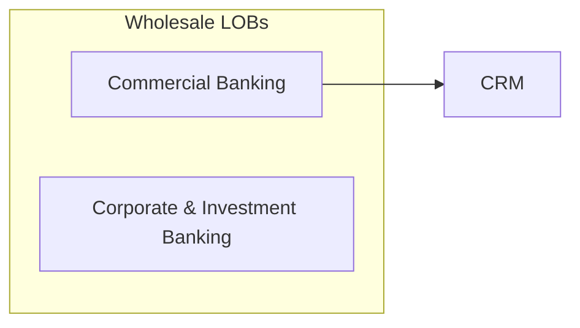

# Phase 2: Phase D — Design - Pattern Map

**Mapped:** 2026-07-25
**Files analyzed:** 5 deliverable classes (~16 files)
**Analogs found:** 5 / 5 classes (diagram class partial — convention exists, no standalone `.mmd` analog)

## File Classification

Docs-only phase — roles are documentation roles, data flow is authored-prose (no runtime code).

| New/Modified File | Role | Data Flow | Closest Analog | Match Quality |
|-------------------|------|-----------|----------------|---------------|
| `docs/DESIGN.md` (replace 5-line placeholder) | design spec | authored prose, entry-keyed | `docs/SPEC_INVENTORY.md` (heading/table conventions) | role-match |
| `docs/DECISIONS.md` (append rulings + D-GATE-D) | decision log | append/extend | `docs/DECISIONS.md` itself (existing entry + gate formats) | exact |
| `docs/diagrams/pillar-*.mmd`, `seam-*.mmd`, `seq-*.mmd` (11+) | diagram source | Mermaid markup | inline `\`\`\`mermaid` blocks in `docs/CCF_Whitepaper_1-2.md` | convention-match |
| `.planning/phases/02-phase-d-design/02-REVIEWS.md` | gate evidence | review transcript | `.planning/phases/01-phase-r-research/01-REVIEWS.md` | exact |
| `.planning/phases/02-phase-d-design/fragments/review-triage.md` | gate evidence | audit/triage tables | `.planning/phases/01-phase-r-research/fragments/review-triage.md` | exact |

Cosmetic fix also in scope (fold into first plan): stale pending-gate text / duplicated heading in `docs/DECISIONS.md` flagged by `.planning/phases/01-phase-r-research/01-VERIFICATION.md`.

## Pattern Assignments

### `docs/DESIGN.md` (design spec)

**Analog:** `docs/SPEC_INVENTORY.md` (2071 lines) — the Phase R deliverable whose conventions DESIGN.md must interoperate with. Current `docs/DESIGN.md` is a 5-line placeholder to replace wholesale; keep its header pattern:

**Header pattern** (`docs/DESIGN.md` lines 1-3, and `docs/DECISIONS.md` lines 1-3):
```markdown
# DESIGN — CCF SDK v0

**Canonical authority:** `CLAUDE.md` (revision 4). CLAUDE.md wins on any disagreement.
```
(DECISIONS.md adds: "Whitepaper citations reference `docs/CCF_Whitepaper_1-2.md` sections, never the PDF (locked D-01)." — carry this citation rule into DESIGN.md's header.)

**Entry-key citation pattern** — cite inventory entries inline exactly as the inventory keys them: `INV-CHx-NN` (e.g., `INV-CH7-02`), decisions as `D-IMPL-NN`, figures as `Fig-CHnn-mm`, whitepaper as `§7.4.2`. The inventory's per-entry field template (SPEC_INVENTORY.md lines 213-229) is the granularity precedent for D-07 contract-level component sections:

```markdown
### INV-CH7-02
- **Section:** §7.1
- **Commitment:** L1 — Signal Layer. Responsibility: ingestion and event normalization. ...
- **Type signature:** Canonical event envelope: `{source, ingestion_timestamp, observed_time?, raw_payload}` ...
- **Invariants:** L1 does not interpret; ...
- **Dependencies:** INV-CH7-03 (L2 consumes the normalized stream).
- **Figures:** Fig-CH07-02.
- **Open question (D-IMPL-33):** ...
```

Mirror this bolded-field bullet style for the D-07 per-component template: **Responsibility** · **Protocol/type signatures** · **Invariants enforced** · **Seams** · **D-IMPL rulings embodied** · inline INV citations.

**Invariant-table pattern** (SPEC_INVENTORY.md lines 1819-1827 — the "Named Architectural Invariants" table) — the D-10 Invariant Preservation chapter table should extend this exact row set (same 7 invariants, same order) with columns: structural argument, enforcement point, diagram/section ref:

```markdown
| Invariant | Origin | Realizing inventory entries |
|-----------|--------|-----------------------------|
| Single-writer enforcement (only L2/Assembly writes L3; DI at boot) | Whitepaper §7.2, §7.3.1, §7.8.4(a); CLAUDE.md §10 ... | INV-CH7-10, INV-CH7-15, INV-CH7-73; INV-CH8-05 ... |
```

**Traceability-matrix pattern** (SPEC_INVENTORY.md lines 1871-1889, "Subsection Coverage") — the D-06 appendix should copy this enumerated-coverage-table shape, one row per key with a checkable cell:

```markdown
| Subsection | Covered by | ✓ |
|------------|-----------|---|
| §7.1 | INV-CH7-01..08 | ✓ |
```
→ Appendix A: 126 rows `| INV-CHx-NN | §section | mapped/deferred: <reason> |`; mechanically checked by `grep -c 'INV-CH'` per RESEARCH Validation Architecture.

**Pillar partitioning source** — do not re-derive: SPEC_INVENTORY.md line 1853 "Pillar-by-Pillar Mapping" table already assigns all 126 entries to the five pillars; use it as the section-ownership assignment (Pitfall 3 in RESEARCH).

**Review appendix pattern** — SPEC_INVENTORY.md carries a Review Appendix (line ~2063) with carried-forward advisory findings; DESIGN.md's Appendix B replicates this (findings F-1..F-5 etc. carried from `fragments/review-triage.md`).

---

### `docs/DECISIONS.md` (decision log — append, do not restructure)

**Analog:** itself. Two established entry formats to extend.

**Open-entry format** (lines 17ff — every entry is a single bold-titled paragraph):
```markdown
**D-IMPL-30 — Context Product Contract element count (eight vs nine).** Open — awaiting Dave. 2026-07-25. Originates: whitepaper §6.3 (INV-CH6-03). Ambiguous passage: "..." Readings: (a) ... — consequence: ...; (b) ... ; (c) ...
```
Pattern: `**D-IMPL-NN — Title.** <STATUS> — <detail>. <date>. Originates: <section (INV ref)>. <body>`.

**Resolved-entry format** (line 59, D-IMPL-51 — the one executed precedent for landing a ruling):
```markdown
**D-IMPL-51 — Live MongoDB metadata query for Homecams triangulation.** RESOLVED — Dave approved the live query at the Phase R gate (2026-07-25); executed read-only (...) and results recorded in .... Originally: 2026-07-25. Originates: CLAUDE.md §2.1 ...; [original question text retained]
```
Pattern for marathon rulings (consistent with CONTEXT discretion + RESEARCH recommendation): keep original entry text, prepend/append status token — `RESOLVED — <ruling>. <date>. Approver: Dave.` or `PROVISIONAL — <adopted recommendation>. <date>. Pending Dave confirmation at D-GATE-D.` Status tokens must be greppable (`grep -cE 'RESOLVED|PROVISIONAL|GATING'` is the DSGN-02 check).

**D-IMPL-01..29 handling** (lines 7-11): these live canonically in CLAUDE.md §12 and are *referenced, not duplicated* — rulings for 01..29 land as status-note bullets in the "Status notes" list (see the D-IMPL-10 bullet, line 9, as the format precedent):
```markdown
- **D-IMPL-10 — Repo shape.** Provisionally resolved as **monorepo** at `github.com/drcastillo/ccf_code` per CLAUDE.md §2.2 (logged 2026-07-24). Remaining open under this entry: ...
```

**Gate-log format** (lines 67-69 — copy structure exactly for D-GATE-D):
```markdown
## Gate Log (D-GATE)

**D-GATE-R** — Phase R (Research) approved. Date: 2026-07-25. Approver: Dave. Scope: <what was approved, incl. gate feedback resolved>. Deliverables: <explicit file list with counts>. Phase D may begin.
```
D-GATE-D additionally lists the confirmed provisional resolutions (CONTEXT specifics: consolidated provisional list at the gate).

---

### `docs/diagrams/*.mmd` (Mermaid sources)

**Analog:** inline `\`\`\`mermaid` blocks in `docs/CCF_Whitepaper_1-2.md` (e.g., lines 322-343) plus rendered PNG twins in `docs/figures/`. No standalone `.mmd` file exists yet — Phase D establishes the standalone-file convention; the *syntax* convention is established:

**Mermaid style** (whitepaper line 322-340):

Conventions to copy: `flowchart LR/TD` core syntax; named `subgraph Id["Label"]` blocks; quoted node labels with HTML entities (`&amp;`) and `<br/>` for line breaks; no exotic Mermaid features (Pitfall 5 — GitHub/mmdc parity).

**Naming convention** (RESEARCH recommendation, Claude's discretion): `pillar-data-context.mmd`, `pillar-agent-types.mmd`, `pillar-orchestration.mmd`, `pillar-hitl.mmd`, `pillar-experience.mmd`, `seam-harness-adapter.mmd`, `seam-artifact-store.mmd`, plus `seq-single-writer-write-path.mmd`, `seq-a2a-admission.mmd`, `seq-hitl-suspend-resume.mmd`, `seq-replay-resolution.mmd` (sequence diagrams use `sequenceDiagram` core syntax). Render-check each with `mmdc -i <f>.mmd -o <scratch>/out.svg` (mmdc verified at `~/.nvm/.../bin/mmdc`).

Descriptive-suffix precedent: `docs/figures/CH07/Fig-CH07-01-overall-architecture.png` — kebab-case descriptive suffixes are the house style.

---

### `.planning/phases/02-phase-d-design/02-REVIEWS.md` (gate evidence)

**Analog:** `.planning/phases/01-phase-r-research/01-REVIEWS.md` — copy structure exactly.

**Frontmatter + header** (lines 1-10):
```markdown
---
phase: 01
reviewers: [gemini, ollama]
reviewed_at: 2026-07-25T07:40:00Z
plans_reviewed: [docs/SPEC_INVENTORY.md, docs/DECISIONS.md]
---

# Cross-AI Deliverable Review — Phase R

Reviewers attempted: gemini ✓, codex ✗ (auth expired), cursor ✗ (empty output twice), ollama/gpt-oss:120b-cloud ✓. Claude CLI skipped (self).
```
Phase D version: `phase: 02`, `plans_reviewed: [docs/DESIGN.md, docs/DECISIONS.md, docs/diagrams/]`. Per-reviewer sections use `## <Reviewer> Review` with Strengths / Concerns (severity-prefixed: `**MEDIUM: ...**`) / Suggestions / `### Overall Risk: LOW|...`.

---

### `.planning/phases/02-phase-d-design/fragments/review-triage.md` (gate evidence)

**Analog:** `.planning/phases/01-phase-r-research/fragments/review-triage.md` — three-part structure to copy:

**Part 1 — element-by-element self-audit table** (lines 5-20), rows = the phase's §3.1 verification criteria. Phase D rows: every inventory entry mapped or deferred (126/126 grep census); every open D-IMPL RESOLVED/PROVISIONAL/gating (49 census); diagram set complete (5 pillars + 2 seams + D-09 sequences, all rendering); 7 invariant rows each with structural argument + enforcement point + diagram ref.
```markdown
| §16 element | Check performed | Result |
|---|---|---|
| One entry per primitive, §5–§8 | 126 `### INV-` entries ...; subsection coverage table 36/36 | PASS |
```
End with `**Self-audit verdict: N/N elements PASS.**`

**Part 2 — cross-AI review invocation** — records the `/gsd-review --phase "Phase D" --all` invocation, any prompt adaptation, reviewer roster with ✓/✗, pointer to `02-REVIEWS.md`.

**Part 3 — findings triage table** (lines 30-40):
```markdown
Blocking = violated invariant, fidelity defect, missing §16 element, or unsurfaced decision. Advisory = style, sequencing, deferred-scope.

| # | Source | Finding | Triage | Disposition |
|---|---|---|---|---|
| F-1 | Gemini (MEDIUM) | ... | advisory | Already surfaced as D-IMPL-30 ... |
```

Phase D addition per CONTEXT specifics: a consolidated "Provisional Resolutions pending D-GATE-D confirmation" list (cross-checked via `grep PROVISIONAL docs/DECISIONS.md`).

## Shared Patterns

### Canonical-authority header
**Source:** `docs/DECISIONS.md` lines 1-3 / `docs/DESIGN.md` lines 1-3
**Apply to:** every `docs/` deliverable
```markdown
**Canonical authority:** `CLAUDE.md` (revision 4). CLAUDE.md wins on any disagreement. Whitepaper citations reference `docs/CCF_Whitepaper_1-2.md` sections, never the PDF (locked D-01).
```

### Stable-key citations
**Source:** SPEC_INVENTORY.md throughout. **Apply to:** DESIGN.md, DECISIONS.md rulings, triage.
`INV-CHx-NN` / `D-IMPL-NN` / `D-GATE-<Phase>` / `Fig-CHnn-mm` / whitepaper `§n.n.n` / CLAUDE.md `§n`. Never invent parallel key schemes; DSGN-01/02 checks grep on these exact tokens.

### Greppable status tokens
**Source:** D-IMPL-51 entry; RESEARCH Validation Architecture. **Apply to:** all decision-log edits.
`Open — awaiting Dave.` / `RESOLVED — ...` / `PROVISIONAL — ... Pending Dave confirmation at D-GATE-D.` / `GATING`. Uppercase, first token after the bold title's closing period.

### Homecams framing
**Source:** DECISIONS.md line 11 status-note bullet. **Apply to:** decision recommendations, DESIGN.md rationale.
Always "data point (not a default) for **D-IMPL-NN**" phrasing; cite the homecams-patterns appendix; never present as the recommended resolution itself (CLAUDE.md §2.1).

### Commit-message pattern
**Source:** git log (`docs(phase-01): ...`, `docs(state): ...`, `docs(02): ...`). **Apply to:** all Phase D commits.
Conventional-commit `docs(scope):` prefix; message names the CLAUDE.md section or D-IMPL-NN served; commit at deliverable/batch boundaries, on branch `phase-d` off `main`.

## No Analog Found

| File | Role | Data Flow | Reason |
|------|------|-----------|--------|
| standalone `.mmd` files | diagram source | Mermaid | `docs/diagrams/` is empty; only inline whitepaper Mermaid blocks exist. Syntax convention transfers; file-level convention (naming above) is newly established this phase. |

## Metadata

**Analog search scope:** `docs/` (DECISIONS.md, DESIGN.md, SPEC_INVENTORY.md, CCF_Whitepaper_1-2.md, figures/), `.planning/phases/01-phase-r-research/` (REVIEWS, fragments, VERIFICATION), git log
**Files scanned:** 10 read (targeted ranges for the 2071-line inventory and whitepaper)
**Pattern extraction date:** 2026-07-25
