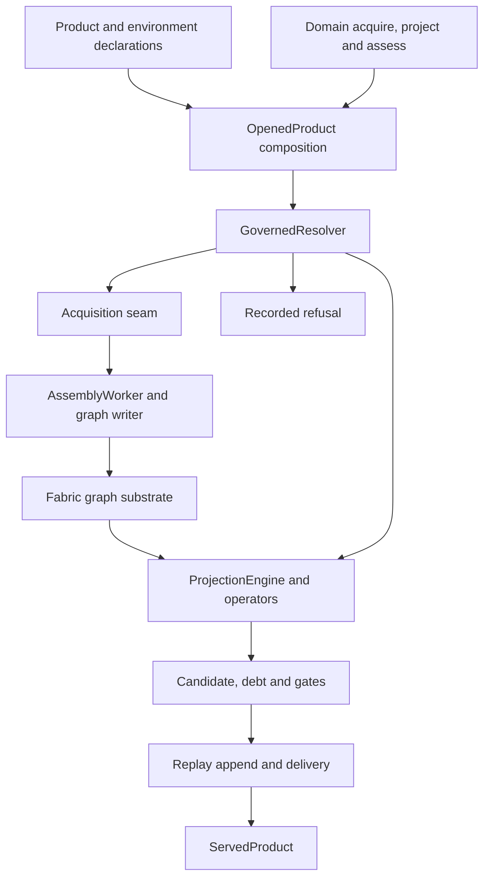
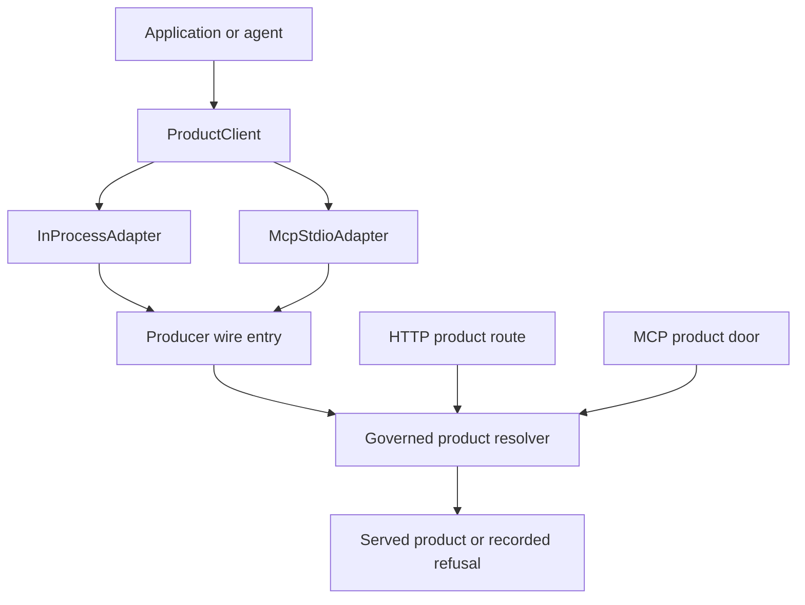
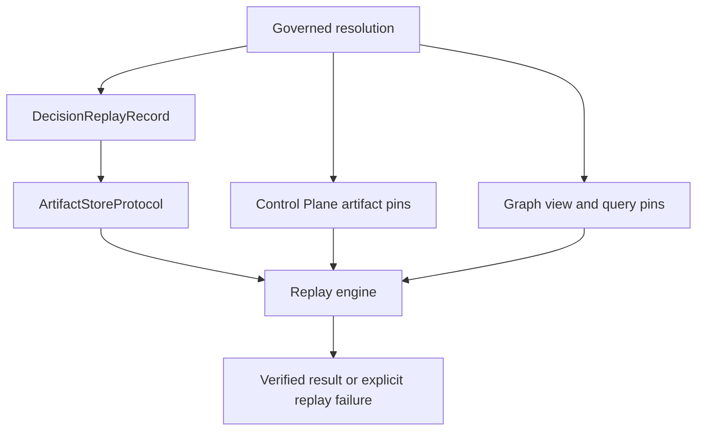

# CCF SDK architecture

**SDK source:** `ccf_code/main@f07e558ed04c81154687d7efcc6312591e7f6f7d` · **Inspected:** 2026-10-09.

[Design index](README.md) · [Source inventory and verification scope](10_SOURCE_INVENTORY.md)

## Purpose and boundaries

CCF turns a declared question, source evidence, policy and a consumer perspective into a governed Context Product or a recorded refusal. The product is a typed contract carrying its payload, lineage, debt and expiry; delivery adds a replay reference. The domain developer supplies acquisition, projection and assessment logic. The SDK composes the request, graph, governance and record boundaries around those functions.

These diagrams reconstruct the implementation at the source pin. Boxes group responsibilities; they do not imply separate services, mandatory containers or deployment topology.

## Product assembly architecture

`OpenedProduct.answer` admits the requested class/lane, creates a fresh fabric, builds the governed resolver, invokes it and closes the fabric in a `finally` block. Its acquisition callback receives the **effective request** after defaults, policy and technical constraints have been resolved. It does not reinterpret the caller's raw parameters independently.

The diagram's substrate is the fabric's own graph. A banking system of record is a separate source that acquisition reads. For example, CP01 reads PostgreSQL counterparty tables but declares SQLite for its working fabric. Selecting a fabric backend does not configure every upstream source.

Sources: [src/ccf/products/product.py](https://github.com/drcastillo/ccf_code/blob/f07e558ed04c81154687d7efcc6312591e7f6f7d/src/ccf/products/product.py); [src/ccf/products/resolver.py](https://github.com/drcastillo/ccf_code/blob/f07e558ed04c81154687d7efcc6312591e7f6f7d/src/ccf/products/resolver.py); [src/ccf/assembly/worker.py](https://github.com/drcastillo/ccf_code/blob/f07e558ed04c81154687d7efcc6312591e7f6f7d/src/ccf/assembly/worker.py); [examples/cp-01-counterparty-reference-snapshot/deployment.py](https://github.com/drcastillo/ccf_code/blob/f07e558ed04c81154687d7efcc6312591e7f6f7d/examples/cp-01-counterparty-reference-snapshot/deployment.py); [examples/cp-01-counterparty-reference-snapshot/ccf_config.yaml](https://github.com/drcastillo/ccf_code/blob/f07e558ed04c81154687d7efcc6312591e7f6f7d/examples/cp-01-counterparty-reference-snapshot/ccf_config.yaml).

## Consumers and delivery surfaces

This is a responsibility view, not a claim that all four paths use an identical HTTP/MCP handler. The `ProductClient` adapters invoke a producer-side byte-encoding entry; runtime HTTP and MCP product surfaces have their own authentication, authorization and response mapping. The shared product mechanisms sit beneath those surfaces.

At this pin the client package registers `inprocess` and `mcp+stdio`. An HTTP product route in the runtime is not evidence of a shipped HTTP `ProductClient` adapter. LangGraph, ADK and Claude Agent SDK integrations implement the separate harness seam, discussed in [Consumer and agent integration](07_CONSUMER_AND_AGENT_INTEGRATION.md).

Sources: [src/ccf/client/client.py](https://github.com/drcastillo/ccf_code/blob/f07e558ed04c81154687d7efcc6312591e7f6f7d/src/ccf/client/client.py); [src/ccf/client/adapters/inprocess.py](https://github.com/drcastillo/ccf_code/blob/f07e558ed04c81154687d7efcc6312591e7f6f7d/src/ccf/client/adapters/inprocess.py); [src/ccf/client/adapters/mcp_stdio.py](https://github.com/drcastillo/ccf_code/blob/f07e558ed04c81154687d7efcc6312591e7f6f7d/src/ccf/client/adapters/mcp_stdio.py); [src/ccf/products/door.py](https://github.com/drcastillo/ccf_code/blob/f07e558ed04c81154687d7efcc6312591e7f6f7d/src/ccf/products/door.py); [runtime/ccf_runtime/mcp/product_door.py](https://github.com/drcastillo/ccf_code/blob/f07e558ed04c81154687d7efcc6312591e7f6f7d/runtime/ccf_runtime/mcp/product_door.py); [runtime/ccf_runtime/http_api/routes/product.py](https://github.com/drcastillo/ccf_code/blob/f07e558ed04c81154687d7efcc6312591e7f6f7d/runtime/ccf_runtime/http_api/routes/product.py).

## Persistent evidence and governed state

| Boundary | Responsibility | Design consequence |
| --- | --- | --- |
| Source → signal | The deployment emits `SignalEnvelope` values | A source connector and a fabric adapter are different extension points. |
| Signal → graph | `AssemblyWorker` resolves and writes through the booted writer | Domain acquisition is not handed the graph writer. |
| Declaration → execution | Versioned Control Plane artifacts plus the pre-execution binder | Declared operators and the plan's required operators are checked before execution. |
| Candidate → delivery | Gates, tolerance, replay append | A successful assembly alone is not a delivered product. |
| Fabric → fabric | Signed peering and admission | A remote payload requires admission before composition. |
| Agent → agent | CP22's external A2A application | The ordinary answer can leave while the Context Product stays inside Agent B. |

The Control Plane registry, graph and artifact store are separate responsibilities even when one process owns all three. Neither replay nor authorization should be inferred merely from the presence of a storage box.

Sources: [src/ccf/signal/envelope.py](https://github.com/drcastillo/ccf_code/blob/f07e558ed04c81154687d7efcc6312591e7f6f7d/src/ccf/signal/envelope.py); [src/ccf/deployment/binder.py](https://github.com/drcastillo/ccf_code/blob/f07e558ed04c81154687d7efcc6312591e7f6f7d/src/ccf/deployment/binder.py); [src/ccf/replay/record.py](https://github.com/drcastillo/ccf_code/blob/f07e558ed04c81154687d7efcc6312591e7f6f7d/src/ccf/replay/record.py); [src/ccf/replay/serve.py](https://github.com/drcastillo/ccf_code/blob/f07e558ed04c81154687d7efcc6312591e7f6f7d/src/ccf/replay/serve.py); [src/ccf/peering/admission.py](https://github.com/drcastillo/ccf_code/blob/f07e558ed04c81154687d7efcc6312591e7f6f7d/src/ccf/peering/admission.py); [examples/cp-22-agent-internal-assembly/agent_b.py](https://github.com/drcastillo/ccf_code/blob/f07e558ed04c81154687d7efcc6312591e7f6f7d/examples/cp-22-agent-internal-assembly/agent_b.py).

## Reading the remaining documents

Use the module map to locate code; the class designs to understand contracts; the sequences to understand ordering; and the example map to find concrete compositions. The security-related diagrams describe implemented checks and remaining limits at this pin. They are not a vulnerability closure or release approval.
