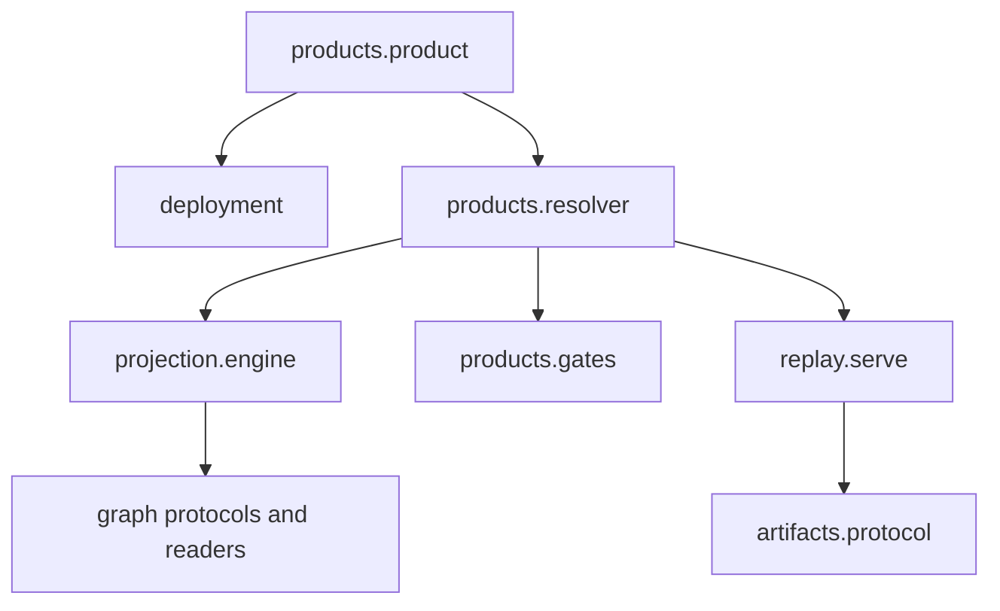
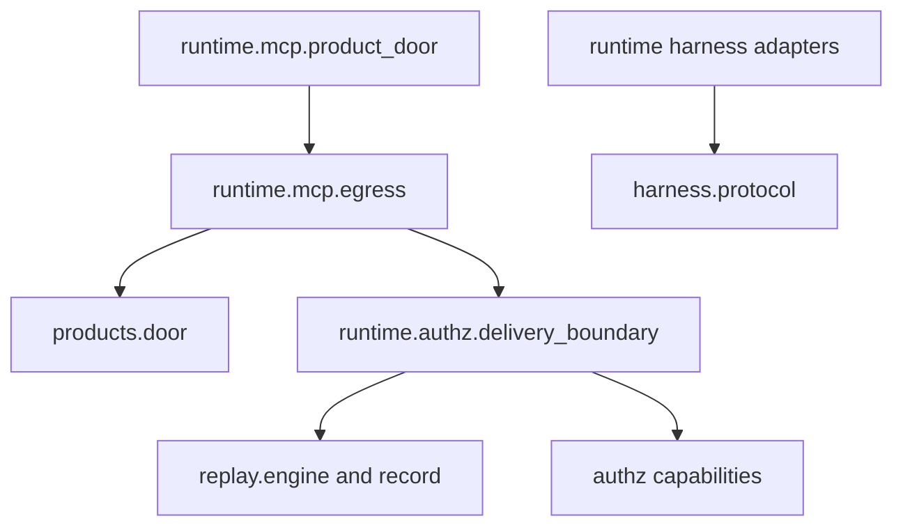

# Module design and dependency map

**SDK source:** `ccf_code/main@f07e558ed04c81154687d7efcc6312591e7f6f7d` · **Inspected:** 2026-10-09.

[Design index](README.md) · [Source inventory and verification scope](10_SOURCE_INVENTORY.md)

## Package boundaries

`src/ccf` contains the contracts and mechanisms. `runtime/ccf_runtime` supplies network servers, orchestration and external harness integration. `examples` supplies banking declarations and domain functions, composing those mechanisms into runnable programs.

The following arrows represent direct imports found in the named source files. They show selected important dependencies, not every transitive import or a strict acyclic layering rule.

Sources: [src/ccf/products/product.py](https://github.com/drcastillo/ccf_code/blob/f07e558ed04c81154687d7efcc6312591e7f6f7d/src/ccf/products/product.py); [src/ccf/products/resolver.py](https://github.com/drcastillo/ccf_code/blob/f07e558ed04c81154687d7efcc6312591e7f6f7d/src/ccf/products/resolver.py); [src/ccf/projection/engine.py](https://github.com/drcastillo/ccf_code/blob/f07e558ed04c81154687d7efcc6312591e7f6f7d/src/ccf/projection/engine.py); [src/ccf/replay/serve.py](https://github.com/drcastillo/ccf_code/blob/f07e558ed04c81154687d7efcc6312591e7f6f7d/src/ccf/replay/serve.py); [runtime/ccf_runtime/mcp/product_door.py](https://github.com/drcastillo/ccf_code/blob/f07e558ed04c81154687d7efcc6312591e7f6f7d/runtime/ccf_runtime/mcp/product_door.py); [runtime/ccf_runtime/mcp/egress.py](https://github.com/drcastillo/ccf_code/blob/f07e558ed04c81154687d7efcc6312591e7f6f7d/runtime/ccf_runtime/mcp/egress.py); [runtime/ccf_runtime/authz/delivery_boundary.py](https://github.com/drcastillo/ccf_code/blob/f07e558ed04c81154687d7efcc6312591e7f6f7d/runtime/ccf_runtime/authz/delivery_boundary.py).

## Responsibility map

| Package | Responsibility | Main design seam |
| --- | --- | --- |
| `contracts` | Frozen value contracts and canonical content addressing | `CCFContract`, canonical bytes and hashes |
| `signal`, `assembly` | Envelopes, entity/relationship resolution and ingestion | `SignalEnvelope`, `AssemblyWorker` |
| `graph` | Read/write protocols, backend discovery, leases and snapshots | `GraphReader`, `GraphWriter`, `BackendRegistration` |
| `controlplane` | Versioned declarations, registry, state and audit | `ControlPlaneProtocol`, pinned artifacts |
| `deployment` | Configuration derivation, registration, boot and operator binding | `derive_deployment`, `load_config_and_boot` |
| `operators`, `projection` | Operator lookup and perspective-conditioned execution | `ProjectionPlan`, `ProjectionEngine` |
| `halflife` | Freshness, completeness, consistency and Context Debt | `DebtFactors`, `DebtAssessment` |
| `products` | Request resolution, assembly, contracts, composition and refusals | `OpenedProduct`, `GovernedResolver` |
| `artifacts`, `replay` | Retained bytes, evidence records and reconstruction | `ArtifactStoreProtocol`, `DecisionReplayRecord` |
| `authz`, `erasure` | Typed authority and erasure consultation | `Authorized`, `ErasureTrust`, erasure index |
| `client` | Consumer API, binding, canonical wire decoding and guarded results | `ProductClient`, `TransportAdapter`, `Result` |
| `agents`, `skills`, `harness` | Agent definitions, granted skills and harness-neutral execution | `Agent`, `HarnessAdapterProtocol` |
| `peering` | Signed inter-fabric exchange and admission | `PeeringProtocol`, `PeeringAdmissionGate` |
| `hitl`, `workflow`, `orchestration` | Human decisions, workflow definitions and orchestration contracts | `HITLTransportProtocol`, workflow factory |
| `llm`, `similarity`, `mcp` | Model calls, similarity services and MCP-facing core mechanisms | See their source modules in the inventory. |
| `ccf_runtime` | Deployable HTTP/MCP surfaces, peering wires, workflow engine, adapters and CLI | Composition over core seams |

## Extension and change ownership

Add a source feed in a deployment's acquisition function. Add a new graph substrate through backend registration and the graph protocols. Add a domain rendering through a `ProjectionPlan`; add a reusable operator through the operator registry. Add a consumer transport through `TransportAdapter` and a binding factory. Add an agent harness through `HarnessAdapterProtocol`. These changes touch different seams and have different contracts.

A Python `Protocol` often uses structural conformance: a concrete implementation need not inherit from it. The class diagrams mark this distinction instead of inventing inheritance edges.

## Static inventory

The table below is generated from every Python file under the two package roots. Counts include `__init__.py`; top-level modules are grouped under `(root)`. Imports under `TYPE_CHECKING` and function-local imports are included in the dependency inventory; an import does not prove a runtime call.

| Package | Python files | Directly referenced CCF package families |
| --- | ---: | --- |
| `ccf.(root)` | 2 | `ccf.assembly`, `ccf.authz`, `ccf.contracts`, `ccf.controlplane`, `ccf.graph` |
| `ccf.agents` | 9 | `ccf.agents`, `ccf.artifacts`, `ccf.contracts`, `ccf.controlplane`, `ccf.products`, `ccf.projection`, `ccf.replay`, `ccf.skills` |
| `ccf.artifacts` | 4 | `ccf.artifacts`, `ccf.authz`, `ccf.contracts`, `ccf.controlplane`, `ccf.mcp`, `ccf.products` |
| `ccf.assembly` | 2 | `ccf.contracts`, `ccf.controlplane`, `ccf.graph`, `ccf.peering`, `ccf.signal` |
| `ccf.authz` | 4 | `ccf.authz`, `ccf.contracts` |
| `ccf.client` | 11 | `ccf.artifacts`, `ccf.authz`, `ccf.client`, `ccf.contracts`, `ccf.controlplane`, `ccf.deployment`, `ccf.erasure`, `ccf.halflife`, `ccf.products`, `ccf.projection` |
| `ccf.contracts` | 5 | `ccf.contracts`, `ccf.signal` |
| `ccf.controlplane` | 9 | `ccf.artifacts`, `ccf.assembly`, `ccf.authz`, `ccf.contracts`, `ccf.controlplane`, `ccf.graph`, `ccf.halflife`, `ccf.operators`, `ccf.products`, `ccf.projection`, `ccf.replay`, `ccf.signal` |
| `ccf.deployment` | 9 | `ccf.agents`, `ccf.assembly`, `ccf.authz`, `ccf.boot`, `ccf.contracts`, `ccf.controlplane`, `ccf.deployment`, `ccf.graph`, `ccf.operators`, `ccf.products`, `ccf.projection`, `ccf.similarity`, `ccf.skills`, `ccf.workflow` |
| `ccf.erasure` | 7 | `ccf.artifacts`, `ccf.authz`, `ccf.contracts`, `ccf.controlplane`, `ccf.erasure`, `ccf.hitl`, `ccf.peering`, `ccf.workflow` |
| `ccf.graph` | 22 | `ccf.contracts`, `ccf.controlplane`, `ccf.graph`, `ccf.peering`, `ccf.products` |
| `ccf.halflife` | 4 | `ccf.contracts`, `ccf.controlplane`, `ccf.halflife` |
| `ccf.harness` | 2 | `ccf.agents`, `ccf.contracts`, `ccf.harness`, `ccf.products`, `ccf.replay` |
| `ccf.hitl` | 10 | `ccf.artifacts`, `ccf.authz`, `ccf.contracts`, `ccf.controlplane`, `ccf.halflife`, `ccf.hitl`, `ccf.peering`, `ccf.skills` |
| `ccf.llm` | 1 |  |
| `ccf.mcp` | 4 | `ccf.mcp`, `ccf.projection` |
| `ccf.operators` | 6 | `ccf.contracts`, `ccf.graph`, `ccf.operators`, `ccf.similarity` |
| `ccf.orchestration` | 2 | `ccf.authz`, `ccf.contracts`, `ccf.orchestration`, `ccf.workflow` |
| `ccf.peering` | 7 | `ccf.artifacts`, `ccf.authz`, `ccf.contracts`, `ccf.controlplane`, `ccf.peering`, `ccf.products` |
| `ccf.products` | 21 | `ccf.agents`, `ccf.artifacts`, `ccf.authz`, `ccf.contracts`, `ccf.controlplane`, `ccf.deployment`, `ccf.erasure`, `ccf.graph`, `ccf.halflife`, `ccf.mcp`, `ccf.peering`, `ccf.products`, `ccf.projection`, `ccf.replay`, `ccf.signal`, `ccf.skills` |
| `ccf.projection` | 5 | `ccf.contracts`, `ccf.graph`, `ccf.operators`, `ccf.products`, `ccf.projection` |
| `ccf.replay` | 7 | `ccf.agents`, `ccf.artifacts`, `ccf.authz`, `ccf.contracts`, `ccf.controlplane`, `ccf.deployment`, `ccf.erasure`, `ccf.graph`, `ccf.halflife`, `ccf.products`, `ccf.projection`, `ccf.replay`, `ccf.skills` |
| `ccf.signal` | 6 | `ccf.contracts`, `ccf.controlplane`, `ccf.mcp`, `ccf.products`, `ccf.signal` |
| `ccf.similarity` | 5 | `ccf.contracts`, `ccf.similarity` |
| `ccf.skills` | 9 | `ccf.agents`, `ccf.authz`, `ccf.contracts`, `ccf.controlplane`, `ccf.mcp`, `ccf.peering`, `ccf.replay`, `ccf.skills` |
| `ccf.workflow` | 3 | `ccf.agents`, `ccf.artifacts`, `ccf.authz`, `ccf.contracts`, `ccf.controlplane`, `ccf.hitl`, `ccf.workflow` |
| `ccf_runtime.(root)` | 2 | `ccf.authz`, `ccf.hitl`, `ccf_runtime.mcp` |
| `ccf_runtime.adapters` | 7 | `ccf.agents`, `ccf.contracts`, `ccf.harness`, `ccf.products`, `ccf.replay`, `ccf.skills`, `ccf_runtime.adapters` |
| `ccf_runtime.authz` | 9 | `ccf.artifacts`, `ccf.authz`, `ccf.contracts`, `ccf.controlplane`, `ccf.erasure`, `ccf.products`, `ccf.projection`, `ccf.replay`, `ccf_runtime.authz`, `ccf_runtime.http_api`, `ccf_runtime.mcp` |
| `ccf_runtime.cdc` | 3 | `ccf.contracts`, `ccf.signal`, `ccf_runtime.cdc` |
| `ccf_runtime.cli` | 16 | `ccf.agents`, `ccf.artifacts`, `ccf.authz`, `ccf.controlplane`, `ccf.erasure`, `ccf.hitl`, `ccf.products`, `ccf.projection`, `ccf.replay`, `ccf.skills`, `ccf.workflow`, `ccf_runtime.cli`, `ccf_runtime.http_api`, `ccf_runtime.mcp`, `ccf_runtime.workflow` |
| `ccf_runtime.erasure` | 2 | `ccf.artifacts`, `ccf.authz`, `ccf.contracts`, `ccf.controlplane`, `ccf.erasure`, `ccf.hitl`, `ccf.mcp`, `ccf.peering`, `ccf.workflow`, `ccf_runtime.erasure`, `ccf_runtime.workflow` |
| `ccf_runtime.http_api` | 19 | `ccf.agents`, `ccf.artifacts`, `ccf.authz`, `ccf.contracts`, `ccf.controlplane`, `ccf.deployment`, `ccf.erasure`, `ccf.graph`, `ccf.hitl`, `ccf.peering`, `ccf.products`, `ccf.projection`, `ccf.skills`, `ccf.workflow`, `ccf_runtime.authz`, `ccf_runtime.http_api`, `ccf_runtime.identity_binding`, `ccf_runtime.mcp`, `ccf_runtime.workflow` |
| `ccf_runtime.mcp` | 9 | `ccf.agents`, `ccf.artifacts`, `ccf.authz`, `ccf.contracts`, `ccf.controlplane`, `ccf.deployment`, `ccf.erasure`, `ccf.hitl`, `ccf.products`, `ccf.projection`, `ccf.replay`, `ccf.skills`, `ccf_runtime.authz`, `ccf_runtime.http_api`, `ccf_runtime.identity_binding`, `ccf_runtime.mcp` |
| `ccf_runtime.orchestration` | 9 | `ccf.authz`, `ccf.contracts`, `ccf.workflow`, `ccf_runtime.orchestration`, `ccf_runtime.workflow` |
| `ccf_runtime.peering` | 3 | `ccf.contracts`, `ccf.peering`, `ccf_runtime.peering` |
| `ccf_runtime.workflow` | 3 | `ccf.artifacts`, `ccf.authz`, `ccf.contracts`, `ccf.controlplane`, `ccf.halflife`, `ccf.hitl`, `ccf.skills`, `ccf.workflow`, `ccf_runtime.workflow` |
