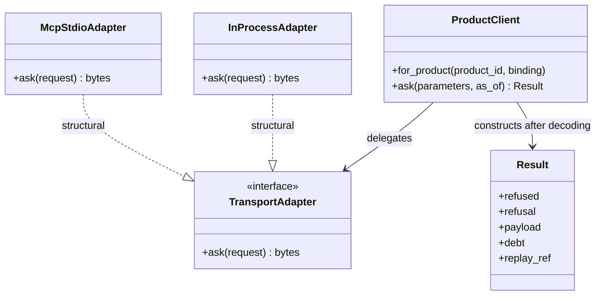
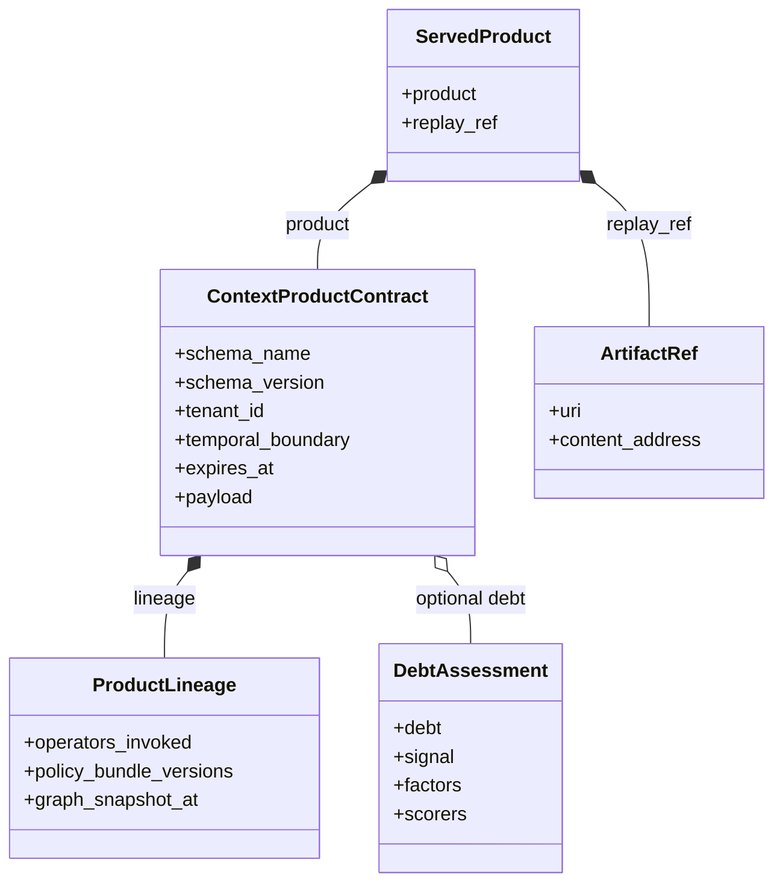
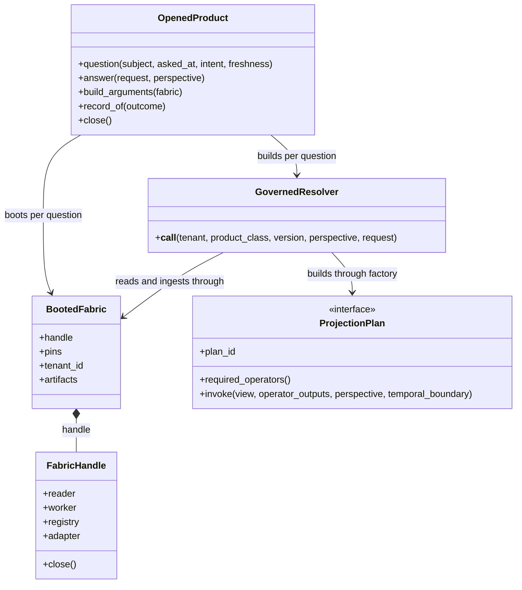

# Core class and contract design

**SDK source:** `ccf_code/main@f07e558ed04c81154687d7efcc6312591e7f6f7d` · **Inspected:** 2026-10-09.

[Design index](README.md) · [Source inventory and verification scope](10_SOURCE_INVENTORY.md)

## Notation

Solid diamonds below mean contained contract values, not storage ownership. Dashed arrows mean dependency or structural Protocol conformance, as labeled. A solid inheritance arrow is used only for actual Python inheritance. Methods and fields are a selected view of the real classes; these diagrams are not complete API listings.

## Consumer contract

Adapters return canonical bytes. `ProductClient` invokes the shared decoder, then constructs `Result` in one place. `Result` is intentionally not a `CCFContract`: its properties enforce the rule that reading a payload from a refused result raises. A governed refusal is a value; a transport failure is an exception.

Sources: [src/ccf/client/client.py](https://github.com/drcastillo/ccf_code/blob/f07e558ed04c81154687d7efcc6312591e7f6f7d/src/ccf/client/client.py); [src/ccf/client/wire.py](https://github.com/drcastillo/ccf_code/blob/f07e558ed04c81154687d7efcc6312591e7f6f7d/src/ccf/client/wire.py); [src/ccf/client/result.py](https://github.com/drcastillo/ccf_code/blob/f07e558ed04c81154687d7efcc6312591e7f6f7d/src/ccf/client/result.py); [src/ccf/client/codec.py](https://github.com/drcastillo/ccf_code/blob/f07e558ed04c81154687d7efcc6312591e7f6f7d/src/ccf/client/codec.py); [src/ccf/client/adapters/inprocess.py](https://github.com/drcastillo/ccf_code/blob/f07e558ed04c81154687d7efcc6312591e7f6f7d/src/ccf/client/adapters/inprocess.py); [src/ccf/client/adapters/mcp_stdio.py](https://github.com/drcastillo/ccf_code/blob/f07e558ed04c81154687d7efcc6312591e7f6f7d/src/ccf/client/adapters/mcp_stdio.py).

## Product values

The product has temporal and policy meaning beyond its payload. `ServedProduct` adds evidence of record persistence. A content address is computed from canonical content; the diagram does not add an invented `content_address` field to `ContextProductContract`.

`DebtAssessment` holds a debt value, signal and `DebtFactors`; factor meanings and scorer pins remain part of the typed contract. A missing assessment must not be rendered as a measured zero.

Sources: [src/ccf/products/contract.py](https://github.com/drcastillo/ccf_code/blob/f07e558ed04c81154687d7efcc6312591e7f6f7d/src/ccf/products/contract.py); [src/ccf/halflife/assessment.py](https://github.com/drcastillo/ccf_code/blob/f07e558ed04c81154687d7efcc6312591e7f6f7d/src/ccf/halflife/assessment.py); [src/ccf/replay/serve.py](https://github.com/drcastillo/ccf_code/blob/f07e558ed04c81154687d7efcc6312591e7f6f7d/src/ccf/replay/serve.py); [src/ccf/artifacts/protocol.py](https://github.com/drcastillo/ccf_code/blob/f07e558ed04c81154687d7efcc6312591e7f6f7d/src/ccf/artifacts/protocol.py).

## Producer orchestration objects

`OpenedProduct` keeps deployment-wide bindings, registry, artifact store and refusal recorder; the working fabric is per question. A lower-level caller can construct `GovernedResolver` directly with explicit bindings. That caller then owns composition duties the facade normally supplies, including ingestion controls and cleanup.

Sources: [src/ccf/products/product.py](https://github.com/drcastillo/ccf_code/blob/f07e558ed04c81154687d7efcc6312591e7f6f7d/src/ccf/products/product.py); [src/ccf/products/resolver.py](https://github.com/drcastillo/ccf_code/blob/f07e558ed04c81154687d7efcc6312591e7f6f7d/src/ccf/products/resolver.py); [src/ccf/deployment/manifest.py](https://github.com/drcastillo/ccf_code/blob/f07e558ed04c81154687d7efcc6312591e7f6f7d/src/ccf/deployment/manifest.py); [src/ccf/boot.py](https://github.com/drcastillo/ccf_code/blob/f07e558ed04c81154687d7efcc6312591e7f6f7d/src/ccf/boot.py); [src/ccf/projection/plan.py](https://github.com/drcastillo/ccf_code/blob/f07e558ed04c81154687d7efcc6312591e7f6f7d/src/ccf/projection/plan.py).

## Question, effective authority and outcome

| Contract or value | Role | Important boundary |
| --- | --- | --- |
| `ProductRequest` | Class/version, subject, intent, freshness, `asked_at`, parameters | Domain question supplied to the resolver. |
| `ProductRequestContract` | Declared argument schema, domains, defaults and capabilities | The request is checked against what the product actually supports. |
| `Perspective` | Principal and role used by projection | This value does not replace transport authentication. |
| `ServableProduct` | Product carrying verified gate provenance | `serve` verifies this provenance before recording/delivery. |
| `ServedProduct` | Contract plus persisted replay reference | Successful resolver outcome. |
| `RefusalEnvelope` | Typed governed refusal, request/evidence and replay reference | Refusal is separate from an empty successful payload. |

`ResolverOutcome` selects the served or refused path. Wiring faults and failed persistence can still raise; the type does not promise that every programming or infrastructure error becomes a governed refusal.

Sources: [src/ccf/products/request.py](https://github.com/drcastillo/ccf_code/blob/f07e558ed04c81154687d7efcc6312591e7f6f7d/src/ccf/products/request.py); [src/ccf/projection/plan.py](https://github.com/drcastillo/ccf_code/blob/f07e558ed04c81154687d7efcc6312591e7f6f7d/src/ccf/projection/plan.py); [src/ccf/products/gates.py](https://github.com/drcastillo/ccf_code/blob/f07e558ed04c81154687d7efcc6312591e7f6f7d/src/ccf/products/gates.py); [src/ccf/products/refusal.py](https://github.com/drcastillo/ccf_code/blob/f07e558ed04c81154687d7efcc6312591e7f6f7d/src/ccf/products/refusal.py).
