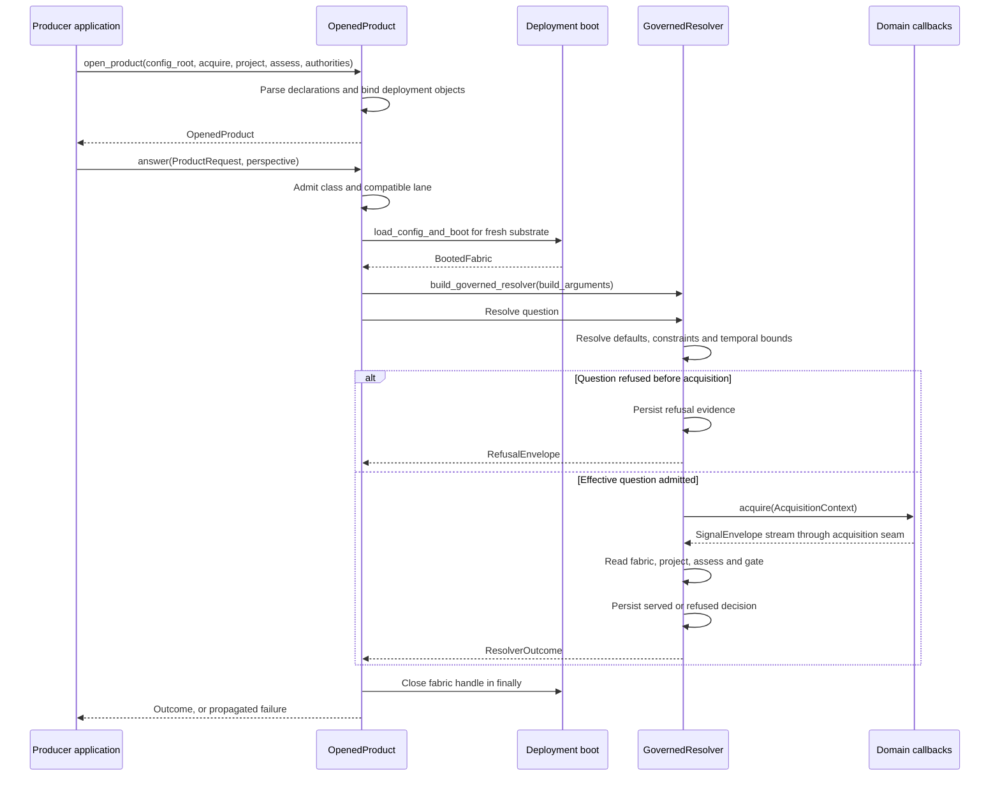
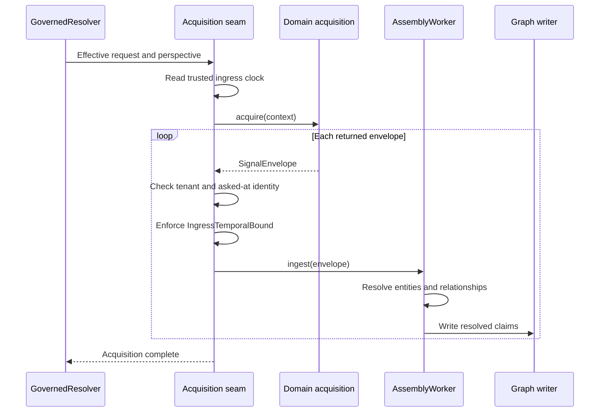
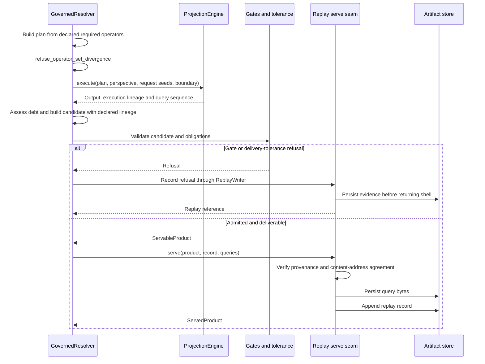

# Product assembly and refusal sequences

**SDK source:** `ccf_code/main@f07e558ed04c81154687d7efcc6312591e7f6f7d` · **Inspected:** 2026-10-09.

[Design index](README.md) · [Source inventory and verification scope](10_SOURCE_INVENTORY.md)

## Opening and answering on the facade

This sequence follows `open_product` and `OpenedProduct.answer`. It omits helper calls but preserves the lifecycle and ownership boundaries. A configured composite inserts child resolution before parent projection; that branch has its own [composition sequence](06_COMPOSITION_AND_PEERING_DESIGN.md).

The application supplies `control_plane` and `erasure_trust` explicitly at this pin. These are composition dependencies, not implied globals. `open_product` also accepts an artifact store, clock, optional product gate and child-question/resolver seams.

Sources: [src/ccf/products/product.py](https://github.com/drcastillo/ccf_code/blob/f07e558ed04c81154687d7efcc6312591e7f6f7d/src/ccf/products/product.py); [src/ccf/deployment/config.py](https://github.com/drcastillo/ccf_code/blob/f07e558ed04c81154687d7efcc6312591e7f6f7d/src/ccf/deployment/config.py); [src/ccf/products/resolver.py](https://github.com/drcastillo/ccf_code/blob/f07e558ed04c81154687d7efcc6312591e7f6f7d/src/ccf/products/resolver.py).

## Acquisition and the graph write boundary

The question's instant, the source observation time and the trusted ingress/serve clocks answer different questions. In particular, `AcquisitionContext.instant` is the bounded as-of request boundary. The ingress guard compares the envelope against a trusted clock; comparing a timestamp to itself would not enforce an age limit.

A recognized temporal or domain refusal raised at the seam is converted into a recorded refusal by the resolver. Unknown exceptions remain failures. No source database write is implied by `worker.ingest`: it writes the fabric through its own writer.

Sources: [src/ccf/products/product.py](https://github.com/drcastillo/ccf_code/blob/f07e558ed04c81154687d7efcc6312591e7f6f7d/src/ccf/products/product.py); [src/ccf/assembly/worker.py](https://github.com/drcastillo/ccf_code/blob/f07e558ed04c81154687d7efcc6312591e7f6f7d/src/ccf/assembly/worker.py); [src/ccf/controlplane/temporal_boundary.py](https://github.com/drcastillo/ccf_code/blob/f07e558ed04c81154687d7efcc6312591e7f6f7d/src/ccf/controlplane/temporal_boundary.py); [src/ccf/products/resolver.py](https://github.com/drcastillo/ccf_code/blob/f07e558ed04c81154687d7efcc6312591e7f6f7d/src/ccf/products/resolver.py).

## Projection to delivery

This is a summary of the final stages, not a promise of one store transaction across all writes. The explicit ordering is query bytes before replay record and replay record before response. A write failure prevents delivery; previously written evidence need not be rolled back.

The binder checks independently authored declarations before projection. The lineage gate later checks assembly-path integrity. Those checks have different purposes; the existence of a lineage comparison is not proof that a misdeclared plan can pass through the binder.

## Failure semantics

| Condition | Outcome |
| --- | --- |
| Unsupported question, policy constraint, temporal bound or recognized seam refusal | Recorded governed refusal; no empty-success substitute. |
| Required composite child blocks | Retain already admitted child contracts, then record the parent's refusal. |
| Candidate passes gates but exceeds effective debt tolerance | Withheld delivery, recorded as refusal. |
| Replay store cannot persist required evidence | Failure propagates; no successful served product or audited refusal shell is fabricated. |
| Wrong resolver tenant/class wiring | Wiring exception rather than a decision about a valid question. |

The diagrams show source ordering. They do not claim that live example gates or backends were executed during this documentation work.

Sources: [src/ccf/deployment/binder.py](https://github.com/drcastillo/ccf_code/blob/f07e558ed04c81154687d7efcc6312591e7f6f7d/src/ccf/deployment/binder.py); [src/ccf/products/gates.py](https://github.com/drcastillo/ccf_code/blob/f07e558ed04c81154687d7efcc6312591e7f6f7d/src/ccf/products/gates.py); [src/ccf/products/resolver.py](https://github.com/drcastillo/ccf_code/blob/f07e558ed04c81154687d7efcc6312591e7f6f7d/src/ccf/products/resolver.py); [src/ccf/replay/serve.py](https://github.com/drcastillo/ccf_code/blob/f07e558ed04c81154687d7efcc6312591e7f6f7d/src/ccf/replay/serve.py).
