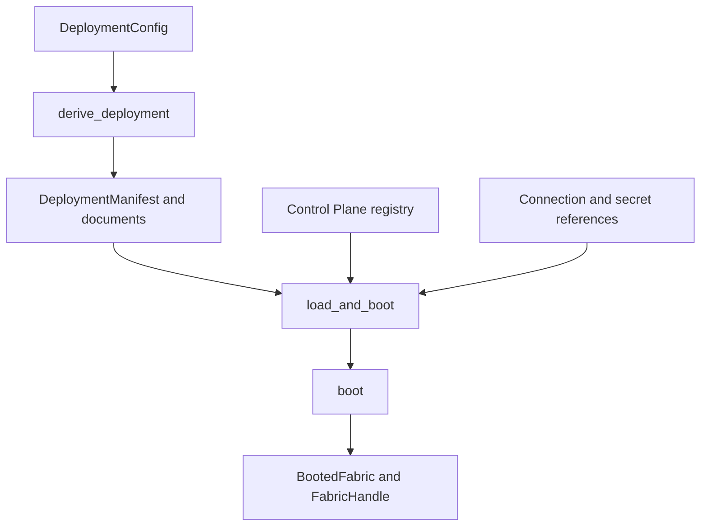
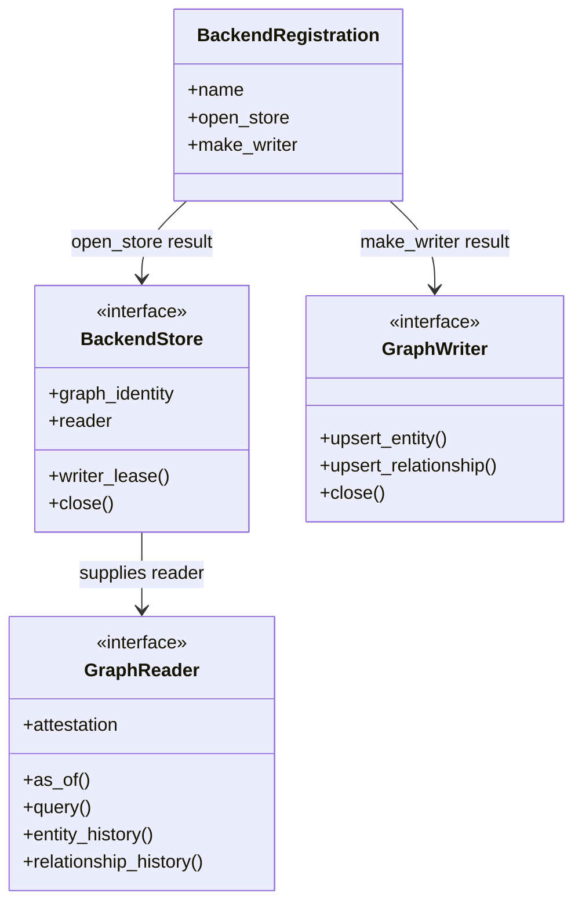
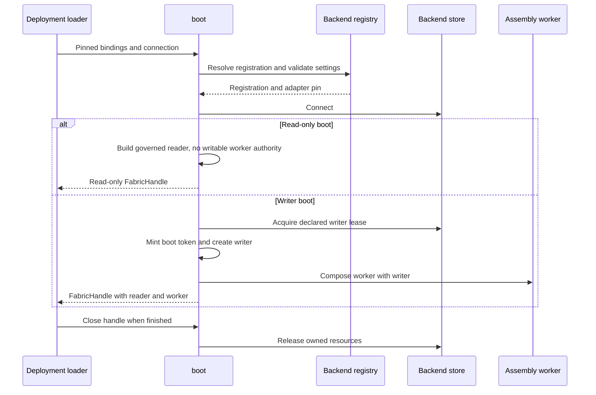
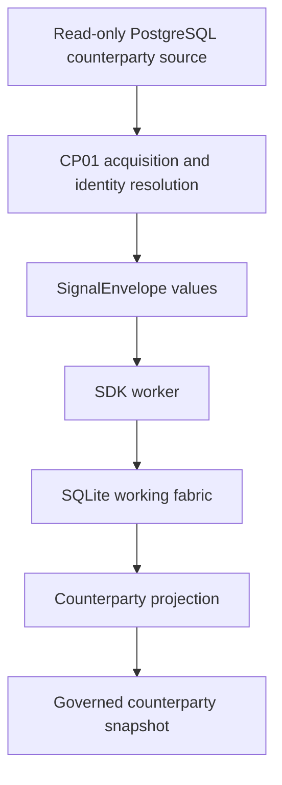

# Deployment and backend design

**SDK source:** `ccf_code/main@f07e558ed04c81154687d7efcc6312591e7f6f7d` · **Inspected:** 2026-10-09.

[Design index](README.md) · [Source inventory and verification scope](10_SOURCE_INVENTORY.md)

## Declaration, environment and composition

`ccf_config.yaml` states the product's semantic configuration: its class, request contract, operators, resolution rules, policy, debt/half-life declarations and supported bindings. `ccf_environment.yaml`, where the product uses the facade, describes environmental settings and source/endpoint references. The application supplies the domain callables and authority objects.

Derivation constructs documents; registration and validation belong to the loading/booting path. `load_config_and_boot` connects those operations. Explicit manifest entries enumerate the artifacts rather than finding them with a glob. The resulting pins say what configuration was actually bound.

A producer should not copy the SDK's config interpreter into its own `deployment.py`. That file should bind domain behavior and source settings. Conversely, a manifest or environment file cannot implement a bank-specific projection by itself.

Sources: [src/ccf/controlplane/artifacts.py](https://github.com/drcastillo/ccf_code/blob/f07e558ed04c81154687d7efcc6312591e7f6f7d/src/ccf/controlplane/artifacts.py); [src/ccf/deployment/config.py](https://github.com/drcastillo/ccf_code/blob/f07e558ed04c81154687d7efcc6312591e7f6f7d/src/ccf/deployment/config.py); [src/ccf/deployment/manifest.py](https://github.com/drcastillo/ccf_code/blob/f07e558ed04c81154687d7efcc6312591e7f6f7d/src/ccf/deployment/manifest.py); [src/ccf/deployment/environment.py](https://github.com/drcastillo/ccf_code/blob/f07e558ed04c81154687d7efcc6312591e7f6f7d/src/ccf/deployment/environment.py).

## Backend extension seam

The backend registry discovers declarations, resolves the requested backend, validates its connection settings and pins its identity/version. `boot` obtains the reader and the single-writer capability through that resolved registration. The registry is an extension seam; the diagram is not an inheritance tree of database adapters.

| Backend | Store | Reader | Implementation |
| --- | --- | --- | --- |
| memory | `MemoryGraphStore` | `MemoryGraphReader` | [memory.py](https://github.com/drcastillo/ccf_code/blob/f07e558ed04c81154687d7efcc6312591e7f6f7d/src/ccf/graph/backends/memory.py) |
| sqlite | `SqliteGraphStore` | `SqliteGraphReader` | [sqlite.py](https://github.com/drcastillo/ccf_code/blob/f07e558ed04c81154687d7efcc6312591e7f6f7d/src/ccf/graph/backends/sqlite.py) |
| postgres | `PostgresGraphStore` | `PostgresGraphReader` | [postgres.py](https://github.com/drcastillo/ccf_code/blob/f07e558ed04c81154687d7efcc6312591e7f6f7d/src/ccf/graph/backends/postgres.py) |
| fluree | `FlureeGraphStore` | `FlureeGraphReader` | [fluree.py](https://github.com/drcastillo/ccf_code/blob/f07e558ed04c81154687d7efcc6312591e7f6f7d/src/ccf/graph/backends/fluree.py) |
| mongo | `MongoGraphStore` | `MongoGraphReader` | [mongo.py](https://github.com/drcastillo/ccf_code/blob/f07e558ed04c81154687d7efcc6312591e7f6f7d/src/ccf/graph/backends/mongo.py) |
| neo4j | `Neo4jGraphStore` | `Neo4jGraphReader` | [neo4j.py](https://github.com/drcastillo/ccf_code/blob/f07e558ed04c81154687d7efcc6312591e7f6f7d/src/ccf/graph/backends/neo4j.py) |

Writer implementations live in the corresponding `*_write.py` modules. `SnapshotPinnable` is a separate capability; a shared read interface does not establish identical historical snapshot guarantees for every backend. Validate attestation, pin behavior and lease requirements for the selected adapter.

Sources: [src/ccf/graph/registry.py](https://github.com/drcastillo/ccf_code/blob/f07e558ed04c81154687d7efcc6312591e7f6f7d/src/ccf/graph/registry.py); [src/ccf/graph/protocols.py](https://github.com/drcastillo/ccf_code/blob/f07e558ed04c81154687d7efcc6312591e7f6f7d/src/ccf/graph/protocols.py); [src/ccf/boot.py](https://github.com/drcastillo/ccf_code/blob/f07e558ed04c81154687d7efcc6312591e7f6f7d/src/ccf/boot.py).

## Writer lifecycle

`FabricHandle` exposes ingestion through its worker, not a public graph writer handle. A read-only boot avoids a writer lease and uses a refusing write path. This is important for replay beside a live writer. Lease scope is explicit: process-local exclusion is not cross-process exclusion; a network deployment must supply the supported declared lease arrangement.

## Example distinction: source estate versus fabric

CP01's `source_dsn` and `connection` deliberately read different bindings. A change to the upstream reference database is not the same operation as replacing SQLite with another fabric backend. Network addresses and credentials remain deployment settings and are not copied into these documents.

Sources: [examples/cp-01-counterparty-reference-snapshot/deployment.py](https://github.com/drcastillo/ccf_code/blob/f07e558ed04c81154687d7efcc6312591e7f6f7d/examples/cp-01-counterparty-reference-snapshot/deployment.py); [examples/cp-01-counterparty-reference-snapshot/produce.py](https://github.com/drcastillo/ccf_code/blob/f07e558ed04c81154687d7efcc6312591e7f6f7d/examples/cp-01-counterparty-reference-snapshot/produce.py); [src/ccf/graph/leases.py](https://github.com/drcastillo/ccf_code/blob/f07e558ed04c81154687d7efcc6312591e7f6f7d/src/ccf/graph/leases.py); [src/ccf/boot.py](https://github.com/drcastillo/ccf_code/blob/f07e558ed04c81154687d7efcc6312591e7f6f7d/src/ccf/boot.py).
