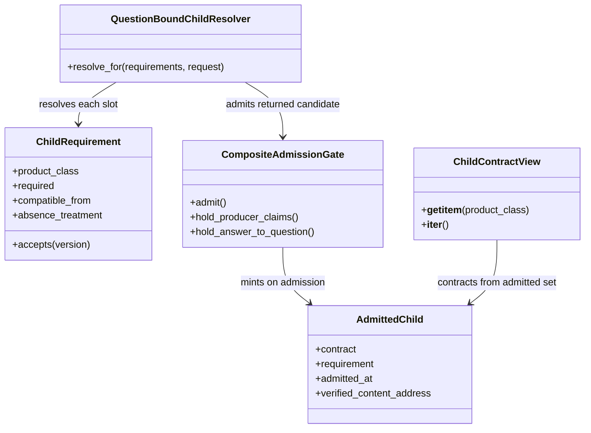
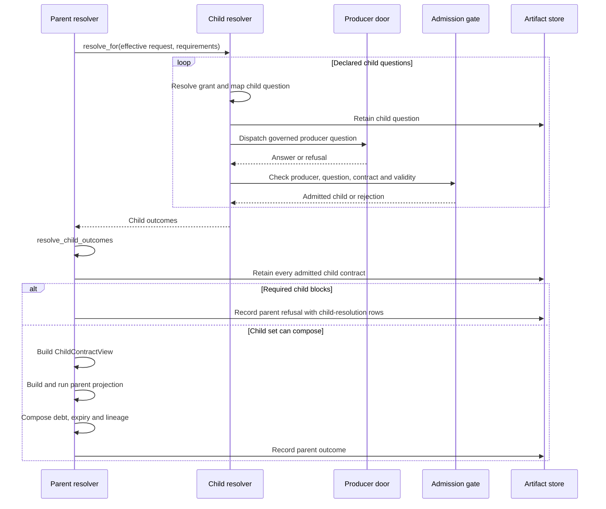
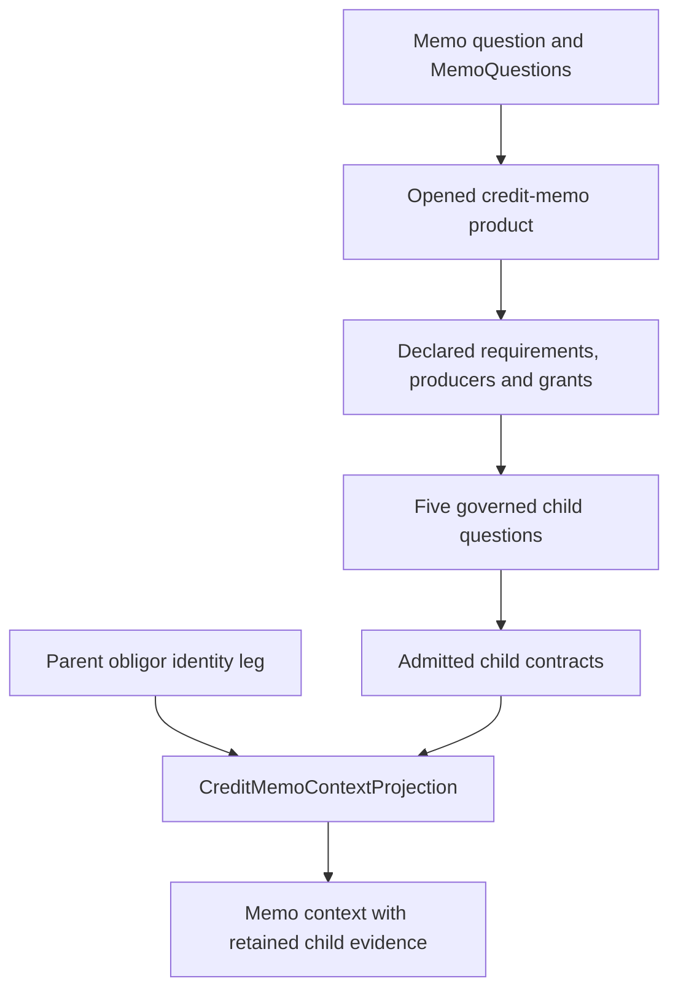
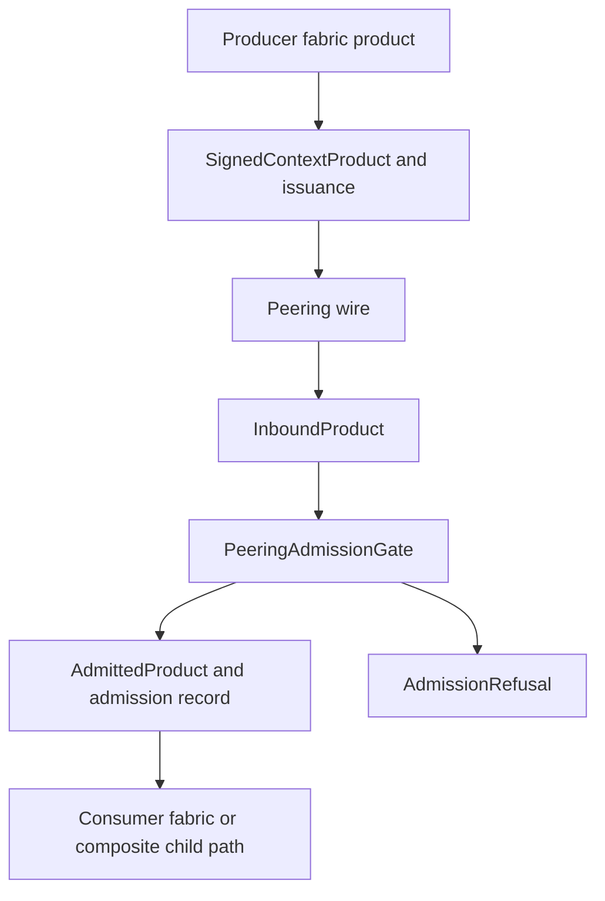

# Composite products and fabric peering

**SDK source:** `ccf_code/main@f07e558ed04c81154687d7efcc6312591e7f6f7d` · **Inspected:** 2026-10-09.

[Design index](README.md) · [Source inventory and verification scope](10_SOURCE_INVENTORY.md)

## A requirement is not a producer address

A `ChildRequirement` declares the product class, compatible version floor, whether it is required and the permitted treatment of optional absence. Producer registrations, skills, grants and endpoint settings resolve who may supply it and how to ask. A deployment's question mapper maps the parent's **effective** question to each child question.

This is an association diagram. `ChildContractView` exposes contracts keyed by class, not the mutable resolver or the entire admission machinery. The provenance carried by an `AdmittedChild` is checked; merely constructing a look-alike object is not equivalent to admission.

Sources: [src/ccf/products/contract.py](https://github.com/drcastillo/ccf_code/blob/f07e558ed04c81154687d7efcc6312591e7f6f7d/src/ccf/products/contract.py); [src/ccf/products/child_resolver.py](https://github.com/drcastillo/ccf_code/blob/f07e558ed04c81154687d7efcc6312591e7f6f7d/src/ccf/products/child_resolver.py); [src/ccf/products/composite.py](https://github.com/drcastillo/ccf_code/blob/f07e558ed04c81154687d7efcc6312591e7f6f7d/src/ccf/products/composite.py).

## Resolve, retain, then branch

The `resolve_for` call encloses the child walk; the loop expands that walk for readability. Retention precedes the blocking split. If one child succeeds and another required child refuses, the parent's refusal still retains the successful child's bytes. Replay must not call a live producer to reconstruct that past admission.

Composition preserves the parent's own operator check before combining admitted child lineage. Composite factors use the supported factor-composition law; expiry is bounded by constituent validity and the parent's declared limits. A parent cannot erase a child's debt or extend its authority by flattening its payload into an ordinary dictionary.

Sources: [src/ccf/products/resolver.py](https://github.com/drcastillo/ccf_code/blob/f07e558ed04c81154687d7efcc6312591e7f6f7d/src/ccf/products/resolver.py); [src/ccf/products/composite.py](https://github.com/drcastillo/ccf_code/blob/f07e558ed04c81154687d7efcc6312591e7f6f7d/src/ccf/products/composite.py); [src/ccf/products/composition.py](https://github.com/drcastillo/ccf_code/blob/f07e558ed04c81154687d7efcc6312591e7f6f7d/src/ccf/products/composition.py); [src/ccf/halflife/debt.py](https://github.com/drcastillo/ccf_code/blob/f07e558ed04c81154687d7efcc6312591e7f6f7d/src/ccf/halflife/debt.py).

## CP14: credit memo context

| Required class in CP14 | Compatible from | Parent use |
| --- | --- | --- |
| `credit-risk.spread` | `1.0.0` | Financial spread summary |
| `reference.corporate-family` | `2.0.0` | Family structure summary |
| `credit-risk.exposure-rollup` | `1.0.0` | Exposure and materiality summary |
| `credit-risk.collateral-coverage` | `1.0.0` | Facility collateral and set-off summary |
| `credit-risk.covenant-cross-reference` | `1.0.0` | Covenant evidence summary |

`MemoPlanFactory.build_with_children` passes the admitted contract view into `CreditMemoContextProjection`. Its `SECTION_FIELDS` table reads the children's served values. It does not independently recompute their banking measures. The current projection explicitly describes a scoped memo skeleton; planned specification sections must not be mistaken for fully implemented memo generation.

Sources: [examples/cp-14-credit-memo-context/ccf_config.yaml](https://github.com/drcastillo/ccf_code/blob/f07e558ed04c81154687d7efcc6312591e7f6f7d/examples/cp-14-credit-memo-context/ccf_config.yaml); [examples/cp-14-credit-memo-context/deployment.py](https://github.com/drcastillo/ccf_code/blob/f07e558ed04c81154687d7efcc6312591e7f6f7d/examples/cp-14-credit-memo-context/deployment.py); [examples/cp-14-credit-memo-context/produce.py](https://github.com/drcastillo/ccf_code/blob/f07e558ed04c81154687d7efcc6312591e7f6f7d/examples/cp-14-credit-memo-context/produce.py); [examples/cp-14-credit-memo-context/projection.py](https://github.com/drcastillo/ccf_code/blob/f07e558ed04c81154687d7efcc6312591e7f6f7d/examples/cp-14-credit-memo-context/projection.py).

## Fabric peering is a separate admission boundary

The wire carries a signed product; it does not authorize that product merely by transporting it. Admission checks include size, signature, issuance/replay conditions, contract, policy binding and lineage. Admission produces its own recorded evidence and provenance-bearing value. CP20's co-lender example exercises a federated child path; CP14's MCP product acquisition and CP22's external agent reply are different compositions.

The core `PeeringProtocol` is implemented by runtime wires such as typed HTTP and LF A2A. These are inter-fabric mechanisms. Do not infer that an arbitrary A2A response has passed `PeeringAdmissionGate`.

Sources: [src/ccf/peering/protocol.py](https://github.com/drcastillo/ccf_code/blob/f07e558ed04c81154687d7efcc6312591e7f6f7d/src/ccf/peering/protocol.py); [src/ccf/peering/admission.py](https://github.com/drcastillo/ccf_code/blob/f07e558ed04c81154687d7efcc6312591e7f6f7d/src/ccf/peering/admission.py); [src/ccf/peering/identity.py](https://github.com/drcastillo/ccf_code/blob/f07e558ed04c81154687d7efcc6312591e7f6f7d/src/ccf/peering/identity.py); [runtime/ccf_runtime/peering/typed_http.py](https://github.com/drcastillo/ccf_code/blob/f07e558ed04c81154687d7efcc6312591e7f6f7d/runtime/ccf_runtime/peering/typed_http.py); [runtime/ccf_runtime/peering/lf_a2a.py](https://github.com/drcastillo/ccf_code/blob/f07e558ed04c81154687d7efcc6312591e7f6f7d/runtime/ccf_runtime/peering/lf_a2a.py); [examples/cp-20-syndicated-lending-co-lender/deployment.py](https://github.com/drcastillo/ccf_code/blob/f07e558ed04c81154687d7efcc6312591e7f6f7d/examples/cp-20-syndicated-lending-co-lender/deployment.py).
