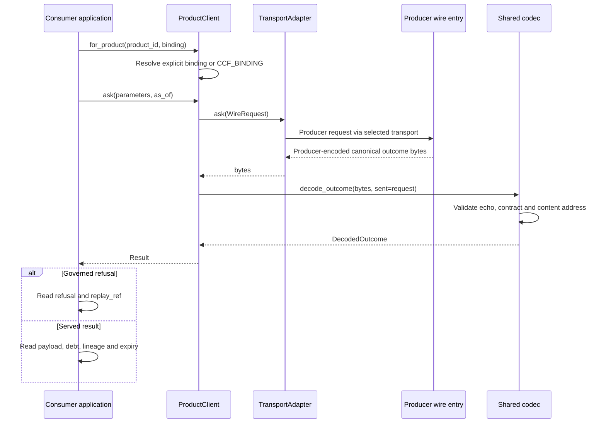
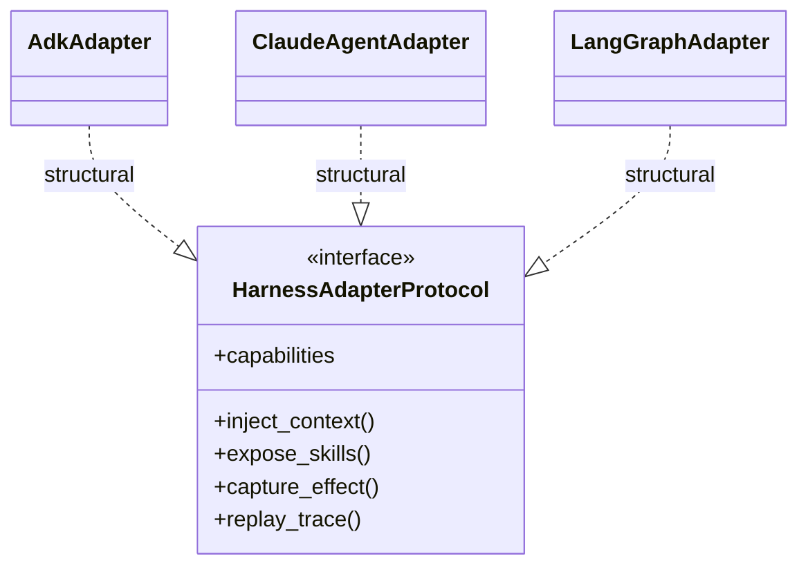
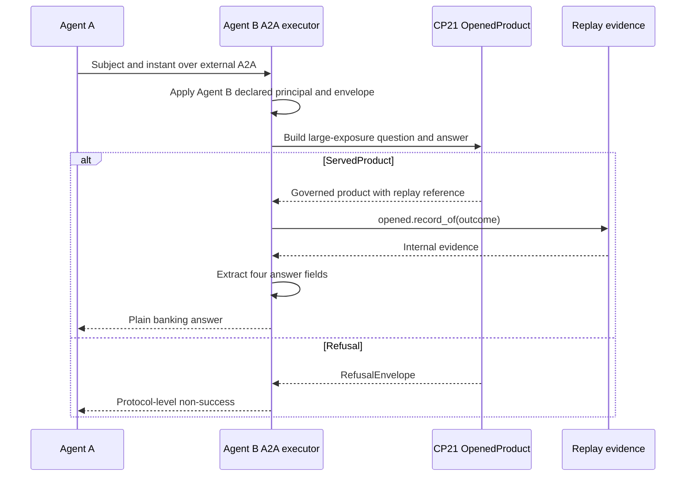

# Consumer and agent integration design

**SDK source:** `ccf_code/main@f07e558ed04c81154687d7efcc6312591e7f6f7d` · **Inspected:** 2026-10-09.

[Design index](README.md) · [Source inventory and verification scope](10_SOURCE_INVENTORY.md)

## Consumer request and verification sequence

A wrong echo or invalid content address is a transport/validation failure, not an ordinary refusal. Reading `Result.payload` without checking `Result.refused` is rejected on the refused path.

For `as_of=None`, the two shipped adapters resolve the instant client-side at this pin. The producer echo preserves the caller's original `None`. A diagram labeling this path “server chooses now” would contradict the adapter implementation. Applications needing an explicit reproducible instant should supply it.

Sources: [src/ccf/client/client.py](https://github.com/drcastillo/ccf_code/blob/f07e558ed04c81154687d7efcc6312591e7f6f7d/src/ccf/client/client.py); [src/ccf/client/binding.py](https://github.com/drcastillo/ccf_code/blob/f07e558ed04c81154687d7efcc6312591e7f6f7d/src/ccf/client/binding.py); [src/ccf/client/codec.py](https://github.com/drcastillo/ccf_code/blob/f07e558ed04c81154687d7efcc6312591e7f6f7d/src/ccf/client/codec.py); [src/ccf/client/result.py](https://github.com/drcastillo/ccf_code/blob/f07e558ed04c81154687d7efcc6312591e7f6f7d/src/ccf/client/result.py); [src/ccf/client/adapters/inprocess.py](https://github.com/drcastillo/ccf_code/blob/f07e558ed04c81154687d7efcc6312591e7f6f7d/src/ccf/client/adapters/inprocess.py); [src/ccf/client/adapters/mcp_stdio.py](https://github.com/drcastillo/ccf_code/blob/f07e558ed04c81154687d7efcc6312591e7f6f7d/src/ccf/client/adapters/mcp_stdio.py).

## Four different integration seams

| Integration | What crosses | Owner of the seam |
| --- | --- | --- |
| `ProductClient` adapter | Wire request and canonical outcome bytes | `TransportAdapter` |
| Runtime MCP/HTTP product surface | Authenticated request and governed product/refusal response | Runtime server and product resolver |
| Agent harness | Injected context, exposed skills, captured effects and trace | `HarnessAdapterProtocol` |
| Fabric peering | Signed Context Product and admission evidence | `PeeringProtocol` and `PeeringAdmissionGate` |

Changing an agent harness does not itself select a product transport, and changing a wire does not replace the governance checks beneath it.

## Harness class design

The adapters translate the SDK's harness-neutral contract into each framework's context, tool and execution model. Agent skill invocation still uses declared skills/grants. `Agent.consume` checks its consumer-side obligations, including expiry; injecting text into a prompt is not a substitute for that boundary.

The runtime also has `orchestration` adapters. They are orchestration implementations, distinct from the `adapters` package's harness interface. The module inventory lists both so that similarly named directories are not collapsed into one component.

Sources: [src/ccf/harness/protocol.py](https://github.com/drcastillo/ccf_code/blob/f07e558ed04c81154687d7efcc6312591e7f6f7d/src/ccf/harness/protocol.py); [src/ccf/agents/agent.py](https://github.com/drcastillo/ccf_code/blob/f07e558ed04c81154687d7efcc6312591e7f6f7d/src/ccf/agents/agent.py); [runtime/ccf_runtime/adapters/adk/adapter.py](https://github.com/drcastillo/ccf_code/blob/f07e558ed04c81154687d7efcc6312591e7f6f7d/runtime/ccf_runtime/adapters/adk/adapter.py); [runtime/ccf_runtime/adapters/claude_agent/adapter.py](https://github.com/drcastillo/ccf_code/blob/f07e558ed04c81154687d7efcc6312591e7f6f7d/runtime/ccf_runtime/adapters/claude_agent/adapter.py); [runtime/ccf_runtime/adapters/langgraph/adapter.py](https://github.com/drcastillo/ccf_code/blob/f07e558ed04c81154687d7efcc6312591e7f6f7d/runtime/ccf_runtime/adapters/langgraph/adapter.py); [src/ccf/orchestration/protocol.py](https://github.com/drcastillo/ccf_code/blob/f07e558ed04c81154687d7efcc6312591e7f6f7d/src/ccf/orchestration/protocol.py).

## CP22: CCF remains inside Agent B

`agent_b.py::_assemble` consumes CP21 inside the server process. `_answer_from` returns `answer`, `counterparty`, `headroom_usd` and `as_of`. The Context Product, its debt, content address and replay record do not cross this application boundary. Agent B's declared principal, envelope and tolerance are not taken from arbitrary caller-supplied fields.

The example's `Agent A` is an ordinary A2A client. It does not become a CCF consumer merely because Agent B uses CCF internally. Historical payload-size and gate measurements in the example README are not repeated here as current runtime measurements.

Sources: [examples/cp-22-agent-internal-assembly/agent_a.py](https://github.com/drcastillo/ccf_code/blob/f07e558ed04c81154687d7efcc6312591e7f6f7d/examples/cp-22-agent-internal-assembly/agent_a.py); [examples/cp-22-agent-internal-assembly/agent_b.py](https://github.com/drcastillo/ccf_code/blob/f07e558ed04c81154687d7efcc6312591e7f6f7d/examples/cp-22-agent-internal-assembly/agent_b.py); [examples/cp-22-agent-internal-assembly/artifacts/agent-b.yaml](https://github.com/drcastillo/ccf_code/blob/f07e558ed04c81154687d7efcc6312591e7f6f7d/examples/cp-22-agent-internal-assembly/artifacts/agent-b.yaml); [examples/cp-22-agent-internal-assembly/artifacts/wire-contract.yaml](https://github.com/drcastillo/ccf_code/blob/f07e558ed04c81154687d7efcc6312591e7f6f7d/examples/cp-22-agent-internal-assembly/artifacts/wire-contract.yaml).
