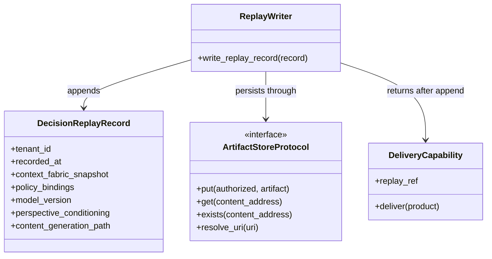
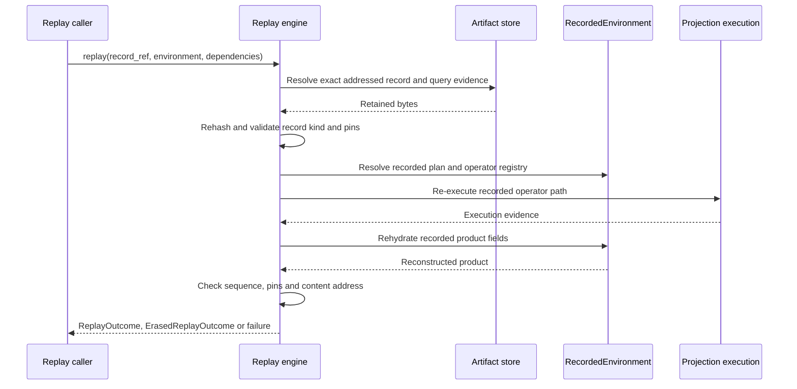
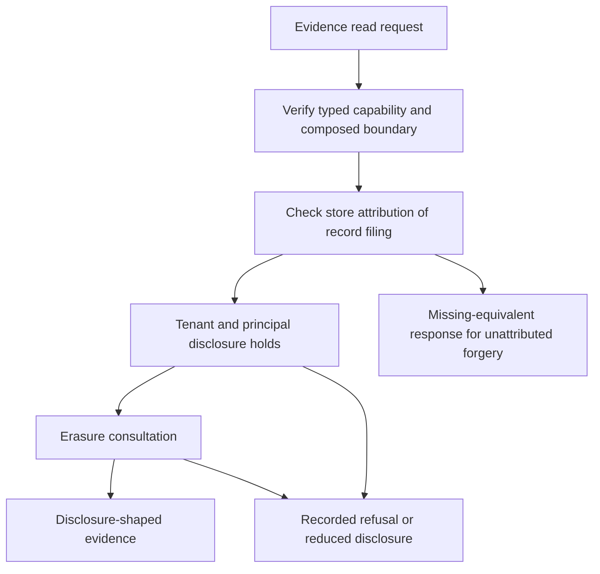
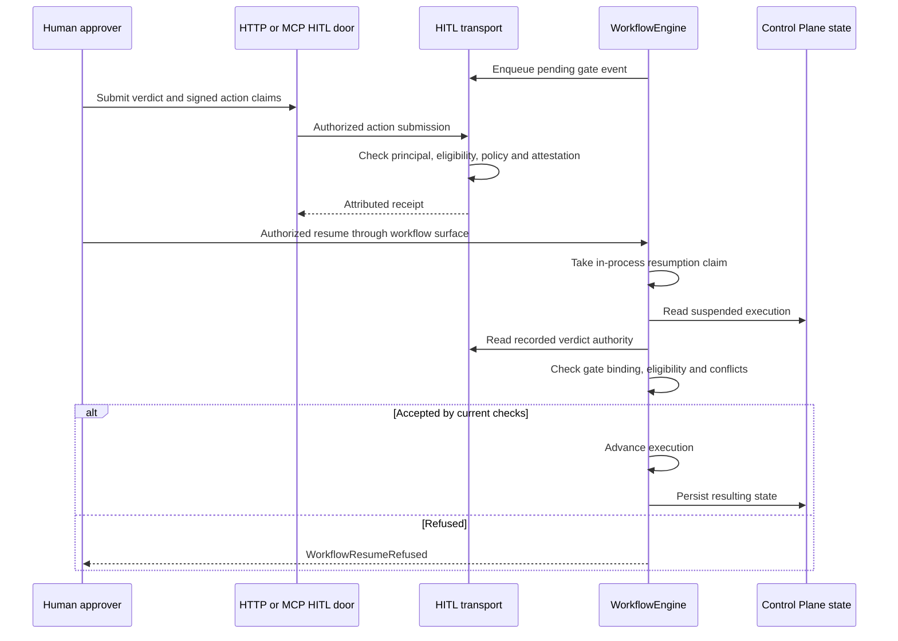

# Replay, authorization and human-control design

**SDK source:** `ccf_code/main@f07e558ed04c81154687d7efcc6312591e7f6f7d` · **Inspected:** 2026-10-09.

[Design index](README.md) · [Source inventory and verification scope](10_SOURCE_INVENTORY.md)

## Evidence classes

The five evidence dimensions are graph context, policy bindings, model/version information, perspective conditioning and the content-generation path. The last includes execution evidence and outcome-specific information. A refusal is recorded using the same record family and writer; it does not manufacture a product to make the shapes look identical.

`ReplayWriter` holds composition-minted `Authorized[ReplayMint]` for one tenant and record class. A normal artifact-write capability is not interchangeable with this authority. Content hashing provides integrity identity; the governed evidence read additionally checks provenance and authorization.

Sources: [src/ccf/replay/record.py](https://github.com/drcastillo/ccf_code/blob/f07e558ed04c81154687d7efcc6312591e7f6f7d/src/ccf/replay/record.py); [src/ccf/replay/serve.py](https://github.com/drcastillo/ccf_code/blob/f07e558ed04c81154687d7efcc6312591e7f6f7d/src/ccf/replay/serve.py); [src/ccf/artifacts/protocol.py](https://github.com/drcastillo/ccf_code/blob/f07e558ed04c81154687d7efcc6312591e7f6f7d/src/ccf/artifacts/protocol.py); [src/ccf/authz/capability.py](https://github.com/drcastillo/ccf_code/blob/f07e558ed04c81154687d7efcc6312591e7f6f7d/src/ccf/authz/capability.py).

## Reconstructing a recorded outcome

The arrows group calls rather than promise one `get` operation. `replay_refusal` is the separate entry for a refusal record; it reconstructs and checks the recorded refusal path without returning a product. Retained child questions/contracts support composite replay. Neither path should substitute a current producer response for retained evidence.

`RecordedEnvironment` uses pinned record information and the deployment's supported composition seams. The replay fabric should be opened read-only when operating beside a live writer. Model outputs and recorded debt are not casually recalculated against today's world. Erasure consultation can change whether evidence is available for reconstruction; missing or withheld evidence must remain explicit.

Sources: [src/ccf/replay/engine.py](https://github.com/drcastillo/ccf_code/blob/f07e558ed04c81154687d7efcc6312591e7f6f7d/src/ccf/replay/engine.py); [src/ccf/replay/environment.py](https://github.com/drcastillo/ccf_code/blob/f07e558ed04c81154687d7efcc6312591e7f6f7d/src/ccf/replay/environment.py); [src/ccf/replay/snapshots.py](https://github.com/drcastillo/ccf_code/blob/f07e558ed04c81154687d7efcc6312591e7f6f7d/src/ccf/replay/snapshots.py); [src/ccf/erasure/store.py](https://github.com/drcastillo/ccf_code/blob/f07e558ed04c81154687d7efcc6312591e7f6f7d/src/ccf/erasure/store.py); [examples/dr-01-replay-a-governed-determination/README.md](https://github.com/drcastillo/ccf_code/blob/f07e558ed04c81154687d7efcc6312591e7f6f7d/examples/dr-01-replay-a-governed-determination/README.md).

## Governed read boundary

This is a selected control view, not a complete listing of handler branches. `govern_dereference` checks what the store says about who filed the record, not only what the record bytes claim about their tenant/principal. A store lacking the required attribution surface raises `UnattributableDeliveryBoundaryError`. The per-tenant erasure and authorization checks have their own responsibilities.

The raw artifact client lane and the governed evidence lane must be distinguished. The source security guide records limits around same-tenant record-shaped client artifacts and read-refusal attribution. This drawing must not be read as a blanket statement that every artifact read is governed by the same controls.

Sources: [runtime/ccf_runtime/authz/delivery_boundary.py](https://github.com/drcastillo/ccf_code/blob/f07e558ed04c81154687d7efcc6312591e7f6f7d/runtime/ccf_runtime/authz/delivery_boundary.py); [runtime/ccf_runtime/mcp/artifact_server.py](https://github.com/drcastillo/ccf_code/blob/f07e558ed04c81154687d7efcc6312591e7f6f7d/runtime/ccf_runtime/mcp/artifact_server.py); [runtime/ccf_runtime/http_api/routes/replay.py](https://github.com/drcastillo/ccf_code/blob/f07e558ed04c81154687d7efcc6312591e7f6f7d/runtime/ccf_runtime/http_api/routes/replay.py); [public/how-to/security-and-deployment.md](https://github.com/drcastillo/ccf_code/blob/f07e558ed04c81154687d7efcc6312591e7f6f7d/public/how-to/security-and-deployment.md).

## Human approval and workflow resumption

Notification is separate: webhook delivery is notify-only and does not submit an authoritative verdict. The transport records human identity and signed action claims; the engine checks whether those recorded actions authorize this suspension.

**Concurrency limit at this pin:** the engine's resumption claim is in-process. `ControlPlaneStateStore` exposes `get`, `put` and `items`, not a cross-process compare-and-set operation. The deployed security guide also describes a rejection arriving after the verdict read and before commit as an open race. The sequence above therefore describes the current checks, not atomic approval consumption across processes or security-finding closure.

Sources: [src/ccf/hitl/transport.py](https://github.com/drcastillo/ccf_code/blob/f07e558ed04c81154687d7efcc6312591e7f6f7d/src/ccf/hitl/transport.py); [src/ccf/hitl/webhook.py](https://github.com/drcastillo/ccf_code/blob/f07e558ed04c81154687d7efcc6312591e7f6f7d/src/ccf/hitl/webhook.py); [src/ccf/controlplane/state.py](https://github.com/drcastillo/ccf_code/blob/f07e558ed04c81154687d7efcc6312591e7f6f7d/src/ccf/controlplane/state.py); [runtime/ccf_runtime/workflow/engine.py](https://github.com/drcastillo/ccf_code/blob/f07e558ed04c81154687d7efcc6312591e7f6f7d/runtime/ccf_runtime/workflow/engine.py); [runtime/ccf_runtime/http_api/routes/hitl.py](https://github.com/drcastillo/ccf_code/blob/f07e558ed04c81154687d7efcc6312591e7f6f7d/runtime/ccf_runtime/http_api/routes/hitl.py); [public/how-to/security-and-deployment.md](https://github.com/drcastillo/ccf_code/blob/f07e558ed04c81154687d7efcc6312591e7f6f7d/public/how-to/security-and-deployment.md).

## Design constraints for readers

| Topic | Constraint to retain in a design |
| --- | --- |
| Authorization | Use composition-issued typed capabilities; a principal string alone is not write authority. |
| Replay | Address exact evidence and configurations; an unresolved pin is not permission to use latest. |
| Persistence | Record before response; storage failure is not an auditable success. |
| Classification | Boot-minted classification authority is required on governed policy reads. |
| Withheld subjects | SEC-020 has implemented mitigations and documented remaining observable channels; no universal indistinguishability claim. |
| Approval | Signed and eligible actions do not by themselves solve state-transition races. |
| Release status | An implementation diagram does not approve a release or close a numbered vulnerability. |

For vulnerability dispositions, use the SDK's current decision record and security guide at the selected commit. This document is a source-derived design view, not a replacement security ledger.

Sources: [src/ccf/graph/governed_reader.py](https://github.com/drcastillo/ccf_code/blob/f07e558ed04c81154687d7efcc6312591e7f6f7d/src/ccf/graph/governed_reader.py); [public/reference/controls-register.md](https://github.com/drcastillo/ccf_code/blob/f07e558ed04c81154687d7efcc6312591e7f6f7d/public/reference/controls-register.md); [docs/DECISIONS.md](https://github.com/drcastillo/ccf_code/blob/f07e558ed04c81154687d7efcc6312591e7f6f7d/docs/DECISIONS.md).

## Latest decision-log status

The 9 October main decision log records 24 of 29, with SEC-001, SEC-013, SEC-020, SEC-027 and SEC-029 open. Further record-reader integrity, stable approval/store identity, recoverable audit rows, declaration persistence and SQLite identity locks are authorized integration work. The diagrams above retain the actual main implementation, including the in-process workflow claim and its limits. See [SDK update status](../SDK_UPDATE_STATUS.md).
