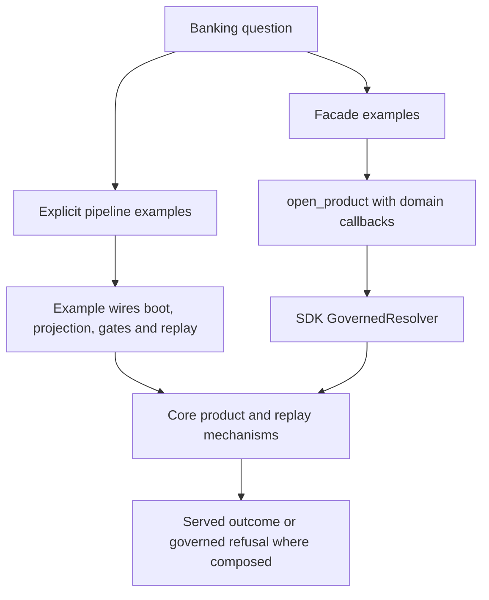
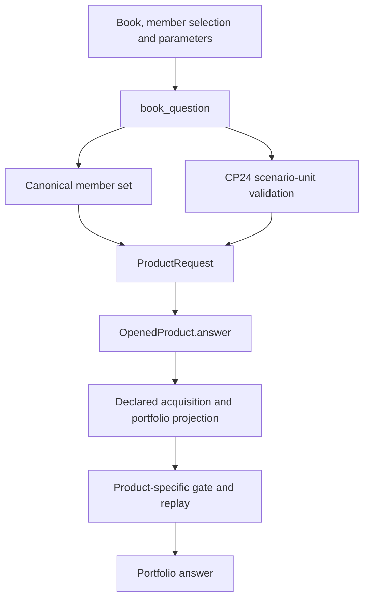

# Example implementation design map

**SDK source:** `ccf_code/main@f07e558ed04c81154687d7efcc6312591e7f6f7d` · **Inspected:** 2026-10-09.

[Design index](README.md) · [Source inventory and verification scope](10_SOURCE_INVENTORY.md)

## What this map classifies

The SDK examples are not one identical implementation copied into different banking domains. The tree contains direct compositions, facade-based products, historical/canonical pairs, consumer/harness demonstrations, peering producers and replay examples. The table below is generated from the pinned tree, parsed declarations and the inspected entry-point calls.

“Facade” means an inspected Python entry point calls `open_product`. “Direct resolver” means it calls `build_governed_resolver` without `open_product`. “Explicit pipeline” means it composes boot/projection/gates/serve directly. These are source shapes, not runtime qualification results. A module under `examples/` may still require migration to match newly required security arguments.

## Two producer shapes

CP01 shows the explicit pipeline: `produce.assemble_and_serve` composes the individual mechanisms and its scenario seam. CP14, CP23 and CP24 show the facade in their `produce.py`. The explicit path's return types and error handling are not automatically identical to `OpenedProduct.answer`; for instance CP01 names its own `AnchorUnresolvable` value.

Sources: [examples/cp-01-counterparty-reference-snapshot/produce.py](https://github.com/drcastillo/ccf_code/blob/f07e558ed04c81154687d7efcc6312591e7f6f7d/examples/cp-01-counterparty-reference-snapshot/produce.py); [examples/cp-14-credit-memo-context/produce.py](https://github.com/drcastillo/ccf_code/blob/f07e558ed04c81154687d7efcc6312591e7f6f7d/examples/cp-14-credit-memo-context/produce.py); [examples/cp-23-portfolio-early-warning/produce.py](https://github.com/drcastillo/ccf_code/blob/f07e558ed04c81154687d7efcc6312591e7f6f7d/examples/cp-23-portfolio-early-warning/produce.py); [examples/cp-24-portfolio-what-if/produce.py](https://github.com/drcastillo/ccf_code/blob/f07e558ed04c81154687d7efcc6312591e7f6f7d/examples/cp-24-portfolio-what-if/produce.py).

## Portfolio question boundary: CP23 and CP24

The CP24 validation branch applies to CP24 only. The membership is semantically a set, so the example canonicalizes it before constructing the request. CP24 also rejects noncanonical scenario magnitudes at that boundary. Its source explicitly distinguishes this local validation failure from a governed refusal with replay evidence.

Neither declaration has a `product_class.requires` list at this pin. Their portfolio aggregation therefore must not be drawn as a generic composite child-product fan-out merely because multiple obligors are involved. CP14 and CP20 supply the contrasting declared-requirement designs.

Sources: [examples/cp-23-portfolio-early-warning/produce.py](https://github.com/drcastillo/ccf_code/blob/f07e558ed04c81154687d7efcc6312591e7f6f7d/examples/cp-23-portfolio-early-warning/produce.py); [examples/cp-23-portfolio-early-warning/ccf_config.yaml](https://github.com/drcastillo/ccf_code/blob/f07e558ed04c81154687d7efcc6312591e7f6f7d/examples/cp-23-portfolio-early-warning/ccf_config.yaml); [examples/cp-24-portfolio-what-if/produce.py](https://github.com/drcastillo/ccf_code/blob/f07e558ed04c81154687d7efcc6312591e7f6f7d/examples/cp-24-portfolio-what-if/produce.py); [examples/cp-24-portfolio-what-if/ccf_config.yaml](https://github.com/drcastillo/ccf_code/blob/f07e558ed04c81154687d7efcc6312591e7f6f7d/examples/cp-24-portfolio-what-if/ccf_config.yaml).

## Complete top-level example map

The product class and backend below come from each available `ccf_config.yaml`; a dash means no such top-level declaration was read for that tree, not that the example has no configuration. A SQLite fabric can still acquire from PostgreSQL, MongoDB or Fluree sources. Refer to the linked deployment/environment files for that separate source topology.

| Example tree | Declared product class | Fabric backend | Observed entry-point shape | Source |
| --- | --- | --- | --- | --- |
| `cp-00-institutional-holders` | `holdings.institutional-holders` | sqlite | Explicit pipeline | [produce.py](https://github.com/drcastillo/ccf_code/blob/f07e558ed04c81154687d7efcc6312591e7f6f7d/examples/cp-00-institutional-holders/produce.py); [declaration](https://github.com/drcastillo/ccf_code/blob/f07e558ed04c81154687d7efcc6312591e7f6f7d/examples/cp-00-institutional-holders/ccf_config.yaml) |
| `cp-01-counterparty-reference-snapshot` | `reference.counterparty` | sqlite | Explicit pipeline | [produce.py](https://github.com/drcastillo/ccf_code/blob/f07e558ed04c81154687d7efcc6312591e7f6f7d/examples/cp-01-counterparty-reference-snapshot/produce.py); [declaration](https://github.com/drcastillo/ccf_code/blob/f07e558ed04c81154687d7efcc6312591e7f6f7d/examples/cp-01-counterparty-reference-snapshot/ccf_config.yaml) |
| `cp-02-facility-terms-snapshot` | `reference.facility` | sqlite | Explicit pipeline | [produce.py](https://github.com/drcastillo/ccf_code/blob/f07e558ed04c81154687d7efcc6312591e7f6f7d/examples/cp-02-facility-terms-snapshot/produce.py); [declaration](https://github.com/drcastillo/ccf_code/blob/f07e558ed04c81154687d7efcc6312591e7f6f7d/examples/cp-02-facility-terms-snapshot/ccf_config.yaml) |
| `cp-03-canonical-obligor-financial-spread` | `credit-risk.spread` | sqlite | Facade | [produce.py](https://github.com/drcastillo/ccf_code/blob/f07e558ed04c81154687d7efcc6312591e7f6f7d/examples/cp-03-canonical-obligor-financial-spread/produce.py); [declaration](https://github.com/drcastillo/ccf_code/blob/f07e558ed04c81154687d7efcc6312591e7f6f7d/examples/cp-03-canonical-obligor-financial-spread/ccf_config.yaml) |
| `cp-03-obligor-financial-spread` | `credit-risk.spread` | sqlite | Explicit pipeline | [produce.py](https://github.com/drcastillo/ccf_code/blob/f07e558ed04c81154687d7efcc6312591e7f6f7d/examples/cp-03-obligor-financial-spread/produce.py); [declaration](https://github.com/drcastillo/ccf_code/blob/f07e558ed04c81154687d7efcc6312591e7f6f7d/examples/cp-03-obligor-financial-spread/ccf_config.yaml) |
| `cp-04-canonical-corporate-family-tree` | `reference.corporate-family` | sqlite | Facade | [produce.py](https://github.com/drcastillo/ccf_code/blob/f07e558ed04c81154687d7efcc6312591e7f6f7d/examples/cp-04-canonical-corporate-family-tree/produce.py); [declaration](https://github.com/drcastillo/ccf_code/blob/f07e558ed04c81154687d7efcc6312591e7f6f7d/examples/cp-04-canonical-corporate-family-tree/ccf_config.yaml) |
| `cp-04-corporate-family-tree` | `reference.corporate-family` | sqlite | Explicit pipeline | [produce.py](https://github.com/drcastillo/ccf_code/blob/f07e558ed04c81154687d7efcc6312591e7f6f7d/examples/cp-04-corporate-family-tree/produce.py); [declaration](https://github.com/drcastillo/ccf_code/blob/f07e558ed04c81154687d7efcc6312591e7f6f7d/examples/cp-04-corporate-family-tree/ccf_config.yaml) |
| `cp-05-credit-exposure-rollup` | `credit-risk.exposure-rollup` | sqlite | Direct resolver | [produce.py](https://github.com/drcastillo/ccf_code/blob/f07e558ed04c81154687d7efcc6312591e7f6f7d/examples/cp-05-credit-exposure-rollup/produce.py); [declaration](https://github.com/drcastillo/ccf_code/blob/f07e558ed04c81154687d7efcc6312591e7f6f7d/examples/cp-05-credit-exposure-rollup/ccf_config.yaml) |
| `cp-06-canonical-collateral-and-setoff-coverage` | `credit-risk.collateral-coverage` | sqlite | Facade | [produce.py](https://github.com/drcastillo/ccf_code/blob/f07e558ed04c81154687d7efcc6312591e7f6f7d/examples/cp-06-canonical-collateral-and-setoff-coverage/produce.py); [declaration](https://github.com/drcastillo/ccf_code/blob/f07e558ed04c81154687d7efcc6312591e7f6f7d/examples/cp-06-canonical-collateral-and-setoff-coverage/ccf_config.yaml) |
| `cp-06-collateral-and-setoff-coverage` | `credit-risk.collateral-coverage` | sqlite | Direct resolver | [produce.py](https://github.com/drcastillo/ccf_code/blob/f07e558ed04c81154687d7efcc6312591e7f6f7d/examples/cp-06-collateral-and-setoff-coverage/produce.py); [declaration](https://github.com/drcastillo/ccf_code/blob/f07e558ed04c81154687d7efcc6312591e7f6f7d/examples/cp-06-collateral-and-setoff-coverage/ccf_config.yaml) |
| `cp-07-client-360-coverage-graph` | `coverage.client-360` | sqlite | Direct resolver | [produce.py](https://github.com/drcastillo/ccf_code/blob/f07e558ed04c81154687d7efcc6312591e7f6f7d/examples/cp-07-client-360-coverage-graph/produce.py); [declaration](https://github.com/drcastillo/ccf_code/blob/f07e558ed04c81154687d7efcc6312591e7f6f7d/examples/cp-07-client-360-coverage-graph/ccf_config.yaml) |
| `cp-08-covenant-in-force-as-of` | `credit-risk.covenant-in-force` | sqlite | Direct resolver | [produce.py](https://github.com/drcastillo/ccf_code/blob/f07e558ed04c81154687d7efcc6312591e7f6f7d/examples/cp-08-covenant-in-force-as-of/produce.py); [declaration](https://github.com/drcastillo/ccf_code/blob/f07e558ed04c81154687d7efcc6312591e7f6f7d/examples/cp-08-covenant-in-force-as-of/ccf_config.yaml) |
| `cp-09-treasury-liquidity-position` | `treasury.liquidity-position` | sqlite | Direct resolver | [produce.py](https://github.com/drcastillo/ccf_code/blob/f07e558ed04c81154687d7efcc6312591e7f6f7d/examples/cp-09-treasury-liquidity-position/produce.py); [declaration](https://github.com/drcastillo/ccf_code/blob/f07e558ed04c81154687d7efcc6312591e7f6f7d/examples/cp-09-treasury-liquidity-position/ccf_config.yaml) |
| `cp-10-rating-and-spread-migration` | `credit-risk.rating-migration` | sqlite | Direct resolver | [produce.py](https://github.com/drcastillo/ccf_code/blob/f07e558ed04c81154687d7efcc6312591e7f6f7d/examples/cp-10-rating-and-spread-migration/produce.py); [declaration](https://github.com/drcastillo/ccf_code/blob/f07e558ed04c81154687d7efcc6312591e7f6f7d/examples/cp-10-rating-and-spread-migration/ccf_config.yaml) |
| `cp-11-credit-surveillance-early-warning` | `credit-risk.early-warning` | sqlite | Direct resolver | [produce.py](https://github.com/drcastillo/ccf_code/blob/f07e558ed04c81154687d7efcc6312591e7f6f7d/examples/cp-11-credit-surveillance-early-warning/produce.py); [declaration](https://github.com/drcastillo/ccf_code/blob/f07e558ed04c81154687d7efcc6312591e7f6f7d/examples/cp-11-credit-surveillance-early-warning/ccf_config.yaml) |
| `cp-12-fx-post-trade-reconciliation` | `markets.fx-reconciliation` | sqlite | Direct resolver | [produce.py](https://github.com/drcastillo/ccf_code/blob/f07e558ed04c81154687d7efcc6312591e7f6f7d/examples/cp-12-fx-post-trade-reconciliation/produce.py); [declaration](https://github.com/drcastillo/ccf_code/blob/f07e558ed04c81154687d7efcc6312591e7f6f7d/examples/cp-12-fx-post-trade-reconciliation/ccf_config.yaml) |
| `cp-13-canonical-covenant-cross-reference` | `credit-risk.covenant-cross-reference` | sqlite | Facade | [produce.py](https://github.com/drcastillo/ccf_code/blob/f07e558ed04c81154687d7efcc6312591e7f6f7d/examples/cp-13-canonical-covenant-cross-reference/produce.py); [declaration](https://github.com/drcastillo/ccf_code/blob/f07e558ed04c81154687d7efcc6312591e7f6f7d/examples/cp-13-canonical-covenant-cross-reference/ccf_config.yaml) |
| `cp-13-covenant-cross-reference` | `credit-risk.covenant-cross-reference` | sqlite | Direct resolver | [produce.py](https://github.com/drcastillo/ccf_code/blob/f07e558ed04c81154687d7efcc6312591e7f6f7d/examples/cp-13-covenant-cross-reference/produce.py); [declaration](https://github.com/drcastillo/ccf_code/blob/f07e558ed04c81154687d7efcc6312591e7f6f7d/examples/cp-13-covenant-cross-reference/ccf_config.yaml) |
| `cp-14-credit-memo-context` | `credit-risk.credit-memo-context` | sqlite | Facade; declared child requirements | [produce.py](https://github.com/drcastillo/ccf_code/blob/f07e558ed04c81154687d7efcc6312591e7f6f7d/examples/cp-14-credit-memo-context/produce.py); [declaration](https://github.com/drcastillo/ccf_code/blob/f07e558ed04c81154687d7efcc6312591e7f6f7d/examples/cp-14-credit-memo-context/ccf_config.yaml) |
| `cp-15-kyc-refresh-beneficial-ownership` | `compliance.beneficial-ownership` | sqlite | Facade | [produce.py](https://github.com/drcastillo/ccf_code/blob/f07e558ed04c81154687d7efcc6312591e7f6f7d/examples/cp-15-kyc-refresh-beneficial-ownership/produce.py); [declaration](https://github.com/drcastillo/ccf_code/blob/f07e558ed04c81154687d7efcc6312591e7f6f7d/examples/cp-15-kyc-refresh-beneficial-ownership/ccf_config.yaml) |
| `cp-16-abs-securitization-surveillance` | `cib.abs-surveillance` | sqlite | Facade | [produce.py](https://github.com/drcastillo/ccf_code/blob/f07e558ed04c81154687d7efcc6312591e7f6f7d/examples/cp-16-abs-securitization-surveillance/produce.py); [declaration](https://github.com/drcastillo/ccf_code/blob/f07e558ed04c81154687d7efcc6312591e7f6f7d/examples/cp-16-abs-securitization-surveillance/ccf_config.yaml) |
| `cp-17-mnpi-wall-enforcement` | `cib.mnpi-wall` | sqlite | Facade | [produce.py](https://github.com/drcastillo/ccf_code/blob/f07e558ed04c81154687d7efcc6312591e7f6f7d/examples/cp-17-mnpi-wall-enforcement/produce.py); [declaration](https://github.com/drcastillo/ccf_code/blob/f07e558ed04c81154687d7efcc6312591e7f6f7d/examples/cp-17-mnpi-wall-enforcement/ccf_config.yaml) |
| `cp-18-ib-opportunity-synthesis` | `cib.opportunity-synthesis` | sqlite | Facade | [produce.py](https://github.com/drcastillo/ccf_code/blob/f07e558ed04c81154687d7efcc6312591e7f6f7d/examples/cp-18-ib-opportunity-synthesis/produce.py); [declaration](https://github.com/drcastillo/ccf_code/blob/f07e558ed04c81154687d7efcc6312591e7f6f7d/examples/cp-18-ib-opportunity-synthesis/ccf_config.yaml) |
| `cp-19-aml-typology-match` | `compliance.aml-typology` | sqlite | Facade | [produce.py](https://github.com/drcastillo/ccf_code/blob/f07e558ed04c81154687d7efcc6312591e7f6f7d/examples/cp-19-aml-typology-match/produce.py); [declaration](https://github.com/drcastillo/ccf_code/blob/f07e558ed04c81154687d7efcc6312591e7f6f7d/examples/cp-19-aml-typology-match/ccf_config.yaml) |
| `cp-20-syndicated-lending-co-lender` | `cb.syndicate-co-lender` | sqlite | Facade; declared child requirements | [produce.py](https://github.com/drcastillo/ccf_code/blob/f07e558ed04c81154687d7efcc6312591e7f6f7d/examples/cp-20-syndicated-lending-co-lender/produce.py); [declaration](https://github.com/drcastillo/ccf_code/blob/f07e558ed04c81154687d7efcc6312591e7f6f7d/examples/cp-20-syndicated-lending-co-lender/ccf_config.yaml) |
| `cp-21-large-exposure` | `risk.large-exposure` | sqlite | Facade | [produce.py](https://github.com/drcastillo/ccf_code/blob/f07e558ed04c81154687d7efcc6312591e7f6f7d/examples/cp-21-large-exposure/produce.py); [declaration](https://github.com/drcastillo/ccf_code/blob/f07e558ed04c81154687d7efcc6312591e7f6f7d/examples/cp-21-large-exposure/ccf_config.yaml) |
| `cp-22-agent-internal-assembly` | `—` | — | External A2A agent; consumes CP21 internally | [run.py](https://github.com/drcastillo/ccf_code/blob/f07e558ed04c81154687d7efcc6312591e7f6f7d/examples/cp-22-agent-internal-assembly/run.py) |
| `cp-23-portfolio-early-warning` | `cib.portfolio-early-warning` | sqlite | Facade | [produce.py](https://github.com/drcastillo/ccf_code/blob/f07e558ed04c81154687d7efcc6312591e7f6f7d/examples/cp-23-portfolio-early-warning/produce.py); [declaration](https://github.com/drcastillo/ccf_code/blob/f07e558ed04c81154687d7efcc6312591e7f6f7d/examples/cp-23-portfolio-early-warning/ccf_config.yaml) |
| `cp-24-portfolio-what-if` | `cib.portfolio-what-if` | sqlite | Facade | [produce.py](https://github.com/drcastillo/ccf_code/blob/f07e558ed04c81154687d7efcc6312591e7f6f7d/examples/cp-24-portfolio-what-if/produce.py); [declaration](https://github.com/drcastillo/ccf_code/blob/f07e558ed04c81154687d7efcc6312591e7f6f7d/examples/cp-24-portfolio-what-if/ccf_config.yaml) |
| `door-cp-05-credit-exposure-rollup` | `—` | — | Standalone producer door | [run.py](https://github.com/drcastillo/ccf_code/blob/f07e558ed04c81154687d7efcc6312591e7f6f7d/examples/door-cp-05-credit-exposure-rollup/run.py) |
| `dr-01-replay-a-governed-determination` | `—` | — | Replay reconstruction demonstration | [README.md](https://github.com/drcastillo/ccf_code/blob/f07e558ed04c81154687d7efcc6312591e7f6f7d/examples/dr-01-replay-a-governed-determination/README.md) |
| `dr-02-package-a-context-product` | `credit-risk.packaged-memo` | sqlite | Facade | [produce.py](https://github.com/drcastillo/ccf_code/blob/f07e558ed04c81154687d7efcc6312591e7f6f7d/examples/dr-02-package-a-context-product/produce.py); [declaration](https://github.com/drcastillo/ccf_code/blob/f07e558ed04c81154687d7efcc6312591e7f6f7d/examples/dr-02-package-a-context-product/ccf_config.yaml) |
| `external` | `—` | — | External adapter examples | [README.md](https://github.com/drcastillo/ccf_code/blob/f07e558ed04c81154687d7efcc6312591e7f6f7d/examples/external/README.md) |
| `hw1-companies-over-revenue` | `—` | — | Supporting example; follow linked entry | [README.md](https://github.com/drcastillo/ccf_code/blob/f07e558ed04c81154687d7efcc6312591e7f6f7d/examples/hw1-companies-over-revenue/README.md) |
| `hw1-harness-clients` | `—` | — | Consumer harness clients | [README.md](https://github.com/drcastillo/ccf_code/blob/f07e558ed04c81154687d7efcc6312591e7f6f7d/examples/hw1-harness-clients/README.md) |
| `peer-cp-20-co-lender` | `cb.co-lender-position` | sqlite | Facade | [produce.py](https://github.com/drcastillo/ccf_code/blob/f07e558ed04c81154687d7efcc6312591e7f6f7d/examples/peer-cp-20-co-lender/produce.py); [declaration](https://github.com/drcastillo/ccf_code/blob/f07e558ed04c81154687d7efcc6312591e7f6f7d/examples/peer-cp-20-co-lender/ccf_config.yaml) |
| `s1-00-companies-over-revenue` | `hw1.companies-over-revenue` | postgres | Direct resolver | [produce.py](https://github.com/drcastillo/ccf_code/blob/f07e558ed04c81154687d7efcc6312591e7f6f7d/examples/s1-00-companies-over-revenue/produce.py); [declaration](https://github.com/drcastillo/ccf_code/blob/f07e558ed04c81154687d7efcc6312591e7f6f7d/examples/s1-00-companies-over-revenue/ccf_config.yaml) |
| `s1-01-hello-context-product` | `—` | — | Direct resolver | [run.py](https://github.com/drcastillo/ccf_code/blob/f07e558ed04c81154687d7efcc6312591e7f6f7d/examples/s1-01-hello-context-product/run.py) |

## Reading variants and evidence

The `canonical` variants of CP03, CP04, CP06 and CP13 coexist with their earlier trees. Their existence does not mean their payloads, declarations or deployment requirements are interchangeable. Keep a design linked to its exact directory and specification.

Use these focused routes:

- **Source versus fabric:** CP01's `deployment.py` and `produce.py`.
- **Facade and domain gate:** CP23/CP24's `product`, `book_question`, `plan_factory` and deployment gate.
- **Declared composition:** CP14's requirements, `MemoQuestions` and `MemoPlanFactory.build_with_children`.
- **Federated child:** CP20's `FederatedChildren` and the `peer-cp-20-co-lender` producer.
- **Agent-owned answer:** CP22's `_assemble` and `_answer_from`.
- **Evidence reconstruction:** DR01 and the core replay engine; DR02 for packaged-product context.

Existing implementation walkthroughs and business-to-spec companions remain in [the reference examples folder](../05-reference/02-context-product-producer/examples/ANALYSIS_INDEX.md). Those documents have their own source baselines. This design map does not silently requalify them or update their embedded source snapshots.
