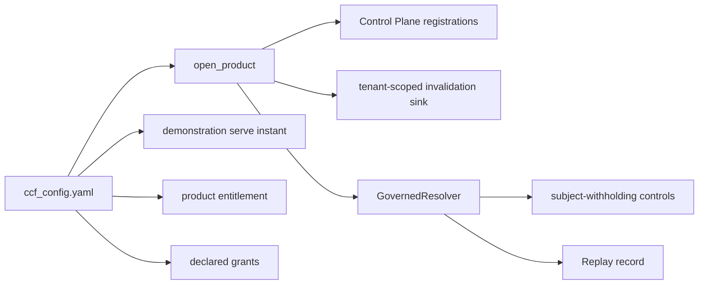
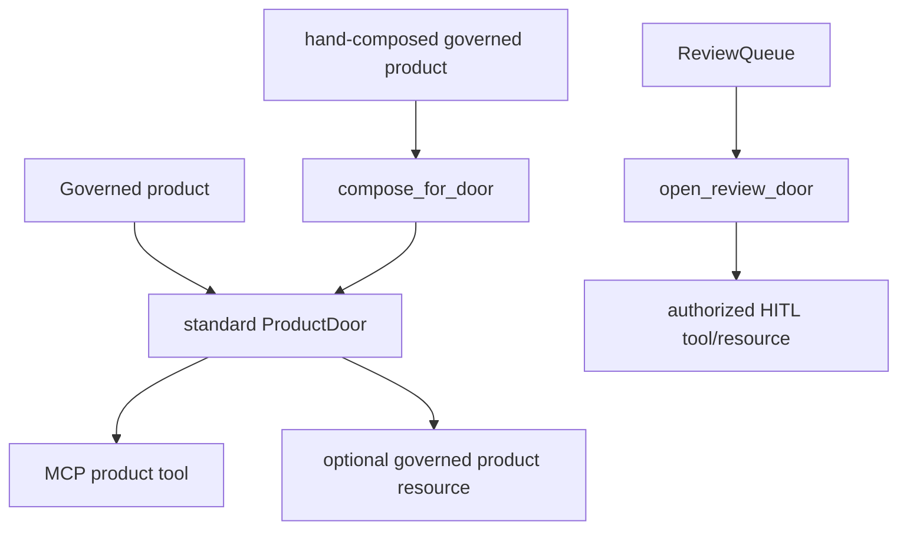
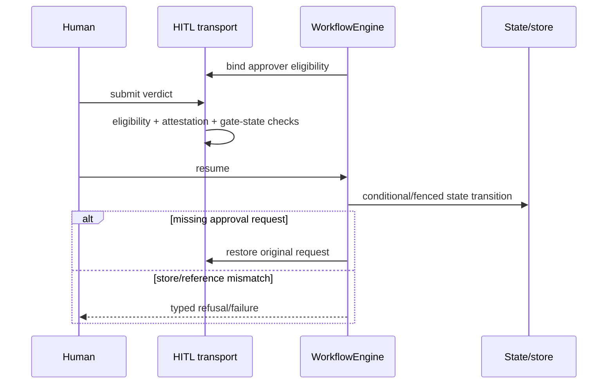

# Current-main design delta — 17 October 2026

**Current SDK source:** `ccf_code/v1.0.2@5f85b389efe9e4b1de62e84a5af62ca4b2e12178`\
**Static design reconstruction baseline:** `ccf_code@f07e558ed04c81154687d7efcc6312591e7f6f7d` (inspected 9 October 2026)

This page is the current-main overlay for the source-derived design package. The Oct-9 documents and their source/hash inventory remain intact as a reproducible static reconstruction; the changes below are the architectural deltas that landed afterward.

## Public topology delta

The committed public manifest changed **233 → 243 modules**.

New public modules since the design snapshot:

- `ccf.controlplane.demonstration_serve_instant`
- `ccf.erasure.subject_match`
- `ccf.products.demonstration_clock`
- `ccf.products.subject_disclosure`
- `ccf.replay.provenance`
- `ccf_runtime.mcp.composed_product`
- `ccf_runtime.mcp.review_door`
- `ccf.replay.evidence`
- `ccf.replay.inspection`
- `ccf_runtime.cli.evidence`

The Oct-13 comparison reported 41 changed existing module entries; the subsequent Oct-13→Oct-17 comparison adds three modules and changes seven existing entries. These counts are comparisons of separate intervals, not additive unique-module counts. Use the [current public surface](../05-reference/05-technical-reference/PUBLIC_SURFACE_INDEX.md) for exact names.

## Product composition delta

The current paved road now composes additional governance at open:

Key changes:

- declared demonstration time can drive a dated development question;
- multi-principal entitlement is configuration, not a hand-written registry mutation;
- declared skill grants are requested through the governed ledger at composition;
- request-scoped child factories can consume the SDK-derived declared chain;
- `subject_withholding` is a product-class declaration with additional construction/runtime checks;
- evidence after the decision instant becomes a governed refusal.

## Delivery-surface delta

The standard door can expose the governed product resource. Hand-composed governed products use `compose_for_door` rather than per-example conformers. Human review release/reject has a separate authorized review door.

The product HTTP/MCP path also aligns the external response for an undeclared class with the unentitled-caller disclosure posture while preserving the internal authorization denial in audit/Replay.

## Evidence-integrity delta

Current main distinguishes three related checks:

1. **bytes** — integrity-sensitive readers re-hash bytes against the address before use;
2. **returned reference** — writers verify the store returned the exact `ArtifactRef` of what was written;
3. **record provenance** — governed evidence proves filing by the governed record writer/tenant, not merely a matching record shape.

Named current failures include `ChildRecordAltered`, `ReplayReferenceMismatch`, `QueryPinReferenceMismatch`, `ChildQuestionReferenceMismatch`, `AdmissionRecordReferenceMismatch`, and `WorkflowTraceReferenceMismatch`.

The Control Plane registry now retains write-verified bytes with its protected reconstruction and parses/verifies those bytes on reads.

## Invalidation and erasure delta

Invalidation storage changed from one whole-tenant register to one record per `(tenant, entity)`, with a narrowly scoped `InvalidationRecordRegister` authority.

Erasure gained subject-match/door-naming contracts and MCP surfaces so an erasure path can determine what an artifact names without treating the operation as a general artifact read.

## SQLite/store lifecycle delta

SQLite current main adds two important file-identity controls:

- optional declared identity-lock directory keyed by the opened DB file's device/inode;
- refusal of a multi-name/hard-linked DB **at store open**, including read-only opens.

Deployment-store creation is separately guarded by a two-phase verified marker and a creation lock. `store_creation_lock_wait_seconds` has no SDK default: absent means refuse immediately when another boot holds the lock; present means bounded wait.

## HITL/workflow delta

The engine binds its Control Plane into the transport's approver-eligibility judgment. Gate closure is explicit. A suspended execution whose approval request was lost can restore the original request without rerunning the step/effect. Concurrent/stale state work can be `ExecutionFenced`.

## SEC-020 design delta

Current main includes:

- positive declaration required for `subject_withholding: never`;
- an unheld-subject probe verified absent before the real subject phase;
- population vs subject-keyed acquisition separation;
- question-store/question-fabric freshness and exclusivity checks;
- early-policy/request-aware-child constraints;
- stand-in/held-subject checks;
- Replay evidence for executed seeds, withholding stance and issuance.

These are implementation controls, not a claim of universal subject indistinguishability or a security-identifier closure.

## How to read the design package now

- Use documents 01–10 for the **Oct-9 static architecture reconstruction** and its exact source/hash evidence.
- Use this page for **post-snapshot architectural changes**.
- Use [SDK Update Status](../SDK_UPDATE_STATUS.md) for migration detail.
- Use the [technical reference](../05-reference/05-technical-reference/README.md) for exact current behavior/API/security semantics.

## Context Skills and durable replay — 17 October additions

SK-01 demonstrates YAML-declared Context Skills: policy, catalog entry, producer binding, agent and grant establish authority to ask a child Context Product. They are not model tools. Dimension 4 now names the composing agent and grant-set identity on served and refused decisions; admitted child rows carry skill/version/grant evidence. Full grant membership/requirements are not recoverable from the record alone.

`evidence_root` separates retained question graphs/records/indexes from scratch. Launcher inspection uses `read_sources=False`; composite replay now restores plan, lineage and expiry from retained children without producer calls, including the zero-admitted-child path. Fluree is pinned to **4.2.4**.

See [Context Skills and replay design](12_CONTEXT_SKILLS_AND_REPLAY_DESIGN.md) for module, class and sequence views, and [current scoped security status](../05-reference/05-technical-reference/SECURITY_AND_AUTHORIZATION.md#current-security-disposition-and-exact-delivery-scope--17-october-2026) for SEC-020/030 and build boundaries.

## SDK 1.0.2 additions — 18 October reconciliation

The release adds permanent state-store identity to workflow records, per-pause request deduplication/judgment, atomic request retirement and explicit rebind of pre-upgrade suspensions. Custom process-scoped stores/queues must expose and hold lifetime leases. Four existing manifest modules change; no modules are added. `FileArtifactStore` now protects name-index updates with a blocking file lock and uses unique staging paths. See [migration requirements](../05-reference/05-technical-reference/MIGRATION_AND_LIMITATIONS.md).

The inspected merged main has the same runtime/examples/configuration as `v1.0.2`; later changes are handoff and release documentation. This overlay does not rewrite the Oct-9 architecture snapshot.
