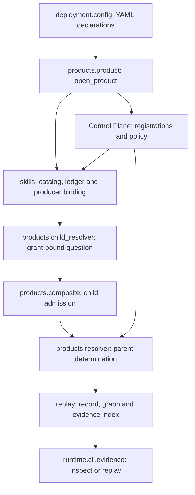
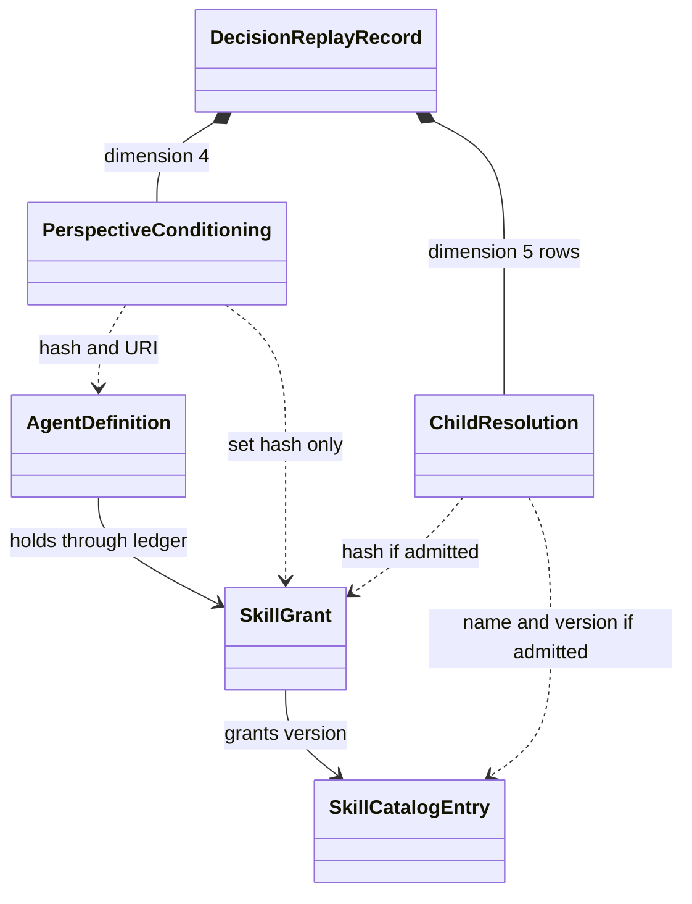
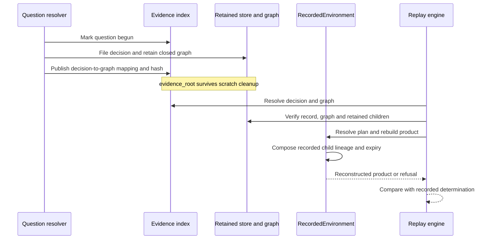

# Context Skills and retained replay design

**Source baseline:** `ccf_code/v1.0.2@5f85b389efe9e4b1de62e84a5af62ca4b2e12178` — 17 October 2026. This page extends the historical design inventory; it does not repin that inventory's source hashes.

## Module responsibilities

The catalog specifies the capability; the ledger requests a policy-compatible grant at composition. The child resolver binds dispatch to the grant and producer. Admission verifies the returned product before the parent composes it. None of these steps makes `mcp_product` a model tool.

## Contract relationships

These are conceptual references, not extra model fields or inheritance. The record identifies authority but does not embed every grant member or skill requirement. SK-01's catalog/grant state is in memory. Refused child rows lack the admitted skill/grant evidence; a pre-child refusal can have no rows.

## Retained-evidence lifecycle

Interrupted questions can leave pending markers without a completed record. The retained index/graphs do not guarantee OS-crash durability of the file-backed record bytes. No automatic cleanup is provided. Reconstruction does not call live producers, but still needs compatible code, configuration and retained artifacts. Composite opening with `read_sources=False` currently still requires declared producer endpoint/credential settings.

## Source and operating references

- [SK-01 configuration](https://github.com/drcastillo/ccf_code/blob/5f85b389efe9e4b1de62e84a5af62ca4b2e12178/examples/sk-01-declare-and-govern-agent-skills/ccf_config.yaml) and [question mapping](https://github.com/drcastillo/ccf_code/blob/5f85b389efe9e4b1de62e84a5af62ca4b2e12178/examples/sk-01-declare-and-govern-agent-skills/deployment.py)
- [Product lifecycle](https://github.com/drcastillo/ccf_code/blob/5f85b389efe9e4b1de62e84a5af62ca4b2e12178/src/ccf/products/product.py), [grant ledger](https://github.com/drcastillo/ccf_code/blob/5f85b389efe9e4b1de62e84a5af62ca4b2e12178/src/ccf/skills/grants.py), [record contracts](https://github.com/drcastillo/ccf_code/blob/5f85b389efe9e4b1de62e84a5af62ca4b2e12178/src/ccf/replay/record.py)
- [Evidence index](https://github.com/drcastillo/ccf_code/blob/5f85b389efe9e4b1de62e84a5af62ca4b2e12178/src/ccf/replay/evidence.py), [recorded environment](https://github.com/drcastillo/ccf_code/blob/5f85b389efe9e4b1de62e84a5af62ca4b2e12178/src/ccf/replay/environment.py), [inspection](https://github.com/drcastillo/ccf_code/blob/5f85b389efe9e4b1de62e84a5af62ca4b2e12178/src/ccf/replay/inspection.py)
- [Context Skills reference](../05-reference/05-technical-reference/CONTEXT_SKILLS.md), [Decision Replay](../05-reference/05-technical-reference/DECISION_REPLAY.md), [SK-01 analysis](../05-reference/02-context-product-producer/examples/SK01_DECLARE_AND_GOVERN_AGENT_SKILLS_ANALYSIS.md)
