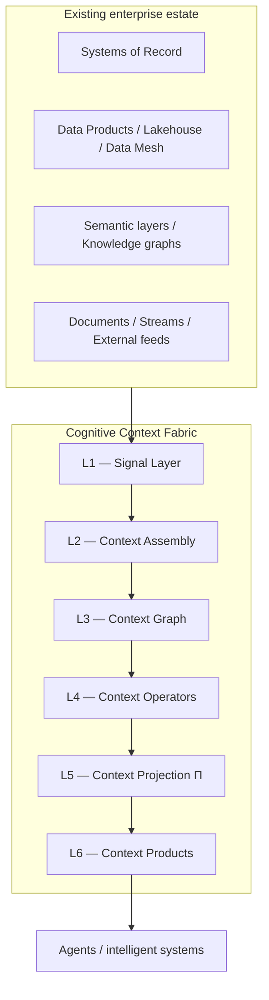
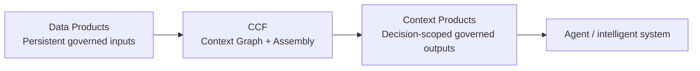

# Architecture at a Glance

## CCF in one picture

The Cognitive Context Fabric sits between the governed enterprise data estate and the agent/runtime layer.

The flow is useful for orientation, but the six layers are **responsibility boundaries rather than a simple one-way pipeline**. The graph persists decision state; operators may compose repeatedly over it; projection shapes the result for the consuming principal; policy and control cut across the stack.

---

## From records to cognition

CCF extends an existing architectural progression:

| Responsibility | Primary question | Examples |
|---|---|---|
| **Systems of Record** | What happened? | ledgers, client systems, operational platforms, transaction systems |
| **Systems of Signal Generation** | What governed signal is available? | lakehouses, Data Products, semantic layers, feature stores, knowledge graphs, document stores |
| **Systems of Cognition** | What does this mean for this decision now? | CCF context assembly, graph state, operators, projection, Context Products |

The first two tiers remain foundational. CCF adds the third responsibility rather than replacing the first two.

---

## The Context Graph

The state model is:

`G(E, R, T, P, Π, L)`

### E — Entities

The objects in the decision domain: clients, accounts, instruments, facilities, counterparties, people, cases, and other semantic anchors.

### R — Relationships

The connections that make isolated facts meaningful: ownership, exposure, dependency, influence, participation, guarantee, hierarchy, and other typed relationships.

### T — Time

Temporal validity: not merely when data was loaded, but what was valid when, what was known when, and whether a signal remains fit for the decision.

### P — Policy

Regulatory, institutional, jurisdictional, entitlement, and decision constraints that shape what context may be assembled and what actions are permitted.

### Π — Perspective / Projection

Typed role-conditioned transformation. The same underlying state may need to become a different decision artifact for a credit officer, relationship manager, operations analyst, or control function.

Projection is **not simply RBAC filtering**. It shapes meaning and structure for the consuming principal.

### L — Lineage

The evidence chain behind the context: which signals, sources, transformations, operators, policies, and versions produced the artifact.

---

## L1–L6 responsibility model

### L1 — Signal Layer

**Owns:** normalized observations.

Structured and unstructured signals enter together from operational systems, databases, events, documents, market/external feeds, and other governed sources.

L1 records provenance and temporal markers. It does not decide what the signal means for the business decision.

### L2 — Context Assembly

**Owns:** construction of typed graph state.

This is where semantic resolution, relationship construction, temporal stitching, policy binding, and assembly logic converge.

### L3 — Context Graph

**Owns:** persisted, typed context state.

The graph holds the entities, relationships, time, policy, perspective state, and lineage that downstream computation can reason over and reconstruct historically.

### L4 — Context Operators

**Owns:** typed computation over context.

Operators include traversal, temporal, policy, similarity, and other bounded compositions. They are designed to be named, inspectable, and replayable rather than ad-hoc hidden reasoning.

### L5 — Context Projection (Π)

**Owns:** principal- and intent-conditioned interpretation.

Projection transforms graph productions into the shape required for a specific decision and consumer while preserving the policy and temporal constraints of the frame.

### L6 — Context Products

**Owns:** governed delivery.

The agent receives a versioned, decision-ready product rather than direct access to the internal graph and assembly machinery.

---

## Control Plane and Data Plane

Two concerns cut across all six layers.

### Control Plane

Declares what the fabric is allowed to do and how it is parameterized:

- policy definitions;
- operator behavior;
- projection rules;
- entitlements;
- Context Debt thresholds;
- half-life calibration;
- materialization / assembly policies;
- versioned configuration and governance state.

### Data Plane

Executes the fabric continuously within those constraints:

- assembly;
- graph reads/writes through defined seams;
- operator execution;
- projection;
- Context Product serving.

This separation makes governance a runtime property rather than an after-the-fact review step.

---

## Data products to Context Products

CCF treats existing Data Products as governed substrate, not as a competing architecture.

The important distinction is the consumer contract:

| Data Product | Context Product |
|---|---|
| persistent reusable dataset | runtime-constructed decision artifact |
| consumer supplies interpretation | system supplies decision-ready meaning |
| refresh cadence | decision-time validity / TTL / per-claim freshness |
| schema-centered | `G(E,R,T,P,Π,L)`-conditioned |
| access governance | policy shaping during construction |
| reusable input | decision-scoped output |

The two are composition partners.

---

## Context Half-life and Context Debt

Not every claim decays at the same rate.

A market observation may become stale quickly. A legal relationship may remain valid until superseded. A quarterly filing may remain authoritative for one purpose while being too old for another.

**Context Half-life** represents that decay behavior per signal/claim.

**Context Debt** makes incomplete, stale, or insufficient context explicit rather than letting an agent silently reason as if the frame were complete.

The architectural intent is conservative: degraded context should influence serving, routing, refusal, or escalation rather than remain invisible.

---

## Decision Replay

Decision Replay reconstructs the decision environment, not merely a model transcript.

A replayable decision needs the relevant context state, policy versions, temporal frame, lineage, operator composition, and other evidence that determined what the agent was allowed to see and reason over.

That is the difference between “what did the model say?” and “what decision environment produced this action?”

---

## Layering, not replatforming

CCF is designed to compose over heterogeneous enterprise systems.

Typical integration may include:

- change-data-capture from operational systems;
- semantic/data-product metadata import;
- Context Product delivery through MCP or other bindings;
- A2A federation;
- structured and unstructured ingestion.

The existing estate remains authoritative for what it already owns. CCF adds the decision-context responsibility above it.

---

## Next

- [Start Here](START_HERE.md)
- [Why CCF](WHY_CCF.md)
- [Context Products](CONTEXT_PRODUCTS.md)
- [Resources](RESOURCES.md)

## Source provenance

Adapted from `drcastillo/ccf@ac81805d0e400da15f860eed8c39a132af3ce945`, primarily Chapter 5 §5.1–5.2, Chapter 6 §6.1–6.2, Chapter 7 §7.1–7.2, and Chapter 8 §8.2–8.3. The diagrams on this page are adoption-oriented simplifications; canonical architectural semantics remain in the whitepaper source.
