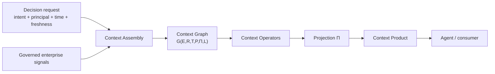

# Context Products

## The primary interface agents consume

A **Context Product** is a typed, governed, decision-ready unit of meaning constructed for a specific decision frame.

It is not simply another dataset, query response, retrieval result, or prompt payload.

A Context Product is shaped by:

- **Intent** — what decision or objective is driving the request.
- **Perspective (Π)** — who or what role is consuming it.
- **Time (T)** — what was valid, when, and what remains fit for use.
- **Policy (P)** — what may be assembled, surfaced, recommended, or acted upon.

Those conditions make the product decision-scoped rather than universally reusable in the same way as a persistent dataset.

---

## From Data Products to Context Products

Data Products remain essential.

They provide domain-owned, governed, discoverable, contract-backed datasets and signals. CCF does not replace that discipline.

The difference is the consumer and the moment of use.

### Data Products

Designed primarily as persistent, reusable governed inputs.

They answer questions such as:

- What data is available?
- What schema does it use?
- Who owns it?
- When is it refreshed?
- Who may access it?

### Context Products

Designed as decision-time outputs.

They answer questions such as:

- What matters for **this** decision?
- Which relationships must be traversed?
- Which signals are valid **now** or as-of the requested instant?
- Which policy regime applies?
- How should the context be shaped for **this** principal?
- What evidence supports each part of the answer?
- Is the context complete and fresh enough to serve?

**Data Products are necessary inputs. Context Products are decision-scoped outputs.**

---

## Derived, not stored

The canonical CCF posture is that Context Products are **derived from governed state for the decision being made**, rather than treated as another permanently materialized business dataset.

That matters because the product may change when any of these change:

- the decision intent;
- the consuming principal;
- the requested temporal instant;
- policy state;
- graph state;
- freshness / Context Debt;
- source availability or supersession.

A persisted dataset can remain unchanged while the correct Context Product changes.

---

## A simple mental model

The consumer should not need to understand every internal assembly step in order to use the product. That is why the adoption portal has distinct **Consume** and **Assemble** learning paths.

---

## What a Context Product carries conceptually

The whitepaper defines a contract-oriented delivery model. At a conceptual level, a product needs to make the following kinds of properties explicit:

- typed structure / schema;
- freshness expectations;
- bounded validity / TTL where applicable;
- policy binding;
- lineage;
- semantic versioning;
- discovery;
- addressability;
- assembly mode and other governed behavior where relevant.

The exact SDK classes, signatures, fields, and defaults are versioned implementation details and belong in the **Reference** section, not on this conceptual page.

---

## Why policy is part of construction

In CCF, policy is not simply a response filter applied after a universal product has already been assembled.

Policy can affect:

- which entities enter the frame;
- which relationships are traversable;
- which sources are admissible;
- which measures count under the requested intent;
- which actions are permitted;
- whether missing policy state forces refusal or degradation.

That is one of the reasons a Context Product is not interchangeable with a stored dataset plus RBAC.

---

## Why time is part of construction

A decision frame can contain signals with very different temporal semantics.

Examples include:

- a market observation from minutes ago;
- a legal term effective months earlier;
- an internal policy version with its own effectivity window;
- a quarterly financial statement;
- a relationship that remains valid until superseded.

The product must preserve those distinctions. It should not collapse everything into one timestamp or one simplistic “fresh/stale” flag.

---

## Why perspective is more than presentation

Different principals may require different structures from the same underlying graph state.

A relationship manager, credit officer, operations analyst, and control function can all be looking at the same entity while legitimately requiring different context shape, emphasis, and admissible relationships.

CCF calls that **Context Projection (Π)**.

Projection is a typed transformation of context, not merely a cosmetic rendering or a field filter.

---

## What happens when context is not good enough

A governed Context Product should be able to expose or act on insufficiency rather than hide it.

That is where concepts such as **Context Half-life**, **Context Debt**, product gates, refusal, and escalation become important.

The consumer should be able to distinguish:

- a valid product;
- a degraded but explicit product;
- a governed refusal;
- a transport/application failure.

The exact mechanics are taught later in **Build with CCF** and the SDK Reference.

---

## Where Context Products fit

Context Products are the bridge between the fabric and the systems that reason or act.

They may be consumed through multiple bindings or runtime surfaces, including in-process access, MCP, A2A, and other supported transports. The transport carries the product; it does not redefine the product's semantics.

This is why CCF can remain agent-framework-neutral.

---

## Next

- [Start Here](START_HERE.md)
- [Architecture at a Glance](ARCHITECTURE_AT_A_GLANCE.md)
- [Resources](RESOURCES.md)

Then continue to **Build with CCF → Consume** if you want to use an existing Context Product, or **Build with CCF → Assemble** if you want to create one.

## Source provenance

Adapted from `drcastillo/ccf@ac81805d0e400da15f860eed8c39a132af3ce945`, primarily Chapter 6 §6.1–6.2 and the Chapter 5/7 definitions of `G(E,R,T,P,Π,L)`, projection, policy, and delivery. Exact SDK contracts are intentionally deferred to `ccf_code` evidence.
