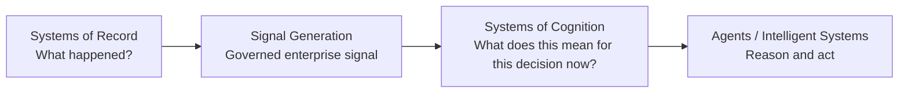

# Cognitive Context Fabric

**New: [Context Skills](../05-reference/05-technical-reference/CONTEXT_SKILLS.md)** — how a bank agent is granted authority to ask a Context Product, with the SK-01 implementation and SME/Information Architect analysis. Current Fluree requirement: **4.2.4**.

## From data to better decisions

The **Cognitive Context Fabric (CCF)** is the architectural layer that turns governed enterprise signals into **decision-ready context** for agents and other intelligent systems.

CCF sits **above systems of record, warehouses, lakehouses, Data Mesh nodes, semantic layers, graphs, documents, and streams — and below the agent runtime**. It does not replace those systems. It composes over them so that an agent receives context that is current enough, policy-shaped, role-appropriate, evidenced, and reconstructible at the moment a decision is made.

That distinction matters because the model determines **how** reasoning is performed; the context determines **what reasoning is possible**.

---

## Why CCF exists

Enterprise data systems are very good at preserving facts, producing governed datasets, and answering questions people already know how to ask. Historically, a human supplied the missing cognitive work: the analyst reconstructed relationships, judged whether information was still current, applied policy, interpreted the information for the role at hand, and assembled the evidence behind the decision.

Agents operate differently. They compose at runtime, work at machine cadence, formulate questions that were not anticipated when schemas were designed, and may carry decision authority into regulated workflows. The system therefore has to construct the decision environment **before reasoning begins**.

CCF makes that context-construction responsibility explicit.

### The architectural progression

CCF is the cognition layer in that progression.

---

## The three ideas to understand first

### 1. Context Graph

CCF represents decision state using the six-dimensional Context Graph:

`G(E, R, T, P, Π, L)`

- **E — Entities:** the things that exist.
- **R — Relationships:** how those things are connected.
- **T — Time:** what was valid, when, and whether it is still relevant.
- **P — Policy:** the constraints that shape what may be assembled and acted upon.
- **Π — Perspective:** the role-conditioned interpretation required by the consuming principal.
- **L — Lineage:** where each claim came from and how the context was constructed.

A knowledge graph tells you that a relationship exists. A Context Graph tells you whether that relationship was **active, relevant, permitted, and authoritative for the decision being made**.

### 2. Context Products

A **Context Product** is the unit agents consume: a typed, governed, decision-ready unit of meaning assembled for a specific intent, role, temporal frame, and policy regime.

Context Products are **derived at decision time rather than treated as another persistent dataset**. They are complementary to Data Products: Data Products provide governed reusable substrate; Context Products assemble that substrate into decision-ready meaning for the consumer.

### 3. Governed decision context

CCF makes properties that are usually implicit visible and enforceable:

- freshness and per-signal decay;
- Context Debt when context is incomplete or stale;
- policy binding before reasoning;
- role-conditioned projection;
- provenance and lineage;
- Decision Replay for forensic reconstruction.

The result is not “more data in the prompt.” It is a governed decision environment.

---

## The six-layer architecture

The CCF decomposes context construction into six responsibility boundaries:

1. **L1 — Signal Layer** — ingest and normalize observations from heterogeneous sources.
2. **L2 — Context Assembly** — resolve entities and relationships, stitch time, bind policy, and assemble graph state.
3. **L3 — Context Graph** — persist typed decision state across entities, relationships, time, policy, perspective, and lineage.
4. **L4 — Context Operators** — compose traversal, temporal, policy, similarity, and related computations over the graph.
5. **L5 — Context Projection (Π)** — transform graph state into the role- and intent-conditioned view required by the principal.
6. **L6 — Context Products** — deliver governed, versioned, decision-ready context under contract.

These are **responsibility boundaries, not a simple sequential pipeline**. A Control Plane declares what the fabric is allowed to do; the Data Plane executes continuously inside those constraints.

---

## Data products to Context Products

CCF does not ask an enterprise to abandon the systems and investments it already has.

The architectural posture is **layering, not replatforming**.

Warehouses remain warehouses. Lakehouses remain lakehouses. Data Mesh domains continue to publish Data Products. Semantic layers continue to govern metrics and definitions. Operational systems remain authoritative for the transactions and records they own.

CCF composes over those systems and adds the context responsibility required at decision time.

**Data Products are necessary inputs. Context Products are decision-scoped outputs.**

---

## Real-time assembly

“Real-time” in CCF does not mean every source refreshes continuously. It means the decision context is assembled against the **best governed state available at the moment of the decision**, preserving the temporal semantics of each contributing signal instead of flattening them into one misleading notion of “current.”

Some claims may be seconds old, some days old, and some valid until explicitly superseded. CCF carries those differences into the product rather than hiding them.

---

## Choose your path

### I want to understand CCF

Start with the [overview video](../02-overview/Cognitive_Context_Fabric_Intro.mp4), then read [Why CCF](WHY_CCF.md) and [Architecture at a Glance](ARCHITECTURE_AT_A_GLANCE.md).

### I want the full architectural argument

Read the released [CCF Whitepaper v1.2](../01-whitepaper/CCF_Whitepaper_1-2.pdf).

### I want to consume Context Products

Go to **Build with CCF → Consume**. The consumer path is intentionally separated from assembly internals.

### I want to assemble Context Products

Go to **Build with CCF → Assemble**. The assembler path begins with the business decision, specification, SME/data-engineer collaboration, and verified data estate before implementation.

### I want to see real financial-services problems

Go to **Financial Services**. Each example begins with the business problem and then traces the evidence chain from requirement to data estate to specification to executable SDK example.

### I care about governance, controls, security, or operations

Go to **Govern & Operate** for policy, provenance, replay, Context Debt, reproducible data environments, security assurance, and production operations.

---

## Continue

- [Why CCF](WHY_CCF.md)
- [Architecture at a Glance](ARCHITECTURE_AT_A_GLANCE.md)
- [Context Products](CONTEXT_PRODUCTS.md)
- [Resources](RESOURCES.md)

---

## Source provenance

Architectural meaning in this page is adapted from `drcastillo/ccf@ac81805d0e400da15f860eed8c39a132af3ce945`, especially the Executive Summary and Chapters 3, 5, 6, 7, and 8. Institution-specific language has been removed; canonical CCF terminology has been preserved.
