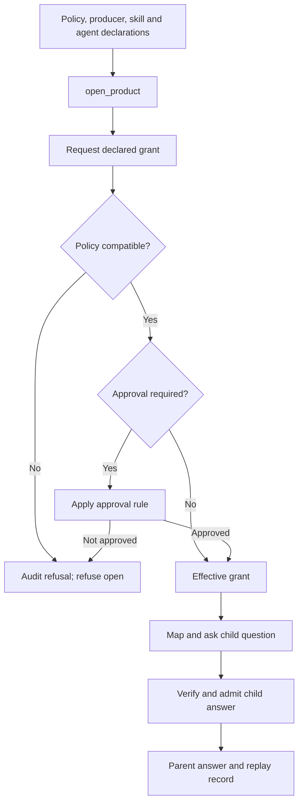

# Context Skills

**SDK source baseline:** `drcastillo/ccf_code/v1.0.2@5f85b389efe9e4b1de62e84a5af62ca4b2e12178` — reviewed 17 October 2026.

A **Context Skill** is a governed authorization for an agent to ask a Context Product: a versioned skill catalog entry together with a grant. The term describes how existing SDK contracts are used; there is no new `ContextSkill` class. The supported deployment path declares the skill in YAML and requests its grant as the product opens.

The bank's policy states what the agent may hold. The skill declares what it needs. The grant records what the agent actually holds. A prompt saying “use the collateral skill” creates none of that authority.

## Three different meanings of skill

| Concept | What it supplies | How authority is established |
| --- | --- | --- |
| Context Skill in the supported CCF deployment path | Permission for a composing agent to ask another governed product | Catalog declaration, policy compatibility and grant; SDK derives `mcp_product` type and producer binding |
| Ordinary CCF harness tool | A callable exposed through an adapter | Bound `tool`, `mcp` or `local_callable` entry; authority and argument checks at dispatch |
| Agent Skill in a model harness | Instructions or a workflow used by the external agent | Harness-specific behavior; its prose does not grant a CCF Context Skill |

The SDK also has a procedure import route (`ccf skill import`) for instruction artifacts. It is a separate path, not the YAML Context Skill demonstrated by SK-01. `procedure`, `peering` and `mcp_product` are not ordinary model tools.

An external agent can call a product door directly under that door's credential, scope and entitlement checks. Such a call does not exercise a composing agent's Context Skill grant. Its producer record identifies the caller; it does not establish that an enclosing bank agent held `collateral-ask`.

## Declare the authority, then map the question

Five groups in `ccf_config.yaml` describe the chain:

| Declaration | Bank decision it expresses |
| --- | --- |
| `policy.skill_governance` | Permitted scope labels and whether grant approval is required |
| `producers` | Trusted producer identity, tenant, offered class/version and environment variable names for endpoint/credential |
| `skills` | Versioned catalog entry, produced class, required scopes and required context products |
| `agent` | Versioned agent name and archetypes; other axes derive from the deployment |
| `grants` | Skills requested for that agent at composition |

The product's `requires` declaration separately names the required child class and compatible version floor. Developer code maps the parent question into the child question. SK-01 supplies that mapping in `deployment.py`; it does not reproduce the child's collateral calculation.

`open_product` owns registrations, SDK-derived bindings and composition-time `DeclaredSkillGrant` authority. Tier 1 judges requirements against the policy regime and agent context contract; tier 2 applies the approval rule where required. A refused grant prevents opening. Do not copy capability minting or manual Control Plane registration into a supported example.

Unknown grant names, declared skills missing from `grants`, and unsupported stated skill types are configuration errors before a grant request; they do not produce the same audit trail as a policy-refused request. Scope labels such as `collateral-coverage.read` are compared as labels. They do not independently enforce database read-only access.

## What the decision record can establish

| Evidence | What is retained | Limit |
| --- | --- | --- |
| Dimension 4 — perspective conditioning | Agent definition hash, versioned URI, archetype composition and skill/grant-set hash | Hash identifies the set; it does not enumerate its members |
| Dimension 5 — admitted child resolution | Producing skill name/version and grant hash, alongside child identity and admission evidence | Present for admitted children; a refused child row does not name the skill/grant |
| Grant audit | `grant_requested` followed by `grant_effective` or `grant_refused` | Stored in the in-memory Control Plane in this example |

Served and refused parent decisions now name the composing agent. A refusal before child acquisition can have no child rows. The record does not pin each skill's requirements. Recovering the whole granted set or rechecking its tier-1 judgment needs additional grant/catalog evidence; SK-01 does not durably retain that evidence.

## Current supported boundary

- The YAML path derives every declared skill as `mcp_product`; another stated type is refused at open. The lower-level SDK's broader catalog types do not make all of them declarable through this path.
- A Context Skill is not an LLM tool. SK-01 correctly reports empty `tools` and `allowed_tools`; no model call occurs.
- Grant/revoke APIs exist, but the example has no supported authorized entry point for changing grants while the product runs.
- The agent is hosted in a composite product with an own acquisition/projection leg. A standalone grant-holding agent is not demonstrated.
- SK-01 constructs an agent for adapter inspection only after its first question; inspecting it before then encounters the unestablished policy regime.
- SDK composite `replay_decision` now uses retained child answers without recontacting producers. SK-01 itself does not run a replay gate; do not report that scenario as verified by this example.

## Learn and implement

- [SK-01 implementation walkthrough](../02-context-product-producer/examples/SK01_DECLARE_AND_GOVERN_AGENT_SKILLS.md)
- [SK-01 business-to-declaration analysis](../02-context-product-producer/examples/SK01_DECLARE_AND_GOVERN_AGENT_SKILLS_ANALYSIS.md)
- [Agents and harnesses](AGENTS_HARNESSES_ORCHESTRATION.md)
- [Deployment configuration](DEPLOYMENT_CONFIGURATION.md)
- [Durable Decision Replay](DECISION_REPLAY.md)

Sources: [SK-01 README](https://github.com/drcastillo/ccf_code/blob/5f85b389efe9e4b1de62e84a5af62ca4b2e12178/examples/sk-01-declare-and-govern-agent-skills/README.md), [configuration](https://github.com/drcastillo/ccf_code/blob/5f85b389efe9e4b1de62e84a5af62ca4b2e12178/examples/sk-01-declare-and-govern-agent-skills/ccf_config.yaml), [findings](https://github.com/drcastillo/ccf_code/blob/5f85b389efe9e4b1de62e84a5af62ca4b2e12178/examples/sk-01-declare-and-govern-agent-skills/FINDINGS.md), [deployment parser](https://github.com/drcastillo/ccf_code/blob/5f85b389efe9e4b1de62e84a5af62ca4b2e12178/src/ccf/deployment/config.py), [tool exposure](https://github.com/drcastillo/ccf_code/blob/5f85b389efe9e4b1de62e84a5af62ca4b2e12178/src/ccf/skills/toolsurface.py), [dimension-4 change](https://github.com/drcastillo/ccf_code/blob/5f85b389efe9e4b1de62e84a5af62ca4b2e12178/docs/surface-changes/385-01-dimension-four-names-the-agent.md).
