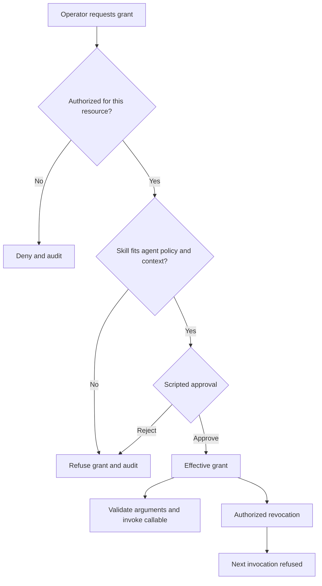

# Bank agent skills: covenant review

> **Current authoring guidance (17 October 2026):** this earlier demonstration uses lower-level manual catalog/grant composition with the current SDK baseline. It is not the supported YAML Context Skill example pattern. Start with [SK-01](../context-skills/README.md) for the current declaration-driven route; its Context Skills are `mcp_product`, not ordinary callable model tools. Its nine tests and demonstration were rerun against the current SDK baseline below.

**Purpose:** demonstrate how a bank agent receives, uses and loses a governed skill. The example performs real calculations over synthetic financials using the current CCF SDK.

**Inspected and tested:** 2026-10-18, Python 3.12, `ccf_code` commit [`5f85b389efe9e4b1de62e84a5af62ca4b2e12178`](https://github.com/drcastillo/ccf_code/commit/5f85b389efe9e4b1de62e84a5af62ca4b2e12178). All nine tests pass at this SDK 1.0.2 source pin. Compatibility with the earlier `v1.0.1` release is not asserted.

## The archived starting point

Yes: the SDK's archived [`02-skilling`](https://github.com/drcastillo/ccf_code/tree/5f85b389efe9e4b1de62e84a5af62ca4b2e12178/archive/examples/02-skilling) example demonstrates the grant/invoke/refuse/revoke lifecycle. Its business setting is clinical trials and its registration and grant calls predate the current capability arguments.

This example adapts that lifecycle to covenant review. It uses the current `Authorized` capabilities, the SDK's deny-by-default `ControlPlaneTenantAuthorizer`, and a real banking calculation. It lives in `ccf_adoption/examples`; no SDK source changes are required.

## The banking problem

A credit analyst wants an agent to review a borrower's financial covenants consistently. The agent needs a trusted calculation capability, but the right to calculate should not imply the right to change a covenant register, waive a breach, or grant itself more capabilities.

Here, **a skill is a declared, versioned capability that becomes available to an agent through an effective grant**. A catalog entry describes the capability, its inputs, its implementation binding and its requirements. Registering the entry makes it available for governance; it does not grant it to every agent.

The demonstration agent receives `calculate-covenant-headroom`. The implementation is a registered Python callable. An attempted grant of `update-covenant-register` fails because the agent's policy permits `portfolio-read`, while that skill requires `covenant-writeback`.

The agent's definition stays unchanged throughout. The changing skill grants have a separate identity, the **grant-set hash**.

## From the business requirement to the artifacts

The SME defines the calculations and the interpretation of their results. The Information Architect defines the identifiers, input contract and intended Context Product relationship. The platform and control owners define who may grant skills, what the agent's policy permits, and who approves an eligible grant.

All demonstration values are in [`artifacts/scenario.yaml`](artifacts/scenario.yaml). They are illustrative, not Wells Fargo policies or customer records.

| Business decision | Declaration or implementation | Effect in this example |
| --- | --- | --- |
| Review financial covenants for a named counterparty | `skills.calculator.argument_schema` | Requires one string, `counterparty_id`; missing, extra and mistyped arguments are refused before dispatch |
| Calculate consistently | [`calculation.py`](calculation.py), registered under `demo-covenant-calculator` | Uses decimal inputs and compares thresholds before display rounding |
| Permit reading, not register updates | `referenced_artifacts` policy declaration | Allows `portfolio-read`; does not allow `covenant-writeback` |
| Require a second decision for an eligible grant | `grant_requires_approval: true` | Invokes the explicitly scripted approval fixture after policy compatibility passes |
| Restrict who can grant or revoke | `identities` and the exact-resource scope mapping constructed in `Demo` | The operator can manage these grants; the analyst's scope cannot |
| Identify the agent and its intended context | `agent_definition` | Declares its archetype, context contract, perspective, policy, debt profile and instruction bindings |
| Keep capability changes separately identifiable | `grants` plus SDK-derived hashes | Pins each grant to an agent definition hash and a catalog artifact version |

The agent's context contract declares `demo-bank.covenant-inputs`. This small example does **not** implement or retrieve that Context Product. The calculator reads local synthetic rows, so its `required_context_products` is explicitly empty. In a fabric-backed version, supply the actual product and declare its class in the skill's requirements as well as the agent's contract. An entry in a contract alone does not fetch data or validate its lineage.

### Illustrative covenant definitions

Debt is measured at the stated date. EBITDA and interest expense cover the trailing twelve months. All monetary values use USD millions; the ratios and headroom are multiples (`x`).

- Leverage = total debt / EBITDA; maximum allowed is 3.50x.
- Interest coverage = EBITDA / interest expense; minimum allowed is 3.00x.
- Leverage headroom = maximum leverage − actual leverage.
- Coverage headroom = actual coverage − minimum coverage.

Negative headroom signals a breach for analyst review. Equality meets the threshold. Ratios are displayed to two decimal places, but breach decisions use values before display rounding. Zero or negative EBITDA, zero or negative interest, non-finite numbers and unknown counterparties are refused in this example; their production treatment requires an explicit business rule.

| Synthetic counterparty | Debt | EBITDA | Interest | Leverage | Coverage | Leverage headroom | Coverage headroom | Result |
| --- | --- | --- | --- | --- | --- | --- | --- | --- |
| `demo-manufacturer` | 180 | 60 | 15 | 3.00x | 4.00x | +0.50x | +1.00x | Within limits |
| `demo-distributor` | 240 | 60 | 24 | 4.00x | 2.50x | −0.50x | −0.50x | Review required |

These definitions are intentionally simple. A bank's actual credit agreement may specify different debt, EBITDA, adjustments, periods and exceptions. A `review-required` result here is a calculation outcome, not a credit decision or a waiver.

## Run the demonstration

Use an authorized local checkout of `ccf_code`, preferably at the inspected commit above. The commands below run from SDK source without changing it or installing a similarly named public package. The SDK checkout is separate from this repository.

```bash
cd /path/to/ccf_adoption/examples/agent-skills-covenant-review
export CCF_SDK_REPO="/path/to/ccf_code"
git -C "$CCF_SDK_REPO" rev-parse HEAD

python3.12 -m venv .venv
source .venv/bin/activate
python -m pip install -r requirements.txt
export PYTHONPATH="$CCF_SDK_REPO/src:$CCF_SDK_REPO/runtime"

python run.py --evidence output/evidence.json
python -m unittest -v test_example.py
```

`requirements.txt` contains the direct dependencies exercised by this demonstration, with versions taken from the inspected SDK. It is not a full CCF deployment manifest. The run needs no model API key, database, bank connection or outbound service. Dependency installation requires package access. If using another SDK revision, compare its APIs and rerun the checks before relying on the example.

See [`expected-output.txt`](expected-output.txt) for the captured console output. Nine tests cover the lifecycle, calculation results, audit transitions, scope restrictions, approval rejection, argument refusal, unknown counterparties, threshold equality, rounding and unsupported financial values.

## What to show in a bank demonstration

1. **Registration is not permission to use.** The catalog contains the calculator, but the first invocation raises `SkillNotBound`.
2. **The analyst cannot self-grant.** The real authorizer denies the analyst's request; no grant request reaches the ledger.
3. **The operator requests a permitted capability.** Authorization checks the operator's scope against the tenant, action and exact agent resource. The ledger then checks skill requirements against the agent's policy and context contract. The scripted approval fixture approves the eligible request, making the grant effective.
4. **The agent uses the skill.** `Agent.invoke_skill` validates arguments and dispatches the registered callable. The two synthetic counterparties produce different covenant outcomes.
5. **An invalid argument never reaches the calculator.** Passing an integer where the schema declares a string raises `MistypedArgumentRefused`.
6. **Approval cannot override an incompatible policy envelope.** The writeback request returns `RequirementsExceedRegime` before the approval fixture is called. Its invocation remains unbound. A sentinel callable makes accidental dispatch fail visibly; there is no bank write integration.
7. **Revocation takes effect on the existing agent.** After the operator revokes the grant, the next calculator call raises `SkillNotBound`. The grant-set hash returns to its initial value and the agent definition hash is unchanged. Revocation is demonstrated for subsequent calls; it does not undo work already completed.



## How this connects to a bank's model-driven agent

The sample drives `Agent.invoke_skill` directly so the control behavior is repeatable without model credentials. It also calls the SDK's `render_tool_surface` and saves the resulting description and closed input schema in the evidence file. This is the shared rendering used by the SDK's harness adapters.

A harness would present the effective calculator skill as a tool. A proposed tool call would contain the skill name and an argument object such as `{"counterparty_id": "demo-manufacturer"}`. The adapter sends those arguments through `Agent.invoke_skill`, which performs the same validation and live grant lookup exercised here. The model does not receive grant-management authority merely because it can propose a calculation call. This example does not start a model or execute a harness adapter.

The SDK recognizes six skill types: `local_callable`, `tool`, `mcp`, `mcp_product`, `peering` and `procedure`. This example exercises **`local_callable`**. At the inspected revision, ordinary harness tool exposure covers `local_callable`, `tool` and `mcp`; the other types have different integration paths. A `procedure` supplies governed instruction content rather than an ordinary tool call. Do not present all six as interchangeable tools.

The `callable_ref` is a key in a registry populated by the trusted deployment. It is not a Python import path supplied by a model. Catalog metadata cannot import arbitrary code.

## Evidence and the production boundary

`output/evidence.json` contains the tool surface, calculation outputs, grant and agent hashes, the captured `PerspectiveConditioning`, the typed writeback refusal, call counts, and events from the shared SDK audit log. The `example_tested_sdk_commit` field identifies this example's tested baseline; it does not inspect the installed SDK version. Check the checkout commit with the command above.

The SDK records authorization decisions and grant transitions. Argument refusals and calculator calls are checked by this driver; they are not presented as SDK audit events. The JSON is **demonstration evidence, not a complete five-dimensional `DecisionReplayRecord`**, and the in-memory audit log exported to JSON is not a durable bank audit service.

| Demonstrated here | Bank implementation needed |
| --- | --- |
| Fixed synthetic portfolio and illustrative covenant formulas | Approved data sources, agreement-specific definitions, data entitlements and validation |
| Trusted fixture `TokenGrant` identities and real SDK authorization decisions | Verified identity source and authenticated request boundary; never accept identity claims from an unverified request body |
| Exact-resource scope mapping, pinned by content hash | Bank-owned scope vocabulary, role assignments and policy deployment process |
| Explicit scripted approval fixture | Authenticated approval workflow, accountable approver identity and durable decision evidence |
| Declared `portfolio-read` and refused `covenant-writeback` requirements | Correct skill declarations and backend access enforcement; scope names alone do not constrain arbitrary callable code |
| Local callable invoked through a live ledger-backed skill view | Approved harness wiring and controlled access to the underlying service; direct Python calls outside CCF bypass this demonstration's boundary |
| In-memory Control Plane and exported evidence | Durable state, audit retention and recovery appropriate to the deployment |
| Captured grant-set identity and perspective conditioning | Full governed Context Product and Decision Replay integration where required |

The fixture uses a fixed clock for repeatability. Every run starts a new in-memory Control Plane. The application composition root registers its own artifacts with `CompositionRegister` authority and records those boot decisions. Grant and revoke authority are minted separately, only after a real authorizer allows the action. The example does not fabricate an allowed authorization decision or use SDK test helpers.

## Files and source references

| File | Purpose |
| --- | --- |
| [`run.py`](run.py) | Composition, authorization, registration, lifecycle demonstration and evidence export |
| [`calculation.py`](calculation.py) | Portfolio lookup and covenant formulas |
| [`artifacts/scenario.yaml`](artifacts/scenario.yaml) | Synthetic data, agent definition, policy artifacts, skill entries and fixture identities |
| [`test_example.py`](test_example.py) | Focused behavior and boundary checks |
| [`requirements.txt`](requirements.txt) | Direct dependencies for this demonstration |
| [`expected-output.txt`](expected-output.txt) | Captured successful console output |

The implementation was checked against these source files at the pinned commit:

- [`SkillCatalogEntry` and `SkillCatalog.register`](https://github.com/drcastillo/ccf_code/blob/5f85b389efe9e4b1de62e84a5af62ca4b2e12178/src/ccf/skills/catalog.py)
- [`GrantLedger.request`, `revoke`, `bound_view` and `grant_set_hash`](https://github.com/drcastillo/ccf_code/blob/5f85b389efe9e4b1de62e84a5af62ca4b2e12178/src/ccf/skills/grants.py)
- [`Agent.invoke_skill` and `perspective_conditioning`](https://github.com/drcastillo/ccf_code/blob/5f85b389efe9e4b1de62e84a5af62ca4b2e12178/src/ccf/agents/agent.py)
- [`CallableRegistry`](https://github.com/drcastillo/ccf_code/blob/5f85b389efe9e4b1de62e84a5af62ca4b2e12178/src/ccf/skills/callables.py) and [`render_tool_surface`](https://github.com/drcastillo/ccf_code/blob/5f85b389efe9e4b1de62e84a5af62ca4b2e12178/src/ccf/skills/toolsurface.py)
- [`ControlPlaneTenantAuthorizer`](https://github.com/drcastillo/ccf_code/blob/5f85b389efe9e4b1de62e84a5af62ca4b2e12178/runtime/ccf_runtime/authz/protocol.py) and [`mint` / `mint_at_composition`](https://github.com/drcastillo/ccf_code/blob/5f85b389efe9e4b1de62e84a5af62ca4b2e12178/src/ccf/authz/capability.py)

[Back to adoption examples](../README.md)
