# Fluree FIBO Ontology — Design Document

**Ledger:** `fibo-v2` on `http://192.168.4.76:8092` (Fluree 4.2.4 since 2026-10-15; the measurements below were taken on 4.1.4 at :8090)
**Measured:** 2026-10-09, ledger `t = 5878`, 88,325 triples; **89,148** after the party-role fix the same day (known-issues §62). Other counts are pre-fix unless marked.
**Source of truth for IRIs:** `docs/ccf_dataprep_v2.md` § *Canonical FIBO IRI binding*
**Status:** descriptive. This document records what is loaded and why. It does not change the binding contract.

---

## 1 · Purpose and scope

Fluree is the **flagship store** of the CCF estate. It is authoritative for:

| Slice | Meaning |
|---|---|
| **R** — relationships | every typed edge between parties, facilities, collateral, signals, documents |
| **T** — time | valid-time and assertion-time stamps, supersession chains, policy versions |
| **Lineage** | provenance class per node, pointers into MongoDB passages |
| **Policy binding** | which policy/regime version was in force when |

It is **not** authoritative for entity attributes (names, addresses, balances, limits). Those live in Postgres. A Fluree node carries its type(s), a display label, `ex:lei` where one exists, and edges. Nothing else.

This document covers the *ontology* (what classes and predicates exist and how they relate) and the *instance design* (the patterns the loaders use). It does not cover runtime assembly, operators or the SDK. Those are out of scope for this repo.

---

## 2 · At a glance

| Measure | Value |
|---|---|
| Triples (current state) | 89,148 (88,325 before §62 fix) |
| Distinct classes in use (`rdf:type` objects, excl. OWL meta) | **93**: 43 FIBO · 43 `ex:` · 7 OMG Commons |
| Classes *declared* in ledger as `owl:Class` | 55: 18 FIBO · 31 `ex:` · 6 Commons |
| Classes used but not declared | 39 (26 FIBO · 12 `ex:` · 1 Commons) |
| Distinct predicates | **181**: 150 `ex:` · 23 FIBO · 2 Commons · 6 W3C |
| Object properties declared | 9 |
| `rdfs:subClassOf` axioms | 7 |
| `rdfs:subPropertyOf` axioms | 2 |
| Triples carried by `ex:` predicates | 54,606 (62%) |
| Triples carried by FIBO predicates | 3,837 (4%) |
| Loaders that write to this ledger | ~40 scripts under `loaders/` |

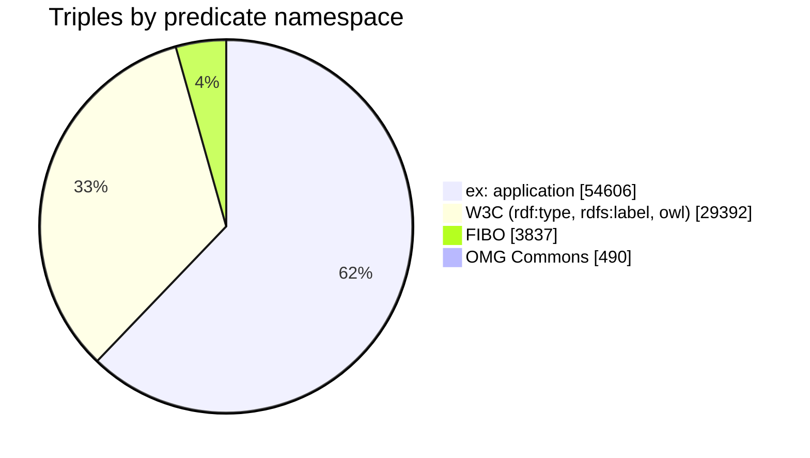

**How to read that split.** FIBO and Commons provide the *nouns*: the classes every node is typed with (that typing sits under `rdf:type`, inside the W3C slice). FIBO also provides the core structural edges: `owns`, `controls`, `hasBorrower`, `isCollateralizedBy`, `isDirectorOf`. The `ex:` namespace carries the bank's operational relations FIBO has no term for, plus all temporal and provenance metadata. Every `ex:` term was checked absent from FIBO before it was minted (`ccf/fibo.py`).

> Counts in this document were taken with `COUNT(DISTINCT …)` per class and per predicate. `GROUP BY` and multi-pattern `COUNT(*)` are unreliable on this Fluree version (see §11).

---

## 3 · Where Fluree sits in the estate

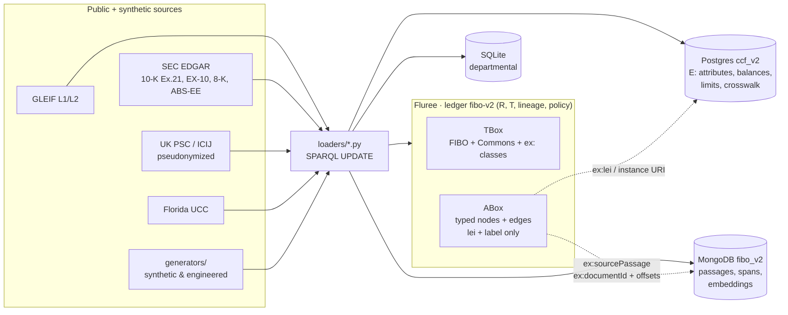

Other ledgers on the same server, **not owned by this repo**:

| Ledger | Owner | Note |
|---|---|---|
| `fibo:main` | this repo, **v1** | frozen comparison baseline (`t = 5`). `ccf/fluree.py` refuses writes to it |
| `ccf:main` + `ccf:cp04-*` branches | the CCF SDK project | read-only from here |
| co-lender ledger | this repo, Wave 18 | on a **separate** Fluree instance (`CO_LENDER_FLUREE_URL`), not this server |

---

## 4 · Design principles

1. **FIBO is the schema.** Types and core predicates use full EDM Council / OMG Commons IRIs. Nothing is renamed or shortened in the ledger.
2. **No OWL inference, so type explicitly.** Fluree applies no reasoning. A query for `cmns-pts:Party` returns only nodes asserted `Party`. Every node is typed for **every role a query will ask about** (§6.1).
3. **Bind upstream, then generate.** A term enters `docs/ccf_dataprep_v2.md` first, verified against `dev.fibo-quickstart.ttl` (not `prod`, which omits Provisional modules). Then data is generated against it. HTTP 200 from spec.edmcouncil.org proves nothing; resolution is by `grep` of the ontology file.
4. **Mint `ex:` only for proven absence.** `ccf/fibo.py::fibo_absent()` refuses to answer "absent" if it could not check.
5. **Single writer.** One store per element. Fluree holds no `legalName`, no balances, no addresses.
6. **Provenance on every element** (§9). Four labels: `public`, `synthetic — internal`, `synthetic — engineered`, `synthetic — bridging`.
7. **Append-only is a feature.** A correction is a retraction that stays in history. Loaders are idempotent so re-runs do not duplicate.

---

## 5 · Namespaces

| Prefix (as used in docs) | Namespace | Role |
|---|---|---|
| `cmns-pts` | `https://www.omg.org/spec/Commons/PartiesAndSituations/` | Agent, Party |
| `cmns-org` | `https://www.omg.org/spec/Commons/Organizations/` | Organization, FormalOrganization, LegalPerson, LegalEntity, ServiceProvider |
| `cmns-id` | `https://www.omg.org/spec/Commons/Identifiers/` | `isIdentifiedBy` |
| `cmns-col` | `https://www.omg.org/spec/Commons/Collections/` | `isMemberOf` |
| `fibo-be-*` | `https://spec.edmcouncil.org/fibo/ontology/BE/…` | legal entities, ownership & control, executives, LEI entities |
| `fibo-fnd-*` | `…/FND/…` | ownership, relations, people, contracts, ratings, reporting |
| `fibo-fbc-*` | `…/FBC/…` | debt, guaranty, credit events, credit ratings, accounts, trades, bank entities |
| `fibo-sec-*` | `…/SEC/…` | bonds, CP, funds, distributed (syndicated) loans, pool-backed securities, CDO triggers |
| `fibo-loan-*` | `…/LOAN/…` | lien position, servicer |
| `ex` | `http://example.org/fibo/` | application terms **and** all instance URIs |
| W3C | `rdf:`, `rdfs:`, `owl:` | typing, labels, axioms, `owl:differentFrom` |

The full prefix-to-namespace table (≈35 FIBO prefixes) is in `ccf_dataprep_v2.md` under each wave's *Prefixes added* heading.

> **Prefix discipline.** Commons was factored out of FIBO. `Party`, `Organization`, `LegalEntity` etc. are **not** FIBO IRIs any more. Only `Corporation` stays in FIBO (`BE/LegalEntities/CorporateBodies/`). The v1 starter set got this wrong; see `known-issues.md` §0.2.

---

## 6 · The ontology layer (TBox)

The ledger does **not** contain the whole of FIBO. Loaders assert only the class and property declarations they need. The **binding table in `ccf_dataprep_v2.md` is the full contract**; the in-ledger TBox is a partial copy of it.

### 6.1 The party chain: the one hierarchy that is loaded as axioms

These seven `rdfs:subClassOf` triples are the only class hierarchy in the ledger. `LegalEntity` has **two** parents. v1 modelled this as a single line, which was wrong.

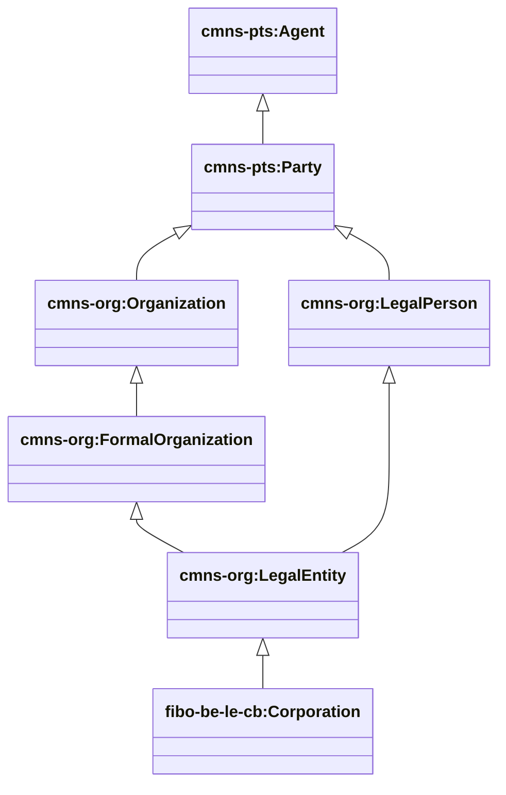

Because there is no inference, these axioms are **documentation only**. They tell a reader the hierarchy; they do not make Fluree answer `Party` for a `Corporation`. So every organization node is typed with its class **and every ancestor**. Loaders get that list from `ccf/party_roles.py::with_ancestors()`, not from a hand-written tuple (§62), and `validators/party_role_closure.py` fails if any node is missing an ancestor. A real example from the ledger:

```
ex:SuperMicroComputerInc
    rdf:type  fibo-be-le-cb:Corporation, cmns-org:LegalEntity, cmns-org:LegalPerson,
              cmns-org:FormalOrganization, cmns-org:Organization,
              cmns-pts:Party, cmns-pts:Agent ;
    rdfs:label "SUPER MICRO COMPUTER, INC." ;
    ex:lei     "54930022CZO1N2UGVW07" ;
    ex:provenance "public" .
```

### 6.2 Property hierarchy

Two `rdfs:subPropertyOf` axioms are loaded, both for GLEIF accounting consolidation:

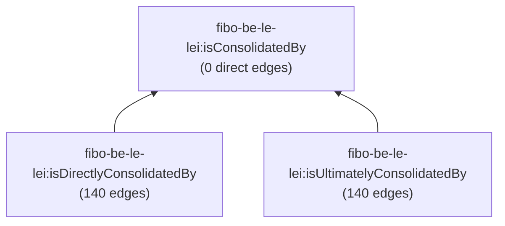

As with classes: a query for `isConsolidatedBy` returns nothing. Query the two sub-properties explicitly.

`owns` and `controls` are deliberately **not** related by an axiom. In FIBO they are siblings under `playsActiveRoleThatDirectlyAffects`. v1 asserted `controls ⊑ owns`, which FIBO does not say. Queries that want "ownership or control" must match both.

### 6.3 Declared object properties (9)

| Property | Namespace | Edges |
|---|---|---|
| `owns` | FIBO `FND/OwnershipAndControl/Ownership` | 636 |
| `controls` | FIBO `FND/Relations/Relations` | 3 |
| `hasGlobalUltimateParent` | FIBO `BE/OwnershipAndControl/CorporateControl` | 103 |
| `hasDomesticUltimateParent` | FIBO `BE/OwnershipAndControl/CorporateControl` | 36 |
| `isConsolidatedBy` / `isDirectlyConsolidatedBy` / `isUltimatelyConsolidatedBy` | FIBO `BE/LegalEntities/LEIEntities` | 0 / 140 / 140 |
| `connectedTo` | `ex:` | 184 |
| `economicallyDependentOn` | `ex:` | 4 |

The other 23 FIBO predicates and 150 `ex:` predicates in use are bound in `ccf_dataprep_v2.md` but **not declared** in the ledger (§12).

---

## 7 · Domain model (instance layer)

The diagrams below are drawn from the live ledger, not from the loaders' intentions. Counts are distinct subjects or edges at `t = 5878`. Prefix `fibo:` is abbreviated; `ex:` is the application namespace.

### 7.1 Corporate structure: ownership, control, consolidation

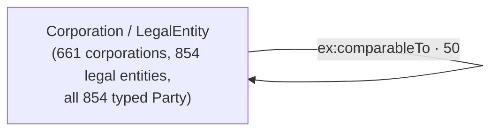

- **Sources:** GLEIF Level 2 (`public`), 10-K Exhibit 21 subsidiaries (`public`, with `synthetic — bridging` stubs where a subsidiary has no LEI), and **engineered** depth chains plus one cross-shareholding cycle (`CycMeridianHoldingsSa → … → back`), so that cycle detection and `depth` have something to find.
- **GLEIF ultimate parent ≠ control.** GLEIF's ultimate parent is the *accounting consolidating* parent. It is loaded as `hasGlobalUltimateParent`, not as `controls`. Genuine control edges are rare by design (3).
- **Exhibit 21 has no ownership %.** Percentages appear only on beneficial-ownership nodes (§7.2).

### 7.2 People, officers, beneficial ownership, identity

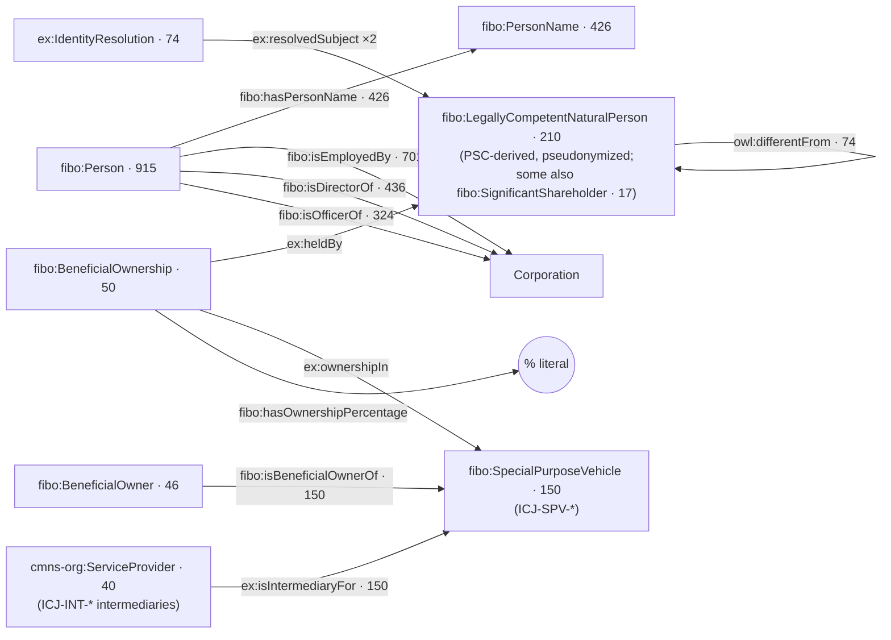

- Officers and directors come from public filings; their names are real public-filing names.
- **PSC people are pseudonymized at ingestion** (rule 3). Structure is preserved; identities are replaced.
- **Imperfect joins on purpose.** `ex:IdentityResolution` nodes pair two people above the fuzzy-match threshold with an `ex:resolutionConfidence`, and `owl:differentFrom` asserts they are **not** the same person. This is the planted false-positive pair rule 5 requires.
- **AML (Wave 17) uses synthetic entities only.** `ex:AMLParty` (201) nodes are invented. Real typologies are loaded as `ex:Typology` / `ex:TypologyPattern`.

### 7.3 Credit: facilities, covenants, collateral, guaranty, syndicate

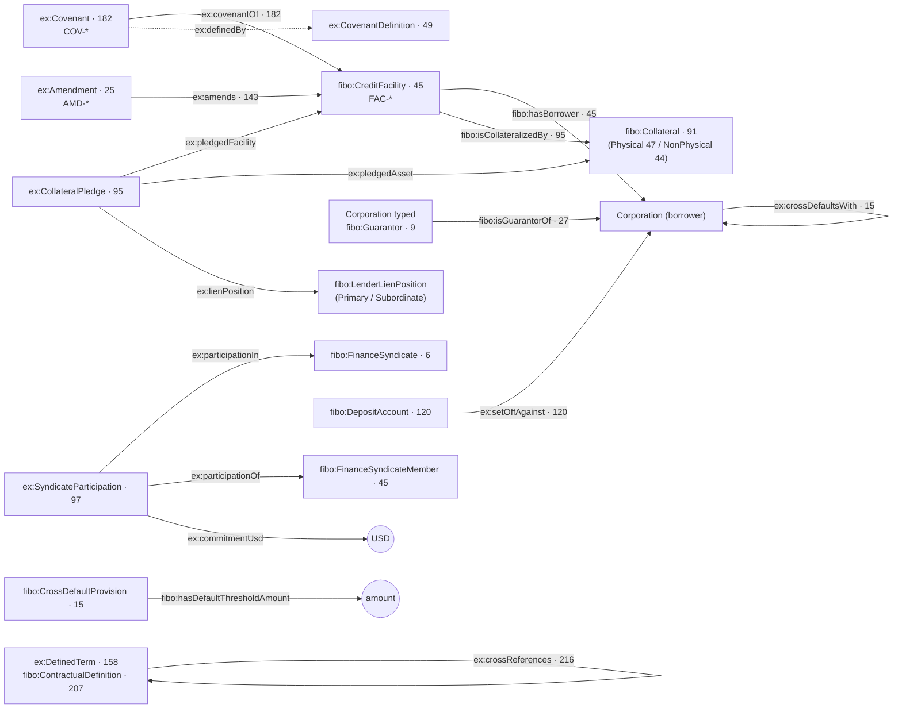

- **FIBO has no Covenant class.** `ex:Covenant` and `ex:CovenantDefinition` are recorded `ex:` extensions (see `ccf_dataprep_v2.md` "FIBO has no Covenant class").
- **Covenant attributes** live on the covenant node as `ex:covenantType`, `ex:direction`, `ex:threshold`, `ex:unit`, `ex:testFrequency`. These are terms of the *relationship*, which is Fluree's slice, not entity attributes.
- **Guaranty, cross-default and set-off connect parties, not facilities.** A guarantor `isGuarantorOf` the borrowing *company*; cross-default is asserted company-to-company; a deposit account is `setOffAgainst` the account-holding *party*. A query that starts from a facility reaches them through `hasBorrower`.
- **Set-off, cross-default and collateral pledge** are bank-operational relations FIBO does not name. They are `ex:` predicates, registered in the Wave 9/10 `ex:` extension register.
- **Syndicate participations carry document lineage.** `ex:sourcePassage` points at a byte range in an EX-10 credit agreement held in MongoDB.
- **UCC liens (Wave 21):** `ex:UccFiling` (65), `ex:UccAmendment` (85), `ex:SecuredParty` (24), linked by `ex:debtorOfRecord`, `ex:securedPartyOf`, `ex:amendedBy`, `ex:filedOn`, `ex:lapsesOn`.

### 7.4 Coverage and investment-banking signals

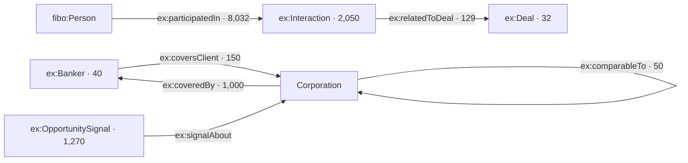

`ex:participatedIn` is the single largest relation in the ledger. Ranking weights for the IB opportunity product are **not** stored here; they are `synthetic — internal` in Postgres.

### 7.5 Credit surveillance, ratings, issuance

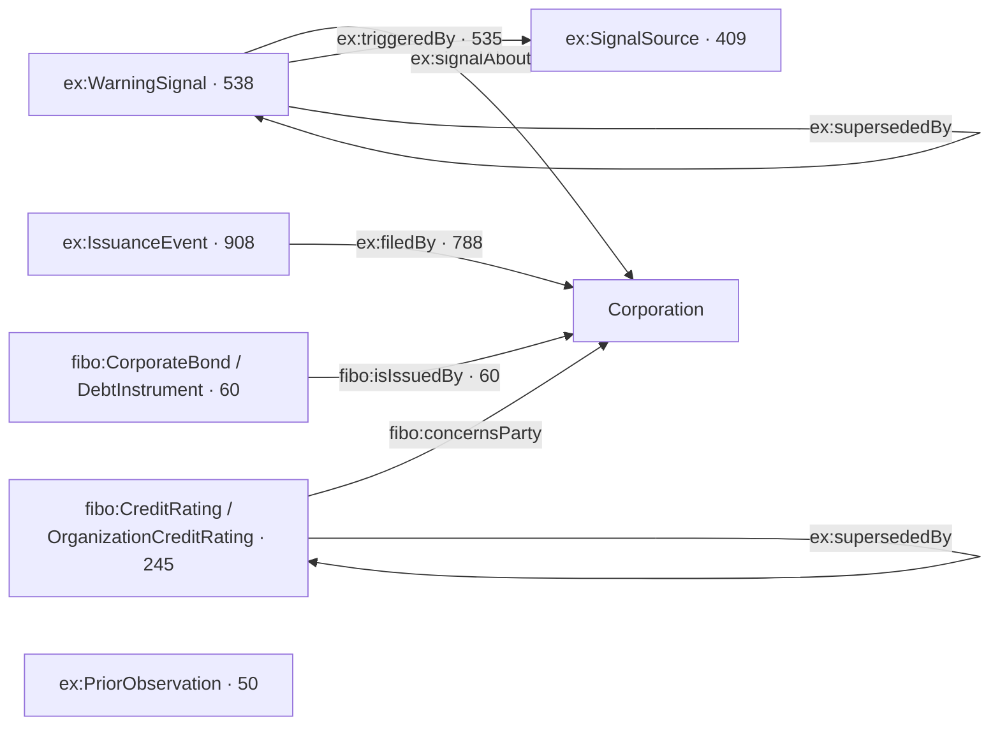

### 7.6 Treasury, FX and post-trade

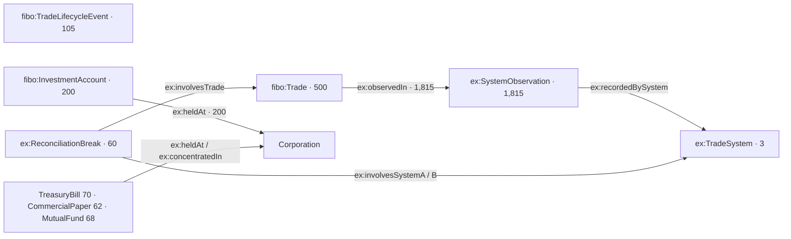

`ex:heldAt` and `ex:concentratedIn` both point at a party (custodian or issuer), from either an account or an instrument.

`ex:SystemObservation` carries `ex:systemObservedAt` and `ex:clockOffsetSeconds`. These make up the engineered *break that inverts under clock alignment*.

### 7.7 Compliance, policy and regulatory posture

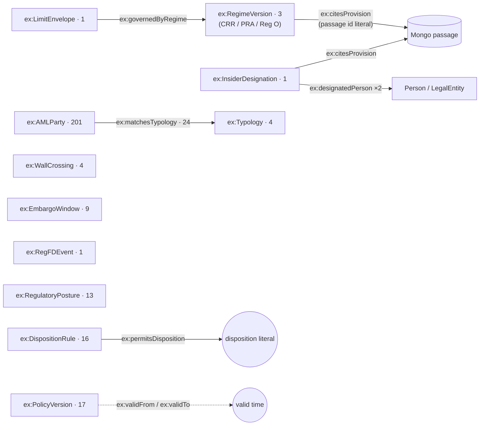

Policy versions are the reason Fluree owns "policy binding". Evaluating a covenant against the policy in force *now* instead of the policy in force *as of* the date in question gives a wrong answer. `validators/bitemporal.py` checks for exactly that.

### 7.8 Securitization (ABS)

`fibo:AssetBackedSecurity` (3 deals) with `fibo:Tranche` (18, ranked by `fibo:isSubordinatedTo`, 16 tranche-to-tranche edges), `fibo:TriggerEvent` (11) via `fibo:specifiesTrigger`, and `fibo:Servicer` (2) via `ex:servicedBy`. Loan-level tapes (1.32M loans) are **not** in Fluree. They sit in Postgres. Rule 6 applies: depth, not breadth.

### 7.9 Document lineage anchors

`ex:PassageAnchor` (44) and the `ex:sourcePassage` / `ex:documentId` / `ex:startOffset` / `ex:endOffset` / `ex:passageSha256` predicates tie a graph assertion to a span of filed text in MongoDB. The SHA-256 lets a consumer detect that the passage text changed underneath the anchor.

---

## 8 · Temporal model

Fluree has two clocks, and the design uses both on purpose.

| Axis | Carried by | Question it answers |
|---|---|---|
| **Valid time** | `ex:validFrom` (3,022), `ex:validTo` (229) | When was this true in the world? |
| **Assertion time** (business) | `ex:assertedAt` (1,555) | When did the bank record it? |
| **Supersession** | `ex:supersededBy` (1,107), `ex:isCurrent` (1,270) | What replaced it? Is this the live version? |
| **Transaction time** (system) | Fluree `t` | Which ledger commit wrote it? |

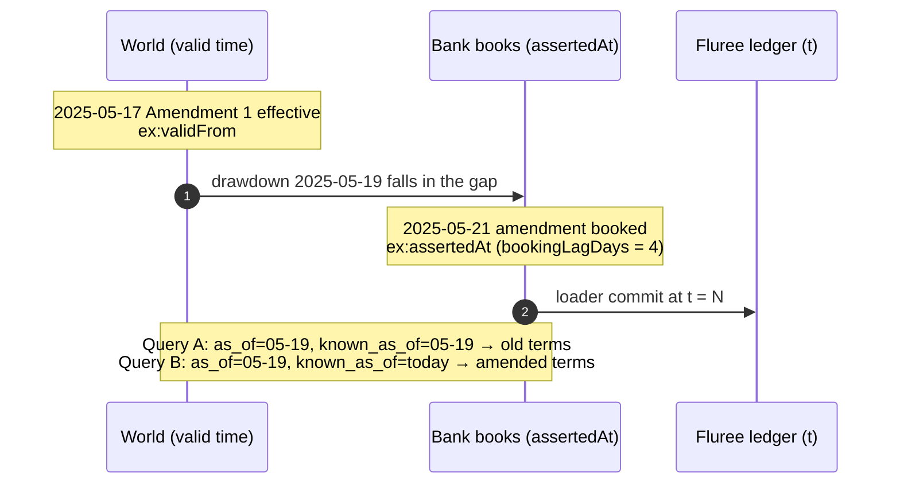

The two queries in that diagram **must disagree** for the bitemporal model to earn its keep. `validators/bitemporal.py` asserts that they do. The engineered amendments are flagged `ex:isEngineeredBookingLag true` and labelled honestly in `ex:bookingDateProvenance`.

**Supersession, not deletion.** A rating or signal is never overwritten. A new node is written, and the old one gets `ex:supersededBy` → new and `ex:isCurrent false` (or `ex:validTo`).

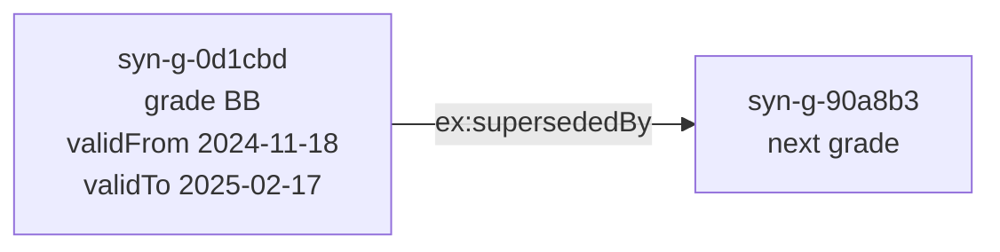

**Two cautions on transaction time:**

1. **As-of over HTTP is silently ignored** (`known-issues.md` §51). A JSON-LD query with `t=100` returns the *current* graph with no error. Only the CLI `fluree history` honors it. Do not build anything that depends on HTTP as-of.
2. **`t` is not a data landmark** (§58). The validator suite writes to this ledger and advances `t` by 46 per run with no change to the data. Compare triple counts and named values, not `t`.

Dates are stored as **plain string literals** (`"2025-05-17"`), not `xsd:date`. Fluree 4.1 corrupts typed dates sent through SPARQL UPDATE (§59).

---

## 9 · Provenance model

Every node that a product depends on carries `ex:provenance` with exactly one of four values (7,848 assertions in the ledger):

| Value | Meaning | Example |
|---|---|---|
| `public` | Fetched from a named public source | GLEIF parent, Exhibit 21 subsidiary, 8-K signal |
| `synthetic — internal` | Bank-internal by nature | covenant thresholds, internal grades, policy versions |
| `synthetic — engineered` | Deliberately invented to create a condition | ownership cycle, booking-lag amendment, false-positive name pair |
| `synthetic — bridging` | Stub so a public fact can attach | Exhibit 21 subsidiary with no LEI |

**Edge provenance.** Plain RDF has nowhere to attach a fact to an edge without reification. The convention is `ex:edgeProvenance` on the **target node** of the edge, meaning "the edge that brought me into the graph is X". It applies to engineered ownership chains and the cycle.

> **Limitation.** If a node has more than one inbound edge with different provenance, a single `ex:edgeProvenance` cannot distinguish them. Reified nodes (`ex:SyndicateParticipation`, `ex:CollateralPledge`, `fibo:BeneficialOwnership`) avoid this, because the relationship is itself a node with its own `ex:provenance`. New relations that need per-edge provenance should follow the reified pattern.

---

## 10 · Identity and cross-store joins

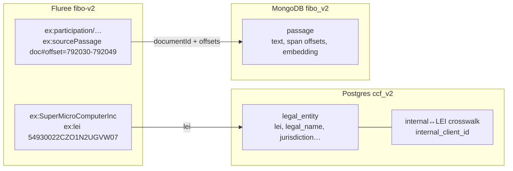

- **Instance URIs** follow `http://example.org/fibo/{LocalName}` for everything, real or synthetic. The URI is a key; it never encodes the LEI.
- **Real LEIs** are 20 alphanumerics, no hyphen. **Synthetic LEIs** start `SYN-` with hyphens. The two cannot be confused.
- `ex:lei` is present on 449 nodes. Nodes without one (bridging stubs, synthetic overlay) join to Postgres by URI local name through the crosswalk.
- **Normalize to full IRIs before comparing across stores.** Mongo and Postgres sometimes store short tokens (`owns`, `controls`). See the *Cross-backend relationship type strings* table in `ccf_dataprep_v2.md`.

---

## 11 · Load pipeline and Fluree 4.1 behaviour

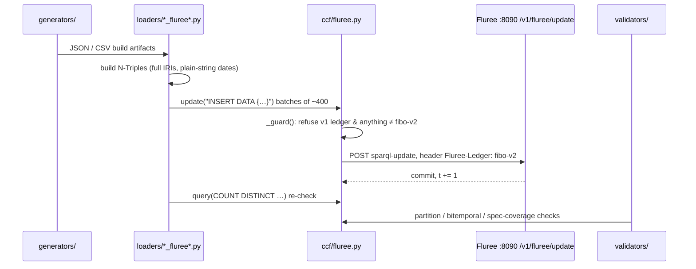

Load order follows the project rule: ontology → crosswalk → entities → relationships → temporal assertions → documents → departmental. `loaders/load_fluree_wave3.py` writes the TBox and the ownership graph; later waves (`wave10`, `wave11a/b`, `wave12_*`, `wave14`, `wave16`–`wave18`, `load_policy_fluree.py`, `load_ucc_fl_wave21.py` and others) add their own slice. `loaders/dump_fluree.py` exports and restores the ledger as N-Triples for the portable bundle.

### Known Fluree 4.1 behaviours that shape queries

| Behaviour | Consequence | Ref |
|---|---|---|
| Query needs explicit `FROM <fibo-v2>` | Missing it returns HTTP 500, not 400. `ccf.fluree.query()` refuses up front | §5.1 |
| No OWL inference | Type every role explicitly; query sub-properties explicitly | §5.2 |
| `GROUP BY ?p` invents predicates | Use `SELECT DISTINCT`, then `COUNT` each one separately | §56 |
| `COUNT(*)` under-reports on multi-pattern WHERE | Use `COUNT(DISTINCT ?x)` | §60 |
| `^^xsd:date` corrupted via UPDATE | Store dates as plain strings | §59 |
| HTTP as-of `t` silently ignored | Use the CLI `fluree history` | §51 |
| Validator suite advances `t` | `t` is not a landmark | §58 |
| Index generations accumulate (46 GB once) | Operational; not a data issue | §50 |

---

## 12 · Observations from this review

These were measured while writing this document. Item 1 was fixed the same day; the rest are open.

1. ~~**315 legal entities are not reachable by a `Party` query.**~~ **RESOLVED 2026-10-09** (`known-issues.md` §62). Three loaders stopped the role chain early on offshore vehicles, intermediaries, holdcos and two RSSD banks. 823 missing ancestor types were asserted, and all 854 legal entities are now typed `Party` and `Agent`. Loaders now take the chain from `ccf/party_roles.py`, and `validators/party_role_closure.py` guards it.
2. **The in-ledger TBox is partial.** 39 classes in use have no `owl:Class` declaration, including `fibo:Person` (915 instances) and `fibo:CreditRating` (245). 172 of the 181 predicates are undeclared. This does not break queries, because Fluree does not use declarations, but a consumer introspecting the ledger for its schema will see less than half of it. The binding table is the real schema.
3. **`fibo:Guaranty` is declared but has zero instances.** Guarantees are modelled as `fibo:Guarantor` + `fibo:isGuarantorOf` instead.
4. **`ex:CovenantDefinition` and `ex:MeasurementPeriod` each carry two `rdfs:label` values.** These are harmless, but they show up as duplicate rows in a naive class listing.
5. **`ex:edgeProvenance` is ambiguous on multi-parent nodes** (§9).
6. **v1 residue predicates** (`ex:legalName`, `ex:riskRating`, …) remain in the binding table marked "not materialized". They hold zero triples, correctly.

---

## 13 · References

| What | Where |
|---|---|
| IRI binding contract (authoritative) | `docs/ccf_dataprep_v2.md` § Canonical FIBO IRI binding |
| Fluree quirks and defect history | `docs/known-issues.md` §0.1, §0.2, §5, §50–§61 |
| Store identifiers | `ccf/config.py` (`FLUREE_URL`, `FLUREE_LEDGER_V2`) |
| Write guard and query helper | `ccf/fluree.py` |
| FIBO absence check | `ccf/fibo.py` (`dev.fibo-quickstart.ttl`) |
| TBox and party chain | `loaders/load_fluree_wave3.py` |
| Bitemporal proof | `validators/bitemporal.py` |
| Store catalog | `docs/store-catalog.md` |
| EDM Council FIBO | https://spec.edmcouncil.org/fibo/ |
