# Cognitive Context Fabric

**Powering Agentic Use Cases in Banking**

Dave Castillo, PhD — May 2026

> **Conversion note (CCF SDK, Phase R):** This Markdown document is the canonical
> citation target converted from `docs/CCF_Whitepaper_1-2.pdf` per locked decision
> D-01. All CCF SDK inventory citations reference this file's sections. The 50
> figures are extracted to `docs/figures/` per D-04 and linked inline. Conversion
> is hybrid: `pdftotext -layout` skeleton with headings, tables, figures, and
> mathematical notation reconstructed visually from the PDF (D-02/D-03). Symbols
> the PDF's embedded font failed to render (visible as blanks in the PDF itself)
> are reconstructed from context: `∘` (operator composition), `⇄` (Search ⇄
> Inference, Algorithmic ⇄ Semantic), `→` (BI → Agentic contrast pairs), `λ_c`
> (Context Half-life).

## What's New in Version 1.1

v1.1 introduces Assembly Mode as the eighth primitive joining the canonical seven, with three named modes — pure algorithmic, algorithmic with LLM packaging, and algorithmic with agent-swarm coordination — each carrying explicit cost-versus-quality-versus-determinism tradeoffs. Assembly Mode lands at Ch 7 §7.6 and as a per-Context-Product lifecycle property at Ch 6 §6.4. The v1.0 framing “forbids LLM inference at assembly time” is replaced by the compound anchor **trust-path purity — deterministic source-of-record with optional probabilistic presentation**, admitting Modes 2 and 3 under the same invariant. **Google Cloud Knowledge Catalog** enters the document in v1.1 as an example of Tier 2 — one persistent knowledge-catalog product among many in that tier rather than the sole adversarial reference. Three sharpened distinctions land across the document: data perspective versus context perspective at Ch 5 §5.1; persistent versus ephemeral at Ch 6 §6.1; and role-conditioned meaning versus access control at Ch 7 §7.5. Ch 8 §8.3.2 lands the four-tier composition pattern (Tier 1 systems of record / Tier 2 Knowledge Catalogs / Tier 3 CCF / Tier 4 agents) and replaces the v1.0 softening “complementary, not competitive” with the hardened anchor structurally incompatible at the policy layer; composable only if CCF sits above the catalog. v1.1 also incorporates pressure-testing against contemporary research in context, drawing on industry and academic work to challenge CCF’s commitments rather than merely cite supporting precedents. The post-v1.0 vault re-ingest sweep cites Recursive Language Models at Ch 7 §7.6 as external instantiation of algorithmic-semantic alternation, Test-Time Training answered explicitly at Ch 5 §5.6 and Ch 7 §7.10 as the one paper that challenges CCF by proposing context-as-weights, and the May 2026 MemoryOS / EverMemoS / MAGMA / MemMachine cluster as Ch 7 reinforcement. Academic foundations grounded in Ch 9 — Kotseruba and Tsotsos, Marcus, Bondac et al., Uddin et al., Chen et al., and Ji et al. — anchor the architecture in cognitive-architecture and memory-systems research. The thinking is shaped by this body of work, not built from it. v1.1 closes with a cross-chapter coherence pass: a 523-cell audit matrix covering canonical terminology, anchor lead-phrases, the PITFALLS E1 marketing-phrase scrub, per-primitive coherence across all eight primitives, and forward and backward reference discipline. The initial audit returned 515 PASS direct plus 7 Pass-with-note plus 0 FAIL; three closure patches landed during re-verification — D-PATCH-01 at Ch 9 L24, D-PATCH-02 at Ch 0 L22, and D-PATCH-03 at Ch 7 L5 — closing 8-primitive global consistency across the Ch 0 / Ch 7 / Ch 9 trio. For the complete inverse-chronological change history including build-tooling and INTAKE admissions, see the CHANGELOG.md at the repository root.

## Forward

The Cognitive Context Fabric (CCF) and the Context Graph architecture described in this paper did not originate from an abstract enterprise initiative or academic research effort. They emerged from a practical, real-world problem I set out to solve within my own home: building an agent-driven property intelligence system capable of understanding what was happening on my property in real time. The goal was not simply to detect motion or identify people on camera, but to answer the questions that actually matter in a dynamic environment—whether a situation is safe, whether a child near the pool is being actively supervised, or whether an individual on the property late at night represents normal activity or potential risk. Existing systems could detect events, but they could not reason about them. The gap between detection and understanding—between seeing and comprehending—became the central problem, and the Cognitive Context Fabric was developed as the architectural solution to bridge that gap.

Addressing this problem required solving a set of challenges that initially appeared domain-specific but ultimately revealed themselves to be fundamentally architectural. These included reasoning over signals that decay in relevance over time, reconciling overlapping perspectives from multiple sensors, preserving explainability in decision-making, and balancing long-term auditability with the need for efficient data representation. As these challenges were addressed, they coalesced into a coherent set of primitives: Context Half-Life and Freshness Budget to manage temporal relevance, the six-dimensional Context Graph G(E, R, T, P, Π, L) to model state, Decision Replayability to preserve explainability, Context Debt to quantify degradation from stale or ungoverned context, Context Compression to manage storage and audit trade-offs, and Context Products to provide a governed interface for agent consumption. What began as a collection of solutions evolved into a unified architecture for constructing, governing, and delivering context to agents.

This white paper represents the first time this architecture has been formally articulated and extended beyond its original domain, and it has been deliberately framed with Wells Fargo as the destination for its application. The intent is to take an innovation proven in a real-world, decision-critical environment and apply it to the challenges associated with deploying AI agents at scale within a large financial institution. While the domains differ significantly in form, the underlying problem—enabling agents to reason over dynamic, time-bound, policy-constrained context—is the same. This material has not been previously published or shared in this form, and it is presented here to help advance the agentic AI agenda by introducing the Cognitive Context Fabric as a foundational architectural layer—one that allows agents to move beyond fragmented data and toward coherent, governed, and explainable understanding. I sincerely welcome thoughtful feedback, critical perspectives, and open dialogue on the ideas presented in this paper, as they are intended to provoke discussion and help refine the path forward for agentic AI in the enterprise.

— Dave Castillo, May 2026

## Executive Summary

Agentic banking is being defined right now, and the institutions that build the right context architecture for it will define what it becomes. The ones that do not will rent it from someone who did. Wells Fargo’s Wholesale franchise — Commercial, Investment, Markets, and Commercial Real Estate — has the regulated estate and decision authority to define this ground rather than receive it. Wells Fargo did not arrive first to agents, but the early movers built on estates not designed for agentic work. That makes the late-mover position leverage, not deficit: the architectural layer beneath the agent is what separates a wrapper from a real capability. Capturing it turns on a single recognition — agent-driven decisions need a substrate human-driven decisions never required, and that substrate is the work this document is about.

Wholesale runs on processes designed around humans. Customer onboarding was built around a banker collecting documents and walking a relationship through KYC; equipment financing was built around a relationship manager carrying a deal through credit committee; covenant analysis, KYC refresh, and credit memos were each shaped around a person reading the file, formulating the right question, and writing the answer down. The cadence is human, the hand-offs are human, the evidence collection is human, and the decision authority sits in a human chair. The data estate underneath inherits that same assumption. Warehouses, lakehouses, semantic layers, and Data Mesh implementations were built to answer questions a human formulated, at human cadence, against a schema someone designed in advance. An agent dropped into either layer is a retrofit on top of a workflow it was never built for, served by an estate that was never built to serve it. The leverage stays narrow because the substrate is wrong, and the failure mode is structural, not a tooling shortfall the next dashboard or retrieval add-on closes.

The Cognitive Context Fabric, or CCF, is the architectural layer that closes that gap. It sits above the bank’s systems of record and below the agentic runtime, composing over the existing estate — warehouses, lakehouses, Data Mesh nodes, semantic layers, documents, conversations — to assemble, govern, and serve decision-ready context to agents in real time. Three primitives carry the innovation. The first is the Context Graph, written formally as G(E, R, T, P, Π, L): the persistent substrate across six axes — Entities, Relationships, Time, Policy, Projection, and Lineage — holding what is true, when it was true, who can see it, how it should be presented, and where it came from. The second is the Context Product, the governed contract through which agents consume context, derived at the moment of decision rather than stored — as different from a data product as a query result is from a stored row. The third is a pair of per-claim measurements the graph carries — Context Half-life, the rate at which a claim’s truth decays, and Context Debt, the shortfall the agent must acknowledge when freshness or completeness falls below threshold — so no agent acts on context whose decay is invisible. Every context an agent consumes is evidenced, policy-bound, and reconstructible after the fact; the institution adopts the fabric incrementally, one Wholesale archetype at a time.

Agentic processes are not faster human processes. Four differences separate them from human processes, and the CCF answers each with a specific mechanism. Agents compose at runtime, combining sources never combined at design time — the fabric answers with Context Operators that assemble Context Products on demand from the graph, in compositions no schema author had to predict. They run at machine cadence, where decisions land in seconds rather than days — answered by Context Half-life, which governs freshness automatically and forces stale claims out of the assembly before they reach the agent. They formulate questions never anticipated, against data whose shape was fixed years before the question was asked — answered by the Graph’s compositional structure, which derives new Context Products without redesigning the underlying schema. And they carry decision authority into regulated workflows, where the system itself must produce the evidence — answered by Decision Replay, which reconstructs the full decision environment (policy version, freshness state, lineage of every claim), not just the model trace. None of these are dashboard problems, retrieval problems, or data-mesh extensions. They are properties of an architectural layer that has not been built into the estate yet. The CCF is that layer.

Wells Fargo’s AI strategy is afforded the learnings of the early movers, and the CCF is one dimension along which that strategy can accelerate. The CCF does not wait on the bank’s data migration; it composes over the existing estate, delivers value against the legacy footprint now, and evolves alongside the migration toward the target state. More fundamentally, the CCF is a natural fit for agent-centered processes — those designed to optimize decisions, where context is a first-class citizen. The future of banking is not faster workflows. It is more effective decision-making, and the optimization and new revenue opportunities that follow. The CCF is the architectural layer that makes that future executable.

## Abstract

In March 2026, Wells Fargo’s Fargo assistant crossed one billion cumulative interactions; JPMorgan Chase runs its LLM Suite across roughly two hundred thousand employees and more than four hundred fifty production use cases; and Bank of America’s Erica has handled more than two and a half billion client interactions, with Erica-for-Employees now used by over ninety percent of the bank’s workforce. Agents are not an emerging category in financial services — they are an installed base. The question is no longer whether banks will run agents, it is what context banks will give them when they do.

That question exposes a structural problem that the data estates of the industry were not built to answer. Warehouses, lakehouses, data mesh implementations, feature stores, and semantic layers were architected for known-question analytics — for human operators asking fixed questions at human cadence, and for dashboards whose consumers know how to read them. Agents stress this model in ways the model was never designed to absorb. They compose many sources at runtime, formulate questions never anticipated at design time, carry decision authority into regulated workflows, and cannot tolerate joins that resolve at inconsistent as-of times. The shortfall is not a tooling shortfall the next BI add-on will close; it is structural. No additional dashboard, semantic-layer extension, or SQL-over-the-warehouse interface restores temporal coherence, principal-shaped views, governed composition, or evidence under composition to estates that were never built to carry them. A new architectural layer is required.

The Cognitive Context Fabric (CCF) is that layer. It is an architectural layer that assembles, governs, and serves decision-ready context to agentic systems in real time. It sits above the enterprise’s systems of record and below the agentic runtime, composing rather than replacing the data estates the institution has already built. It is designed for the regulated enterprise: every context an agent consumes is evidenced, governed, and reconstructible after the fact. The fabric is not a product category the bank must adopt wholesale or defer; it is an architectural responsibility the bank can take on incrementally, one archetype of work at a time, against the estate already in production.

The contribution is the synthesis of eight primitives under regulated-enterprise constraints: a six-axis Context Graph G(E, R, T, P, Π, L) as the system of state; a compositional algebra of Context Operators as the system of computation; typed Context Projection Π as the system of interpretation; derived Context Products with uniform contracts as the system of delivery; Context Debt and Context Half-life as per-claim decay measures; Control Plane / Data Plane separation as the governance surface; Decision Replay — environment replay, not model trace — as the forensic primitive; and Assembly Mode as the per-Context-Product configuration property carrying trust-path purity across pure-algorithmic, algorithmic-plus-LLM-packaging, and algorithmic-plus-agent-swarm assembly modes. The chapters that follow give each of these primitives a formal model, a delivery contract, and an integration posture against the enterprise systems of record already in production. The synthesis is what is novel; the parts draw influence from semantic layers, knowledge graphs, policy-as-code, bitemporal stores, and service-mesh control patterns — alongside decades of cognitive-architecture and knowledge-graph research — that the document names where the influence is credible.

Document, audio, and chat content enter the fabric as first-class signals with passage-level lineage pinned to the source spans the agent actually saw, making regulatory-defensible narrative work — credit memos, SAR filings, covenant analyses — reconstructible down to the sentence an agent cited. Unstructured evidence is not an attachment to structured context inside the CCF; it is a typed property of the graph itself, carried through composition and projection with the same determinism as any other signal.

Document-Heavy Compositional work, Temporal Reconciliation, Forensic-Defensibility, and Conversational Synthesis — four archetypes of Wholesale workload where the CCF delivers measurable agentic leverage — organize the worked examples the document returns to throughout. Each archetype names a distinct stress the institution’s existing estate does not answer and a distinct composition of CCF primitives that does.

Why this matters now is a function of what current data estates cannot do for an agent and what the supervisory perimeter has just demanded that an agent be able to show. The US Treasury’s Financial Services AI Risk Management Framework (FS AI RMF), released in February 2026, enumerates 230 control objectives banks must evidence. The EU AI Act’s Annex III high-risk enforcement lands in August 2026. An architecture that cannot produce the artifacts these regimes require is unfit for the work. The path to scaled agentic leverage inside a Tier-1 institution is a single-domain pilot — one Wholesale archetype, chosen on pressure gradient rather than convenience — that builds platform primitives reusable across the other three. The CCF is intended for Wells Fargo Wholesale Banking context — Commercial, Investment, Markets, Commercial Real Estate, and Corporate — as the Tier-1 institution against which the architecture is pressure-tested, while remaining industry-agnostic in its core formulation. The architectural commitment that organizes the synthesis is trust-path purity — the audit-trail integrity of the algorithmic substrate, with optional probabilistic presentation layered above it as a per-Context-Product configuration. Senior architects will read what follows for the mechanism behind these claims; engineering leads will read it for the integration posture; the document is written so that both can implement against it.

## Contents

- What's New in Version 1.1
- Forward
- Executive Summary
- Abstract
- **1. Introduction — The Banking Problem and AI**
  - 1.1 Structural Fragmentation in Financial Services
  - 1.2 The Forensic Data Gap
  - 1.3 The Real Problem Statement
  - 1.4 The Challenge of Client 360
- **2. The Rise of Agentic Systems in Financial Services**
  - 2.1 Agents Are Already Here
  - 2.2 What Has Changed
  - 2.3 Industry Impact
  - 2.4 Key Observation
  - 2.5 The Enterprise Agent Stack
- **3. Agents — The Execution Layer of Cognitive Context**
  - 3.1 From Stateless Models to Stateful Systems
  - 3.2 Anatomy of an Agent
  - 3.3 The Agent Execution Loop
  - 3.4 Context as the Operating Environment
  - 3.5 Multidimensional Context
  - 3.6 Failure Modes of Context-Starved Agents
  - 3.7 Policy and Governance as Context
  - 3.8 Decision Traceability and Memory
  - 3.9 Implications for System Design
  - 3.10 Search vs Inference Dependency
- **4. The BI → Agentic AI Gap**
  - 4.1 The Architecture of BI Systems
  - 4.2 The Requirements of Agentic Systems
  - 4.3 Structural Mismatches
  - 4.4 Implications in Financial Services
  - 4.5 Why Incremental Improvements Fail (4.5.1 The Five-Row Platform-Add-On Landscape; 4.5.2 Google Cloud Knowledge Catalog — Seven-Dimension Deep-Dive)
  - 4.6 Reframing Existing Investments
  - 4.7 The Missing Layer
- **5. The Cognitive Context Fabric: Conceptual Model**
  - 5.1 From Systems of Record to Systems of Cognition
  - 5.2 Context Graph Definition G(E, R, T, P, Π, L)
  - 5.3 Dynamic Context versus Dynamic Content
  - 5.4 Core Thesis
  - 5.5 Mapping Data Systems to CCF
  - 5.6 Context Products — Derived not Stored
  - 5.7 The Cognitive Context Fabric Architecture (5.7.1 On Prior Art)
- **6. Context as a Product**
  - 6.1 Why Data Products Are Insufficient
  - 6.2 Definition of Context Product
  - 6.3 Context Product Specification
  - 6.4 Context Product Lifecycle
  - 6.5 Context Product Key Principles (6.5.1 MCP as the access layer)
  - 6.6 Search ⇄ Inference Loop (6.6.1–6.6.4)
- **7. System Architecture: Cognitive Context Fabric** (7.1–7.10)
- **8. Integrating the CCF with Enterprise Legacy Systems** (8.1–8.13)
- **9. CCF Summary**


## 1. Introduction — The Banking Problem and AI

The gap between what an enterprise data estate delivers and what a regulated-enterprise agent now requires is no longer theoretical; it has moved, inside at least one large US institution, from backlog item to top-of-house mandate. Decades of investment in warehouses, lakehouses, and data mesh implementations have made data more accessible and catalogued than at any point in the industry’s history, yet the artifacts those estates deliver — aggregated reports, dashboards, role-bound views — are not the artifacts an agent needs to reason and act at the moment of decision. In April 2025, Wells Fargo and Google Cloud expanded their relationship to roll out Agentspace across approximately two hundred and fifteen thousand employees; in November 2025, the bank named Saul Van Beurden its first Head of Artificial Intelligence — a senior-leadership move that is the reason for the acceleration, not a response to it. The platform is being rolled across the fragmentation the rest of this chapter describes, not integrated into it.

### 1.1 Structural Fragmentation in Financial Services

Financial institutions are fragmented along three axes that compound one another: domain, system, and relationship. The fragmentation is the cumulative residue of specialization, acquisition, regulatory separation, and incremental system evolution, and together the axes produce an environment in which assembling coherent context about a client, an exposure, or a decision is unusually hard — not because any single piece of information is missing, but because the pieces live in models and stores that were never designed to be read together at runtime. The first axis is the domain silo across business lines. A Tier-1 Wholesale Bank operates as a federation of businesses, not a single one. Commercial Banking serves middle-market and large-corporate clients on its own origination and credit-memo pipelines; Corporate & Investment Banking runs capital-markets origination, M&A advisory, and syndicated financing on its own deal stacks; Markets operates flow-trading and structured-derivatives on their own order-management, risk, and post-trade systems; Commercial Real Estate underwrites property-secured exposures whose reasoning lives in appraisals, rent rolls, and covenants never surfaced in the other lines; Corporate Banking covers multinational treasury and global cash-management with different entitlements, limit structures, and regulatory obligations again. Each line develops its own data models, risk frameworks, and processes — specialization that enables local optimization at the cost of structural coherence.

The second axis is system fragmentation across platforms and data stores. A single wholesale LOB typically touches a core-banking ledger, one or more CRM systems, a transaction-processing engine, a risk system, a classical data warehouse for regulatory reporting, a lakehouse for analytical workloads, and a growing footprint of document stores and vector stores for unstructured content. Wells Fargo’s publicly disclosed posture — a multi-cloud footprint spanning Google Cloud, Azure, and on-premises infrastructure, alongside the Agentspace rollout cited above — is representative rather than exceptional. Integration layers built over two decades are effective at moving data; they are far less effective at moving meaning. The third axis, and the least addressed, is relational fragmentation. A wholesale client is not a row in a customer master; it is a network spanning legal entities, sponsors and their portfolio companies, counterparties, covered bankers and their contact hierarchies, and internal stakeholders — RMs, product specialists, credit underwriters, compliance officers — whose interactions form the relationship’s temporal substrate. These connections are rarely modeled dynamically; they are modeled, when at all, as snapshots that age immediately. Even the casual relationship-manager question — who in the bank has the deepest recent engagement with this client’s treasurer, and what were the last three things discussed — depends on an assembly the systems of origin do not perform. Overlaying all three axes is a fact the industry has not fully reckoned with: the overwhelmingly dominant share of banking decision-context — credit memos, covenants, KYC documents, investment-banking research, adverse-media, broker-dealer chat, and compliance call recordings — sits in unstructured or semi-structured form. A decisive majority of banking decision-context is narrative rather than tabular, and the conventional warehouse-and-mesh estate treats that material as attachment rather than signal. The relationship graph in particular is authored inside the unstructured stream far more densely than inside any structured system. Fig-CH01-01 renders this concretely: each LOB reaches into a different subset of platforms, most platforms are touched by multiple LOBs, and the document-and-vector-store footprint that holds the unstructured majority of decision-context sits alongside — not inside — the structured stores the BI estate was designed around. The enterprise does not lack data about its clients; it lacks a coherent, dynamic representation of those clients within their full relational and temporal context. That absence is most visible when it meets a regulator — which we take up next.

### 1.2 The Forensic Data Gap

While financial systems reliably capture outcomes, they are structurally limited in capturing the context that produced them. The residue — transactions, positions, approvals, denials — is a record of the decision; the reasoning, the evidence, and the as-of state of the world at the moment of judgment is typically lost. The decision survives; the defensible reconstruction of it does not. We name this absence the Forensic Data Gap, and it is a regulatory gap first. Principle 4 of BCBS 239 — Risk Data Aggregation Accuracy and Integrity — requires systemically important banks to generate accurate and reliable risk data and to reconcile aggregated data against its sources. Drafted after the 2007–2009 crisis, Principle 4 assumes an end-to-end auditable workflow: risk-report numbers trace back to sources, and sources reconcile to ledgers of record. An enterprise agent that assembles a risk view at decision time — composing across trading, credit, operational, and compliance sources — exercises exactly the aggregation function Principle 4 governs, but at a finer time-grain and in service of a specific judgment rather than a periodic report.


Yet the dominant architectures in banking were built for BI-shape reporting: pipelines to static dashboards, lineage at the table grain rather than the row grain, as-of state recoverable only to the last batch boundary. Banks already own the supervisory obligation they struggle structurally to discharge. When the forensic trail is absent, liability attaches: in February 2024, the British Columbia Civil Resolution Tribunal held Air Canada liable for the bereavement-fare advice produced by its customer-service chatbot, ruling that the carrier could not disclaim a representation it could not reconstruct (Moffatt v. Air Canada). The regulatory face becomes substantially harder when applied to unstructured content — where most wholesale decision-context lives. Credit memos, covenant registers, KYC documentation, investment-banking research, adverse-media reports, broker-dealer chat, and compliance call recordings carry the reasoning behind a large fraction of regulated decisions. Applying BCBS 239 Principle 4 to that material means a supervisor must trace a risk claim back to the specific passage in the specific document, on the date the agent read it, under the policy in effect at that moment — traceable back to the source passage, not to the dashboard cell that quoted it. Two recordkeeping regimes already treat the unstructured record as the legal substrate of regulated decisioning: in the United States, SEC Rule 17 CFR §240.17a-4 requires broker-dealers to retain communications on Write Once Read Many media for three to six years with exact preservation of form; in the European Union, MiFID II Article 16(7) (Commission Delegated Regulation (EU) 2017/565) requires firms to record and retain telephone conversations and electronic communications related to client orders and transactions for a minimum of five years, extendable to seven. Both regimes treat raw audio, chat, and document streams as the authoritative artifact — yet the BI-shape ecosystem treats these streams as storage to be indexed, not as first-class signal from which decisions are composed. The cost of leaving that gap unaddressed is being paid in public. In October 2025, Deloitte Australia refunded the Commonwealth government approximately AU$290,000 after a governmentcommissioned report produced with AI assistance was found to contain fabricated academic citations and an invented federal-court quote. The refund was small; the architectural lesson is not. The failure was the absence of an evidence-pinning substrate that would either catch the fabricated citation at composition time or make it recoverable on review. Fig-CH01-02 makes the asymmetry concrete: the left lane preserves aggregated totals and outcome rows; the right lane enumerates what a defensible agent must reconstruct, and the two lanes do not meet. The regulatory face is one face; the architectural face — the absence of a system that assembles decision-ready context at runtime — is the subject we turn to next.

### 1.3 The Real Problem Statement

The real problem is not data fragmentation; it is the absence of a system that assembles decision-ready context at runtime. Fragmentation is a symptom and a contributing factor — the three axes §1.1 named are real and costly — but the binding constraint is the assembly capability itself. Traditional enterprise data architectures were designed around a reporting contract: shape data into predictable artifacts in advance, then consume them later. Agentic workflows invert that contract. The query is not known at design time; the composition is not stable; the consumer is not a dashboard. What an agent needs is context composed now, against the state of the world now, for the decision now — evidenced, policy-shaped, and recoverable. The enterprise data estate, as currently shaped, does not perform that function.


**Assembled at decision time, not precomputed against design-time queries.** BI-shape data architectures precompute aggregates against known queries and serve them later; agentic workflows formulate queries at decision time, against state that evolves faster than any precomputation cycle. A Commercial Banking relationship manager drafting a credit memo draws on spread financials, covenant history, concentration policy, industry benchmarks, and yesterday’s quarterly filing — the specific composition of those sources depends on the client, the ask, and the moment. It is not knowable at design time; it is shaped by the decision. The requirement is that the context exists when the decision runs, not that it existed when the pipeline ran. Evidenced back to source, so the decision can be reconstructed. A regulated-enterprise agent that cannot answer “where did this claim come from?” is not deployable. As §1.2 made clear, BCBS 239 Principle 4 and the SEC 17a-4 / MiFID II Article 16(7) communications-record regimes converge on exactly this obligation: aggregated numbers trace back to sources; communications traceable back to the authoritative artifact; for unstructured content, the trail extends to the specific passage of the specific document on the date the agent read it under the policy in effect at that moment. Evidence is not a reporting flourish; it is the substrate on which defensibility rests. Without it, the agent’s output is an opinion the institution cannot stand behind. Shaped to the role that consumes it. The commercial banker, the compliance officer, and the credit-risk analyst all read the same underlying facts through different lenses, because they are answering different questions with different accountabilities. The compliance officer’s view of a client is not “the banker’s view with some fields hidden”; it is the view a compliance officer needs in order to answer a compliance question. Shape is a property of the context itself, not an afterthought applied via access control at the boundary. The requirement is that the context arrives already fitted — composed from sources, filtered by policy, and framed to the role — so that the agent consumes an artifact that is meaningful for the decision it is being asked to support. These requirements are not hypothetical; their absence has already generated liability. In Moffatt v. Air Canada (February 2024), the British Columbia Civil Resolution Tribunal held the airline liable for bereavement-fare advice produced by its customer-service chatbot. The carrier’s defense — that the chatbot was a separate legal entity whose statements did not bind the company — failed. The Tribunal’s ruling rested precisely on the architectural gap this chapter describes: Air Canada could not produce the policy of record the chatbot ostensibly consulted, could not reconstruct the conversation state at the moment of advice, and could not show that the chatbot’s response had been shaped to the role of bereavement-claim handler rather than a generic customer-service agent. When the forensic trail is absent, representation liability attaches to the principal — the human institution behind the system. The ruling is narrow in facts and broad in consequence: a bank deploying agents inherits Air Canada’s architectural problem by default, not by exception. The real problem is architectural; it is most visible in the industry’s longstanding attempt to solve Client 360 — which we turn to next.

### 1.4 The Challenge of Client 360

Client 360 initiatives were designed to address the relational fragmentation §1.1 names, and they improve visibility — a banker today can open a dashboard and see name, industry, AUM, product mix, risk grade, and last contact in a single view. They do not, however, solve the problem of context. Aggregation is not understanding; assembling a dashboard is not the same as assembling a decision. Client 360 collapses structured fields into a static snapshot; it does not traverse the relationship graph that expresses what a client actually is to the bank, and it stops at the edge of the structured record. The difference between the two is the difference between the verb aggregate and the verb assemble. That difference shows up concretely in the questions Wholesale Banking actually asks. A compact typology distilled from Wholesale practice names five traversals a bank’s relationship graph must support if it intends to reason about its clients rather than merely report on them. **Relationship — the coverage graph.** The first traversal walks the bank’s own coverage graph: Client → Covered_By → Banker → Knows → Contact — who covers whom, who knows whom, which internal stakeholders hold the deepest institutional memory of a given client. A relationship-level question such as “who from our C-Suite has had the most interactions with Jensen Huang at Nvidia?” cannot be answered from a single row in a CRM; it requires traversing the coverage-andinteraction graph that joins banker, contact, meeting, email, and deal records. The dashboard can display the banker of record; it cannot, in general, return the relationship-traversal answer. Similarity — clients that resemble each other along dimensions the team cares about. The second traversal asks for clients whose profile resembles a given client along a specified set of dimensions — clients similar to Nvidia on Industry + Size + Time-in-Business, for instance, as a starting point for a banker building a prospect list or a credit officer benchmarking a covenant package. Similarity is not one-size-fits-all: the dimensions the team cares about shift by context (sector-team prospecting looks different from syndicated-loan pricing), and the similarity itself must be computable at decision time against current state. Dashboards offer faceted filters; they do not offer similarity as a first-class traversal. Hierarchical — legal-entity and sponsor-portfolio hierarchies. The third traversal climbs and descends ownership trees: Alphabet IS_PARENT_OF Google IS_PARENT_OF DeepMind, or a private-equity sponsor IS_PARENT_OF its portfolio companies. Commercial Banking credit policy cares about the ultimate parent for concentration and country-of-risk purposes; AML cares about beneficial ownership down to the natural-person level; CIB coverage cares about the sponsorportfolio map. Both structured legal-entity hierarchies and contractual sponsor-portfolio hierarchies are hierarchical traversals, and a flat snapshot-dashboard that presents the counterparty as a single legal entity cannot surface either without additional reasoning the dashboard does not perform. Temporal — as-of traversal. The fourth traversal is the as-of dimension: “what banker covered Nvidia as of March 1, 2026?”, “what was this client’s risk grade before the rerating on the last day of the quarter?”, “which covenants were in force on the drawdown date?”. A compliance SAR narrative drafted months after the fact, or a credit memo being reconstructed for a model-risk review, depends precisely on this class of query: the bank must know what it knew then, not what it knows now. Dashboards show the current state; few BI systems reconstruct an arbitrary past state without explicit temporal support. Circular — network closure, cycles. The fifth traversal follows cycles in the relationship graph: “who is company X’s investor → company XX, which is a subsidiary of company X” — the ownership loop that, left undetected, hides concentration risk and cross-shareholding, and that AML beneficial-ownership analysis explicitly requires. Cycles are structurally invisible to reports that present the graph as a flat list; they require a traversal that closes back on itself, and a system that recognizes the closure. Dashboards and BI systems support one or two of these cleanly; agentic Wholesale Banking requires all five — sometimes simultaneously, often composed against as-of time.

There is a further face of Client 360 that the typology above only begins to name. The most consequential knowledge a bank holds about a wholesale client does not live in CRM rows or transaction aggregates. It lives in the client’s 10-K and recent equity and credit research coverage, in SAR history and the narrative sections of compliance-recorded call transcripts, in appraisals supporting a Commercial Real Estate exposure, in adverse-media and sanctions-list matches that arrive as document updates, and in investment-banking pitchbooks that record the thinking of a coverage team over time. It lives in the bank’s own vendor and third-party contracts — the roughly 250,000 vendor agreements Wells Fargo disclosed in its 2025 Google Cloud announcement as an illustrative volume of third-party-risk-relevant text — each of which can touch a client through a service dependency or data relationship. These sources are not edge cases; they are the substance of how a wholesale client is actually known. CDP-style Client 360 is structurally blind to all of this. The CDP stack was designed for consumer marketing — unify the customer’s email, web, and transaction events into a single identity and emit segments. It was not designed to compose narrative documents, regulated recordings, and graph relationships into a decision-time view of a wholesale client. The blindness is architectural, not merely a gap in content: the unstructured material is never lifted into the same model as the structured fields, so no amount of dashboard refinement brings it into the banker’s view. This is the business-visibility face of the gap §1.2 named through its regulatory face — the same absence, seen from a different direction.


Fig-CH01-03 makes the contrast visible: the left pane is the Client 360 dashboard a banker sees today; the right pane is what the banker — or the banker’s agent — needs at the moment of decision. The unstructured sources on the right are the business-visibility face of the gap §1.2 named through its regulatory face, and the verb shift from aggregate to assemble is not cosmetic — it is a change in what the system is being asked to do. The shift from Client 360 to client cognition is not cosmetic; it is architectural. What the bank needs is cognition of the client, not aggregation of the client — a composable, evidence-anchored, role-shaped understanding that can answer the question being asked, at the moment it is asked, with the sources open for inspection. Client 360 gives the banker a page; what the agent needs is the bank’s best current reading of the client, composed on demand. The gap is architectural, not tooling. Banks are not short on data, dashboards, or integration platforms; they are short on a layer that assembles decision-ready context at runtime, evidences it back to source, and shapes it to the role that consumes it. The rest of this document asks what to do about it — beginning, in the chapter ahead, with the evidence that banks are already deploying agents into workflows the current data ecosystem was not built to support.

## 2. The Rise of Agentic Systems in Financial Services

Between the fourth quarter of 2024 and the first quarter of 2026, agentic systems crossed from pilot to production across US money-center banks. The crossing was not an announcement; it was a posture change visible in disclosed deployment scale, in named senior leadership, and in the reorganization of work itself — movement from point solutions inside isolated business units to institution-wide runtimes with named governance, published metrics, and board-level sponsorship. Agentic systems represent a structural shift in how decisions are constructed, how workflows are executed, and how intelligence is operationalized across the enterprise — a category change rather than an incremental improvement on the analytics estate that preceded it. The evidence is unevenly disclosed across the industry, but it is no longer absent: Fig-CH02-01 collects the deployments at the five largest US institutions for which first-party scale metrics are publicly available, and it is the spine on which the rest of this chapter rests.

### 2.1 Agents Are Already Here

| Bank | Deployment | What it does | Scale metric | Source |
| --- | --- | --- | --- | --- |
| JPMorgan | LLM Suite | Internal LLM portal across lines of business | ~200K users, 450+ use cases | AI News |
| Bank of America | Erica / Erica-for-Employees | Consumer virtual assistant plus internal employee assistant | 2.5B cumulative consumer interactions; 90%+ employee adoption (Erica-for-Employees) | BofA Newsroom Mar 2026 |
| Morgan Stanley | AI @ Morgan Stanley Debrief | Meeting notes with Salesforce write-back for Financial Advisors | 98% FA adoption; up to 15 hrs/week saved | Morgan Stanley Press |
| Goldman Sachs | Banker Copilot | M&A pitchbook, financial modeling, IPO prospectus drafting | 95% IPO prospectus automation | Klover.ai |
| Citi | Citi Stylus / Citi Assist | Document summarization, translation, and agent workspaces | 166K employees, 76 countries | Citi Press |


Fig-CH02-01 makes the existence proof concrete: five distinct deployments across five money-center institutions, each at scale measured in tens of thousands of users or millions of interactions, none of which is a pilot. Read across the rows, the most striking feature is not any individual deployment; it is that none of them is small. Two hundred thousand users at JPMorgan across more than four hundred and fifty production use cases; two and a half billion cumulative interactions at Bank of America’s Erica, with Erica-for-Employees now adopted by more than ninety percent of the bank’s workforce; ninety-eight percent advisor adoption at Morgan Stanley’s Debrief, with as much as fifteen hours per week reclaimed from note-taking; ninety-five percent of an IPO prospectus drafted by Goldman’s Banker Copilot; one hundred and sixty-six thousand employees across seventy-six countries now working inside Citi Stylus. Whatever else is true of the table, it is not pilot activity — it is installed base at money-center scale, and it sets the floor for what counts as agents are already here in this chapter and the document that follows. Read across the rows the other way — by the work each deployment is actually doing — the consistent structural pattern is the one the agentic-banking literature has named precisely: across these systems, systems process data and generate signals, but they cannot assemble the full context required for decision-making. Erica answers a customer question without composing the customer’s full position across the bank’s lines of business; LLM Suite drafts inside a single document without reaching across the LOBs whose facts the document depends on; the Banker Copilot generates a prospectus from a corpus the runtime cannot reason about as policy-shaped, role-shaped, and time-shaped material. Each deployment is useful; none of them is yet an agent operating on the bank’s best current representation of its world. The pattern is the same shape under different surface conditions — process, generate, hand back — and it is the pattern this chapter, and the chapters that follow, will name structurally. The existence proof is also unstructured-deep, and the unstructured face is the one the industry has been quietly in production against for nearly a decade. JPMorgan’s COiN platform, in production since 2017, parses on the order of twelve thousand commercial credit agreements in seconds — work that previously consumed roughly three hundred and sixty thousand lawyer-hours per year. Bank of America’s CashPro Chat reasons over corporate transaction narratives at scale — adopted by approximately seventy percent of the bank’s corporate clients, with eighteen million cumulative searches and roughly two-point-four million in the third quarter of 2025 alone. Combined with the ninety-five-percent IPO prospectus automation already inside Fig-CH02-01 from Goldman’s Banker Copilot, the three deployments span three distinct shapes of unstructured-agentic work — input-unstructured reasoning (COiN), narrative reasoning (CashPro Chat), and output-unstructured generation (Banker Copilot). Each of the three lives in a regulated workflow, and each emits artifacts that a supervisor can, in principle, ask an institution to defend. **Agents are already drafting regulated narrative.** These deployments share a retrieval-centric shape — parse, chunk, embed, retrieve, draft — that leaves passage-level evidence, policy filtering, and freshness as per-pipeline implementation details rather than as architectural guarantees of the layer that delivers them. The shape is not the problem; the absence of a layer that carries those properties under a uniform contract is.

### 2.2 What Has Changed

The deployments collected above are not the analytics estate doing more analytics. They reflect four architectural shifts that have moved through the industry over the past two years, each a departure from a load-bearing assumption of the BI-shape data ecosystem beneath the bank’s decision surface, and each producing a different kind of pressure on the architecture underneath. Read together, the four shifts reposition what the underlying systems must deliver — and they reposition it in a way that the existing ecosystem was not built to handle. **Deterministic workflows give way to probabilistic reasoning.** Traditional automation followed predefined paths through rule engines, scheduled jobs, and static procedures: the same inputs produced the same outputs, and the correctness of the output was the correctness of the path. Agentic systems reason over available context and select actions whose likelihoods they evaluate, not whose pathways they follow. Flexibility increases; dependence on context quality increases faster. For a regulated financial institution, whose conservative risk posture presumes determinism as a baseline property of the decision surface, this shift is not incidental — it is the point at which the assumption that decisions can be audited by re-running the code breaks, and it is why the gap is binding rather than a tooling preference. **Static pipelines give way to dynamic planning.** Batch ETL and warehouse queries are run on schedules and produce known artifacts at known cadences; the engineering contract is that a query answered today will return the same shape of result tomorrow. Agentic systems construct plans at the moment a decision is constructed and revise them as new information arrives — a relationship discovered mid-task, a policy update landed overnight, a counterparty state that moved in the last five minutes. The architectural implication is not smaller: context must be assembled when the plan is constructed, not pre-aggregated against design-time queries, and the assembly must happen under the timing constraints the decision itself imposes. **Human execution gives way to machine execution with human oversight.** The operator role inverts. Humans were the primary executors of regulated work; they are now the supervisors of systems that execute autonomously within defined boundaries and escalate when those boundaries are approached or breached. The inversion amplifies the importance of consistency, traceability, and policy alignment across every action the system takes, and it surfaces a new architectural requirement: the supervision substrate must be at least as engaged with the agent’s state as the system it supervises. Passive dashboards and after-the-fact review are not supervision in the agentic register; they are lagging telemetry of a decision surface that has already moved. **Post-hoc governance gives way to embedded policy enforcement.** Policy can no longer act as an external control layer applied after the fact — a compliance review that reads the decision log the morning after, a risk check that re-runs the model on last quarter’s data. It must shape the decisions as they are being constructed, which means compliance, role, entitlement, and jurisdiction become first-class properties of the context the agent reads, not filters bolted to the edges of the decision. The shift relocates governance from the review cycle into the runtime, and it places a burden on the layer that delivers context: the layer must not only carry the evidence, it must carry the policy under which that evidence is permitted to compose into a decision.

### 2.3 Industry Impact

The four shifts of §2.2 have produced four corresponding impacts in production. Each is real, each is being measured against pre-agentic baselines inside the institutions running the deployments collected in Fig-CH02-01, and each carries a counterpart risk surface that is in many cases the architecturally interesting half of the story. The productivity claims make the headlines; the risk surfaces are where the architecture is earned or lost. **Faster decision cycles.** Decision cycles accelerate as systems process information continuously rather than episodically. Work that once moved on a human cadence — a credit memo reviewed on a weekly committee calendar, a research synthesis assembled over two days, a KYC file walked through by an analyst — now compresses into minutes or seconds, because the system evaluates the evidence as it arrives and returns a decision-ready summary on request. The counterpart risk is the one speed surfaces: incorrect decisions propagate at the same rate as correct ones, and without a layer that checks the decision’s context against policy and against source in the same tight cycle, an error lands at scale before a human review has a chance to catch it. **Expanded operational coverage.** Agents operate across larger datasets, larger portfolios, and larger client bases than human-only workflows ever could — not because the agent is smarter, but because the agent does not tire at the 40th counterparty or the 400th. Coverage expands into work that was previously left undone because the economics did not support a human headcount against it: adverse-media triage across the full client roster, beneficial-ownership walk for every entity touched by a transaction, covenant-breach scan across the full loan book. The counterpart risk is that scaling incomplete or inconsistent context scales the error pattern along with the coverage; the same poorly-shaped context applied two hundred thousand times has different institutional consequences than the same gap applied once. **Increased analytical depth.** Systems evaluate more variables and more relationships than traditional architectures could carry at decision time — cross-LOB exposure, counterparty networks traced three hops deep, time-windowed behavior compared against a rolling baseline. Work that was structurally impossible to surface in a BI dashboard, because the query shape was not anticipated, becomes routine inside an agent runtime that can assemble the evidence as the reasoning demands it. The counterpart risk is the one depth surfaces: depth is only useful when it is grounded in coherent and consistent context, and without that grounding, depth becomes a multiplier on noise rather than on signal — the system confidently synthesizes across sources that disagree, and the disagreement is invisible inside the output. **New risk surfaces.** Hallucination, inconsistency across invocations, policy violations that the runtime cannot see, lack of explainability under regulator pressure — each becomes a deployment-blocker in regulated contexts, not a model-tuning problem. The risk that draws the most public visibility, though, is the autonomous-replacement risk: when an institution attempts to substitute an agent for a human role rather than to augment it, the failure mode is structural, not modelistic. When Klarna publicly reversed course in 2025 on its AI-for-customer-service deployment — rehiring humans after reliability failed — the architectural diagnosis was not that the model was too small. It was that prompts and guardrails alone cannot encode the real-time state, the temporal validity of policy, the role-shape of the response, or the compositional dependencies among the decisions the work required. The model was the visible artifact; the missing layer was beneath it. The diagnosis sharpens into a thesis when stated structurally — the subject of §2.4.

### 2.4 Key Observation

Early approaches to agentic systems have leaned heavily on prompt engineering and policy-driven guardrails, on the assumption that better instructions and stricter rails would yield better outcomes. The assumption rests on a deeper one — that the model itself contains sufficient knowledge of the situation, and that prompts can approximate the missing context closely enough to produce defensible decisions. The Klarna example just reviewed is one of several that suggest the assumption does not hold inside regulated workflows. The reason it does not hold is structural, and it sharpens into the thesis this chapter has been building toward. **Agent capability scales with context quality, not with model capability.** The thesis explains what the Klarna deployment and its peer failure modes actually teach. Prompts cannot encode real-time state — positions, exposures, balances, and counterparty statuses move in seconds, and the frame the agent sees at invocation is stale the moment it is composed. Prompts cannot enforce temporal validity — the policy in force on the date of the decision may not be the policy in force on the date the decision is being reviewed, and the agent must know which one was binding at the moment it is now reconstructing. Prompts cannot dynamically adapt to changing relationships — a counterparty’s parent-subsidiary structure changes when an acquisition closes, and a pre-written instruction has no way to discover the new shape of the graph. And prompts cannot guarantee policy compliance — entitlements vary by role, by jurisdiction, by counterparty, and by workflow, and a single static frame cannot express a decision surface whose constraints are themselves contextual. The architectural consequence is precise: the missing capability is not better prompts. It is the system that supplies the agent with the right context — assembled at the moment the decision is constructed, evidenced back to the source that carries the authority, shaped to the role that consumes it, and timed to the freshness the workflow itself demands. Each of those four properties is a distinct architectural requirement, and none of them is solved by a larger model, a longer context window, or a more elaborate prompt template. A larger model does not discover a counterparty’s new parent; a longer context window does not enforce which policy was in force on March 14th; a more elaborate prompt template does not shape the response to a Wholesale Banker’s entitlements where a Consumer Banker would see a narrower frame. The four properties are properties of the layer beneath the agent, not of the agent itself — and that relocation of responsibility is what the remainder of this document is about. The chapter has now named the requirement in the register it demands: a decision-time, source-evidenced, role-shaped, freshness-qualified context supply. What remains is to place it architecturally — to show where in the emerging enterprise agent stack that supply sits, what other tiers it depends on, and why the industry has not yet given the tier a settled name. Section 2.5 takes that step, makes the missing layer visible as the one tier without an industry label, and closes the loop the chapter opened with Fig-CH02-01.

### 2.5 The Enterprise Agent Stack

To support the deployments of §2.1 — and to deliver the requirement §2.4 just named — institutions are assembling a new stack. Some of its tiers are recognizable from the analytics estate that preceded it; some are protocols newly standardized over the past two years; one tier is so new that it does not yet have a settled industry name, even as every deployment above it depends on it being there. Fig-CH02-02 makes the stack visible, and it makes one structural feature visible at the same time: every tier in the stack except one has a name, and the tier without a name is the tier this chapter has been pointing at from Fig-CH02-01 onward. Fig-CH02-02 makes the architectural geography concrete: four of the five tiers carry industry-recognized names or named protocols; the fifth — the layer between the document-understanding tier and the data estate — has not yet been named by the industry that depends on it, even as the deployments above it depend on it functioning. The stack is not speculative; its four named tiers are already in production at the five banks of Fig-CH02-01, in one form or another, and the absence of a name for the fifth tier is not an oversight but a symptom of how the layer has been implemented so far — as per-pipeline glue rather than as a tier with its own contract. Two of the five tiers warrant a precise statement of what they are not. The Model Context Protocol is the recognized open standard here, and its positioning is often misread. **MCP is a transport and protocol layer, not a context-semantics layer.** MCP tells an agent how to call a resource and how to interpret the response shape; it does not tell the resource what context to return for that specific caller, that specific role, that specific purpose, or that specific moment in time. **A2A (Agent-to-Agent) extends the same client/resource separation to agent-to-agent federation** — one agent calls another the way an agent calls a tool, with the same protocol-level uniformity and the same protocol-level silence on what context should compose the call. Both are interoperability primitives; neither is a context fabric. The widespread perception that an MCP-enabled tool ecosystem solves the context problem is a category error: the protocol moves messages between the caller and the resource; it does not assemble the situation those messages are about, and it does not shape the response to the caller’s policy envelope or temporal frame. The document-understanding tier sits in a strange architectural position. It is orthogonal to the runtime above it and to the data estate below it — neither naturally owns it, and no open protocol yet organizes it the way MCP and A2A organize the tier above. Today, every agent runtime reinvents the tier per pipeline, choosing its own parsers, chunking strategies, embedding models, retrieval mechanisms, and reranker stacks, and every bank ships passage-level provenance, policy filtering, and freshness as per-pipeline implementation details rather than as architectural guarantees of the layer that delivers them. The tier carries the work but not the contract. The §2.1 unstructured deployments illustrate the consequence: agents that draft regulated narrative are doing so without a layer that guarantees, at the architectural level, that the passage cited is the passage that exists, the policy applied is the policy currently in force, and the freshness of the underlying source is what the decision actually requires. This is the absence of a uniform contract that §2.1 pointed at; the stack figure makes the absence visible as a tier. The missing layer that would integrate these orphaned tiers — that would give passage-level provenance, policy filtering, and freshness their architectural home, that would give the agent runtime a contract for what context to expect rather than a per-pipeline reinvention, and that would sit beneath the wire protocols as the semantics layer MCP deliberately leaves unsaid — is what the rest of this document names and defines: the Cognitive Context Fabric, specified in Chapter 5.

![Fig-CH02-02: The Enterprise Agent Stack — five tiers visible across production deployments at money-center scale. Wire protocols (MCP and A2A) are named because they are open standards; runtime, document-understanding, and data-estate tiers use abstract category labels because the institutional choices vary. The fabric tier between document-understanding and the data estate is the unnamed tier. [Converter note: the PDF caption is misnumbered "Fig-CH02-01"; the surrounding prose identifies this diagram as Fig-CH02-02.]](figures/Fig-CH02-02.png)

Chapter 2 has not yet asked what that fabric must contain, how it composes, or what primitives it exposes; it has only asked what the existence proof looks like, what shifted to make it visible, what impact it produces, and what stack it now sits inside. The figure places the layer; the chapters that follow fill it in. Before we can specify what that fabric must deliver, we must examine why context is the agent’s operating environment rather than its input. Chapter 3 opens that anatomy — the agent’s structure, its execution loop, the dimensions across which its context must compose, and the failure modes that surface when those dimensions are absent. The fabric and its primitives wait until the chapters that follow Chapter 3 are in place; the agent’s anatomy comes first, because the agent is what the fabric ultimately serves.

## 3. Agents — The Execution Layer of Cognitive Context

Agents are the execution layer of cognitive systems. If systems of record capture what has happened, agents are the mechanism through which what is known at a given moment is transformed into action. The distinction matters because much of the current discourse around AI focuses on models — what they know, how they reason, how they are prompted — and in an enterprise setting models do not operate in isolation. They operate within systems, and those systems define the environment in which reasoning occurs. Agents are not simply wrappers around models. They are systems that combine reasoning, memory, context, and tools into a continuous execution loop, and their effectiveness is not determined by model capability alone but by the quality and structure of the context in which they operate. This chapter develops the architectural anatomy of an agent — the components, the loop, the operating environment, the dimensions of context, and the predictable failure modes when context is incomplete — as the foundation on which the sections that follow specify what a system delivering decision-ready context must do.

### 3.1 From Stateless Models to Stateful Systems

Large language models and vision-language models are inherently stateless. Each interaction is processed independently, with no persistent awareness beyond what is provided in the immediate input — which limits their ability to perform multi-step reasoning, maintain continuity, or adapt over time. Agents extend these models into stateful systems, and statefulness introduces three capabilities the model alone cannot provide:

- Memory — persistent representation of what has been observed, inferred, and decided.
- Continuity — reasoning treated as an evolving process rather than a single isolated step.
- Iterative refinement — intermediate outputs that inform subsequent reasoning as new context becomes available. Memory in this sense is not a log of prior interactions. It is a structured representation of what the system has already seen and concluded, carried forward in a form that subsequent reasoning can operate on. The agent can build on prior knowledge rather than recompute from scratch, and the work of earlier steps is preserved as input to later ones rather than discarded when the model call returns. Continuity lets the agent treat reasoning as a process rather than a single isolated step. Instead of producing an answer in one pass, the agent can explore, revise, and converge — testing a hypothesis, retrieving additional evidence, adjusting the frame, and arriving at a conclusion that has been pressure-tested against the work that came before it. Continuity is the prerequisite for any reasoning whose depth exceeds a single model call. Iterative refinement allows the agent to improve its understanding as new context arrives, folding later signals into earlier judgments rather than discarding the earlier work. In financial services, decisions are rarely made with complete information — iterative refinement is essential, and it requires the system to retain and reuse what it has already learned.

### 3.2 Anatomy of an Agent

An agent is composed of several interacting capabilities. While these are often described as discrete components, their effectiveness depends on how they operate together within a unified system:

- Memory — persistence across interactions, enabling sustained reasoning.
- Reasoning — interpretation of goals, evaluation of options, determination of actions.
- Context — the operating environment that determines what the agent can see and how signals are interpreted.
- Tools — interaction with external systems, including data retrieval, APIs, analytical services, and other agents.
- Feedback — outcome evaluation that closes the loop and enables improvement over time. Memory provides persistence across interactions, enabling the agent to maintain state and build upon what it has already observed. Without memory, the agent collapses back into a stateless model — capable of producing a single response but incapable of sustained reasoning, because each invocation begins from nothing and nothing carries forward. Memory is the structural property that keeps the agent a system rather than a call. Reasoning is the mechanism through which the agent interprets goals, evaluates options, and determines actions. It is driven by the model, but shaped by the context provided to it — the same model reasons differently against different context, and the reasoning an agent can perform is bounded by the context it has been given. Context defines the environment in which the agent operates. It determines what the agent can see, what information is available, and how signals are interpreted. Context is not an input to reasoning in the same sense that a function parameter is an input to a function; it is the foundation upon which reasoning occurs, and the section that follows develops the consequences of that distinction. Tools enable the agent to interact with external systems. These include data retrieval functions, APIs, analytical services, and other agents — the mechanisms through which the agent extends its reach beyond what is contained within the model. Tools convert the agent from a reasoner over its own context into a participant in the broader system, able to fetch, compute, act, and invoke further specialized capability. Feedback closes the loop. It allows the agent to evaluate outcomes, adjust its approach, and improve over time, and it may originate from the environment the agent acted on, from other systems observing the outcome, or from human oversight reviewing the result. Without feedback the loop does not close, and the agent cannot distinguish between actions that worked and actions that did not.

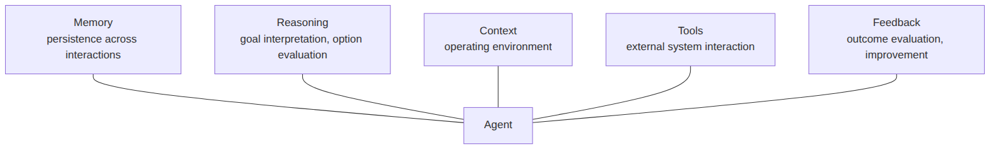

Fig-CH03-01 makes the architectural point visually: the agent is not any single component; it is the system that emerges from the interaction of the five. The undirected edges are deliberate — no single component is upstream of the others; each depends on the others and shapes their operation, and the agent is what appears when all five are composed under a single runtime. At enterprise scale these components are not housed in a single agent. They are distributed across systems of agents that collaborate, coordinate, and specialize.

### 3.3 The Agent Execution Loop

Agent behavior can be understood as a continuous execution loop. While often presented as a sequence, this loop is inherently iterative and adaptive — the agent may revisit earlier stages as new information becomes available or as intermediate results reveal gaps in understanding. The core stages are:

- Trigger — the event or request that initiates an agent action.
- Goal formulation — translation of the trigger into an explicit objective.
- Planning — decomposition of the goal into achievable steps.
- Context assembly — construction of the decision-relevant view of the environment.
- Tool invocation — interaction with external systems to retrieve information or take action.
- Reasoning — application of the model against the assembled context to evaluate options.
- Action execution — the agent’s commitment to a specific action.
- Feedback incorporation — outcome assessment that informs the next iteration. Each stage builds on the previous one, but the process is not strictly linear — the agent may revisit earlier stages as new information arrives or intermediate results reveal gaps. Context assembly is the critical inflection in this loop: it is where intent becomes understanding. Without accurate and complete context at this stage, every subsequent stage is compromised, regardless of how capable the underlying model is. Fig-CH03-02 makes Context assembly’s position explicit: it sits at the midpoint of the loop, between intent (Trigger, Goal formulation, Planning) and action (Tool invocation, Reasoning, Action execution, Feedback incorporation). The dotted feedback edge is what makes the loop a loop rather than a sequence — outcomes re-enter planning, refining the next iteration against what the last one learned, and the agent converges through repetition rather than through a single pass.


### 3.4 Context as the Operating Environment

Chapter 2 closed by naming context as the operating environment, not the input. Here is what that means architecturally. Context in an agent runtime is not a parameter the model consumes; it is the frame within which the model is permitted to reason at all. It establishes:

- what the agent is aware of
- what information is visible
- what actions are permitted
- how signals are interpreted Awareness is the set of entities the agent has been given standing to consider — clients, exposures, products, obligations, decisions already taken. Visibility is the subset of signals attached to those entities that the runtime has composed into the current frame; a signal that exists in the estate but is not in the frame does not affect the decision. Permission is the envelope of actions the agent may take against that frame under the policies and entitlements currently in force — what it may draft, what it may propose, what it may execute, what it must route to a human. Interpretation is the roleand jurisdiction-conditioned lens through which the assembled signals are read — the same covenant ratio reads one way to a portfolio manager and another way to an OCC examiner, and the lens is part of the context, not metadata about it. This distinction matters: the model determines how reasoning is performed; context determines what reasoning is possible. The implication is that improving agent performance is not primarily a function of improving the model — it is a function of improving the environment in which the model operates. A smaller, older model reasoning against a precisely assembled, policy-shaped, freshness-qualified frame will produce sharper decisions than a frontier model reasoning against a stale, role-flat, policy-empty frame; the reasoning an agent can do is bounded above by the environment its runtime has composed for it. Consider a Commercial Banking relationship-management agent looking at the same client through two different context-assemblies. The first assembles a six-month-old AR aging report and a stale CRM call log; the second assembles current treasury position with covenant-compliance signals and the most recent regulatory recordkeeping notification. Same model, same prompt — materially different recommendations. The model is identical. The environment is not. Existing data architectures were designed to deliver context as an input — a join, a query, a feature — not as an environment.

### 3.5 Multidimensional Context

Context in an agentic system cannot be reduced to a single dataset, a single table, or a single retrieval result. It is a composition across several independent dimensions, each carrying its own validity conditions and its own failure modes, and a decision constructed without attending to any one of them is at risk of being architecturally incomplete regardless of how sound the reasoning otherwise appears. Five dimensions frame the composition:

- Semantic — meaning and interpretation of signals.
- Temporal — what is valid right now (with per-signal freshness characteristics).
- Policy — constraints, permissions, and the regulatory regime in force.
- Relational — connections between entities (clients, exposures, products, decisions).
- Perspective — the role-conditioned viewpoint from which context is interpreted. The Semantic dimension carries the interpretive layer over raw signals — what a number means in the workflow that reads it, how a term of art (covenant, exposure, facility, obligor) resolves against the institution’s controlled vocabulary, and how ambiguous values are disambiguated against the surrounding frame. A number without semantic framing is a string; a number with semantic framing is a claim the agent can reason over. The Temporal dimension governs what is true right now as distinct from what was true at an earlier moment. Each signal has a context half-life — a decay characteristic that determines when context is too stale to use. Some signals retain validity for hours, others for seconds; the architectural commitment is to treat freshness as a per-signal property, not a system-wide assumption. The formal model arrives in Chapter 7 §7.7; here we name the concept. The architectural consequence is that context freshness must be carried as a property of every signal the agent reads, not asserted globally by the runtime that reads from it. The Policy dimension carries the constraints, permissions, and regulatory-regime markers under which the agent is operating — exposure limits, entitlements, jurisdictional restrictions, supervisory obligations. Policy is not a validation step applied to the output; it is a precondition on what the agent may reason about and what actions it may take, and in the register §3.7 develops it is part of the operating environment the agent reads, not a filter applied to the response. The Relational dimension carries the graph of connections between entities — parent-subsidiary chains, sponsor-portfolio linkages, counterparty networks, obligor-to-facility bindings. A decision that looks prudent against a single counterparty may look very different against the relational frame that places the counterparty inside a sponsor network whose aggregate exposure has quietly drifted past appetite. Relational context is the substrate on which compositional reasoning operates. The Perspective dimension carries the role-conditioned lens through which the assembled signals are read. The same client file is one object to the relationship manager, a different object to the credit committee, and a different object still to the examiner. Perspective is not presentation styling layered over a shared artifact; it is a dimension of the context itself, and an agent that lacks perspective produces artifacts that satisfy one role while failing the others. A credit decision requires semantic understanding of financial metrics, temporal awareness of recent performance, policy constraints on exposure limits, relational insight into sponsor networks, and perspective alignment with the decision-maker’s role. Omitting any dimension produces an incomplete and potentially misleading representation of reality. Fig-CH03-03 makes the structural difference visible: the left pane is what BI gives an agent today; the right pane is what an agentic system requires. The distinction is not that the right pane carries more data. It is that the right pane carries data along axes the left pane was never asked to preserve — and the axes are what make the frame decision-ready.


### 3.6 Failure Modes of Context-Starved Agents

Agent failures under production conditions are not random, and they are not primarily failures of model capability. They are predictable architectural degradations that surface when one of the dimensions of §3.5 is absent, stale, or misaligned with the decision the agent is constructing. Five modes recur across publicly disclosed incidents in the 2024-2025 window, and each maps to the dimension whose absence it reveals.

| Failure Mode | Architectural Meaning | Banking Example | Real-World Precedent (with URL) |
| --- | --- | --- | --- |
| Context Starved | The agent lacks signals it needs to disambiguate. | eloquent hallucination — a beautiful credit memo built on incomplete data | McDonald's IBM drive-through — CNBC |
| Content Static | The agent serves the same output regardless of audience or jurisdiction. | same output for the analyst, the committee, and the OCC examiner | DoNotPay FTC settlement — FTC |
| Latency Poisoned | The agent operates on signals whose validity has expired. | a decision that was correct 47 minutes ago — looks right, is wrong | Moffatt v. Air Canada — ABA |
| Policy Blind | The agent acts without internalized constraints from the regulatory regime. | action outside current risk appetite but within historical patterns | NYC MyCity chatbot — The Markup |
| Perspective Flat | The agent has no model of role-conditioned interpretation. | no distinction between analyst and regulator views | Klarna 2025 reversal — see §2.3 |

**Context Starved.** An agent is Context Starved when the signals it needs to disambiguate a decision are absent from the assembled frame. The McDonald’s IBM drive-through deployment is the canonical disclosed case: the agent could not disambiguate noisy voice signals against the menu state, producing misreads that included adding bacon to ice cream and ordering dozens of Chicken McNuggets in a single interaction. The failure was not that the model misunderstood language; it was that the understanding had no architectural grounding in the menu state the order depended on. In Wholesale Banking the equivalent surfaces as the eloquent hallucination — a beautiful credit memo that is wrong because the agent never assembled the financial signals the narrative depends on. The architectural implication is that completeness of the assembled signal set is a property of the layer that composes it, not of the model that reads from it. **Content Static.** An agent is Content Static when it serves the same output regardless of who is asking, the jurisdiction at issue, or the regulatory regime in force. The FTC’s final order against DoNotPay is the canonical disclosed case: the Commission found that DoNotPay “did not test whether its AI lawyer operated to the level of a human lawyer” and “did not hire or retain attorneys to test the quality and accuracy of its service’s law-related features,” and the settlement prohibited the deceptive claims outright. The failure was structural: the agent had no architecture for varying its output by principal or regime. In banking the equivalent is producing identical output for the analyst, the credit committee, and the OCC examiner — a posture that survives until the first compliance review. The architectural implication is that output-shape must be a function of audience and regime, not a constant. **Latency Poisoned.** An agent is Latency Poisoned when it operates on signals whose validity has expired relative to the decision at hand. The Moffatt v. Air Canada case is the canonical disclosed precedent: the chatbot served a 90-day-after-booking bereavement-fare procedure that did not match Air Canada’s then-current published policy; the policy of record had moved (or had never matched the chatbot’s representation in the first place); the chatbot’s context had not. The British Columbia Civil Resolution Tribunal rejected Air Canada’s “separate legal entity” defense and held the airline liable. The failure was not a wrong answer; it was an answer correct against a context-state that no longer obtained. In Wholesale Banking the equivalent is a decision that was correct 47 minutes ago — by the model’s lights it looks right; by the freshness of the signals it stood on, it is wrong. The architectural implication is that temporal validity of context must be enforced at the layer that delivers the signal. **Policy Blind.** An agent is Policy Blind when it acts without internalized constraints from the regulatory regime. The NYC MyCity chatbot — powered by Microsoft Azure AI services — is the canonical disclosed case: the chatbot told New York City businesses they could legally take a cut of their workers’ tips, refuse Section 8 vouchers, decline cash payments (in violation of a 2020 NYC law), lock out tenants, and reset rent-stabilization terms — none of which were lawful. The regulations were not encoded into the agent’s operating environment; the agent reasoned over a policy-empty frame. In banking the equivalent is action that sits outside current risk appetite but within historical patterns — the agent finds precedent in the data but no constraint in the regime. The architectural implication is that policy must be embedded as a precondition for reasoning, not validated against the output after the fact. **Perspective Flat.** An agent is Perspective Flat when it has no model of role-conditioned interpretation — when the same artifact serves every consumer because the runtime has no dimension along which to shape it. Klarna’s 2025 reversal, cited in Chapter 2 §2.3 as the canonical fully-autonomous-replacement failure, was at root a Perspective Flat failure: the agent had no model of when a customer interaction required a human’s perspective rather than its own. The failure was not capacity — the system handled the volume — but the absence of a perspective dimension. In Wholesale Banking the equivalent is the agent that produces output without distinguishing the analyst view from the regulator view: the same artifact serves both, and the artifact that satisfied the analyst is not what the regulator needs. The architectural implication is that perspective is part of context itself, not metadata layered on top of it. Agent failures attributed to model limitations are usually failures of environment. The five modes above name per-decision failures. In a multi-agent workflow they compound. A servicing agent reading a stale customer risk profile produces a wrong decision; an escalation agent inheriting that decision reasons over an already-degraded substrate; a resolution agent acting on the cumulative result is two layers deep into compounded error before any human ever sees the workflow. The accumulated degradation has a name — context debt — and it compounds at agent speed, not human speed.

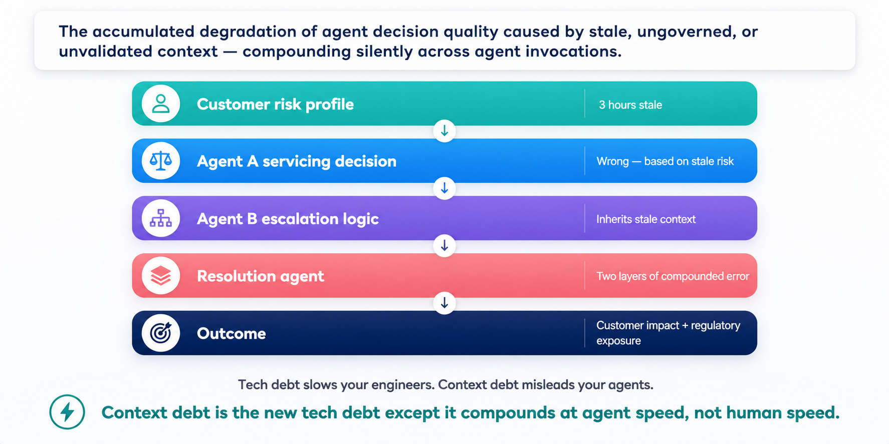

Fig-CH03-04 renders the cascade in five stages: a customer risk profile that is three hours stale at the moment of decision; Agent A’s servicing decision rendered wrong because it stood on the stale profile; Agent B’s escalation logic inheriting the stale context as input rather than refreshing it; the resolution agent operating two layers deep in compounded error; the outcome carrying both customer impact and regulatory exposure. The cascade is what makes context debt structurally different from tech debt. Tech debt slows engineers at human cadence, where the cost is amortized across review cycles; context debt misleads agents at runtime, where the cost is realized inside the decision itself and propagates forward through every subsequent agent that inherits the same substrate. Chapter 7 §7.7 specifies the formal mechanism — the Context Debt scalar D_c, the Context Half-life parameter λ_c, and the conservative fail-closed routing the cascade is meant to be governed by — and Fig-CH07-20 there renders the mechanism-level interaction at handoff boundaries; §3.6 uses the cascade as the failure picture the mechanism answers.

### 3.7 Policy and Governance as Context

In traditional architectures, policy is applied after a decision is made — as a control that validates or rejects outcomes. In agentic systems this is insufficient. The agent must understand constraints before it acts, not after. The shift relocates governance from the review cycle into the runtime, which means policy must arrive with the signals the agent reads, shaped to the role that consumes them and the jurisdiction the decision sits inside. A Commercial Banking relationship-management agent must understand exposure limits, KYC restrictions, and the current risk-appetite settings before it acts on a client request — not after, when the action has already produced regulatory exposure. Embedding policy in the operating environment is what makes compliance intrinsic to decision-making rather than an external validation step. The consequence is that the architectural home for policy is the layer that composes context, not the workflow that consumes the agent’s output; the decision that reads a policy-empty frame has already foreclosed the governance the institution needs.

### 3.8 Decision Traceability and Memory

For agentic systems to be viable in financial services, decisions must be reconstructible — not merely outcomes logged, but the context that was assembled, the reasoning that was applied, and the constraints that were enforced at the moment the decision was taken. A log of what the agent did is not a record of how it decided; reconstruction requires the evidence that stood behind the decision, the policy frame under which it was read, and the freshness of the signals on which it was built. For a Commercial Banking credit decision to survive examiner scrutiny under SR 11-7 or BCBS 239, the bank must reconstruct what the agent knew, why it acted, and under which constraints — not merely log the outcome. The artifact a regulator needs is the decision’s environment, not the decision’s output. The requirement is architectural: memory, context retention, reasoning trace, and constraint trace must be properties of the system delivering decision-ready context, not after-the-fact reconstructions assembled when an examiner asks. A runtime that discards the frame it reasoned from cannot be made auditable by a downstream report writer; the trace must be carried by the layer that composed it.

### 3.9 Implications for System Design

The requirements §§3.4-3.8 have named are not satisfied by extending the existing data ecosystem. They impose new structural demands on the systems that serve agents — demands that cut against the architectural assumptions of batch pipelines, warehouse queries, and retrieval stacks designed to return data on request rather than context on demand. Four implications follow.

- real-time context assembly (not static data retrieval)
- semantic alignment across domains
- policy integrated into reasoning, not applied post-hoc
- traceable and replayable decisions Real-time context assembly means composing the decision-relevant frame at the moment the decision is constructed — across structured and unstructured sources, across systems of record and derived signals — rather than returning a pre-aggregated artifact assembled against a design-time query shape. Static retrieval returns what was asked for yesterday; context assembly returns what is needed now. Semantic alignment means that the vocabulary the agent reasons over resolves consistently across the domains it touches. A covenant means the same thing in treasury that it means in credit that it means in regulatory reporting; a counterparty’s identity is the same across LOBs. Without semantic alignment, reasoning fragments along the lines of the data estate rather than along the lines of the decision.

Policy integrated into reasoning means that constraints, entitlements, and jurisdictional markers are part of the context the agent reads, not filters applied to the output. The §3.7 shift lands here as a system-design requirement: the layer that composes context must carry policy, or the runtime above it cannot honor it without a separate enforcement pass that the regulated register does not tolerate. Traceable and replayable decisions means that what the agent knew, why it acted, and under which constraints must be reconstructible after the fact — not as a best-effort log reassembly but as a first-class property of the architecture. The §3.8 regulatory anchor lands here as a system-design requirement: the layer that composed the decision’s environment must carry the evidence that stood behind it. Why these requirements cannot be satisfied by extending existing data architectures — medallion, mesh, lakehouse, semantic layers, feature stores — is the subject of Chapter 4.

### 3.10 Search vs Inference Dependency

Agentic systems operate through a recursive interplay between search and inference. Inference determines what information is needed; search retrieves and constructs that information; each iteration refines both the context and the understanding of the problem. The loop is not a sequence with a known number of stages; it is a recursion that continues until sufficient confidence is achieved to take action.

```
inference        → drives search
search           → enriches context
enriched context → improves inference
```

This loop is the operational mechanism by which an agent’s working context is iteratively refined to meet the actual decision need rather than fitted to a precomputed template. The template-and-fill model of decision support — a report shape defined in advance, a query backing each field — is what the BI estate was built to produce; the recursive refinement model is what an agentic runtime actually requires, and the two are not variants of the same pattern. How this loop is engineered as a Context Product abstraction — not a per-agent ad-hoc retrieval pipeline — is the subject of Chapter 6. The loop continues until sufficient confidence is achieved to take action. Whether that confidence is reachable depends entirely on the system that constructs and delivers context dynamically — the fabric this document names and the rest of the chapters specify.

## 4. The BI → Agentic AI Gap

Chapter 3 closed by naming the structural demands that existing data architectures cannot satisfy. Here is why they cannot. Enterprise data architectures have reached a point of diminishing returns for the question they were built to answer, and the question has changed. The architectures were designed for descriptive analytics, for reporting, for decision-support delivered to human analysts who assembled context on their own. Agents do not assemble context on their own — they require it to be assembled for them, at the moment of decision, as a coherent architectural artifact. What follows diagnoses the specific structural reasons the existing architectures cannot produce that artifact. Data systems are designed to deliver information. Agentic systems require environments that enable reasoning. The first commitment assumes a human reconstruction of meaning after retrieval; the second requires meaning to be constructed before the reasoning begins. That is the gap this chapter names, and the remaining chapters specify. The architectures surveyed in §4.1 are not failures of engineering — they are successes at the problem they were built to solve. The issue is that the problem has changed, and the architectural commitments that made them successful under the old framing are the same commitments that constrain them under the new one.

### 4.1 The Architecture of BI Systems

Six architectural patterns dominate the enterprise data estate, each a response to what came before. Taken in historical order, they trace the industry’s evolution from schema-committed warehouses through open-format substrates toward meaning-governed query layers — and each, on examination, resolves a problem adjacent to the one agentic reasoning actually poses. **Classical Data Warehouse.** Teradata introduced a database management system purposebuilt for decision support in 1983, and Ralph Kimball’s Data Warehouse Toolkit formalized the dimensional-modeling methodology that defined warehouse design for three decades — star schemas, conformed dimensions, slowly-changing dimensions. Dimensional modeling is a genuine architectural achievement: it made cross-subject-area analytical queries tractable at enterprise scale and gave regulated institutions the reliable numerical truth that executive reporting and regulatory submission depend on. The schema, however, is design-time: grain, join topology, and conformed dimensions are declared before queries are issued. An agent constructing context at decision time does not have a pre-declared query shape; it has a decision to make against signals that may span dimensions the warehouse was never asked to preserve. **Medallion Architecture (Bronze / Silver / Gold).** Databricks popularized the medallion pattern as part of the lakehouse paradigm: Bronze captures raw unvalidated signal, Silver validates and normalizes, Gold produces business-ready aggregations. The contribution is an explicit quality-progression discipline — each layer’s obligations are structurally distinct, which promotes pipeline correctness from a per-job concern to an architectural property. Delta Lake’s ACID foundations, schema evolution, and time travel made the layering reliable at scale. The three layers, however, describe data quality progression — they are orthogonal to context construction at decision time. Gold-layer tables are schema-committed artifacts of the same category the warehouse produced, now sitting on open formats; no layer in Bronze/Silver/Gold is architecturally responsible for per-signal freshness, policy embedding, or perspective conditioning. **Lakehouse.** The 2021 CIDR paper by Armbrust, Ghodsi, Xin, and Zaharia argued that open direct-access table formats — Delta Lake, Apache Iceberg, Apache Hudi — could replace the historical warehouse-vs-lake split with a single governed substrate supporting BI, streaming, and machine learning on one storage layer. ACID transactions over Parquet, Z-order locality, and time-travel queries collapsed the dual-system pattern. By 2025 the lakehouse had become the dominant substrate for enterprises running analytical and ML workloads on a single governed estate. The lakehouse unifies storage and adds ML-first optimization; it does not unify meaning or context construction. What changes is the uniformity of storage; what does not change is the category of output — tables for queries. It is a better place to stand; it is not the layer agents need. **Data Mesh.** Zhamak Dehghani introduced Data Mesh at Thoughtworks in May 2019 and elaborated it in her 2022 O’Reilly book, articulating four principles — domain ownership, data as a product, self-serve data platform, federated computational governance — that together addressed a structural problem the monolithic warehouse and centralized lake both exhibited. The mesh moves ownership of analytical data to the domains that generate and understand it, formalizes datasets as products with contracts and SLAs, and federates governance. It is one of the most influential data-architecture contributions of the 2020s. The unit of architecture, however, is the Data Product: a contracted, domain-owned, analytical artifact optimized for human consumers in domain-aligned teams. Agents need a different unit — a runtime-assembled artifact carrying temporal validity, policy binding, and lineage that Data Product contracts were not written to specify. Data Mesh and the missing layer occupy different architectural slots — Data Mesh productizes domain-owned signal at the dataset boundary; the missing layer composes context across those products at the moment of decision. **Feature Stores.** Uber’s Michelangelo platform (2017) established the canonical pattern, and Tecton subsequently packaged the architecture for commercial adoption; Feast and platform-native feature stores followed. The defining architectural contribution is the online/offline split — an offline store for training-time feature snapshots, an online store for low-latency inference serving, with point-in-time-correct retrieval across the two. This solved a real problem: consistent feature definitions across training and inference, so production models did not silently drift from training-time semantics. Feature stores, however, encode features as pre-computed scalar values or vectors addressable by entity key at inference time; the commitment is to design-time feature definitions materialized on cadence. Agents need context composed across entities, spanning temporal-validity horizons per signal, carrying policy and perspective as first-class dimensions. The feature store is the right architecture for feeding ML models scalar features; it is not the architecture for constructing context.

**Semantic Layers.** The defining 2020s contributions are dbt’s Semantic Layer (powered by MetricFlow, GA October 2024) and Cube (founded 2018), with the Open Semantic Interchange initiative pursuing a vendor-neutral standard. Both solve a real and persistent problem: metric consistency across tools. When dashboards, notebooks, and ad-hoc queries each compute “revenue” differently, the institution’s numerical truth fragments at the presentation layer; a semantic layer defines the canonical formula once, and every downstream consumer computes against the same definition. Semantic layers, however, define metrics — meaning at the query-result layer, not at the context-construction layer. A semantic layer tells the agent that “net revenue” is a specific formula; it does not tell the agent which positions, counterparties, exposures, and covenants constitute the decision environment for a specific credit exception at 14:02 today. It resolves the meaning of data. It does not construct the context of decisions. Across six architectural generations, the pattern holds. **Data is the product. Interpretation is external.** The interpretation was always supposed to happen somewhere — in an analyst’s head, in a dashboard’s rendering, in a downstream query issued against the warehouse. When the reasoner becomes an agent operating at machine cadence, the architecture’s division of labor breaks: the interpretation has no place to happen, and no system in the stack is architecturally responsible for making it happen.

### 4.2 The Requirements of Agentic Systems

The requirements of agentic systems are not symmetric with what BI architectures deliver. Agents need an operating environment — an assembly of the decision-relevant slice of the enterprise, constructed at the moment of decision — and that environment must carry several independent dimensions simultaneously, each with its own validity conditions and its own failure modes. What BI treats as orthogonal properties of a dataset, agents require as coupled properties of a frame. Five dimensions characterize the context an agent operates within. They are the same five Chapter 3 §3.5 named from the agent’s side; here we name them from the architecture’s side — what the system must carry, not what the reasoner must receive.

- Relational structure — entities and their connections across domains.
- Temporal validity — what is true now versus what was true previously.
- Policy constraints — what actions are permissible under current conditions.
- Perspective conditioning — how context is interpreted based on role and objective.
- Semantic resolution — meaning resolved before reasoning begins. Relational structure binds entities across domains — a counterparty sits inside a sponsor network, a position binds to a facility, a facility traces to a covenant, a covenant binds to a jurisdiction. Decision quality depends on assembling the neighborhood, not retrieving an isolated record. BI systems can join across tables on request; what they cannot do is deliver the graph of connections as a coherent first-class substrate that an agent reasons over without reconstructing it query by query. Temporal validity asks what remains true now as distinct from what was true at some earlier moment. Each signal carries a decay characteristic: some are valid for hours, some for seconds, some for quarters. BI systems define freshness as a cadence property of the pipeline; agents need freshness as a per-signal property of the frame, enforced at the layer that assembles it. The architecture must carry temporal validity alongside the signal, not asserted globally by the runtime that reads from it.

Policy constraints govern what the agent may reason about and what actions it may take under the regulatory regime in force. Access control — who can read which rows — is a prerequisite, not the commitment. The agentic requirement is that policy arrives with the context: exposure limits, entitlements, jurisdictional restrictions, supervisory obligations are carried into the frame so the agent reasons over a policy-shaped environment rather than validating output against a policy register after the fact. Perspective conditioning carries the role-conditioned lens through which the assembled signals are read. The same client file is one object to the relationship manager, a different object to the credit committee, and a different object still to the examiner. Perspective is not presentation styling layered over a shared dataset; it is a dimension of the context itself, and an agent that lacks perspective produces artifacts that satisfy one role while failing the others. Semantic resolution is the dimension BI systems have historically deferred. BI systems return rows matching a join key; semantic equivalence between what the agent asked for and what the database returned is the reader’s job. Agentic systems require the inverse commitment: meaning must be resolved before reasoning, so that the agent operates on disambiguated claims rather than on strings whose interpretation has been deferred. A number without semantic framing is a string; a number with semantic framing is a claim the agent can reason over. Five dimensions describe what context is; four commitments describe what the architecture must deliver.

- Context construction — the architecture must assemble the decision-relevant frame at the moment of decision, not hand off a pre-shaped artifact.
- Meaning resolved before reasoning — semantic disambiguation is a commitment of the architecture, not of the consumer.
- Policy embedded in context — what actions are permissible must travel with the context, not be applied downstream.
- State persists across decisions — the architecture must remember what the agent observed, inferred, and decided, so subsequent decisions build on prior work. Context construction is the load-bearing commitment. BI ships an artifact to the consumer and delegates the assembly of meaning to whoever — or whatever — reads it; the agentic requirement inverts the responsibility. The architecture constructs the frame, the agent reasons over the result. The dashboard was correct because the analyst read it correctly; the agent has no equivalent reading step in which delegated meaning quietly resolves. Meaning resolved before reasoning states the semantic commitment as an architectural obligation. A human analyst reconciles “revenue” and “net revenue” and “recognized revenue” silently, drawing on context the system does not carry; an agent operating at machine cadence has no time for silent reconciliation and no shared context in which to perform it. The architecture must resolve the semantics before the reasoning begins, not afterward. Policy embedded in context relocates governance from review cycle to runtime. Access control says the agent may read a table; policy reasoning says the agent may or may not act on what the table contains, under conditions that depend on the current state of the regulatory environment. The agentic requirement is that policy is a dimension of the frame, not a gate applied after the frame is delivered. State persists across decisions commits the architecture to agent memory. BI systems do not carry agent state forward between sessions — each query is self-contained. Agentic systems require state as a first-class architectural commitment: what the agent concluded in the previous decision must inform the context of the next, or the institution is architecting amnesia into its reasoning layer. The distinction is fundamental. **Agents do not consume data. They operate within context.** The architecture that delivers one is not the architecture that constructs the other, and §4.3 enumerates the specific structural mismatches between the architecture the enterprise has and the requirements just named.

### 4.3 Structural Mismatches

The six structural mismatches between BI architectures and agentic requirements are not variations on a single problem. They are six distinct ways the architecture of data delivery fails to produce the operating environment agents need — each naming a specific architectural commitment BI has made well and long, and the specific reason that commitment cannot be extended to satisfy agentic reasoning. **pipelines → environments.** BI pipelines deliver pre-shaped data to pre-declared consumers — a table, a report, a message feed — with output shape fixed at design time. Agentic reasoning requires a dynamically assembled environment: the decision-relevant frame composed at the moment of decision, carrying signals whose combination the pipeline architect did not anticipate because the decision has not yet been posed. A pipeline materializes a known output; an environment composes an unknown one. A pipeline optimized for throughput and reliability is not partway to an environment; it is architecturally pointed in a different direction. This is the Context Starved failure mode Chapter 3 §3.6 named. **data products → contextual synthesis.** Data products are curated artifacts with fixed schemas, produced on a release cadence, consumed as-is. The Data Mesh discipline formalizes each as a governed, contracted asset with declared SLAs. Contextual synthesis is a different commitment: resolving conflicts across multiple data products at runtime — the semantic equivalence between Customer in the CRM product and Customer in the Risk product, the temporal reconciliation of differing freshness SLAs, the role-conditioned shape of the synthesized frame. A data product serves every consumer equivalently by design; a synthesized context serves a specific decision at a specific time for a specific role. Data products are composition inputs, not composed outputs. This is the Content Static failure mode Chapter 3 §3.6 named. **freshness → temporal validity.** BI’s freshness commitment is cadence-based — the snapshot refreshes hourly, daily, nightly — and the cadence is declared by the pipeline. Temporal validity is a per-signal property: a credit-facility drawdown has a validity measured in seconds; an intraday FX rate in milliseconds; a covenant-compliance attestation may hold for quarters. The notion of context half-life — the rate at which a signal’s relevance to the current decision decays — is the per-signal concept BI’s cadence model cannot express. A dataset refreshed hourly is fresh against its pipeline contract and stale against any signal whose half-life is shorter than an hour. The architecture must carry temporal validity alongside the signal. This is the Latency Poisoned failure mode Chapter 3 §3.6 named. **access control → policy reasoning.** Access control governs who may read which tables — rolebased policies, row-level security, column masking — at the access boundary of the data platform. Policy reasoning governs what actions are permissible within context, as a function of the state of the world and the role acting: a permissible action at 09:00 may not be permissible at 14:30 after a rate move. An agent with correct table access but no policy reasoning may read data it is permitted to see and then take an action no permitted role could authorize under the conditions in force. Policy belongs inside the context the agent reasons over, not downstream of it as a post-hoc validator. This is the Policy Blind failure mode Chapter 3 §3.6 named. **data latency → context latency. Data latency is a transport problem. Context latency is a cognition problem.** Data latency measures how quickly bytes move from system of record to consumption substrate; context latency measures how quickly meaning is assembled from those bytes into a decision-ready frame. An enterprise can drive data latency to near-zero with streaming pipelines and still leave context latency architecturally unbounded, because the step that assembles meaning from bytes has no layer to do it in. Optimizing data latency produces faster-arriving bytes whose interpretation is still the consumer’s problem. This is the architectural-category mismatch beneath the Chapter 3 §3.6 failure modes — not a per-signal staleness problem (which mismatch #3 named as Latency Poisoned) but a per-frame assembly-time problem the existing architecture has no layer to solve. **human → machine cognition.** BI outputs are designed for human interpretation. They tolerate ambiguity because the human reader resolves it from domain knowledge the dashboard does not carry, and they present a role-agnostic artifact the human shapes into a role-appropriate decision silently, at reading time. Agentic systems invert every assumption in that design: ambiguity must be resolved before the agent reads, semantics must be explicit, and the role-conditioned shape of the context must be carried by the architecture because the agent has no human reading-position from which to project role into an artifact. The output category itself — human-readable artifact versus machine-reasoning-ready context — is the mismatch. This is the Perspective Flat failure mode Chapter 3 §3.6 named. The six mismatches are the operational consequences of three structural choices BI offers — choices that worked when the reasoner was a human, and that break under agentic load. Fig-CH04-01: Three Structural Choices The three choices are the architectural patterns the six mismatches operationalize — each a legitimate answer to “how does BI serve a human decision-maker?” that fails the substitution when the decision-maker becomes an agent. The six mismatches and the three choices reduce to a single commitment. **BI systems assume context is reconstructed after retrieval. Agentic systems require context to be constructed before reasoning.** The sections that follow trace the implications in Wholesale Banking, diagnose why the 2026 platform add-ons patch the surface without fixing the model, and point at the architectural layer whose absence completes the diagnosis. The empirical demolition of just-expand-the-window assumptions catalogued in Chroma Research’s Context Rot: How Increasing Input Tokens Impacts LLM Performance (trychroma.com/research/contextrot, 2025) — an evaluation across 18 frontier LLMs (GPT-4.1, Claude 4, Gemini 2.5, Qwen3) showing non-uniform performance degradation with input length even on trivial tasks, with the structurally novel finding that shuffled haystacks outperform coherent ones because coherent ordering creates false salience signals that mislead attention — is the empirical foundation of the mismatches above. The structural answer the chapter develops is that context must be constructed under per-frame discipline before reasoning runs, not assembled from larger and larger retrieval windows in the hope that more tokens compensate for the absence of an assembly layer.

![Fig-CH04-01: Three Structural Choices — BI offers three patterns for satisfying “data → decision”: hand the artifact to a human (HITL), materialize state at cadence (snapshot), or encode role in the presentation layer (role-as-dashboard). Each pattern breaks under agentic load — humans cannot match decision cadence, per-signal half-life is shorter than snapshot cadence, and agents need role-conditioned context construction rather than role-conditioned presentation. The six structural mismatches above enumerate the operational consequences of these three structural choices](figures/Fig-CH04-01.png)

### 4.4 Implications in Financial Services

The mismatches are not abstract. In Wholesale and Commercial Banking they surface as specific failure patterns across the domains where agentic systems are being deployed — and the failures trace cleanly to the §3.6 vocabulary the preceding section used to gloss the mismatches. **Credit decisioning (Commercial Banking).** An agent assembling a credit-facility recommendation reads across the warehouse, the CRM, covenant-monitoring systems, position systems, and regulatory recordkeeping. A Context Starved failure arises when the agent sees the refreshed quarterly exposure but not the intraday drawdown the borrower executed this morning — the frame is incomplete because the architecture never composed those signals into a single decision view. A Latency Poisoned failure arises when the covenant-compliance attestation was current at quarter-end but the borrower’s operating cash position has shifted materially in the last week — the architecture carries freshness at pipeline cadence, not at per-signal validity. Neither failure is a capability gap in the model; both are environment-construction gaps. The recommendation was a correct inference from an incorrectly assembled frame. **IB opportunity synthesis (Corporate & Investment Banking).** An agent scanning opportunity signals across deal pipelines, industry news, M&A databases, and broker-dealer activity proposes ranked prospects to relationship managers. A Content Static failure arises when every RM sees the same ranked opportunity list regardless of coverage portfolio or the client’s stated appetite — the architecture produced one artifact and the presentation layer filtered it. A Perspective Flat failure arises when the synthesis returns “top 20 prospects” irrespective of whether the reader is an M&A originator, a DCM banker, or a sector strategist — each of whom needs a different dimensional shape of the same underlying signal. The signal was in the estate; the frame that shapes it per role was not. **Treasury management.** An agent advising on cash positioning, FX exposure, and short-duration investment decisions across corporate-client relationships operates against rate curves, concentration limits, and regulatory-posture constraints that shift during the trading day. A Policy Blind failure arises when the agent proposes an allocation the client is permitted to transact but that violates concentration limits embedded in the current regulatory posture — access control said yes; policy reasoning was not in the frame. A Latency Poisoned failure arises when the rate-curve refresh is daily but the market has moved eight basis points in the last ninety minutes — the frame is correct against its pipeline contract and wrong against the decision at hand. **Fraud and AML triage.** An agent adjudicating transaction-monitoring alerts operates across three consumer roles in a single escalation path — the L1 analyst, the L2 reviewer, and the regulatory examiner — each needing a different shape of the same alert. A Perspective Flat failure arises when the alert is presented identically to all three: L1 needs action-ready triage with suggested disposition; L2 needs investigative history with counterparty graph and prior-alert lineage; the examiner needs defensibility artifacts including reasoning trail and policy-version attribution. A Policy Blind failure arises when the agent proposes a closure disposition the analyst is authorized to enter but that violates the current regulatory filing posture for similar transaction patterns — the agent read the alert; it did not reason over the policy regime the alert arrived within. Across all four domains the pattern is structural. **The constraint is not data availability. The constraint is context construction at decision time.** The data is in the estate; the architecture that constructs it into a decision-ready frame is not.

### 4.5 Why Incremental Improvements Fail

The 2026 platform add-ons responding to the agentic turn fall into two architectural patterns — agent primitives layered onto data-platform substrates, and agent runtimes layered onto workflow-automation substrates. Both deliver real architectural work. Neither constructs the missing layer. **Databricks Agent Bricks** and **Snowflake Cortex** are the data-platform layer’s answer. Agent Bricks (GA June 2025; Custom Agents, Document Intelligence, and Supervisor Agent components reaching GA through late 2025 as of April 2026) is an agent runtime layered on the Lakehouse, with Unity Catalog providing identity-first governance and the AI Gateway routing across models with automatic fallbacks; agents inherit user identity through on-behalf-of token passing so they access only what the user is authorized to use. Snowflake Cortex (Cortex Agents reached GA 4 November 2025 as of April 2026) orchestrates a four-phase loop — plan, retrieve, reason, respond — across three tool types (Cortex Analyst for structured data grounded in semantic-model YAML, Cortex Search for unstructured data, and Custom Tools), all within Snowflake’s governance perimeter where data never leaves the boundary. Both platforms add real work: Unity Catalog’s on-behalf-of propagation, Cortex Analyst’s Semantic Views, the AI Gateway’s automatic evaluation harnesses. Both preserve their substrate unchanged — the Lakehouse still delivers tables, the warehouse still enforces its perimeter — and both layer agent orchestration above the substrate rather than constructing context across substrates. The add-on patches the surface where agents meet data. It does not fix the model of what data systems are for. **Microsoft Copilot Studio** and **Salesforce Agentforce** are the workflow-automation layer’s answer. Copilot Studio (Build 2025 and Ignite 2025 updates shipping multi-agent orchestration, the SharePoint channel, computer use, and conversational authoring through 2025–2026 as of April 2026) is an agent-authoring runtime over Dataverse as the knowledge backbone and Microsoft Fabric as the data estate, using Model Context Protocol for cross-agent and cross-data-source interop — and as Chapter 2 §2.5 named, MCP is a transport and protocol layer, not a context-semantics layer. Salesforce Agentforce (GA 29 October 2024, with Agentforce 360 announced October 2025 as the current evolution, as of April 2026) is a four-layer stack: Data Cloud as the customer-data substrate, CRM applications and clouds above it, AI models including the Atlas Reasoning Engine (System-2 inference-time reasoning in an asynchronous event-driven architecture), and agents at the top. Both runtimes deliver enterprise-grade agent orchestration over their respective substrates. Neither runtime’s substrate — Dataverse, Fabric, or Data Cloud — is a cross-enterprise context fabric that constructs per-signal temporal validity, policy-embedded reasoning, and role-conditioned perspective across heterogeneous estates. This too is patching surface, not fixing model. The retrieval-as-default-trust assumption beneath these platform-add-on architectures has its own empirical demolition. RAG’s Context-Compliance Regime: When Retrieval Is Wrong and the Model Doesn’t Know (Chen et al., arXiv:2605.14473, 2026) measures it directly: standard RAG scores 15.0% accuracy on TruthfulQA adversarial misconception injection across N=500 probes — the model almost universally defers to the injected wrong context over its own correct parametric knowledge — and the paper’s Context-Driven Decomposition causal probe achieves 64.1% mistake-injection causal sensitivity on Gemini-2.5-Flash, surfacing RAG-as-default-trust as a measurably broken architectural assumption rather than a tunable failure mode. The platform-addons inherit this assumption every time they bind agent reasoning to a retrieval primitive without a measured trust signal on the retrieved evidence; the structural answer the chapter develops is to lift the trust dimension into the cognition tier where the closed feedback loop can downweight retrieval sources as their outcome trajectories warrant.

The architectural commitment the missing layer rests on, once named explicitly, is trust-path purity — deterministic source-of-record with optional probabilistic presentation. What is preserved under that commitment is the audit-trail integrity the regulated estate already depends on: the algorithmic substrate — entity resolution, ontology binding, graph traversal, temporal stitching, policy filtering — is the artifact-of-record the supervisor inspects, the examiner re-traces, and the Decision Replay record commits to, never the LLM-rendered narrative that may sit above it. What is relaxed is the mechanism by which that substrate is built: substrate construction is a per-Context-Product configuration property that names which of three modes the product is built under — pure algorithmic assembly, algorithmic assembly with LLM packaging, or algorithmic orchestration with agent-swarm assembly — committing a cost-vs-quality-vs-determinism tradeoff that the routine high-volume case, the narrative-heavy adjudicated case, and the cross-organizational federated case all weigh differently. The reframing ages well because the trust-path is invariant under that mode selection: an agent-swarm-orchestrated Mode 3 product in 2028 and a pure algorithmic Mode 1 product in 2026 anchor against the same algorithmic substrate as the audit-defensible record, and the per-product mode choice is a Ch 6 §6.3 contract-layer property and a Ch 6 §6.4 lifecycle-layer governance decision rather than an architectural commitment that has to be re-litigated when the mechanism of substrate construction evolves. Chapter 7 §7.6 specifies the three-mode mechanism; Chapter 6 §6.3 carries the per-product configuration as the ninth element of the contract; Chapter 6 §6.4 carries it through the eight-step lifecycle.

#### 4.5.1 The Five-Row Platform-Add-On Landscape

The 2026 platform-add-on inventory named above — Databricks Agent Bricks, Snowflake Cortex, Microsoft Copilot Studio, and Salesforce Agentforce — covers four agentic-platform-class entries, each extending an existing enterprise-substrate franchise into agent orchestration territory. April 2026 added a fifth entry of a different architectural class: Google’s rebrand of Dataplex into Google Cloud Knowledge Catalog, productized at Cloud Next ’26 as a hyperscaler-scale knowledgecatalog substrate explicitly positioned for agent consumption. The five-row landscape below stages the foil the rest of §4.5 names, with the architectural anchor and shipping cadence each platform commits to.

| Platform | Architectural Anchor | GA Date |
| --- | --- | --- |
| Databricks Agent Bricks | Lakehouse + Unity Catalog + AI Gateway | GA June 2025 (as of April 2026) |
| Snowflake Cortex | Cortex Agents + Cortex Analyst + Cortex Search within warehouse perimeter | Cortex Agents GA 4 Nov 2025 (as of April 2026) |
| Microsoft Copilot Studio | Dataverse + Microsoft Fabric + MCP protocol | Build 2025 / Ignite 2025 updates through 2025–2026 (as of April 2026) |
| Salesforce Agentforce | Data Cloud + CRM applications + Atlas Reasoning Engine | GA 29 Oct 2024 (Agentforce 360 announced Oct 2025, as of April 2026) |
| Google Cloud Knowledge Catalog | Data Products + Gemini enrichment + BigQuery measures / LookML / MCP toolbox | Launched 2026-04-22 at Cloud Next '26 (rebranded from Dataplex 2026-04-10) |

Each row carries its own Wholesale-banking posture worth elaborating before the categorical asymmetry the table makes visible. Databricks Agent Bricks delivers an agent runtime over the Lakehouse with Unity Catalog as the identity-first governance backbone and the AI Gateway routing across models with automatic fallbacks. The Wholesale relevance is most direct where the data-platform substrate is the institution’s center of mass — a Markets desk running a Lakehouse for cross-asset surveillance, a Commercial Banking line of business running data products on Unity-Catalog-governed schemas — and where agent orchestration is welcomed precisely because the storage perimeter does not have to move. Unity Catalog’s on-behalf-of token propagation, where agents inherit the calling user’s identity so they access only what the user is authorized to use, addresses one of the load-bearing compliance perimeters of Wholesale agentic workloads — the entitlement-projection requirement at the storage boundary. What Agent Bricks does not address is the architecture above the substrate: the runtime composes agent reasoning over Lakehouse tables; the Lakehouse continues to deliver tables. The substrate stays a Tier-2 signal generator; the orchestration sits at the agent-consumption layer above it; what is missing is the layer in between, where context is constructed from signal at the moment of decision. Snowflake Cortex orchestrates a four-phase plan-retrieve-reason-respond loop across Cortex Analyst (structured data grounded in semantic-model YAML), Cortex Search (unstructured corpora), and Custom Tools — all inside Snowflake’s governance perimeter where data never leaves the boundary. For Wholesale, the warehouse-resident posture is the value proposition wherever financial-analytics data has consolidated into Snowflake — counterparty rollups, exposure aggregations, regulatory-reporting marts — and the four-phase loop’s “data never leaves the boundary” property addresses the cross-jurisdictional data-residency constraint that a global Wholesale footprint with EU, APAC, and LatAm presence forces. Sensitive trading data stays inside the warehouse’s perimeter; agents reason in-place; no MNPI crosses an external API boundary. What Cortex inherits from the warehouse architecture is also what it carries forward: the warehouse delivers tables, Cortex Analyst delivers tables shaped by semantic-model definitions, Cortex Search delivers retrieved unstructured passages. Agent orchestration sits above; what is between the warehouse and the agent — the context construction that turns governed signal into a decision-ready frame — remains the consumer’s responsibility. Microsoft Copilot Studio is an agent-authoring runtime over Dataverse as the knowledge backbone and Microsoft Fabric as the data estate, using Model Context Protocol for cross-agent and cross-data-source interoperability. The Wholesale relevance is most direct for institutions whose enterprise estate is Microsoft-centric — Treasury operations on Excel and Power BI, Compliance workflows on SharePoint, M365 productivity tools across the institution — and Copilot Studio composes these signals into agent-authored workflows that the institution’s workflow-automation layer can already trigger and govern. What Copilot Studio does not deliver is a cross-enterprise context fabric: Dataverse is one knowledge backbone, Fabric is one data estate, and a typical Wholesale agentic workload spans Dataverse plus Fabric plus a core-banking platform on a different vendor stack plus a Markets data estate plus a Compliance document store none of these owns. MCP is the transport that lets Copilot Studio reach across; Chapter 2 §2.5 already named MCP as a transport and protocol layer, not a context-semantics layer. The semantics layer above MCP — the layer that constructs decision-relevant frames from cross-substrate signal — is the absent layer the rest of this book names. Salesforce Agentforce is a four-layer stack: Data Cloud as the customer-data substrate, CRM applications and clouds above it, AI models including the Atlas Reasoning Engine (System-2 inference-time reasoning in an asynchronous event-driven architecture), and agents at the top. For Wholesale, Agentforce’s value lands in the relationship-manager workflow: a Commercial Banking RM advising a corporate treasurer, a Wealth Management advisor onboarding a high-net-worth household, an IB banker shaping a pitchbook against a known client. Data Cloud unifies the customer’s identity across Salesforce’s CRM surfaces; the Atlas Reasoning Engine adds inference-time reasoning over that unified view. What Agentforce does not address is everything that lives outside the customer view — the position the RM is recommending against, the covenant the IB banker is structuring around, the credit-policy framework the Commercial RM is operating within, the regulatory perimeter the deal must satisfy. Data Cloud as a substrate is excellent at unifying customer-resident signal; it is not the substrate from which counterparty exposure, instrument terms, jurisdictional policy, and regulatory perimeter assemble into a decision-ready frame. The four entries above share an architectural class — agentic-platform substrates. Each platform vendor extends its existing enterprise-substrate franchise into agent orchestration territory, layering an agent runtime over the storage, warehouse, knowledge-backbone, or customer-data tier the vendor already owned. The fifth entry, Google Cloud Knowledge Catalog, occupies a different architectural class — a knowledge-catalog-class substrate — and the categorical difference is what makes the comparison structurally informative rather than apples-to-oranges. Knowledge Catalog is not an agent runtime; it is a substrate that productizes catalog construction, enrichment, semantic-layer aggregation, and access-aware retrieval as a coherent productized layer below where agent orchestration sits. The categorical difference matters because Knowledge Catalog competes for the same context-construction architectural slot as the four agentic-platform-class entries — not by orchestrating agents but by claiming productized authority over the context substrate the agents would otherwise need to assemble themselves. Where §4.5’s lead pivot named the four agentic-platform entries as “patching surface, not fixing model,” the knowledge-catalog-class entry is a different kind of incomplete answer — a productized substrate that delivers real architectural work at the catalog tier and still leaves the cognition tier missing. The five-row landscape names the structural asymmetry; the §4.5.2 deep-dive walks why the comparison repays the depth. Google Cloud Knowledge Catalog — first naming: Google Cloud Knowledge Catalog (formerly Dataplex; rebranded 2026-04-10; launched 2026-04-22 at Cloud Next ’26 as the universal context engine for the enterprise); subsequent references in this document use the short form Knowledge Catalog — productizes, per its launch positioning (Pydimukkala & McVeety, 2026-04-22), three pillars: Aggregation (cross-vendor data unified via Lakehouse federation), Enrichment (Gemini-driven catalog metadata and entity extraction at landing time), and Search (access-control-aware semantic retrieval). Data Products are the foundational unit, documented (Google Cloud Data Products documentation) as “curated, logical groupings of data assets, formally packaged to be discoverable, trusted, and accessible,” carrying refresh-frequency contracts (a “weekly at 8:00 AM PST” example) and access-group plus IAM-role binding. For Wholesale, the relevance is the catalog-as-substrate posture: an institution can productize its data estate — counterparty masters across CRM and core banking, exposure rollups from risk systems, document corpora from research and credit — as Data Products carrying refresh-cadence and access-group contracts, then expose them for agent consumption via MCP. The substrate is real, the productization is shipped, and the architectural ambition is serious. The question §4.5.2 takes up is whether the catalog substrate’s productized architecture covers the seven dimensions a context fabric must carry.

#### 4.5.2 Google Cloud Knowledge Catalog — Seven-Dimension Deep-Dive

The seven dimensions below are the architectural axes the Cognitive Context Fabric carries — temporal reasoning, policy, perspective and projection, decision replayability, context debt formalism, assembly mechanics, and control-plane / data-plane separation. The deep-dive walks Knowledge Catalog’s shipped approach against each axis, with the calibrated reading from public Google documentation overlaid for verdict-correctness. Where the publicly described product architecture is verified by Google’s own launch and documentation surfaces, the prose cites the source; where the claim is diagnostic-inferred from the absence of a primitive in the public surface, the prose flags it explicitly. The fair-engagement framing is that Google ships a genuinely productized Tier-2 substrate; the architectural gap the deep-dive surfaces lives at the Tier-3 cognition layer above it, not at the substrate Google productizes. **Temporal reasoning.** Knowledge Catalog’s freshness model is refresh cadence — Data Products carry refresh schedules (“weekly at 8:00 AM PST” being the canonical documentation example per Google Cloud Data Products documentation), and downstream consumers know when the substrate was last materialized. This is pipeline freshness: the property that the materialization process ran on schedule. The CCF’s temporal dimension T is bitemporal validity-as-state — each signal in G(E, R, T, P, Π, L) carries its own validity envelope, distinct from when it was last refreshed; a credit exposure recorded at 14:02 today is true-as-of-14:02 even if the pipeline materializing that signal runs at midnight, and a counterparty-master record bears its validity period independently of when the catalog last updated the row. Refresh cadence is a pipeline-level property; bitemporal validity is a per-signal graph-state property. The two solve adjacent problems, and the absence of the latter at the substrate layer is not a defect — Knowledge Catalog is a catalog. The architectural conclusion is that bitemporal validity is a cognition-layer responsibility the catalog substrate does not assume. **Policy.** Knowledge Catalog enforces access at the IAM and access-group boundary per the Data Products documentation: each Data Product has owners, access groups, and underlying IAM bindings; consumers see what their identity is authorized to see. This is policy as access control, applied after the catalog has been constructed. The CCF’s policy dimension P is policy-at-construction: regulatory bindings (ECOA, SR 11-7, FinCEN, EU AI Act, jurisdictional requirements), internal risk-threshold policies, and entitlement-formative rules are encoded inside the Context Product the agent receives, not appended as post-retrieval filters. The difference is architectural: a Knowledge Catalog Data Product that is accessible to a principal returns the same canonical content for everyone authorized to see it; a Context Product constructs differently for different principals because the policy regime active for the principal’s role and jurisdiction shapes which entities and relationships compose into the product in the first place. The catalog substrate does the right thing at its layer — access control over data assets. The construction-time policy embedding the CCF requires is one layer above where the catalog operates. In Wholesale terms, the catalog substrate and the cognition tier are structurally incompatible at the policy layer; composable only if CCF sits above the catalog — a posture the four-tier pattern §4.5.2’s close names as the architectural implication.

**Perspective and projection.** The most subtle dimension. Knowledge Catalog’s launch positioning does not document a “Perspectives” capability for the catalog itself — the verified absence per Pydimukkala & McVeety, 2026-04-22 is consistent with the access-control-via-IAM model documented for Data Products. The canonical “Perspectives” framing originates in Google’s separate BigQuery and Looker Perspectives feature, where Perspectives provides role-shaped views over a single canonical schema — RBAC-shaped, access-control-shaped, filtering-shaped. The CCF’s Π is typed subgraph substitution: the same entity has different semantic shape per principal, not because rows are filtered out but because the typed structure projected for the principal is a different graph than what another principal sees. A Counterparty Credit Risk Context Product for a credit officer projects exposure, covenant, and collateral as load-bearing entities; for a Compliance officer over the same counterparty, the same projection request yields a different graph — SAR-relevant transaction patterns, sanctions-screening artifacts, KYC document spans — where the credit officer’s covenant-and-exposure structure simply does not appear because it is not what Compliance reasons over. RBAC says which rows you may see; Π says what the typed structure of the graph is for you. The catalog’s perspective primitive is the former. Chapter 7 §7.5 carries the canonical distinction. **Decision replayability.** Based on the publicly described Knowledge Catalog architecture, no Decision Replay primitive equivalent to the CCF’s five-dimension record is documented; the catalog-level audit surface Google describes — lineage at the catalog, data-product, and asset granularity — operates at a different scale than the per-decision environment reconstruction the CCF specifies. The CCF’s Decision Replay is a per-decision artifact: the complete graph substate at decision time (the projected G(E, R, T, P, Π, L) the agent reasoned against), the active policy bindings, the model version, the perspective conditioning, and the content generation path. SR 11-7 model validation, OCC consent-order monitoring, and FinCEN examiner re-tracing each require this granularity; the catalog-level audit surface does not deliver it. The publicly available product documentation does not detail per-decision replay primitives, and the absence is what is claimed here. Chapter 7 §7.6 carries the per-mode replay footprint as a per-Context-Product property; Chapter 7 §7.10 carries the replay-across-assembly-modes mechanism. The architectural conclusion is that the regulated-enterprise audit posture sits at a granularity the catalog substrate does not address. **Context debt formalism.** The CCF’s D_c = 1 − (F · C · S) multiplicative-conjunctive form quantifies how far short the assembled context falls from the coverage the decision requires, across freshness, completeness, and semantic consistency — and routes the decision to Forced-LLM Conditional Assessment Routing when D_c crosses a class-specific threshold. No equivalent primitive is documented in Knowledge Catalog’s publicly described product architecture. Refresh cadence is a pipeline-freshness signal; coverage and semantic consistency are not surfaced as catalog-level quality measures bound to a decision class. The absence is diagnostic-inferred from the catalog’s product surface — a catalog substrate is not architecturally responsible for decision-class adequacy. The CCF’s commitment is to make adequacy a first-class structural property the routing logic depends on; Chapter 7 §7.7 carries the formalism, and §7.7’s defended-choice subsection rejects the weighted-additive alternative against regulator-adversarial reading. **Assembly mechanics.** Knowledge Catalog’s Enrichment pillar runs Gemini-driven extraction and metadata generation at landing time per Pydimukkala & McVeety, 2026-04-22 — LLM inference is embedded inside catalog construction. The architectural commitment is the opposite of what the Phase 12 compound anchor above commits: in Knowledge Catalog, the LLM is part of how the substrate is built; in the CCF, the algorithmic substrate is the artifact-of-record and LLM inference is a per-Context-Product mode-selection decision (Mode 2 algorithmic-with-LLM-packaging or Mode 3 algorithmic-with-agent-swarm-orchestration) that happens at delivery time over a substrate already assembled algorithmically. The two postures are not equivalent and not interchangeable. For a Wholesale credit decision where SR 11-7 model validation depends on the substrate being deterministically reconstructible — and where smoothing across regulator-flagged inconsistencies must be surfaced rather than reconciled — embedding LLM inference at catalog construction time relocates the trust-path from the algorithmic layer to the LLM layer in a way the regulated estate cannot defend. This is fair-engagement framing, not pejorative: Google ships a substrate where LLM enrichment at landing time is a feature; the CCF’s trust-path-purity commitment forbids the same posture at the cognition tier because the cognition tier is what the examiner re-traces against. The two architectural choices are coherent within their respective layers. **Control plane vs data plane.** The CCF’s architectural separation between Control Plane (versioned policy, λ_c calibration, operator-behavior policies, model registries) and Data Plane (graph state, Context Operators, projection runtime) carries the governance lineage every configuration change touches — a FinCEN guidance update is a versioned Policy event in the Control Plane that propagates lazily into the Data Plane, with full audit trail. The publicly described Knowledge Catalog governance surface operates at retrieval-time access-control granularity — IAM bindings, access groups, audit logging at the asset and data-product level — and an Istio-style Control-Plane / Data-Plane separation for versioned policy propagation is not documented in product literature. Whether such a separation exists internally is a question the public surface does not answer; the architectural conclusion is that the catalog substrate’s governance surface is consumer-facing at the retrieval boundary, not infrastructure-facing at the policy-versioning boundary. Chapter 7 §7.8 carries the Control-Plane specification. **Six-tuple verdict-count summary.** Tested against the six-tuple G(E, R, T, P, Π, L), Knowledge Catalog scores 2 hits + 1 partial of 6 — entities and relationships are productized at hyperscaler scale (54B entities, 1.6T facts per Google’s publicly described Knowledge Vault inheritance and Gemini extraction); lineage is partial (catalog-level rather than per-claim); temporality, policy, and projection are explicit misses (refresh cadence → bitemporal validity; IAM → policy as graph state; RBAC → typed projection). See Chapter 5 §5.1 for the canonical 6-row verdict table. **The four-tier composition pattern.** The seven dimensions above surface the gap; the deployment posture the gap implies is a four-tier composition rather than a head-to-head replacement. Tier 1 is the institution’s systems-of-record-and-signal — core banking, CRM, payments, risk, documents, market feeds — the existing estate the institution already operates. Tier 2 is Knowledge Catalog (or an equivalent catalog substrate) as the productized data-product layer that aggregates, enriches, and surfaces Tier-1 signal with cataloging discipline. Tier 3 is the Cognitive Context Fabric — runtime assembly under temporal validity, policy-at-construction, role-conditioned projection, context debt, and decision replay — composing context above the catalog substrate. Tier 4 is agent consumption. Chapter 8 §8.X elaborates the four-tier pattern with the concrete integration mechanics; the compressed form here names the strategic posture the deep-dive earns by walking the seven dimensions: the CCF composes above Knowledge Catalog as a Tier-3 cognition layer; the two are not adversarial but architecturally stacked, structurally incompatible at the policy layer in isolation but composable when CCF sits above the catalog. **Trade-secret moat.** Operational tuning constants — per-domain λ_c calibration values and replay-record-schema specifics — are not disclosed in this deep-dive; the architecture stays published per the existing Chapter 7 §7.7 illustrative λ_c table and the five-dimension replay record at Chapter 7 §7.10, while the per-domain calibration methodology and operational replay-record-schema specifics remain withheld as the trade-secret moat per the milestone’s strategic positioning.

### 4.6 Reframing Existing Investments

The diagnosis is not that existing data architectures are obsolete. They are essential. The diagnosis is that they have been asked to do something they were not designed for. Warehouses, lakehouses, Data Mesh implementations, feature stores, and semantic layers are the enterprise substrate on which everything else stands — and the correct move is not to replace them but to clarify what they are for. They are not systems of decision. They are systems of signal generation. **Data ecosystems are upstream providers of signal. They are not downstream consumers of decisions.** The existing estate produces the signals; a layer above it composes those signals into the decision-relevant frame; the agent reasons over that frame. Nothing in the estate is replatformed; the missing layer is what is added. The framing lands across all six architectures named in §4.1. Classical warehouses generate historical signal — what happened, governed and audit-ready. Medallion architectures refine signal through bronze, silver, and gold curation. Lakehouses deliver multi-engine-accessible signal over a governed substrate. Data Mesh delivers domain-owned signal with data-as-a-product discipline. Feature stores deliver ML-ready signal vectors with training-serving consistency. Semantic layers deliver meaning-governed signal with consistent metric definitions. Every one of these systems is producing signal. None is producing decisions. The layer that would compose signal into decisions — construct context from signal at the moment of decision — is the layer §4.7 names.

### 4.7 The Missing Layer

The sequence of sections above — the requirements (§4.2), the mismatches (§4.3), the Wholesale Banking implications (§4.4), the failed incremental fixes (§4.5), the reframing (§4.6) — converges on a single architectural claim. **The layer that constructs decision-ready context from signal is missing.** The absence is visible once the two stacks are placed side by side. Fig-CH04-02: The Structural Discontinuity The two stacks differ by one layer. That layer is the subject of the remaining specification work — the architectural primitive this chapter has diagnosed as absent, and which the balance of the document introduces. The architectural layer that constructs context at the moment of decision — the layer whose absence this chapter has diagnosed — is the subject of Chapter 5. This chapter has named the absence. The remaining chapters specify what fills it. The fabric this document has been describing — and which Chapter 5 specifies — is what agentic reasoning requires as its operating environment.


## 5. The Cognitive Context Fabric: Conceptual Model

Chapter 4 closed by diagnosing the absence of a layer that constructs context at the moment of decision. Chapter 5 specifies that layer. The diagnosis did not describe a missing product or a missing platform; it described a missing architectural responsibility. What follows establishes what that responsibility is, how the architecture represents state in order to discharge it, and the principles that distinguish the resulting layer from the systems it composes above. The limitations of enterprise data architectures are not failures of engineering. They are the natural consequence of systems designed with a different objective. For decades, financial institutions have invested in systems that capture, store, and organize data with extraordinary precision. These systems answer questions about what has happened and, increasingly, what is happening now. They are optimized for durability, consistency, and access. What they do not do — at least not as a first-class capability — is construct meaning at the moment a decision must be made. When a human analyst interacts with data, the analyst performs the cognitive work of interpretation: relationships are inferred, temporal relevance is evaluated, policies are applied, decisions are synthesized. The system provides inputs; the human provides understanding. Agentic systems invert this model. They require the system itself to construct understanding before reasoning begins — to assemble fragmentary signals into a coherent representation of reality that is complete enough, current enough, and governed enough to support action at machine cadence. The architectural layer this chapter specifies — the layer whose absence Chapter 4 diagnosed — exists for that purpose. It is a new architectural responsibility, distinct from the responsibilities existing data systems carry. It does not replace those systems; it composes above them, operating alongside them, transforming their outputs into decision-ready context at the moment a decision must be made. The remainder of this chapter specifies what that layer is, the formalism through which it represents state, the principles that distinguish context from content, and the high-level architecture that realizes it.

### 5.1 From Systems of Record to Systems of Cognition

Enterprise information architectures have accumulated three distinct responsibilities over time, and the transition from descriptive analytics to agentic reasoning foregrounds the third of the three. Naming all three and stating the architectural role each discharges is the foundation on which the rest of this chapter rests. Three tiers describe the architecture. First, Systems of Record — durable, consistent, access-first systems designed to answer the question what happened? The institution’s transactional ground truth lives here: core banking ledgers, customer systems, event streams, instrument masters, market data of record. These systems are foundational and irreplaceable. They provide the raw material from which all higher-order capabilities are derived, and their primary concern is fidelity — that information is captured accurately, stored durably, and made accessible through well-defined interfaces. Above them sits a second tier: Systems of Signal Generation — the governed enterprise substrate that medallion pipelines, data mesh domains, master-data platforms, knowledge graphs, semantic layers, feature stores, and document stores together produce. Each architecture in this tier delivers governed signal at a particular grain, cadence, and quality contract. Each is valuable within its envelope. None of them, on its own, produces decisions. And above Signal Generation sits the third tier — Systems of Cognition — the interpretive layer whose responsibility is to construct meaning at the moment a decision must be made. Historically this tier existed, but outside the architecture: in an analyst’s head, in a dashboard’s rendering, in a downstream query shaped by a human reader’s intent. The agentic shift relocates it into the architecture itself. Historically, interpretation has been externalized. A human analyst retrieves data, mentally reconstructs relationships, evaluates relevance, applies policy, and synthesizes a decision. This process is powerful, but it is also fragile, inconsistent, and non-scalable — and at machine cadence, it does not run at all. Agentic systems require this process to be internalized. A system of cognition performs the functions that were previously performed by humans: it integrates signals across systems, resolves relationships, evaluates temporal validity, applies policy constraints, and produces a coherent representation of the current state. This representation is context. The cognitive layer’s sole responsibility is to construct it. The transition’s structural arrival is sharpest when seen against the data-perspective the Tier-2 substrate stops at — and where the cognition-tier responsibility takes over. The data-perspective vs context-perspective distinction names the boundary explicitly. The data-perspective models entities, relationships, and lineage as the architectural primitives a data-modeling discipline can productize at scale: the assertion these objects exist, these connect to those, this came from that. Google Cloud Knowledge Catalog is the concrete adversarial example shipping at hyperscaler scale — 54 billion entities, 1.6 trillion facts inherited from Knowledge Vault productization plus Gemini-driven extraction, with catalog-level provenance binding each entity and relationship to its data-product source. The entire toolchain that turns enterprise signal into a productized graph belongs at the data-perspective; the CCF does not duplicate it. The context-perspective begins where the data-perspective ends. Where the data-perspective treats time as refresh cadence (a pipeline-level property of when the catalog last materialized), the context-perspective treats time as T — bitemporal validity-as-state: each signal in G(E, R, T, P, Π, L) carries its own validity envelope independent of when the underlying pipeline ran. Where the data-perspective treats policy as access control over a constructed canonical view, the context-perspective treats policy as P — graph-state element: a regulatory binding, internal limit, or entitlement-formative rule shapes which entities and relationships compose into the principal’s graph in the first place, not which rows the response filter drops. Where the data-perspective treats role as RBAC over a single canonical schema, the context-perspective treats role as Π — typed reshape per principal: different principals receive different typed graphs, not different filtered views of one graph. The six-tuple verdict table below makes the boundary concrete on Knowledge Catalog's specific shipped capabilities.

**Six-tuple verdicts for Google Cloud Knowledge Catalog** (canonical reference; Ch 4 § 4.5.2 compressed verdict-count prose cross-cites this table)

| Dimension | CCF specification | Google Cloud Knowledge Catalog (shipped) | Verdict |
| --- | --- | --- | --- |
| E (Entities) | Typed entity primitives composing into G(E, …) at runtime; ontology-bound and policy-shaped per principal | Knowledge Vault productization at hyperscaler scale: 54B entities + 1.6T facts; Gemini-driven entity extraction at landing time | HIT — Google's data-perspective productization of entities matches the CCF's structural requirement at the substrate layer; the cognition-layer Π parameterization sits above |
| R (Relationships) | Typed relationship primitives with semantic affordances (exposure / influence / dependency / interaction) the agent reasons over | Knowledge-graph-class relationships productized at the same hyperscaler scale; cross-vendor aggregation via Lakehouse federation; semantic-layer productization via BigQuery measures + LookML | HIT — Google's relationship productization matches the CCF's structural requirement at the substrate layer; the cognition-layer composition rules sit above |
| T (Time / Temporal validity) | Bitemporal validity-as-state: each signal carries its own validity envelope independent of pipeline refresh cadence | Refresh cadence per Data Products documentation (e.g., "weekly at 8:00 AM PST"); pipeline-freshness primitive, not per-signal validity envelope | MISS — refresh cadence → bitemporal validity. The pipeline-level property and the per-signal graph-state property solve adjacent problems; bitemporal validity is a cognition-layer responsibility the substrate does not assume |
| P (Policy) | Policy-at-construction: regulatory bindings, internal limits, and entitlement-formative rules encoded inside the Context Product, not appended as post-retrieval filters | IAM + access groups per Data Products documentation; access control applied after catalog construction | MISS — IAM → policy-as-graph-state. The access-control layer enforces what the principal may see of a single canonical view; policy-at-construction shapes what gets composed into the principal's graph |
| Π (Projection / Perspective) | Typed subgraph substitution per principal: same entity has different typed shape for different roles, not different filtered views of one canonical shape | "Perspectives" feature (in Google's separate BigQuery / Looker product surfaces) provides role-shaped views over a single canonical schema; RBAC-shaped at the response boundary | MISS — RBAC → typed projection. The Perspectives feature filters one canonical view; Π constructs different typed graphs for different principals |
| L (Lineage) | Per-claim, passage-level lineage binding every Context Product claim to its source span (with Anthropic Citations API as the canonical primitive for unstructured content per Ch 7 § 7.10) | Catalog-level lineage at the dataset / data-product / asset granularity per Data Products documentation; not per-claim or per-passage | PARTIAL — catalog-level lineage covers a meaningful substrate-tier audit surface but does not extend down to the per-decision evidence chain SR 11-7 / FinCEN / OCC examiner re-tracing requires |

Two hits at the substrate layer (E + R productized at hyperscaler scale); one partial at lineage (catalog-level coverage, per-claim gap); three explicit misses at temporal validity, policy, and projection — the three dimensions where the cognition-tier responsibility takes over. The verdict pattern is the structural reading of where the data-perspective stops and the context-perspective begins: Knowledge Catalog productizes E + R at scale the CCF inherits as Tier-2 substrate; T + P + Π are the cognition-tier primitives the CCF adds; L extends from catalog-level (Tier-2 substrate) to per-claim (Tier-3 cognition layer). Chapter 4 § 4.5.2 compressed verdict-count prose cross-cites this table as the canonical authoritative reference. **The transition from record-keeping to cognition is not a replacement but a layering of responsibilities.** Systems of Record continue to answer what happened? Systems of Signal Generation continue to produce governed signal. What is added is a tier above them whose output is meaning, not data. The formalism through which that tier represents state — the Context Graph, defined by a six-tuple — is the subject of Section 5.2.

### 5.2 Context Graph Definition G(E, R, T, P, Π, L)

The Context Graph is the formal structure through which the cognitive layer represents state. It is defined as a six-tuple:

```
G(E, R, T, P, Π, L)
```

This formulation defines the minimum set of dimensions required for decision-time reasoning to be valid. Each dimension is necessary. None are optional. **A knowledge graph tells you the relationship exists. A context graph tells you whether that relationship was active, relevant, and authoritative at decision time.** Knowledge graphs are about facts. Context graphs are about decisions. The T, P, Π, L dimensions are what separate them. **Entities (E)** represent the objects that exist within the enterprise domain. These include clients, accounts, instruments, counterparties, and internal actors. In traditional systems, entities are records. Within the Context Graph, entities are semantic anchors. They provide the reference points around which meaning is constructed — and when the anchor is ambiguous, everything attached to it becomes unreliable. **Relationships (R)** define how entities connect. Not just joins. These connections capture exposure, influence, dependency, and interaction. A client is not simply linked to an account; it is exposed to risk, influenced by counterparties, and connected through a network of relationships that must be understood holistically — a three-dimensional relational shape that a two-dimensional join collapses. **Time (T)** introduces temporal validity. It answers not just when something occurred, but whether it remains relevant. A credit exposure from six months ago does not carry the same weight as one from five minutes ago. Time determines whether a signal contributes to current context or should be discounted by its context half-life. **Policy (P)** encodes constraints — regulatory requirements, internal governance rules, operational thresholds, entitlements, jurisdictional-residency obligations. In traditional architectures, policy is applied after data retrieval. In the Context Graph, policy shapes context before reasoning, not after. It determines which states are valid inputs and which actions are permissible outputs of the agent’s decision. **Perspective (Π)** reflects role-based interpretation. Context is not absolute. A credit officer, a relationship manager, and a compliance analyst require different views of the same underlying reality. Perspective determines which signals are emphasized and how relationships are interpreted — it is a dimension of the context itself, not a presentation layer on top of it. **Lineage (L)** captures how context is constructed — the signals used, the relationships traversed, the policies applied, the transformations performed, the model versions invoked. Lineage is essential for auditability and trust. It allows decisions to be explained, validated, and replayed. When the signal source is unstructured text, Lineage extends further still, pinning each claim to the passage it rests on — but that extension is the subject of Section 5.6. Each dimension is necessary. That claim admits a test: name a decision the agent is trying to make, then remove the dimension and describe the failure that results. Six such tests follow, one per dimension, drawn from Wholesale and Investment Banking use cases where the failure mode is concrete. Consider a Commercial Banking credit-memo agent drafting an annual renewal for a portfolio company called “Acme Holdings LLC.” Two entities with that legal name appear in the institution’s loan system — one incorporated in Delaware, the other a mid-market California subsidiary of an unrelated parent. Without canonical entity resolution — a Legal Entity Identifier anchoring each distinct organization — the agent conflates the two: portfolio-company financials from the Delaware entity attach to credit-history covenants of the California entity, and the memo surfaces a recommendation supported by the wrong balance sheet. The failure is not inference; it is semantic anchoring. This is the Context Starved failure mode Chapter 3 §3.6 named. Consider a Corporate and Investment Banking FX post-trade agent aggregating intraday counterparty exposure for a multi-national conglomerate whose trading-entity subsidiaries transact separately on the bank’s FX desk. Without the relationship edge linking each trading entity to its parent group, the agent reports exposure only at the trading-entity level — a view that is accurate for each unit and structurally misleading for the group. The parent-group aggregate may materially exceed the bank’s counterparty concentration appetite while each constituent trading entity sits within individual limits. The failure is the relational variant of Context Starved — the relationship dimension has been collapsed to structural joins. Relationships in the Context Graph capture exposure, influence, and dependency; without them, the decision frame is two-dimensional where the risk is three-dimensional. Chapter 3 §3.6 named this vocabulary. Consider a Commercial Banking credit-memo agent drafting a Q3 renewal in September 2026, pulling the issuer’s most recent 10-K — filed in March 2026 for fiscal year 2025. The annual filing cadence of Form 10-K means the leverage ratios, working-capital metrics, and debt-service coverage the memo relies on reflect balance-sheet state from up to eighteen months earlier. A treasury drawdown executed in Q2 2026, a new senior note issuance in June, a covenant waiver renegotiation in August — none of these surface through a 10-K whose validity has decayed well past the half-life the decision requires. Time is not metadata; it is a dimension of the signal itself, and when the temporal validity of a claim has expired, the claim is Content Static — stale signal treated as current. The formal half-life model arrives in Chapter 7 §7.7; the vocabulary Chapter 3 §3.6 named applies here without modification. Consider a markets-desk agent retrieving research-desk coverage of a corporate client. Among the candidate documents sits a draft research note containing non-public earnings guidance — material non-public information that, under institutional information-barrier policies and Regulation Fair Disclosure, must not flow across the research-to-trading boundary. Without a policy dimension shaping the candidate space before retrieval runs, the agent assembles context that includes passages it was never permitted to read, and the downstream action carries MNPI provenance it cannot legally act upon. The failure is Policy Blind — the agent reasoned over a policy-empty frame. Policy in the Context Graph shapes context before reasoning, not after; the mechanism by which it does so is specified later in the document. Chapter 3 §3.6 named the vocabulary. Consider a single credit memo for a syndicated-loan renewal, read in turn by three roles within the institution. The relationship manager needs emphasis on client-relationship health, cross-sell opportunities, and pricing trajectory. The credit-risk officer needs emphasis on covenant sufficiency, historical utilization patterns, and portfolio concentration. The compliance analyst needs emphasis on KYC refresh status, AML flags on related entities, and the policy-version under which prior approvals were taken. Without Perspective, the runtime serves one projection — typically the one the originating author shaped — to all three roles; the memo satisfies one, bewilders the second, and endangers the third. Perspective is not presentation styling; it is a dimension of the context itself. Without it, the assembled frame is Perspective Flat — one role’s view flattened onto all others. The full mechanics of Projection as typed transformation are specified later in the document; the vocabulary Chapter 3 §3.6 named applies here directly. Consider an AML agent drafting a Suspicious Activity Report narrative describing an unusual wire-corridor pattern flagged by transaction monitoring. Every claim in the narrative — the parties, the corridor, the typology, the prior precedent — derives from signals in the Context Graph: chat messages among correspondents, wire-narrative free-text, adverse-media articles, prior SAR filings. Under 31 CFR §1020.320 the bank must maintain the SAR and supporting documentation for five years, and examiners reviewing the filing during BSA/AML examinations expect to trace each claim back to its source. Without passage-level Lineage pinning the narrative to specific passages, pages, and chat turns, the SAR cannot withstand examiner re-tracing, and decision replay of the agent’s reasoning cannot reproduce the evidence chain. Lineage is the auditability dimension — the explicit extension of Chapter 3 §3.6’s taxonomy that the L-dimension names. The mechanics of passage-level lineage and replay are specified later in the document. All six dimensions are required; decision-time reasoning without any one of them is unreliable. T, P, Π, L are what elevate the context graph from a static representation to a living decision substrate. Without all six, the decision is incomplete. **The Context Graph is not an enhancement. It is a requirement.** The comparison the six-tuple invites is with the four-tuple that underwrites the semantic-layer algebra practitioners already rely on — Fig-CH05-01 makes the extension visible.


The three dimensions the Context Graph adds — Policy, Perspective, Lineage — are not incidental. They are what the six vignettes above have shown to be individually necessary, and they are what Section 5.7 later frames as the algebraic extension that earns the Context Graph its status as the representational substrate of the cognitive layer.

### 5.3 Dynamic Context versus Dynamic Content

The distinction between dynamic context and dynamic content is foundational to the architectural layer this chapter specifies. Dynamic context represents situational intelligence — understanding of what is true of the world right now and why it matters for a decision about to be taken. Dynamic content represents expressive intelligence — the generation of outputs that communicate, justify, or act on that understanding. These capabilities are often conflated, leading to systems that produce sophisticated outputs without a coherent understanding of the underlying situation. Dynamic context answers the question: what is the state of the world right now, and what is relevant? It requires the system to continuously integrate signals from multiple sources, evaluate their relevance, and maintain awareness of change. This includes semantic retrieval, temporal reasoning, role-based conditioning, and environmental grounding — the six dimensions of G(E, R, T, P, Π, L) the previous section specified.

Dynamic content answers a different question: how should this understanding be expressed? It involves assembling outputs, selecting formats, adapting to audiences, and integrating feedback. Its concern is communication, not understanding. The relationship between the two is directional: **Context informs content. Content does not define context.** When this relationship is inverted, systems produce outputs that are fluent but ungrounded. They may appear intelligent, but they lack consistency, explainability, and compliance. This is also the structural answer to one family of pipelines that blurs the two. Systems that produce sophisticated output from stored retrieval artifacts — text snippets pre-assembled into a document-flavored index — produce dynamic content from fundamentally static retrieval. They are content-first pipelines. What the architectural layer this chapter specifies produces is dynamic context, continuously reconstructing graph state at decision time rather than reassembling stored snippets. In Wholesale Banking terms: an issuer’s 10-K filing is dynamic content — the expressive artifact that arrives at filing time, disclosing what the issuer wishes to communicate about its condition. A context product about the same issuer is dynamic context — the situational understanding composed at decision time from the 10-K, the most recent research note, covenant history, and adverse-media signals. The 10-K informs the context product; the context product does not define the 10-K. The cognitive layer this chapter specifies enforces a strict separation. It is responsible for constructing dynamic context. It does not generate content. Instead, it provides the foundation upon which content-generating systems operate — ensuring that all outputs are grounded in a consistent and governed representation of reality.

### 5.4 Core Thesis

The core thesis of the cognitive layer this chapter specifies is that **context (not data) is the unit of decision-making**. Data is an input. Context is an interpretation. Data, in isolation, is insufficient — it must be interpreted, combined, constrained, and validated. Context is the result of this process. This distinction has profound implications. Context must be constructed dynamically at runtime. It cannot be precomputed, because relevance depends on the specific decision being made. It must integrate multiple dimensions simultaneously, ensuring that no critical aspect is omitted. Context must be validated before use. It must satisfy constraints of completeness, consistency, and policy compliance. It must also be temporally valid, reflecting the most current state of the world. Context must be traceable. Every decision must be explainable, and that requires a record of how context was constructed. By elevating context to a first-class system capability, the architectural layer transforms decision-making from an implicit process into an explicit, engineered function.

### 5.5 Mapping Data Systems to CCF

Existing data architectures are not replaced by the cognitive layer. They are repositioned. Each carries an architectural contribution that the layer above composes with rather than supplants, and the mapping below names what each contributes, what it does not, and how the cognitive layer composes above it.

| Architecture | What it does | What it lacks | How CCF composes above it |
| --- | --- | --- | --- |
| Medallion (Bronze/Silver/Gold) | Progressive data-quality gates: raw / validated / business-ready | Runtime-constructed context; per-signal freshness; policy binding at assembly time | Context Operators read Gold as one signal source; Context Products derived on demand |
| Data Mesh (Dehghani) | Domain-owned Data Products with contracts; federated governance | Runtime-assembled synthesis across domains with temporal + policy + perspective dimensions | Context Products complement Data Products on consumer side — composition partner, not replacement |
| MDM (Reltio / Informatica / Stibo) | Golden records via entity resolution — canonical identity at scale | Relationships, temporal validity, policy, perspective, lineage as first-class | CCF treats MDM's golden records as authoritative E source; composes above with R / T / P / Π / L |
| Knowledge Graphs (Neo4j / TigerGraph / Neptune) | Entities + relationships + traversal primitives at enterprise scale | Temporal validity per edge; policy shaping; role-conditioned projection; passage-level lineage | CCF uses KG storage as substrate for E and R; adds T / P / Π / L inside the formalism |
| Semantic Layers (Cube / dbt / AtScale / LookML) | Governed business-metric definitions; text-to-SQL grounding; (M, D, T, J) algebra | Policy, perspective-as-typed-transformation, passage-level lineage as tuple dimensions | CCF's G(E, R, T, P, Π, L) is strictly richer algebra — Fig-CH05-01 visualizes the extension |
| Feature Stores (Tecton / Feast / Hopsworks) | Online/offline feature split; train-serve parity for ML; feature registry | Runtime-assembled frames shaped by decision; perspective differentiating by role | Context Products subsume feature views; Π adds role-differentiation the feature store's global definition does not encode |
| Document stores / Enterprise Search / Vector stores (Smarsh / Proofpoint / NICE / Verint; Elasticsearch / OpenSearch; Pinecone / Weaviate / Milvus / Chroma) | Durable retention; full-text + hybrid retrieval; ANN over embeddings | Persisted graph structure with typed entities extracted from text; temporal validity; policy shaping; passage-level lineage | CCF references these as L1 signal sources; parse → chunk → embed → policy-shape → similarity-rank → graph-edge pipeline lands unstructured content in G (mechanics specified later in the document) |

The medallion architecture, introduced by Databricks as part of the Data Lakehouse paradigm, encodes progressive data-quality gates — Bronze captures raw ingestion, Silver validates and conforms, Gold delivers business-ready aggregates. The discipline of separating obligations by layer is a genuine architectural contribution; it made lakehouse-scale pipeline correctness a structural property rather than a per-job concern. What the layers do not produce is runtime-constructed context: Gold is a consumption-ready table, not a decision-ready projection. The cognitive layer sits above Gold — Operators read Gold as one signal source among many; Context Products are derived on demand from the resulting Graph state. Zhamak Dehghani’s Data Mesh — domain-oriented decentralized ownership, data-as-a-product, self-serve data platform, federated computational governance — is one of the most influential data-architecture contributions of the 2020s; it reoriented the enterprise from centralized data-lake bottlenecks toward domain-aligned Data Products with contracts. What Data Products encode is analytical meaning for human consumers who bring their own context, experience, and reasoning; what they do not encode is decision-time synthesis across domains with temporal validity, policy binding, and role-conditioned perspective. Context Products complement Data Products on the consumer side — they are the runtime-assembled companion to the stored Data Product, not a replacement for the mesh. Master Data Management platforms — Reltio, Informatica, Stibo — produce golden records via entity resolution, reconciling duplicate representations of the same real-world entity across the institution’s transactional systems into a single canonical record with a durable identifier. This is the correct answer to “how do we know who is who” at enterprise scale. What MDM does not do is carry the relationships, temporal validity, policy binding, perspective, or lineage that turn an entity into decision-ready context. The cognitive layer treats MDM’s golden records as the authoritative E (entity) substrate — Operators compose above with R / T / P / Π / L at assembly time, inheriting the MDM-anchored entity identity rather than duplicating it. Knowledge graphs — Neo4j, TigerGraph, Amazon Neptune — provide entities, relationships, and graph-traversal primitives at enterprise scale; they are the mature substrate for reasoning about connected data. What a knowledge graph stores is facts: the relationship exists, the entity is typed, the traversal returns. What a knowledge graph does not store, by architectural intent, is the temporal validity of each relationship, the policy under which it may be visible, the role-conditioned projection that shapes whose graph view it joins, or the lineage pinning each edge to its originating signal. The cognitive layer uses KG storage as the substrate for the E and R dimensions; it adds T / P / Π / L inside the formalism, turning static representation into a living decision substrate. Semantic layers — dbt’s Semantic Layer powered by MetricFlow, Cube, AtScale, LookML — decouple business-language metric definitions from the warehouse or lakehouse queries that compute them. A single definition of revenue, active customer, or net interest margin governs every downstream consumer: dashboards, embedded apps, text-to-SQL agents. The Open Semantic Interchange initiative is making the metric definition a vendor-neutral standard. The algebra the semantic layer supports is a four-tuple (M, D, T, J) — measure, dimension, time, join. The cognitive layer’s G(E, R, T, P, Π, L) is strictly richer algebra: the three missing elements — P policy, Π perspective as typed transformation, L passage-level lineage — are what Fig-CH05-01 above makes visible. Feature stores — Tecton, Feast, Hopsworks — solve the train-serve-skew problem for operational machine learning by maintaining paired offline and online stores with point-in-time-correct retrieval, a feature registry for shared definitions, and materialization pipelines that keep the online store synchronized. They are the mature answer to operating ML at scale. What a feature store delivers is a pre-registered scalar feature addressable by entity key; what it does not deliver is a runtimeassembled projection shaped by the specific decision, the role asking it, the policy regime in force, and the temporal validity per signal. Context Products subsume feature views: the feature becomes one dimension of the assembled projection, and perspective adds role-differentiation the feature store’s global definition does not encode. The institution’s unstructured corpus lives across three architectural tiers. WORM-compliant archives — Smarsh, Proofpoint, NICE, Verint — enforce the durable-retention obligations of SEC 17a-4, FINRA 4511, and MiFID II Art 16(7). Enterprise search systems — Elasticsearch, OpenSearch — deliver full-text and hybrid retrieval over parsed text. Vector stores — Pinecone, Weaviate, Milvus, Chroma — serve approximate-nearest-neighbor retrieval over embedding representations. What the three tiers together produce is retrieval-ready text: passages, chunks, and embedding vectors addressable by query. What they do not produce is persisted graph structure with typed entities, relationships extracted from text, temporal validity of document claims, policy shaping of the candidate space, role-conditioned perspective, or passage-level lineage persisted for audit. The cognitive layer references these systems as the L1 signal sources for unstructured content; a parse → chunk → embed → policy-shape → similarity-rank → graph-edge pipeline lands documents in the Context Graph with half-life and lineage intact. The mechanics — and the architectural answer to the “just another RAG pipeline” objection — are specified later in the document. The seven mappings above share a single architectural posture: the data ecosystem is not being replaced; it is being repositioned. Medallion remains the quality-progression discipline. Data Mesh retains the domain-ownership architecture. Master-data platforms preserve the golden-record substrate. Knowledge graphs continue as the relationship-traversal primitive. Semantic layers define governed metrics. Feature stores deliver train-serve parity for operational ML. Archive platforms enforce regulatory retention obligations the institution cannot abrogate. Each is a composition partner of the cognitive layer above it, not a competitor — and the investments the institution has made in each are preserved, not replaced. Chapter 8 §8.2 names this posture formally as “layering, not replatforming”; it is the central design principle that makes the cognitive layer a pragmatic architecture for regulated enterprises with decades of accumulated data-platform capital rather than a greenfield thesis. The full mapping — three tiers, each crediting an architectural contribution the next composes with rather than replaces — is captured in Fig-CH05-02.

### 5.6 Context Products — Derived not Stored

Context Products are the operational output of the cognitive layer. They are not static datasets. They are dynamically constructed projections of the Context Graph shaped by the specific conditions of a decision — the decision’s intent, the perspective of the role taking it, the temporal validity required of the signals that inform it, and the policy under which it may be taken. The same underlying signals produce different Context Products depending on these conditions. For example, a liquidity-management decision requires a Context Product that emphasizes intraday balances and payment flows; a credit decision requires a Context Product that emphasizes exposure, covenant state, and temporal debt-service coverage. Both Context Products are derived from the same underlying signals — core banking ledgers, position systems, MDM-resolved entities, credit-memo document store — but they are constructed differently, projected to different shapes, shaped by different perspective conditioning. This is what “derived not stored” means: the Context Product is assembled at the moment it is requested, from the Context Graph’s current state, under the conditions of the specific decision. It is not a pre-materialized artifact. The Lineage dimension of the Context Graph carries particular weight when the signal source is unstructured. When a credit-memo Context Product cites the issuer’s 2025 10-K, passage-level Lineage L records not the document reference alone but the specific page-and-paragraph span on which the claim rests — the sentence the agent read, the passage that supported the inference, the source page that can be surfaced to a reviewer in under five seconds. This is the primitive that separates a reviewable claim from a confident hallucination. The component mechanism on which passage-level L for unstructured builds — Anthropic’s Citations API — and the full Decision Replay architecture are specified in Chapter 7. Context Products are the uniform contract that Chapter 2 §2.5 named as the missing layer’s defining property — the architectural interface under which consuming systems receive runtime-assembled, policy-bound, lineage-traceable projections of state regardless of which underlying signals the projection integrates. The full specification of the contract — its schema, its freshness obligations, its lifecycle, and its key operational principles — is the subject of Chapter 6. Within the derived-not-stored commitment, the contract carries Assembly Mode as a per-product property naming one of three modes — pure algorithmic assembly, algorithmic assembly with LLM packaging, or algorithmic orchestration with agent-swarm assembly — under which the product is built; the per-product mode-selection mechanism is specified at Chapter 7 §7.6. The derived-not-stored commitment is also the structural answer to a family of pipelines that persists retrieval artifacts and re-assembles them at query time. Microsoft GraphRAG — and the pipeline family it represents — persists snippets as stored retrieval artifacts; the cognitive layer this chapter specifies derives Context Products at decision time by projecting from the live Context Graph. The distinction is **retrieve-then-filter** vs **project-then-retrieve**.


The mechanism that enables project-then-retrieve — where policy shapes the candidate space before retrieval runs, before similarity is even measured — is specified in Chapter 7. The derived-not-stored commitment is also the structural answer to a different challenge — the proposal that decision-relevant context should be compressed into model weights rather than externalized at all. Reimagining LLM Memory: Using Context as Training Data Unlocks Models That Learn at Test-Time (Sun & Choi, NVIDIA Developer Blog, developer.nvidia.com/blog/reimagining-llmmemory-…, 2026) proposes Test-Time Training with End-to-End formulation — context absorbed via inference-time next-token-prediction gradient updates into the model’s weights, achieving a 35× speedup at 2M tokens versus full attention with constant inference latency regardless of context length. The architectural disagreement with the fabric is structural, not preferential: context-as-weights compresses information about entities and relationships passably but cannot encode bitemporal validity, policy-as-graph-state, role-conditioned projection, or passage-level lineage — the four dimensions T, P, Π, L of the six-tuple G(E, R, T, P, Π, L). A weight delta does not carry an expiry the half-life can observe, does not enforce MNPI or jurisdictional residency at the substrate before inference, does not produce different typed shapes per principal, and is not replayable: the specific evidence that shaped the response compresses into a gradient and disappears, which the Decision Replay record Chapter 7 § 7.10 specifies cannot reconstruct. For any decision class where decision replay or policy binding is load-bearing — which in regulated banking is most of them, including the credit-memo Mode 2 narrative-packaging artifact-of-record property Chapter 6 § 6.3 binds to — the fabric must own the substrate while the model is free to choose its inference strategy over the bounded context the fabric supplies.

### 5.7 The Cognitive Context Fabric Architecture

The architecture that composes the cognitive layer is what this chapter has been specifying across six sections — and it is named, formally, the Cognitive Context Fabric. The fabric comprises five architectural components, each with a specific responsibility. The remainder of this section previews those five components; their full specification is the subject of a later chapter. At its foundation is the Context Graph — the structural substrate of state, shaped by the six-tuple G(E, R, T, P, Π, L) specified in Section 5.2. Above it sit the Context Operators — the computational machinery that performs traversal, temporal evaluation, policy shaping, similarity analysis, and perspective projection over the Graph. The Context Assembly Layer integrates Operator outputs into coherent runtime projections; it is the layer where meaning is produced. Context Products are the outputs of the Assembly Layer — the projections that consuming systems receive through the uniform contract Section 5.6 introduced. And the control plane — governing the interaction of all four components, enforcing policy, and recording lineage for decision replay — completes the five-component architecture. This architecture is not arbitrary. Each component exists because it addresses a specific requirement that the six dimensions of G(E, R, T, P, Π, L) impose. Together they form a system that enables agentic reasoning by ensuring context is constructed before decisions are made.

#### 5.7.1 On Prior Art

The Cognitive Context Fabric is a synthesis, not an invention. Its architectural ingredients have well-attested precedents, and acknowledgment is part of the specification.

Rasmussen et al.’s Zep (arXiv:2501.13956) — with its open-source Graphiti engine — introduces a bitemporal knowledge graph for agent memory, tracking both valid time (when a fact was true in the world) and transaction time (when the graph ingested it). This is the primitive the T dimension builds on — Zep establishes durable, interrogable temporal state as an agent-infrastructure component; the Cognitive Context Fabric extends it with per-claim context half-life and supersession-as-Policy-event. Palantir Foundry Ontology is the closest full-stack commercial analog — a semantic / kinetic / dynamic three-layer architecture establishing that an operational ontology with integrated action semantics can exist as a production-grade primitive. The gaps the six-tuple closes are two: there is no explicit Π as a typed function in the Foundry formalism, and there is no formal Half-Life primitive for per-claim temporal decay. The OPA (Open Policy Agent) project — a CNCF-graduated policy-as-code precedent — establishes externalized policy evaluation via declarative rules on structured input. The architecture’s policy machinery inherits OPA’s externalized-decision semantics; where OPA separates policy evaluation from application logic, the architecture specified in this chapter extends the primitive from boundary enforcement to composition — policy shapes the candidate subgraph before retrieval runs, rather than gating after retrieval. The Cube / dbt / AtScale / LookML semantic layers together establish the metric-definition and text-to-SQL grounding precedent. The four-tuple (M, D, T, J) they underwrite decouples shared meaning from the warehouse query. The G(E, R, T, P, Π, L) formalism is strictly richer algebra — and Fig-CH05-01 above pairs the two tuples to make the extension explicit. Beneath these engineering precedents sit the academic research foundations from which the architectural posture takes its lineage. Kotseruba & Tsotsos’s 1995–2018 survey of 84 implemented cognitive architectures (Artificial Intelligence Review 2018) shapes the layered-primitives commitment; Marcus’s 2020 hybrid-AI critique informs the algorithmic-substrate framing; Ji et al.’s IEEE TNNLS knowledge-graph survey (2022) grounds the temporal-graph formalism the T plane operationalizes; Chen, Herrera, and Hwang’s cognitive-computing lineage (IEEE Access 2018) situates the third-era framing; Bondac et al.’s PLS-SEM trust-pathway validation (Electronics 2026, DOI 10.3390/electronics15020372) empirically anchors the Context Trust Triangle; Uddin et al.’s KG-augmented reinforcement-learning agent state (Nature Scientific Reports 2025) anchors structured graph knowledge as load-bearing decision input. The 2026 agentic-memory wave is the third or fourth era of a multi-decade research program; the surrounding design space was mapped before the transformer. Each precedent contributes a primitive or pattern. What this architecture contributes is the unified six-tuple with explicit P, Π, and L as first-class citizens, operated on by deterministic Context Operators, and emitted as Context Products derived at request time. The composition is novel; the ingredients are not. The fabric this chapter has specified — Systems of Record and Signal Generation composed with a Cognitive layer whose output is derived Context Products shaped by G(E, R, T, P, Π, L) — is how agentic reasoning is served decision-ready context. Chapter 6 specifies Context Products in full: the contract that makes them a reliable interface, the lifecycle that governs their ephemeral validity, and the principles by which they serve as decision-ready meaning.

## 6. Context as a Product

Chapter 5 introduced Context Products as derived projections of the Context Graph shaped by G(E, R, T, P, Π, L). Chapter 6 specifies what that projection must carry — the contract, the lifecycle, and the principles that make it reliable as the interface between systems and agents. The shift from data-as-product to context-as-product is not an incremental rebranding; it is a category change in what the enterprise asks of the layer that sits between its data systems and its agents. Existing enterprise data architectures answer what happened and, increasingly, what is happening now — but the interpretive work of deciding what that data means for the decision at hand has historically remained with the human consumer. Agentic systems invert that model: the system must construct meaning before reasoning begins. The work this chapter specifies is what it means to treat context itself as a product — an engineered artifact that is consumable by agents, governable under regulatory constraint, and interoperable across evolving agent frameworks. The Cognitive Context Fabric this document specifies — as Chapter 5 introduced with the derivation-not-storage commitment — treats context through that product lens rather than as ad-hoc retrieval from a data store. The directional shift this chapter enacts — **From Data as a Product → Context as a Product** — is a category change, not an incremental refinement. Data Mesh established Data as a Product as the operating vocabulary for domain-owned datasets with contracts, and that vocabulary has reshaped how large enterprises govern their analytical estates. What this chapter specifies is what the next product primitive — the one agents actually consume — looks like: the contract it carries, the lifecycle it governs, and the principles that distinguish it from the datasets it composes above.

### 6.1 Why Data Products Are Insufficient

Data products solved the fragmentation problem of enterprise data. Mesh-oriented domain ownership, discoverable registries, and contract-backed dataset interfaces moved large financial institutions past the silo-plus-ETL era that preceded them, and the discipline of treating a dataset as a product with owners, SLAs, and schemas is a genuine architectural contribution the cognitive layer composes above rather than replaces.

What data products were not designed to deliver is runtime-assembled meaning for an agent making a decision. Three assumptions of the data-product discipline hold when the consumer is a human and break when the consumer is an agent. First, interpretation is assumed to occur outside the system — the consumer is expected to bring the semantic, temporal, and policy understanding that turns a dataset row into a decision input. Second, context is assumed to be reconstructed by the consumer — the consumer assembles cross-domain signals into a coherent decision frame at the point of use. Third, decisions are assumed to be made downstream of data access — the data system’s job ends when the query returns. These assumptions held when consumers were humans reading dashboards and compiling analytic reports. They do not hold for agentic systems. An agent cannot wait for a human to reconstruct context; the system itself must do so, at the moment the decision is taken, with the typed structure, policy binding, and role-conditioned perspective that decision reasoning requires. What data products are not shaped to provide is the set of properties decision-time reasoning requires: runtime assembly of signals from multiple domains under a single temporal envelope; role-conditioned projections that surface different emphases of the same entity for different consuming agents; policy binding applied during construction rather than as a post-retrieval filter; passage-level lineage pinning every claim to the source span it rests on; and TTL-bound validity that expires with the moment of the decision. These are not optional enhancements to the data-product contract. They describe a different contract, serving a different consumer — the agent rather than the analyst — under a different temporal discipline: the moment of decision rather than the window of a query. The gap between data products and what agentic consumers require is not a quality issue. It is a category mismatch. Data products are the right primitive for human analytic consumption; context products are the right primitive for agentic decision-time reasoning. The two primitives coexist, and naming the boundary between them is what the rest of this section does. Data Mesh gave the enterprise domain-owned Data Products with contracts, federated computational governance, and a coherent operational vocabulary for decentralized data ownership. Dehghani’s four principles — domain-oriented decentralized ownership, data-as-a-product, self-serve data platform, and federated computational governance — solved the fragmentation problem of enterprise data that preceded them and are the reason the modern data estate looks like a mesh of owned products rather than a centralized lake. What Data Mesh was not built to deliver is runtime-assembled synthesis across domains under temporal validity, policy binding, and role-conditioned perspective — the properties agents require at decision time. The four principles were written for an era whose consuming workload was human analytic reasoning, and they answered that era’s binding constraint — fragmentation — with precision. Agentic consumption is a different workload with a different binding constraint, and the answer to that constraint is a different primitive layered above, not a redefinition of what Data Products were asked to be. **Data products are necessary inputs. They are insufficient outputs.** Context Products are the complementary consumer-side interface the agent layer requires; the two are composition partners, not competitors. Data Products supply the governed substrate that feeds the Context Graph; Context Products assemble that substrate into decision-ready meaning at runtime under a contract the agent can depend on. The category-mismatch framing the § 6.1 paragraph above commits is sharpest when the contract test is concrete — when the eight properties a Context Product contract carries are tested against the contract surface a Google Data Product actually delivers. The persistent vs ephemeral distinction names the architectural posture each contract commits to. The Data Product is persistent: a curated, refresh-scheduled dataset that materializes at pipeline cadence and stays available between refreshes; consumers query the materialized dataset as a stored artifact. The Context Product is ephemeral: a runtime-assembled artifact that exists only for the moment of the decision and the TTL window after it; consumers receive a constructed product the fabric assembles on demand. Knowledge Catalog’s Data Products carry the persistent-graph posture documented in Google Cloud’s Data Products documentation (refresh-frequency + access-group contracts, with a “weekly at 8:00 AM PST” example anchoring the persistence model); Context Products carry the runtime-assembled posture Chapter 6 § 6.5 commits to as a derived-not-stored principle. The two postures are structurally incompatible at the policy layer; composable only if CCF sits above the catalog — the Data Product’s access-control posture cannot be reshaped at construction time, and the Context Product’s policy-at-construction posture cannot inherit pre-materialized policy that was bound at a different moment than the decision. The contract test below makes the boundary concrete on eight specific properties the Cognitive Context Fabric's vault canonical context-as-a-product specification names. Three properties hit at the substrate layer; five properties miss as the category-change set that distinguishes a Data Product contract from a Context Product contract.

**Eight-property Context Product contract test against Google Data Product** (canonical reference; Ch 6 § 6.3 compressed verdict-count prose cross-cites this table)

| CCF Property | Google Data Product (shipped) | Verdict |
| --- | --- | --- |
| Schema-ish — Typed structure of entities, relationships, attributes consumers reason over | Data Product schema is dataset-shaped (rows + columns + types); discoverable via catalog metadata | HIT — substrate-tier schema productization matches the typed-structure requirement at the Data-Product layer |
| Refresh-as-Freshness — When the underlying signal was last materialized | Refresh cadence in Data Product contracts (e.g., "weekly at 8:00 AM PST"); pipeline-freshness primitive | HIT — refresh cadence matches the freshness-SLA requirement at the substrate layer; bitemporal validity-as-state is the § 6.3-element-level commitment Phase 12 D-10 carries separately |
| Discovery/Addressability via MCP toolbox — Agents locate Context Products by intent; structured queries with intent + role + freshness parameters | Knowledge Catalog Discovery + MCP-native retrieval primitive; pre-built MCP tools surface Catalog assets to consuming agents | HIT — MCP-toolbox-shaped retrieval matches the discovery / addressability requirement at the consumer-access boundary |
| Runtime-assembled — Product is constructed at the moment of the decision, not retrieved from a pre-materialized cache | Data Products are persistent, refresh-scheduled artifacts that exist between materializations; consumers query the stored artifact | MISS — persistent-graph posture is the category-change axis the contract test names. Knowledge Catalog ships persistent Data Products; CCF ships ephemeral Context Products. The two are not interchangeable contract surfaces |
| TTL-with-recompute — Bounded validity after which the product is invalid; new request reconstructs against current graph state | Refresh cadence governs pipeline materialization, not consumer-side TTL bound to decision freshness; consumers receive what the pipeline produced regardless of TTL | MISS — refresh cadence → TTL-bound recompute. The Data Product contract does not commit to consumer-side recompute on TTL expiry; the contract is dataset-availability, not decision-time-bounded validity |
| Π typed reshape — Different principals receive different typed graphs of the same underlying entity per role and policy regime | Data Products serve the same canonical content to all authorized consumers; "Perspectives" feature (in Google's separate BigQuery / Looker surfaces) filters one canonical view, not constructs different typed views | MISS — RBAC-shaped Perspectives is the category-change axis. Π typed substitution is a cognition-tier mechanism; the Data Product contract does not carry the per-principal projection primitive |
| Policy-at-construction — Regulatory bindings, internal limits, entitlement-formative rules encoded inside the product, not appended as post-retrieval filters | IAM + access groups governing who may access the Data Product; access control applied after the Data Product is constructed; policy as filter, not as graph-state element | MISS — IAM-shaped access control → policy-at-construction. The Data Product contract assumes the product is the same for all authorized consumers; the Context Product contract assumes the product is shaped by policy at the moment of construction |
| Entitlement-formative — Entitlement is a graph-state property that shapes which entities and relationships compose into the product, not which fields the response filter drops | Access groups govern visibility of Data Products and their fields; entitlement-as-visibility-filter, not entitlement-as-construction-primitive | MISS — visibility-filter → construction-primitive. The Data Product contract carries entitlement as access control over a stored artifact; the Context Product contract carries entitlement as a formative dimension of what gets assembled |

Three hits at the substrate layer (Schema-ish + Refresh-as-Freshness + Discovery/Addressability via MCP toolbox); five misses at the category-change axes (Runtime-assembled + TTL-with-recompute + Π typed reshape + Policy-at-construction + Entitlement-formative). The miss pattern is the productization gap the vault canonical context-as-a-product article names — the five properties Knowledge Catalog Data Products do not carry are the five properties that distinguish a Context Product from a Data Product contract. The contract test confirms the category mismatch the prose above asserted: Data Products and Context Products are not contract variants of the same primitive; they are different contracts serving different consumers under different temporal disciplines. Chapter 6 § 6.3 compressed verdict-count prose cross-cites this table as the canonical authoritative reference. Chapter 8 §8.2 names this posture formally as “layering, not replatforming” — Context Products do not replace Data Products, they complete the interface agents require. The table below names the six properties on which Data Products and Context Products differ in kind.

| Data Products | Context Products |
| --- | --- |
| Persisted datasets | Runtime-constructed projections |
| Human interpretation | Machine-consumable meaning |
| Periodic freshness | TTL-bound validity |
| Schema-centric | G(E, R, T, P, Π, L)-centric |
| Access governance (post-retrieval) | Policy-embedded by construction (principal-scoped) |
| Reusable inputs | Decision-scoped outputs |

Three of these axes — runtime construction, principal-scoped policy embedding, and TTL-bound validity — are the minimum differentiators that establish Context Products as a category change rather than a dataset variant. The other three — machine-consumable meaning, G-tuple-centricity, and decision-scoped outputs — are the architectural companions that make the first three operational. The objection most often raised at this moment is that Context Products are just another RAG pipeline with fancier framing. That objection credits RAG fairly: retrieval over unstructured corpora is RAG’s genuine contribution, and the passage-level Lineage primitive Chapter 5 §5.6 named rests on that lineage of techniques. The distinction is architectural, not cosmetic. What a RAG pipeline does is retrieve-then-filter: similarity-rank a candidate pool of ephemeral chunks, then post-filter the matches by policy. What a Context Product does is project-thenretrieve: policy shapes the candidate space before retrieval runs, and passage-level Lineage pins each claim to the document span it rests on inside a typed graph whose temporal validity has already been established. The candidate space an agent reasons over is no longer a similarity-nearest slice of ephemeral chunks; it is a projection of a governed graph state, shaped by the agent’s intent, role, and freshness requirements. The mechanism that enables project-then-retrieve — Policy-before-Similarity composition — is specified in Chapter 7 §7.4.

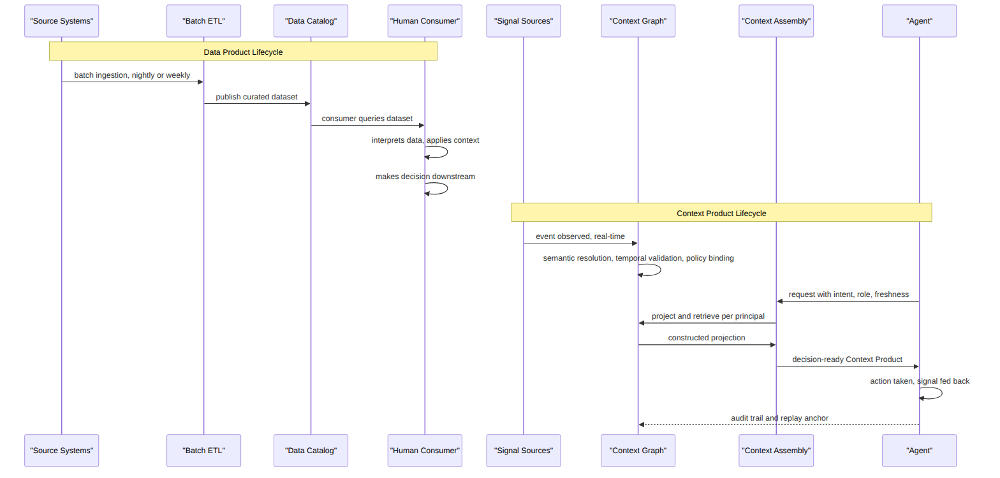

The category mismatch the preceding table and pivot paragraph name in prose is visible in lifecycle form — Fig-CH06-01 places the two lifecycles side by side. The Data Product lifecycle (top half) is batch-shaped and human-interpretation-terminal — source systems feed batch ETL into a catalog; a human consumer queries the dataset, interprets it, and acts downstream. The Context Product lifecycle (bottom half) is event-shaped and agent-action-terminal with a closing replay edge — signal sources feed the Context Graph in real time; semantic resolution, temporal validation, and policy binding happen at graph-mutation time; an agent requests a Context Product with intent, role, and freshness parameters; Context Assembly projects and retrieves per principal; the constructed projection is decision-ready at delivery; the agent acts, and the action’s audit trail closes back onto the graph as a replay anchor. The category mismatch the 6-row table above names in prose is what this figure makes visible in lifecycle form. The closing replay edge Fig-CH06-01 shows on the Context Product side — agent action folding back into the Context Graph as audit trail — is what the Data Product lifecycle structurally lacks, and is what Chapter 7 returns to when it specifies Decision Replay as the forensic substrate of agent action.

### 6.2 Definition of Context Product

§6.1 framed the category change. §6.2 states what a Context Product is — the definition that the contract, the lifecycle, and the principles of the remaining sections build on. A Context Product is best understood not as a new type of dataset, but as a fundamentally different kind of system output. It is a typed, governed, decision-ready unit of meaning, constructed dynamically at runtime to reflect the current state of the world as it relates to a specific intent. Data products answer the question “what data is available?” Context Products answer a far more consequential set of interdependent questions — questions that become visible only when the context is shaped by who is asking, why, when, and under what constraints. Four forces shape any Context Product at the moment of its construction:


- Intent — the decision or objective driving the request. The same underlying graph can produce very different context shapes depending on what the agent is trying to decide. A credit-decision intent and a liquidity-posture intent reach into different entities, traverse different relationships, and invoke different policy constraints, even when the consuming agent and the underlying Context Graph are the same.
- Perspective (Π) — the role and responsibilities of the consuming agent. A credit officer, a compliance analyst, and a risk officer each require context shaped differently for the same underlying entity — not as a display-layer transformation on top of a shared view, but as a first-class dimension of the context itself.
- Time (T) — what is currently valid and relevant. Context carries temporal validity, not just a timestamp; signals decay at different rates, and the Context Product must reflect the currency each signal actually warrants. A 10-K filed nine months ago carries different temporal weight than an intraday trade-blotter entry from fifteen minutes ago, and the Context Product makes that asymmetry explicit.
- Policy (P) — what is permissible within regulatory and organizational boundaries. Policy is not a filter applied after context is constructed; policy shapes which signals may be composed in the first place, which actions may be recommended, and which entities may be mentioned within the consuming agent’s frame of reference. These four forces are not an enumeration of separate properties. They are interdependent dimensions of a single construct, combining to answer the questions a decision requires: what is relevant right now; what remains valid under current conditions; how are the relevant elements connected; what actions are permitted; and why is this the case. The construction of a Context Product is the construction of the answer to these five questions jointly — a projection that is coherent in time, authoritative in source, permissible in action, and shaped for the role reading it. §6.3 specifies the contract that makes a Context Product a reliable interface — the eight elements a Context Product must carry for an agent to depend on it.

### 6.3 Context Product Specification

The contract a Context Product carries is the guarantee that makes it a reliable interface — the promise an agent depending on it can rely on for how it was constructed, under what temporal validity, through what policy envelope, from which sources, and how to request another shaped differently. Nine elements jointly specify the contract. Each names a property the product must carry to be trustworthy at decision time and a principle the architecture must enforce for that property to hold under enterprise conditions. The contract test the § 6.1 canonical 8-property table commits maps onto the nine elements specified below. Tested against Google Data Product — the Dehghani-style data-mesh substrate with refreshcadence and access-group contracts — the Context Product specification hits roughly 3 of 8 contract properties (schema-ish + refresh-as-freshness + discovery / addressability via MCP toolbox) and misses 5 (runtime-assembly + TTL-recompute + Π typed reshape + policy-at-construction + entitlement-formative); the missed 5 are the category-change set § 6.1’s contract test names. The nine elements below extend that contract-test framing into the specification a Context Product producer must register against — the 8-property test names what the contract carries; the 9-element specification names which contract surface each property maps to. See § 6.1 for the canonical 8-property comparison table.

| Property | Role |
| --- | --- |
| Schema | Context-aware structure of entities, relationships, attributes — supports variability while preserving semantic consistency |
| Freshness SLA | How current the context must be (seconds for fraud, minutes for liquidity, hours/days for credit posture) |
| TTL | Time-to-live after which the product is invalid and must be recomputed — enforces continuous re-evaluation |
| Policy Binding | Regulatory constraints, internal limits, entitlements encoded in the product — agents do not "check policy" after the fact |
| Lineage | Sources, transformations, applied policies — auditability, replay, trust |
| Semantic Versioning | Controlled evolution; agents can depend on specific versions without breaking on upstream change |
| Discovery | Registry/catalog enabling agents to locate context products by intent, domain, or capability |
| Addressability | Well-defined interfaces enabling structured queries that specify intent and anchors |
| Assembly Mode | Per-Context-Product configuration property, under the architectural commitment of trust-path purity, that names which of three modes the product is built under — pure algorithmic assembly, algorithmic assembly with LLM packaging, or algorithmic orchestration with agent-swarm assembly — and thereby commits the cost / quality / determinism tradeoff the product accepts (mechanism specified at Ch 7 §7.6) |

Each element is unpacked below, grounded in a single threaded illustration: the Counterparty Credit Risk Context Product serving a commercial-banking credit officer’s lending-decision workflow.

**Schema.** The Schema is the typed shape into which the Context Graph projects — entities, relationships, and attributes the consuming agent can reason over without re-interpretation. In the Counterparty Credit Risk Context Product, the Schema names counterparty, parent group, exposure, facility, and collateral as entities; ownership, guarantee, cross-default, and set-off as relationships; risk rating, leverage ratios, and covenant-breach indicators as attributes. This alignment to G(E, R, T, P, Π, L) is what separates a Context Product from a table fragment: the projection shape is the product’s identity, and the agent reasons over typed structure rather than raw rows. **Freshness SLA.** Freshness SLA specifies how current the underlying signals must be for the product to be valid at decision time. It is the expectation of currency; TTL is the bounded validity after currency is no longer guaranteed — sibling primitives, not duplicates. In the Counterparty Credit Risk Context Product, Freshness SLA is end-of-day for fundamental financials and intraday for market exposure; a product that mixed the two without surfacing the asymmetry would produce an unreliable agent input. Freshness SLA varies by signal and by decision — seconds for fraud detection, minutes for liquidity posture, hours or days for credit posture. **TTL.** TTL is the contract’s enforcement of continuous re-evaluation. After TTL expires, the product is invalid; a new request reconstructs it against current graph state. In the Counterparty Credit Risk Context Product, TTL is four hours for trading-desk actionable context — market conditions move fast enough that a trader’s decision-frame must refresh within a shift — and twenty-four hours for credit-committee review context, since committee deliberations operate on end-of-day positions. Bounded validity prevents stale context from driving decisions; without TTL, a cached product could drift unnoticed into unreliability. **Policy Binding.** Policy Binding encodes regulatory and institutional constraints inside the product — agents do not “check policy” after assembly because construction already refused to compose the impermissible. In the Counterparty Credit Risk Context Product, Policy Binding carries ECOA disparate-impact constraints on the credit-decisioning path, the institution’s internal credit-limit envelope, U.S. Regulation O on insider-lending restrictions, and UK PRA 9/17 large-exposure limits. Compliance shifts from a validation step the agent might skip to a construction principle the agent cannot bypass. **Lineage.** Lineage is the product’s memory of how it was constructed — the sources drawn from, the transformations applied, the policies observed, the model versions invoked. In the Counterparty Credit Risk Context Product, Lineage pins claims to 10-K filing page and paragraph spans, to bilateral trade blotter records, to external rating-agency feeds, and to internal credit-opinion memos. The passage-level Lineage primitive this document introduced at §5.6 is what makes each claim resting on unstructured text machine-auditable; Chapter 7 §7.10 specifies the component primitives it builds on. Lineage is the substrate for auditability, replay, and trust — three obligations the regulated enterprise cannot compromise on. **Semantic Versioning.** Semantic Versioning makes the product evolvable without silent behavior change. As ontology definitions mature — new relationship types, refined attribute semantics, retired entity categories — agents depending on specific versions retain predictable behavior rather than breaking on upstream drift. In the Counterparty Credit Risk Context Product, the current version is v2.1 of the counterparty-risk ontology, and a migration path from v2.0 is preserved so agents pinned to the older version continue to operate during transition windows. **Discovery.** Discovery lets agents locate the product they need without hardcoding paths. A registry exposes available products by intent, domain, and capability; agents resolve names to endpoints at runtime. In the Counterparty Credit Risk Context Product, the registry entry credit-risk.counterparty.v2 with a capability manifest makes the product composable across agent frameworks — one lookup, one contract, one endpoint. Without Discovery, Context Products collapse into bespoke workflow bindings. **Addressability.** Addressability gives every product a well-defined interface the agent queries with intent, role, and freshness parameters. Structured queries enable decision-time assembly rather than pre-aggregated retrieval. In the Counterparty Credit Risk Context Product, the address pattern `/context-products/credit-risk/counterparty/{counterparty-id}?intent=lending-decision&freshness=...` encodes exactly what the agent needs: which entity, for what decision, under what temporal requirement. **Assembly Mode.** Assembly Mode is the per-product configuration property that commits the cost-vs-quality-vs-determinism tradeoff at product-class governance time, naming which of three modes — pure algorithmic assembly, algorithmic assembly with LLM packaging, or algorithmic orchestration with agent-swarm assembly — the product is built under, with the architectural commitment of trust-path purity holding invariant across all three. In the Counterparty Credit Risk Context Product family, the routine credit-officer query is committed to Mode 1, serving the structured exposure and covenant signal directly to the L1 agent without LLM packaging; the creditmemo narrative variant of the same product family commits to Mode 2, in which the algorithmic substrate remains artifact-of-record and a pinned-configuration LLM packages the credit-officer narrative over it; the syndicated-deal cross-counterparty variant commits to Mode 3, in which multiple agents reconcile cross-organizational covenant schedules a single fabric cannot ingest under the syndicate’s trust-boundary partition. The governance implication is that Assembly Mode is a documented per-product decision the product owner makes with cost-vs-quality-vs-determinism rationale at the time the product class is registered, not an emergent runtime property the agent discovers at decision time; mechanism for the three modes is specified at Ch 7 §7.6 and lifecycle integration at §6.4 below. Discovery and Addressability together turn the contract from a per-product artefact into a reusable enterprise capability — one registry, one interface pattern, one contract shape every agent framework can consume. The lifecycle that constructs, serves, consumes, and replays a product under this contract is the subject of §6.4.

### 6.4 Context Product Lifecycle

A Context Product is constructed through a canonical lifecycle of eight stages, from the moment a signal enters the enterprise to the moment an agent’s action on the resulting product is replayed for audit. Each stage names a responsibility the architecture carries for moving raw signal toward decision-ready context, and each carries specific guarantees the contract relies on. The Counterparty Credit Risk Context Product threads through the walk-through below. **Step 1 — Event/Data Ingestion.** Signals enter the enterprise continuously from many sources. In the Counterparty thread, ingestion covers trade-blotter events via streaming interfaces, endof-day balance-sheet filings through scheduled APIs, rating-agency feed updates via change-datacapture, and internal credit-opinion memos published into the unstructured corpus. Each signal arrives with source metadata preserved — origin system, emission timestamp, emitting principal, payload schema version. Preservation is the precondition for every later stage: Lineage, Temporal Validation, and Replay all rest on the metadata captured when the signal crossed the enterprise boundary. **Step 2 — Semantic Resolution.** Raw signals are not meaningful until resolved into the enterprise’s shared semantic frame. A counterparty named in the trade blotter under a legal-name variant must be reconciled with the same counterparty identified by Legal Entity Identifier in the rating-agency feed and by internal client ID in the KYC record. Ontology mapping normalizes how “exposure” is used across credit, trading, and treasury systems; entity resolution collapses duplicates into canonical identities. Semantic Resolution turns signals into interpretable building blocks the graph can absorb without contradiction. **Step 3 — Context Graph Mutation.** Resolved signals update the Context Graph through an append-plus-supersession discipline that preserves history in the T dimension. In the Counterparty thread, a new ownership relationship discovered during a KYC refresh is appended alongside the prior relationship with a supersession marker; a guarantee structure updated post-amendment writes the new guarantee while preserving the pre-amendment terms in force. Mutation never overwrites; it layers, so temporal truth remains reconstructible. **Step 4 — Temporal Validation.** Temporal Validation assigns TTL to each mutation and assesses whether each signal remains valid within the decision horizon being assembled. In the Counterparty thread, a 10-K filing carries a Freshness SLA of roughly ninety days from filing date; an intraday trade-blotter entry carries a TTL of fifteen minutes. Temporal Validation refuses to assemble a product that silently mixes the two — a product conflating ninety-day financials with fifteen-minute blotter entries would produce unreliable credit decisions by collapsing the asymmetry the agent needs to see. **Step 5 — Policy Binding.** Policy Binding applies regulatory and institutional constraints during construction rather than afterward. In the Counterparty thread, ECOA disparate-impact constraints filter the credit-decisioning reasoning path; the internal large-exposure limit enforces concentration thresholds; the UK PRA 9/17 jurisdictional envelope projects the large-exposure regime onto cross-border counterparties; entitlements shape which relationships the credit officer’s agent is authorized to reason over. By the time the product is served, an impermissible reasoning path has already been foreclosed. **Step 6 — Context Serving.** With Policy Binding complete, the product is served through the addressable endpoint. The credit officer’s agent calls `/context-products/credit-risk/counterparty/{counterparty-id}` and receives a product that is policy-compliant, time-valid, role-shaped, and intent-scoped. The contract the product carries tells the agent how to interpret every dimension — Freshness SLA, TTL, policies, sources, version, and how to request a variant. **Step 7 — Agent Consumption.** The agent reasons over the served product to produce a decision — a lending recommendation for the credit officer’s committee packet. It composes the recommendation over structured, validated, policy-bound context without performing any assembly work itself: no entity resolution, no temporal stitching, no policy filtering, no re-interpretation. Assembly was the architecture’s responsibility; reasoning is the agent’s. The recommendation flows into the human-in-the-loop workflow where the credit officer adjudicates. **Step 8 — Replay & Audit.** The agent’s action is captured for replay; the product’s composition plus the agent’s reasoning path form an auditable record. In the Counterparty thread, audit findings over time — a covenant whose Lineage was missing in a prior product, a Policy envelope that proved over-inclusive, a Freshness SLA violation surfaced only by a downstream adverse event — feed back as policy updates that enter Step 1 of the next cycle. The lifecycle is a loop whose feedback edge is what makes the architecture learn from its decisions. The eight-step lifecycle, with its closed-loop audit feedback, is captured in Fig-CH06-02.

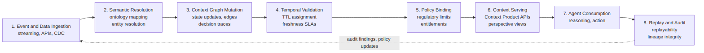

The lifecycle advances left-to-right through eight stages — Event and Data Ingestion, Semantic Resolution, Context Graph Mutation, Temporal Validation, Policy Binding, Context Serving, Agent Consumption, and Replay and Audit. The solid arrows trace the forward construction path from raw signal to agent action. The dotted feedback edge from Replay and Audit back to Event and Data Ingestion closes the loop: audit findings and policy updates from Step 8 become new signals that Step 1 ingests, so the architecture learns from its own decisions. The lifecycle is a loop, not a pipeline. A Context Product does not exist independently of the moment in which it is constructed. It is inherently ephemeral: its validity is bounded by time through TTL and Freshness SLA; its shape is determined by the intent of the consuming decision; its contents are constrained by the policy and entitlements of the consuming agent. As any of these factors change — a signal is refreshed, an intent shifts, a policy is updated, an entitlement is revoked — the product must be reconstructed. Ephemerality is not a limitation; it is the direct consequence of the runtime-construction commitment. The architectural commitment at the heart of the lifecycle is **trust-path purity — deterministic source-of-record with optional probabilistic presentation**: the algorithmic substrate is the artifact-of-record the audit trail anchors against, while any natural-language rendering or agent-swarm-synthesized cross-reference is a presentation layer over that substrate rather than the artifact a supervisor inspects. Under this commitment, the contract carries Assembly Mode as a per-product configuration property — the §6.3 specification’s ninth element — naming which of three modes the product is built under: pure algorithmic assembly with no LLM at any stage, algorithmic assembly with LLM packaging at the presentation layer, or algorithmic orchestration with agent-swarm assembly across federated trust boundaries. What is preserved across all three modes is the same trust-path posture: the algorithmic substrate stays artifact-of-record; lineage to source signals is recorded at the substrate not at the rendering; replay re-derives the substrate deterministically from the same Context Graph state. What becomes a per-product choice is the mode by which the substrate is built and how — if at all — it is presented to the consuming agent, with a documented cost-vs-quality-vs-determinism rationale the product owner commits to at the time the product class is registered. The mechanism for the three modes is specified at Chapter 7 §7.6. In Mode 1, the assembly of a Context Product is pure algorithmic aggregation — deterministic entity resolution, ontology mapping, graph traversal, temporal stitching, and policy filtering — with no LLM invocation at any stage of the assembly itself; the LLM, when it participates downstream at all, does so only in the reasoning the agent performs over the already-assembled product. Across the lifecycle, algorithmic and semantic stages alternate: Steps 1–6 are pure algorithmic aggregation, Step 7 is the semantic stage where the model reasons over the structured substrate, Step 8 is algorithmic again as replay and audit records are captured. No semantic stage operates on raw signal, and no algorithmic stage performs semantic interpretation; the stages interleave. Three consequences follow: deterministic assembly is replayable and auditable; the LLM sees a dimensionally reduced, policy-enriched substrate rather than raw data, which reduces the surface on which hallucination operates; and cost is contained because inference does not run at every construction step. The mechanism by which algorithmic stages combine — the Context Operators this document introduces as a primitive — is specified in Chapter 7 §7.4.

### 6.5 Context Product Key Principles

At the core of the Context Product model is a shift in the interface between enterprise systems and the agents consuming them. **Agents do not consume data directly. They consume context** — and treating context as a product means enumerating the principles the product must uphold to be reliable as an interface. Seven principles follow.

- Runtime Construction. Context is constructed at runtime, not persisted and retrieved. Persisting context would introduce staleness the moment source signals shift; runtime construction keeps every context instance aligned to current state. This is not an optimization — it is a requirement for any interface that serves decisions whose inputs change continuously.
- Time-bound (TTL). Every Context Product carries an implicit or explicit TTL that enforces continuous recomputation. In financial services, conditions change at cadences ranging from milliseconds to days, and temporal validity becomes as important as correctness. A product whose TTL has expired is not merely stale; it is invalid under the contract.
- Policy-embedded. Policy is integrated into the construction of context itself, not layered as a post-construction validation step. Compliance shifts from something the agent verifies after retrieval to a principle the construction enforces before the product exists. Where traditional systems apply rules after information has been assembled, a context-driven architecture forecloses impermissible compositions at construction time so the product served is compliant by construction.
- Entitlement-aware. Entitlements are not a filter applied to an already-constructed view; they are a formative constraint that determines what the context is allowed to be in the first place. Three implications follow. First, agents only see context they are authorized to reason over — correctness, not just security, because information the agent cannot act on introduces noise and invites invalid decisions. Second, sensitive relationships never materialize for unauthorized consumers: in commercial banking, syndicate participation, MNPI-bearing relationships between research and trading, and advisor-client confidentiality boundaries shape which graph edges are even visible. Third, policy and access unify into a single construct — two agents operating on the same underlying signals may receive different Context Products because entitlements shape the product, not a view on top of it.
- Discoverable. A registry exposes available Context Products by intent, domain, and capability; agents resolve names to endpoints at runtime. Without discoverability, products collapse into bespoke workflow bindings. Discovery transforms Context Products from isolated constructs into reusable enterprise capabilities.
- Traceable (Lineage). Every Context Product carries the lineage of its construction: the signals drawn from, the relationships traversed, the policies applied, the model versions invoked. In regulated industries, why a decision was made is as important as the decision itself, and Lineage is the substrate by which supervisors, auditors, and internal-control functions can reconstruct what the agent saw.
- Interoperable. Context Products must integrate with the emerging agent-interoperability standards the industry is converging on — the Model Context Protocol for agent-to-tool discovery and invocation, and the Agent-to-Agent protocol for cross-agent federation. Interoperability is the reason a product specified once can be consumed by agents built on different frameworks without re-plumbing each time a new framework lands.

#### 6.5.1 MCP as the access layer

The Model Context Protocol (MCP) is the emerging industry standard for how agents discover and invoke capabilities — a Linux-Foundation-governed protocol under the AI Agent Interoperability Forum that defines the wire surface agents call when they need a tool, a resource, or a context product. Chapter 2 §2.5 named MCP descriptively. This chapter names it mechanistically: MCP is the access layer through which agents request Context Products, and the Cognitive Context Fabric is the construction layer that produces them. Conflating the two is the most common misreading the protocol invites. The boundary is essential and worth stating directly:

| Responsibility | Owner |
| --- | --- |
| Constructs context (signal integration, validation, transformation into meaning) | CCF |
| Provides access to context (discovery, request, invocation by agents) | MCP |
| State management, temporal logic, policy application | CCF, not MCP |
| Discovery and standardized invocation | MCP — bridges agents to the Context Assembly Runtime |

The request path is equally worth stating directly:

```
Agent → MCP Interface → Context Assembly Runtime → Context Graph → Context Product → Agent
```

The agent calls MCP; MCP routes to the Context Assembly Runtime; the Runtime projects from the Context Graph under the intent, role, and freshness parameters the request carries; the resulting product returns through the same interface. MCP does not manage state, enforce temporal logic, apply policy, or construct context. It bridges agents to the construction layer; it is not the construction layer itself. Two architectural advantages follow. First, context construction stays centralized, governed, and consistent — one construction layer, one set of invariants, one audit substrate, regardless of how many agent frameworks sit above the MCP interface. Second, interoperability across evolving agent frameworks becomes a property of the interface rather than an integration problem; new frameworks adopt MCP and immediately reach the Context Products the fabric publishes without rewiring the construction layer. Where MCP handles the interface between a single agent and the Context Assembly Runtime, A2A (Agent-to-Agent protocol, Linux Foundation AAIF) extends interoperability to cross-agent federation — the integration pattern is specified in Chapter 8 §8.3.

### 6.6 Search ⇄ Inference Loop

Chapter 3 §3.10 named the interdependence of search and inference in agentic systems descriptively — inference drives what to search for, search enriches the context inference reasons over, enriched context improves inference. What Chapter 3 described as a pattern, this chapter frames as an operational loop engineered by the fabric as a Context Product abstraction rather than a per-agent ad-hoc retrieval pipeline. §6.6 closes the framing in four beats.

#### 6.6.1 Search and inference interdependence

Agentic reasoning is not a single-shot retrieval followed by a single-shot inference. It is a recursive interplay in which each step of inference reveals what further context is needed, each retrieval enriches the context the next step reasons over, and the enriched context improves that next step. The loop runs until sufficient confidence is reached to act, or until the agent escalates, defers, or refuses. Chapter 3 §3.10 rendered this interdependence as a three-line vocabulary. This chapter picks up the same vocabulary to frame what the Context Product abstraction makes operationally true of it:

```
inference        → drives search
search           → enriches context
enriched context → improves inference
```

Each line is a commitment. Inference drives search: the agent’s working hypothesis determines which portion of the Context Graph is worth reaching into next — a dynamically-shaped request whose parameters reflect what the agent has so far learned, not a fixed query shape defined in advance. Search enriches context: the fetched projection extends the working context, adding dimensions it lacked. Enriched context improves inference: each step operates on a substrate strictly more informative than the one preceding it. What makes this recursive loop tractable — rather than unbounded — is that each iteration is grounded in a Context Product request with a defined contract. The agent does not query raw data stores, does not assemble its own temporal or policy envelope, does not reconstruct entity identities. It requests a Context Product, reasons, and requests the next one the reasoning calls for. Assembly stays in the architecture; reasoning stays with the agent.

#### 6.6.2 Recursive context enrichment

The recursion is easiest to see in a worked example — a commercial-banking credit officer’s agent working a Counterparty Credit Risk decision across three turns. Turn one: “what is this counterparty’s current exposure?”. The agent requests an initial Context Product at `/context-products/credit-risk/counterparty/{id}?intent=exposure-snapshot&freshness=intraday`. The Context Assembly Runtime invokes Context Operators to traverse the counterparty’s facility and guarantee graph, temporally validate the exposure components against current Freshness SLAs, and project through the credit-officer Perspective Π. The agent reasons over the returned product and answers the surface question.

Turn two: “how did this exposure evolve over the last seventy-two hours?” — a temporal refinement of the same decision. The agent requests a second Context Product with a temporal window parameter. The Runtime re-invokes the traversal but parameterises the temporal stitching to produce a series rather than a scalar, and the Projection Π selects exposure-series attributes. Turn three: “of that counterparty’s exposure, which covenants are near breach?”. This combines traversal (walk the facility-to-covenant relationships), policy-shaped filtering (only covenants the officer is authorized to reason over, under institutional breach-threshold policy), and temporal judgment (near breach against current graph state). The Runtime composes the Context Operators the request requires — a traversal Operator, a policy-shaping Operator, a temporal Operator, and one that evaluates covenant-breach proximity — and returns a product shaped for that compositional intent. Across the three turns the recursion is visible: each turn’s product builds on the graph state the prior turn revealed, each invokes a different composition of Context Operators without the agent specifying them directly, and each Projection Π reshapes the product for what the reasoning now requires. The agent requested; the architecture constructed; the agent reasoned. How the Operators combine — what invariants they preserve, what typing discipline they carry — is specified in Chapter 7 §7.4.

#### 6.6.3 Confidence thresholds and stopping criteria

A recursion needs a stopping criterion. In agentic systems the criterion is not “the data ran out” but “sufficient confidence has been reached to act, or disconfirmed so escalation, deferral, or refusal is appropriate.” What makes that criterion tractable is a trust framework separating the dimensions of context quality so the agent can reason about each. The Context Trust Triangle names three legs on which any Context Product’s trustworthiness rests:

- Context Confidence — is it reliable? Combines model scores, source reliability, and consensus across independent signals. A product whose claims converge across multiple highreliability sources rates high; a product resting on a single low-reliability source rates low, regardless of how fresh the signal or how intact the Lineage.
- Context Freshness — is it current? Combines the product’s TTL, the context half-life decay of underlying signals, and recency of the most recent event bearing on the decision. A product assembled against fifteen-minute-old trade-blotter data at a moment when positions are moving rapidly rates differently than one against the same data at a quiet moment.
- Context Lineage Integrity — is it traceable? Combines the integrity of the provenance chain, the completeness of the transformation audit, and the resolution of the L dimension against source substrate. A product whose passage-level Lineage resolves cleanly against 10-K spans rates high; a product with a Lineage gap rates low. The triangle is conjunctive, not disjunctive. Weak legs degrade the whole. A product can be perfectly fresh and perfectly Lineage-intact but low-Confidence, and aggregate trust is low. A product can be high-Confidence and high-Lineage-Integrity but stale, and aggregate trust is low. An agent reasoning over an aggregate-low-trust product should not act; it should escalate, request a different product, or surface the weakness to the human. The conjunctive structure of the Trust Triangle is captured in Fig-CH06-03.

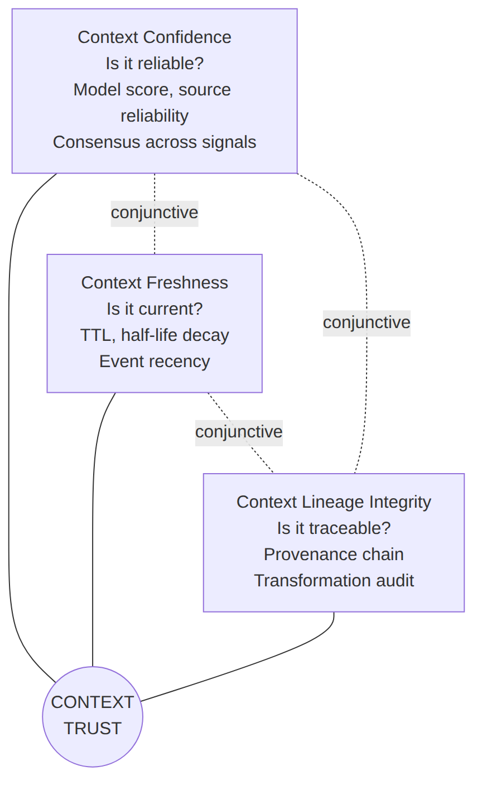

The three legs — Context Confidence, Context Freshness, and Context Lineage Integrity — converge on the single aggregate of Context Trust the agent reasons against. The dotted conjunctive edges enforce the semantics: each pair of legs must hold jointly, and weakness in any one degrades the aggregate regardless of the other two. The triangle is therefore a quality gate for stopping criteria: when all three legs hold, the recursion may terminate and the agent may act; when any leg weakens, the recursion continues, escalates, or defers. The Trust Triangle is also where the most consequential objection to context-first architectures is answered. The objection runs: RAG (retrieval-augmented generation) hallucinates — published studies place rates between seventeen and thirty-three percent even in legal-domain deployments — and a Context Product pipeline using retrieval under the hood inherits the same failure mode. The objection is calibrated and cannot be dismissed. The Deloitte Australia 2025 incident, in which an Australian government report drafted with generative assistance included fabricated citations that cost Deloitte a partial refund, is the canonical public example of what the failure looks like in the open. A Context Product architecture does not claim hallucination goes away; it claims the architecture structurally reduces the exposure. Four mechanisms compound. Evidence pinning — every claim anchored to a source span — removes the failure mode in which a plausible-sounding but unsourced assertion is reasoned against as if it were fact. Passage-level Lineage makes the anchor machine-auditable: a traceable address into the corpus, not an informal citation. Graph persistence removes per-query re-inference pressure: facts already resolved are reasoned over as typed graph state, not re-extracted from text at every query. Policy projection constrains the retrieval surface to authoritative, current, and permitted sources before similarity ranking runs. Together with the Context Debt primitive that surfaces low-confidence assembly as explicit decision input — specified in Chapter 7 §7.7 — these mechanisms reduce the failure surface by changing what the model infers on, not the model itself.

#### 6.6.4 Foundation for agent reasoning loops

Chapter 3 §3.10 closed with a forward-reference that has been load-bearing across four chapters: “How this loop is engineered as a Context Product abstraction — not a per-agent ad-hoc retrieval pipeline — is the subject of Chapter 6.” This section resolves it. The engineering is the Context Product abstraction the chapter has specified — contract, lifecycle, principles, and the Search ⇄ Inference loop closure the three preceding beats developed. A per-agent ad-hoc retrieval pipeline is bespoke to the application it was built for, re-implements assembly for every new agent, scatters policy enforcement across whatever query layer the application happens to use, and carries no shared discipline on temporal validity, Lineage integrity, or entitlement shaping. The Context Product abstraction replaces that with a specified interface — one contract, one lifecycle, one principle set, one trust framework, one access layer — reused across agents, governed uniformly, audited against a single substrate. The fabric this chapter has specified — in contract (§6.3), lifecycle (§6.4), principles (§6.5), and the Search ⇄ Inference loop closure (§6.6) — is what agentic reasoning requires as its operating interface rather than what it would have to improvise without one. Chapter 7 commits to the how: the layered architecture that realises the fabric, the Context Operators as the system of computation, the Projection Π as typed transformation, the Context Debt and context half-life that drive selective recomputation, the Control Plane that governs runtime behaviour, and the Decision Replay that makes every agent action forensically reconstructible.

## 7. System Architecture: Cognitive Context Fabric

Chapter 6 specified Context Products in contract, lifecycle, and principles. Chapter 7 commits to the mechanism: how each primitive is architected, how the primitives compose, and how the fabric enforces its guarantees at runtime. The preceding chapters named what the fabric must deliver; this chapter commits to how it delivers. Every subsection §7.1 through §7.10 answers a different engineering question a principal architect would raise against the conceptual model: how state is held, how computation runs, how interpretation is shaped, how delivery is bounded, how degradation is measured, how governance is separated from execution, how learning closes the loop, and how every decision is forensically reconstructible. The eight primitives this chapter commits to in mechanism detail — the L1–L6 Layered Architecture, the Context Operators, the Context Projection, the Context Debt, the Control Plane, the Closed Loop with self-learning, the Decision Replay, and the Assembly Mode (per-ContextProduct configuration carrying trust-path purity across the three modes specified in §7.6) — are the load-bearing primitives the preceding chapters named without yet specifying. The Cognitive Context Fabric the document has named as a category is realised here as a concrete runtime architecture a competent engineering team can implement. The load-bearing claim of this chapter is that every primitive introduced in Chapters 5 and 6 — the Context Graph, the Context Operators, the Context Projection, the Context Products, the Context Debt, and the context half-life — can be reduced to concrete mechanism a principal engineer can probe, not left as gestured architectural claim. Ten of the thirteen architectural objections enumerated across this document are answered in this chapter, each in the subsection that commits to the mechanism the objection tests — a projection that is not an RBAC filter, a Debt function that is not a TTL, a Control Plane that is also an audit plane, a replay record that is not a model trace. The reference implementation referenced throughout the chapter is a property-intelligence reduction-to-practice: a production system that has already operationalized the CCF primitives at pattern level, offering existence proof that each primitive composes and behaves as specified. The property-intelligence system is reduced-to-practice as the reference implementation of the

architecture; the worked-example voice of this chapter remains Wholesale and Consumer Banking, with Commercial Banking preferred where the decision environment is richest. Before the chapter decomposes the fabric into layers, concerns, and primitives, Fig-CH07-01 renders the architecture as a single closed loop — the system-of-systems view the ten sections that follow develop in mechanism detail.

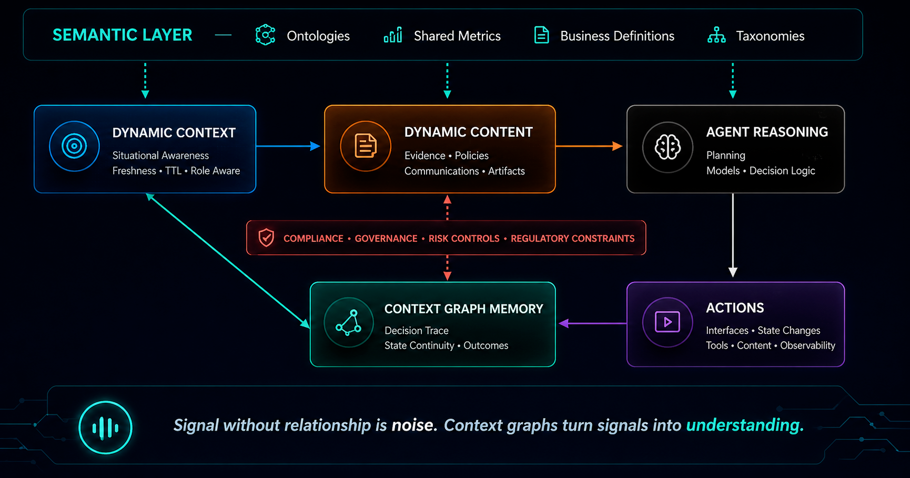

*Fig-CH07-01: The Cognitive Context Fabric as Persistent Institutional Memory. This overall-architecture view anchors the ten sections that follow. Dynamic Context (situational awareness, freshness, TTL, role-aware) feeds Dynamic Content (evidence, policies, communications, artifacts), which feeds Agent Reasoning (planning, models, decision logic), which produces Actions (interfaces, state changes, tools, content, observability) — and every action writes back to the Context Graph Memory (decision trace, state continuity, outcomes) so the next decision reads refined state. The Semantic Layer (ontologies, shared metrics, business definitions, taxonomies) governs the top of the loop; the Compliance, Governance, Risk Controls, and Regulatory Constraints band governs the middle. Signal without relationship is noise; context graphs turn signals into understanding The architecture commits to two visual anchors readers should hold in mind as §7.1 opens. The first is the six-layer stack of responsibility boundaries the fabric decomposes into — the Signal Layer at the bottom, the Context Products at the top, and the four layers between them that construct meaning from signals. The second is the pair of orthogonal planes that cut across every layer — the Control Plane that defines what the fabric is allowed to do, and the Data Plane that executes within those constraints at runtime. Against the persistent-institutional-memory view Fig-CH07-01 anchors, the Signal Layer and the Data Plane sit at the entry surface where signals arrive, the Context Graph Memory sits as the write-back destination every decision refines, and the Semantic and Compliance overlays correspond to the Control Plane the six-layer stack reads against. Fig-CH07-02 renders both claims together, and §7.1 develops each layer in turn before the Control Plane and Data Plane are named as crosscutting concerns.*

### 7.1 Layered Architecture (L1–L6)

The fabric decomposes into six layers of responsibility — L1 through L6 — each named for the artifact it owns and the handoff it controls. The layering is not incidental; it is the architectural answer to the missing-layer observation Chapter 4 §4.7 named. Traditional data architectures end at L3 or L4 in this decomposition: they store state, serve queries, and leave interpretation to whoever is asking. Agentic reasoning cannot operate on that substrate because it requires L5 and L6 — typed interpretation conditioned by role and intent, and decisionready delivery under contract — and those two layers do not exist in a query-serving architecture. The fabric adds them. Each of the six layers holds a single responsibility, owns a single artifact, and publishes a single handoff into the layer above it. L1 — Signal Layer. The Signal Layer is the ingestion surface. Transactions flow in from core banking, payments, and trading systems. Operational events flow in from case-management, workflow, and servicing platforms. Documents flow in from credit memos, KYC files, covenant archives, adverse-media feeds, broker-dealer chat, and research libraries. Audio transcripts flow in from compliance recordings. External feeds flow in from market data, news, regulatory filings, and credit bureaus. The responsibility of L1 is ingestion and event normalization — taking heterogeneous sources and expressing each incoming observation with source identifiers and timestamps in a canonical event envelope the rest of the fabric can operate on. L1 does not interpret. Signals crossing L1 carry provenance and temporal markers but are not yet typed as entities or relationships; they are observations of reality waiting to be resolved. The handoff from L1 to L2 is a stream of normalized signals — every signal tagged with its source, its ingestion timestamp, its observed-time where known, and whatever raw payload the upstream system emitted. This is where structured and unstructured streams arrive together; the fabric does not privilege one over the other at the ingestion boundary. L2 — Context Assembly. The Context Assembly layer is where raw signals become typed graph state. Four concerns converge here, and their composition defines the layer. Semantic resolution extracts entities and relationships from the signal stream — legal-entity identification from transaction counterparties, obligor resolution from credit memos, covenant extraction from loan documents, entity linkage across document chunks and transaction records. Temporal stitching reconciles observed-time with valid-time, producing as-of views the downstream graph can index against without leaking future information into historical queries. Policy binding attaches principal scope, jurisdictional constraint, and entitlement state to every resolved subgraph — the fabric does not resolve entities first and then ask who can see them; scope is bound at assembly time so downstream operators can reason against it directly. Operator invocation is the fourth concern: Assembly is where Context Operators are actually run against the accumulating graph, producing subgraph productions the rest of the fabric consumes. L2 is the stage the algorithmic-and-semantic alternation pattern — introduced at Chapter 6 and specified in §7.6 of this chapter — actually crosses, because algorithmic structure (graph traversal, temporal reconciliation) and semantic structure (entity extraction, relationship inference) are both active in Assembly.

L3 — Context Graph. The Context Graph is the first-class persisted state of the fabric. It is not a cache over a source system, and it is not a denormalized view over a lake — it is a computational primitive. The graph holds entities as their typed records of identity, relationships as the typed edges between them, temporal state as the as-of versions that make historical reconstruction sound, policy state as the entitlement and jurisdictional constraints that bind every subgraph production, projection state as the materialized role-conditioned views the Projection layer has built, and lineage as the append-only record of what signal chain produced every entity and every edge. The structure is append-only-forward-with-supersession: new observations do not overwrite old ones; they supersede them, with both versions retained so as-of queries remain sound and supersession events themselves become analyzable state. The mechanism for graph persistence, write paths, and the single-writer invariant that enforces deterministic state transitions is specified in §7.3. What matters at L3 for the layered view is that the Graph is persisted, typed, and designed as the substrate against which every other layer composes. L4 — Context Operators. The Context Operators layer is the system of computation. Four canonical categories compose over the Graph: Traversal operators that walk relationship edges from seed entities to a bounded subgraph; Temporal operators that apply as-of filters reconciling valid-time against observed-time; Policy operators that enforce entitlement, jurisdiction, and regulatory constraint before downstream computation sees the data; and Similarity operators that surface non-obvious but relevant context — analogs, cohorts, patterns — from the graph. The layer owns composition: operators do not run as a fixed pipeline, and they are not exposed to agents as query primitives. They compose into Operator Plans — typed expression trees the Assembly runtime can execute, memoize, and replay. Composition preservation — the property that running the same operator plan against the same graph state yields the same output — is the mechanical foundation of the Decision Replay primitive §7.10 specifies. The operator mechanism and its composition semantics are detailed in §7.4; what matters at L4 for the layered view is that computation over the graph is not ad hoc retrieval, but typed composition under constraint. L5 — Context Projection (Π). The Projection layer shapes subgraph productions into role-conditioned decision views. Projection is the step where a resolved subgraph becomes a Context Product payload. It is not a filter applied after the fact; it is a typed transformation from Graph substructure into principal-conditioned artifact, parameterized by the tuple (role, intent, temporal context, policy). The same underlying subgraph is projected differently for a relationship manager, a credit-risk officer, and a compliance analyst — not because different rows are hidden from each, but because the graph substructure is substituted for role-shaped structure under each projection. The distinction between projection as transformation and projection as filter is load-bearing for the Rebuttal #4 answer — projection is not an RBAC overlay on a shared dataset — and §7.5 commits to the mechanism that makes the distinction architectural, not merely semantic. At L5 for the layered view, the claim is that interpretation happens here and nowhere else: it does not leak into the agent, it does not leak into the delivery layer, and it does not leak back into the graph. L6 — Context Products. The Context Product layer is the delivery surface the fabric presents to agents. A Context Product is the typed, governed, decision-ready unit of meaning served under

the eight-element contract Chapter 6 §6.3 specified — schema, freshness SLA, TTL, policy binding, lineage, semantic versioning, discovery, addressability. L6 does not re-specify that contract; it inherits it by name and commits to the delivery mechanism that enforces it. A Context Product is not a query result, and it is not a cache entry — it is a versioned artifact produced by the upstream layers, bounded by TTL, stamped with its semver, linked to a lineage record that resolves every source signal that contributed to it, and served to the agent under the freshness SLA the contract declared. The §7.6 mechanism specification details contract enforcement, materialization policy, and the SLO envelope that backs the freshness promise. At L6 for the layered view, the claim is that delivery is a contracted decision-time artifact — not a shared queryable data model. The six-layer stack defines where work happens; it does not yet define what governs the work. The fabric resolves that through two orthogonal planes — the Control Plane and the Data Plane — that cut across every layer rather than sitting above or below them. The Control Plane is the governance surface: it carries Policy definitions that bind to L2 and L4; Operator behavior rules that parameterize L4 operator execution; Projection rules and entitlement definitions that parameterize L5; D_c thresholds that drive the Debt-gated fail-closed decisions §7.7 specifies; λ_c calibration per observation type that drives the half-life decay §7.7 specifies; and Materialization policy that decides which Context Products are pre-computed against which are derived on demand. The Control Plane is where the fabric is declared — what it is allowed to do, how it is parameterized, and under what conditions it must refuse to act. The Data Plane, by contrast, is the continuous-execution surface: it runs Context Assembly at L2, Operator execution at L4, Projection execution at L5, and Context Product serving at L6, within the constraints the Control Plane has set. The separation is the canonical control-plane and data-plane pattern of modern runtime architectures applied to a cognitive fabric rather than a service mesh, and §7.8 commits to the specific mechanism that keeps the two planes separated at runtime. The key anchor for the section is simple to state and load-bearing to act on. These layers are not a sequential pipeline; they are responsibility boundaries that ensure context is constructed correctly before it is consumed. The Control Plane defines the constraints within which each layer operates; the Data Plane runs continuous execution within those constraints. Fig-CH07-02 renders the complete structural picture in a single diagram. The figure shows the six layers of responsibility in the vertical stack, the Control Plane and Data Plane as the two orthogonal cross-cutting planes that bind execution within governance, and the forward flow from L1 signals to L6 products the Data Plane traces continuously. Fig-CH07-02 is the structural reference §7.3 through §7.10 commit mechanism against. Every subsection of this chapter binds to one or more layers of the diagram and to one or both planes. §7.2 turns the layered view inward and names the four architectural concerns — state, computation, interpretation, delivery — the layers realize.

### 7.2 Architectural Decomposition

The L1–L6 stack names where the fabric does its work; the architectural decomposition names what responsibility each part carries. The fabric realizes as four concerns — State, Computation,

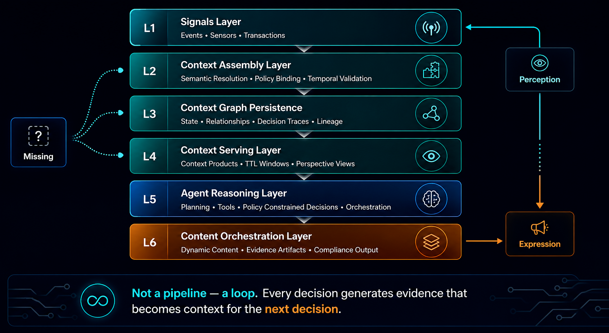

*Fig-CH07-02: L1–L6 Logical Architecture of the Cognitive Context Fabric. The annotation “Missing” on L2, L3, and L4 marks the three layers absent from most enterprise stacks — the context assembly, persistence, and serving layers the CCF specifies as first-class. The Perception arrow (Signals rising into Context) and the Expression arrow (Context descending into Content) render the stack as a bidirectional loop rather than a top-down pipeline*

Interpretation, Delivery — and the remaining sections of this chapter commit to each concern in mechanism detail. State is how the fabric holds what is true about the world at a given moment in time. Computation is how the fabric derives subgraph productions from that state under the constraints the Control Plane declares. Interpretation is how the fabric shapes those productions into decision-ready payloads conditioned on the principal who will consume them. Delivery is how the fabric returns those interpretations as versioned, governed, SLO-bounded artifacts agents act on. The layered view and the decomposition are complementary readings of the same architecture: L1 through L6 answer where, and state / computation / interpretation / delivery answer what. The sections that follow specify each concern. State. State realizes as a typed, accumulating graph persisted behind a single-writer persistence tier, and is the concern §7.3 commits to in mechanism detail. The single-writer invariant is not a convention but an enforced architectural property: only the Assembly worker holds a write handle to the graph; every read-path service in the fabric is constructed without one, with the absence of a write handle enforced by dependency injection at boot time rather than by runtime discipline. The significance of the invariant is that deterministic state transitions are a precondition for deterministic replay — if any read-path component could write, the graph history would be contaminated by non-Assembly transitions that the Decision Replay record could not reconstruct. Pattern grounding from the reference implementation: in a reference implementation, state realizes as a typed graph persisted with a compound unique index on (tenant_id, entity_uri), idempotent upsert with multi-source lineage accumulation, and single-writer enforcement at boot time. The architectural claim is that state is not merely a database under the fabric — it is a first-class computational primitive with its own invariants, and §7.3 specifies the mechanism that enforces them. Computation. Computation realizes as read-only-sync operator composition over projected subgraph, and is the concern §7.4 commits to in mechanism detail. Operators do not mutate graph state; they read it, compose over it, and produce typed subgraph productions downstream layers consume. The composition is compositional: operators are named, typed, and compose into expression trees the Assembly runtime evaluates deterministically. Composition preservation — the property that composing operators A and B and then running the result against state S yields the same production as running A against S and B against A’s production — is the foundation of deterministic Decision Replay, and §7.10 depends on it. Pattern grounding from the reference implementation: in a reference implementation, operators compose via a typed expression tree with intermediate contexts replayable individually and lineagecomplete end-to-end. The architectural claim is that computation is not an opaque large-languagemodel call against the graph; it is a typed composition of named operators producing replayable intermediate outputs a human engineer can inspect, bound, and audit. Interpretation. Interpretation realizes as a Protocol-based projection engine with structural typing, and is the concern §7.5 commits to in mechanism detail. The engine is not a class hierarchy; it is a two-method contract — required_operators() declares which operators the projection depends on, and invoke() executes the typed transformation —

and dispatch is by structural typing at registration time rather than inheritance. New projections register by matching the Protocol shape, and the engine resolves the operator dependencies, runs them against the current subgraph, and transforms the result into the role-conditioned payload. Pattern grounding from the reference implementation: in a reference implementation, projections realize as structural interfaces with per-request operator resolution and a multi-stage execution engine with validation gates. The architectural claim is that interpretation is not a role-basedaccess-control filter layered on top of a shared query result; it is a typed transformation from Context Graph substructure to principal-conditioned Context Product payload. §7.5 commits to the mechanism that makes the distinction architectural rather than semantic. Delivery. Delivery realizes as a typed contract with semver, TTL, and lineage enforced at validation time, and is the concern §7.6 commits to in mechanism detail. The Context Product contract is the eight-element specification Chapter 6 §6.3 established — schema, freshness SLA, TTL, policy binding, lineage, semantic versioning, discovery, addressability — and §7.6 commits to the enforcement mechanism rather than re-specifying the contract. The typed base declares the eight elements structurally; validation forbids additional fields at contract time (the forbid-extra discipline), so a Context Product cannot drift beyond its declared contract between versions. Per-product subclasses add typed payloads specific to the decision the product serves. Pattern grounding from the reference implementation: in a reference implementation, contracts realize as typed bases with forbid-extra structural validation and per-product versioned payloads, with three sequential validation gates (empty-operator guard, lineage strict equality, TTL bounds) at assembly time. The architectural claim is that delivery is not a shared queryable data model the agent reaches into; it is a contracted decision-time artifact with audit-ready lineage. §7.3 through §7.6 specify each concern in mechanism detail.

### 7.3 Context Graph — System of State

The Context Graph is the system of state the Cognitive Context Fabric reasons against. Chapter 5 § 5.2 named its formal shape as the six-tuple G(E, R, T, P, Π, L) — entities, relationships, temporal state, policy state, projection state, lineage — with each element a distinct axis of reality the fabric must preserve independently. § 7.3 is where the tuple stops being formal vocabulary and becomes mechanism: how each dimension is persisted, how writes are serialized, how multisource lineage accumulates, and how unstructured content becomes typed graph state rather than retrieval-time text. The six elements carry distinct responsibilities that downstream operators compose against. E identifies entities as URI-addressable nodes whose identity persists across source systems and over time. R captures typed relationships — ownership, guarantee, cross-default, covenant-of, definedby, measured-by, and similar directed edges — as first-class persisted state rather than derived joins. T preserves temporal state along two reconciled axes: valid-time (when a fact was true in the world) and observed-time (when the fabric learned of it). P holds policy state — the principal, jurisdiction, and regulatory-regime binding that travels with every subgraph. Π holds projection state — the role-conditioned, materialized views §7.5 specifies in mechanism detail. L holds lineage — the append-only record of what signal chain produced every entity and every edge, including passage-level anchors for unstructured content.

These six axes are orthogonal in concern but interdependent in use: no operator composes meaningfully against fewer than four of them at once, which is why collapsing them into flat tables breaks reasoning. The rest of this section commits the persistence mechanism that holds each axis as a first-class surface.

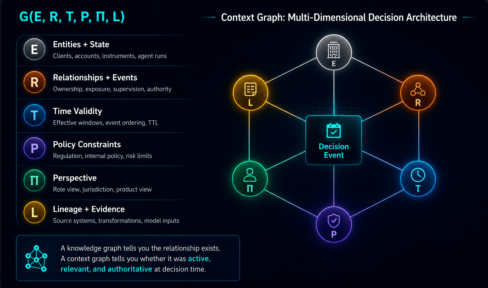

*Fig-CH07-03: The Context Graph as a Six-Dimensional Decision Architecture. The hexagonal arrangement is not decorative — it makes visible that every decision in the fabric is the reconciled output of all six dimensions, not a traversal across one or two. A knowledge graph tells you the relationship exists; a context graph tells you whether the relationship was active, relevant, and authoritative at decision time. The six-tuple is the formal anchor Chapter 5 §5.2 introduced; § 7.3 commits the mechanism for persisting each dimension as first-class computational primitive The hexagonal rendering Fig-CH07-03 anchors is the picture to hold while the rest of §7.3 commits mechanism: every operator composition §7.4 specifies and every projection §7.5 shapes reads against all six vertices of the hexagon simultaneously, not one at a time. A covenant-compliance decision reconciles the E counterparty node, the R covenant-of edge, the T as-of-measurement binding, the P Reg O and jurisdictional regime in force, the Π credit-officer role conditioning, and the L passage-level evidence chain all at once — drop any single vertex and the decision becomes indeterminate.*

#### 7.3.1 The Graph as First-Class Persisted Computational Primitive

The architectural commitment the fabric makes at § 7.3 is that the Context Graph is a first-class persisted computational primitive.[^c1] The Graph is not a cache over a system of record; it is not a denormalized view over a lake; it is not an application-level abstraction over a query-serving layer. It is persistent state with its own invariants, its own write path, and its own lifecycle — 1

and downstream primitives (operators, projections, products, debt, replay) read against it without reconstructing it. Two structural properties flow from this commitment. First, the Graph accumulates enrichments as it flows through pipeline stages: an entity resolved by L2 Context Assembly is not thrown away after a subgraph production is served; it is persisted, and the next enrichment pass — an entitlement tag, a covenant extraction, a temporal reconciliation — attaches to it rather than recomputing from raw signals. Second, downstream stages append rather than reconstruct: L4 operators, L5 projections, and L6 product materializations read the current graph state, produce their own outputs, and write their outputs back with lineage — they never rewrite entities the Assembly worker owns, and they never overwrite relationships the ingestion pipeline established. The base graph is built to support domain-specific subclassing. A banking deployment instantiates a Counterparty Credit Risk subclass whose entity types carry ownership-chain traversal hooks and whose relationship types carry guarantor-chain and cross-default semantics; a markets deployment instantiates a Counterparty Settlement subclass with post-trade-specific temporal semantics and failed-trade tracking; a treasury deployment instantiates a Liquidity subclass with intraday-specific T reconciliation. The base ContextGraph type declares the six-tuple structure, the single-writer write path, the lineage-accumulation semantics, and the supersession-not-deletion invariant; subclasses extend the entity-class enumeration and the relationship-type enumeration within that shape. In a reference implementation, the physical representation maps to ~10 collections with a single-writer invariant enforcing that only the Assembly worker writes to the enrichment surface — enforced by dependency injection, not convention. Every readpath service in the fabric — the operator runtime, the projection engine, the product materializer, the replay reconstructor — is constructed without a write handle; the absence is a structural property of the constructor signature, not a runtime check. This is the mechanism that makes deterministic state transitions a precondition for deterministic replay: if any read-path component could write, the graph history would be contaminated by non-Assembly transitions that Decision Replay (§7.10 forward-ref) could not reconstruct. The Feb–May 2026 memory-as-OS-resource wave — MemoryOS / EverMemOS / MAGMA / MemMachine, consolidated in Anatomy of Agentic Memory (Jiang et al., arXiv:2602.19320, 2026) — independently arrives at the first-class-primitive framing at the cluster scale, treating memory as an OS-level resource with storage hierarchies, lifecycle management, and write-vs-read-path separation as the organizing axes; the convergence validates the architectural class § 7.3 commits to without modifying the six-tuple structural contract the fabric makes load-bearing.

#### 7.3.2 Compound Index, Idempotent Upsert, and Multi-Source Lineage Accumulation

Persistence is keyed by a compound unique index on (tenant_id, entity_uri). Multi-tenancy is a structural property of identity, not a query-time filter: there is no code path in the fabric that resolves an entity without a tenant scope, and the uniqueness of (tenant_id, entity_uri) is enforced at the persistence tier rather than the application layer. This is what makes the tenant invariant a first-class correctness property (§7.8 forward-ref for the architectural-invariant framing) rather than a reviewable discipline. The write path is idempotent upsert: the same observation arriving twice from two different

source systems, or arriving once and being retried by a failed-and-resumed ingestion worker, produces exactly one persisted entity record. The lineage of that entity, however, is not idempotent: multi-source lineage accumulates via set-union operations across every source that ever contributed evidence for the entity’s existence or its attribute values. A corporate counterparty identified by the core banking system, re-identified from a credit memo, re-identified again from a regulatory filing, and re-identified once more from a bilateral trade blotter resolves to a single E node whose L carries set-union-accumulated evidence from all four sources with per-source timestamps and per-source passage-level anchors where the source is unstructured. Entity URIs are first-class addressable nodes carrying a naming convention the fabric reads against: entity-class://<identity-hash> for entities resolved by hash of identifying attributes, or entity-class://<principal>-<discriminator> for entities whose identity is scoped to a principal (for example, counterparty://lei-5493001RKR55V4X61F71 names a counterparty by its Legal Entity Identifier; facility://<borrower-lei>-<facility-id> names a credit facility scoped to the borrower). URI addressability means operators compose against stable identifiers that survive source-system changes; the L dimension preserves the mapping from URI to the source-systemnative identifiers that contributed to it.

#### 7.3.3 Unstructured Content as First-Class Signal Type

The Chapter 5 § 5.6 commitment that lineage is passage-level for unstructured content carries into Chapter 7 as a mechanism obligation. The fabric’s unstructured-ingestion commitment is that documents, audio transcripts, semi-structured chat feed the Graph as typed structure — the ingestion path does not store raw text and return it at retrieval time; it performs entity/relationship extraction at ingestion time, producing typed nodes and typed edges that persist in E and R alongside the entities and relationships structured feeds produced. This is the architectural distinction from retrieval-augmented generation: the Graph is built from unstructured content, not consulted from it. Passage-level Lineage L is how the extraction preserves its evidentiary basis. The phrase passage-level Lineage is Chapter 5 § 5.6’s first-naming; § 7.3 commits the mechanism the primitive reads against. When the ingestion pipeline extracts a covenant-definition edge from § 1.5 of a syndicated loan agreement, the edge carries an L record that anchors back to the source document, the page, the paragraph, and the offset span — not merely the document identifier. When the extraction produces a relationship-edge linking two entities mentioned in a broker-dealer chat transcript, L carries the transcript identifier, the timestamp, and the textual span from which the relationship was inferred. Passage-level anchoring at L is what makes § 7.4 Composition (a) operationally possible and what makes § 7.10 Decision Replay forensically defensible: the chain from Context Product back to source passage is traversable at any time, across any retention window, without reconstructing it from unstructured indexes. Consider the covenant cross-reference worked example that Chapter 8 § 8.3 Pattern 5 will operationalize end-to-end. A credit officer queries covenant compliance for Borrower X at the current reporting date. A syndicated loan agreement declares in § 14 a financial covenant — say, a leverage ratio bound. § 14 refers by clause to § 1.5, which is where the precise covenant term is defined-by definition. § 1.5 in turn references § 2.1, which is where the measurement methodology for that term is measured-by specification. In a retrieval-augmented pipeline, an agent would issue a similarity query against chunked paragraphs and hope the three relevant passages surface together; passage ordering is not preserved, the covenant, the definition, and the methodology are

logically separate documents from the index’s perspective, and the agent reconstructs the multi-hop reasoning from retrieved chunks under ambiguity. In the CCF, the three passages are already extracted as typed edges: the covenant node in § 14 carries a defined-by edge to the definition in § 1.5, which carries a measured-by edge to the methodology in § 2.1. The agent’s query traverses edges; this is the canonical CCF vs RAG distinction, worked. The covenant, the definition, and the methodology are three graph nodes connected by two named relationships with passage-level L on every edge; resolving them is a three-node traversal, not a chunk-level retrieval contest. § 7.4 Composition (a) renders this same example in operator-algebra form; § 8.3 Pattern 5 Unstructured Ingestion commits to the ingestion-time extraction mechanism. Key Insight — Fig-CH07-04 renders the logical-versus-physical mapping of the Context Graph — the six-tuple on the logical side and the collection pattern on the physical side — as the structural reference § 7.3 commits mechanism against. The figure makes visible the dotted binding between the six G(E, R, T, P, Π, L) dimensions and the ~10-collection physical representation that the single-writer invariant governs. The logical layer holds the canonical six-tuple G(E, R, T, P, Π, L) as the vocabulary every upstream chapter has inherited. The physical layer renders the collection pattern a production deployment persists this vocabulary against — a per-entity registry keyed by the compound unique index (tenant_id, entity_uri) that enforces structural multi-tenancy, a per-relationship registry that carries its own lineage independent of the entities the edges connect, per-dimension state collections that hold T valid-time and observed-time snapshots separately so supersession events remain reconstructible, and a multi-source lineage collection that accumulates via set-union rather than overwriting. Only the Assembly worker holds a write handle to any of these collections; every other service in the fabric is constructed without one, and the absence is a property of the constructor signature rather than a runtime check. The mapping Fig-CH07-04 makes visible is the point at which the formalism becomes operable: the six dimensions are not abstract design intent but collections with indexes, write paths, and supersession semantics that downstream operators can compose against deterministically. § 7.4 will take this physical substrate and compose typed operator plans over it; § 7.5 will take those plans and produce role-conditioned projections; § 7.6 will take those projections and serve them under Context Product contracts.

#### 7.3.4 The Counterparty Credit Risk Graph Topology

To make the six-tuple concrete in a wholesale banking setting, the Counterparty Credit Risk Context Product threaded through Chapter 6 § 6.3 (Contract) and § 6.4 (lifecycle) now gets its Graph commitment. The topology below is the graph the § 7.4 worked compositions (a) covenant cross-reference and (d) credit-exposure traversal will compose against; it is also the graph the § 7.5 three-role projection (credit officer / compliance officer / credit-risk officer) will project from.

- Entities. The core entities of the Counterparty Credit Risk graph are counterparty, parent group, material subsidiaries, exposure, facility, and collateral. A counterparty is the legal entity the bank holds risk against — identified by Legal Entity Identifier where one exists, by internal client identifier otherwise, with L preserving both source bindings. A parent group is the ultimate parent entity whose consolidated financials bound the counterparty’s credit profile. Material subsidiaries are the subset of the parent’s subsidiaries whose

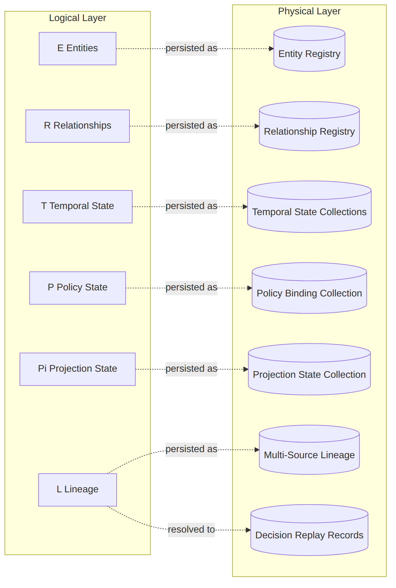

*Fig-CH07-04: Context Graph — logical six-tuple and physical collection pattern*

obligations, guarantees, or operational exposures materially affect the counterparty’s risk position; materiality is itself a thresholded relationship, not a graph-wide flag. An exposure is the unit of economic loss the bank is exposed to if the counterparty defaults; a facility is the committed credit instrument the exposure is drawn from; collateral is the security pledged against the facility.

- Relationships. The core relationships are ownership (one entity holds equity in another, with the percentage carried on the edge), guarantee (one entity has legally committed to satisfy another’s obligation — full, partial, or keepwell), cross-default (default on one obligation triggers default on another, often with carve-outs), and set-off (offsetting exposure may be netted across legal entities under defined conditions). Each relationship type is persisted in its own collection with its own lineage; an ownership edge sourced from a corporate-structure feed is the same relationship type as an ownership edge sourced from a 10-K filing but carries different L that supports different downstream inferences.
- Temporal state. T reconciles as-of filing date for 10-K snapshots (entity state as it was at the end of the reporting period the filing covers) against as-of intraday for market exposure (mark-to-market valuations that change continuously). A credit review that combines a counterparty’s 10-K-derived leverage ratio with its current market-exposure-driven credit-defaultswap implied probability of default is a composition over two different temporal surfaces; T holds both without flattening them.
- Policy state. P binds regulatory regime, jurisdiction, and internal policy. Reg O constrains insider lending; UK PRA 9/17 large-exposure policy constrains single-name concentration; internal policies constrain facility-level tenor, industry-concentration bands, and country-risk overlays. P is attached at subgraph-resolution time, not post-processed: a credit officer in the US branch of a bank resolving a UK counterparty sees the intersection of US and UK policy state without reconstructing the intersection per query.
- Projection state. Π holds the role-conditioned lens: a credit officer projection surfaces exposure, covenant structure, guarantor chains, and risk indicators as primary; a compliance officer projection surfaces policy-adherence evidence and regulatory-citation lineage as primary; a credit-risk officer projection surfaces aggregate portfolio exposure, correlation signals, and stress-test scenarios as primary. § 7.5 commits to the mechanism that makes these three views substitutions over the same graph rather than filters over a shared query result.
- Lineage. L for this topology comprises 10-K filing paragraph spans (passage-level anchors into SEC EDGAR filings), bilateral trade blotter records (trade-level entries from the bank’s post-trade systems), external rating-agency feeds (rating snapshots with agency + date), and internal credit-opinion memos (credit-committee documents with author + date + decision). The counterparty’s L at any moment is the set-union across all four source classes; decision replay reconstructs the L state at decision time rather than the current L. This six-element topology is the graph § 7.4 operators will compose against. Compositions (a) covenant cross-reference and (d) credit-exposure traversal both traverse this topology; composition (c) AML Policy-before-Similarity composes against a transaction-and-client graph with related but distinct entity and relationship types; composition (b) intraday liquidity composes against a treasury-liquidity graph slice with its own temporal semantics. In each case, the graph is the substrate; the operators are how the fabric reads against it.

#### 7.3.5 Interaction Mechanics — Supersession and Entity Resolution Rendered

as Sequences

The static six-tuple topology commits a shape; it does not yet render the interaction mechanics that distinguish a Context Graph from a relational warehouse at runtime. Two interactions are worth rendering explicitly because the rest of the chapter reads against them as if they were already visualized. The first is graph mutation on supersession — how a new observation that contradicts a prior claim enters the graph without destroying the prior claim’s audit trail. The second is entity resolution across disparate source systems — how fragmented identifiers across Markets, Treasury, and ADR systems converge to a single canonical E node whose L carries every contributing source. Key Insight — Fig-CH07-05 renders supersession as a sequence of messages across Ingestion Pipeline, Semantic Resolver, Context Graph, Temporal Operator, and Lineage Writer. The figure is load-bearing because supersession is the single interaction that distinguishes append-only-forwardwith-supersession from overwrite-in-place, and the distinction is what makes the § 7.10 Decision Replay primitive architecturally possible.

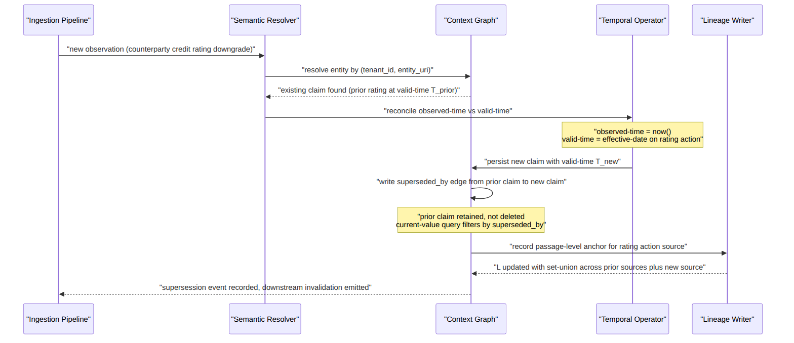

*Fig-CH07-05: Graph mutation on supersession — new observation enters, prior claim retained, supersession edge written, lineage accumulates The sequence renders the supersession path from ingestion through to downstream-invalidation emission. The interaction commits to three architectural properties the rest of the chapter leans on. First, supersession is logical, not physical — the prior claim remains in the graph with a superseded_by edge and a superseded_at timestamp, and § 7.10 Decision Replay against T_prior re-renders the prior state exactly because the prior state was never discarded. Second, the Temporal Operator reconciles two distinct axes the T dimension carries — the observed-time the fabric learned of the rating action and the valid-time the rating action becomes effective — and the reconciliation is structural rather than a retention heuristic. Third, the Lineage Writer accumulates via set-union across every source that ever contributed evidence, so a counterparty whose rating was previously sourced from a corporate-structure feed and is now updated from a rating-agency feed carries both source attributions in L with per-source timestamps and per-source passage-level anchors where applicable. The interaction is the runtime enactment of D-11’s first-class persisted computational primitive commitment and D-33’s supersession-as-Policy-event obligation; Fig-CH07-05 makes visible why*

overwriting the prior claim would make Decision Replay at T+2 years structurally impossible, and why the fabric commits to append-only-forward-with-supersession rather than overwrite-in-place. The supersession interaction Fig-CH07-05 renders is the mechanism behind the § 7.7 supersession-as-Policy-event treatment and the § 7.10 Decision Replay reconstruction story; both sections read against this sequence without re-rendering it. Key Insight — Fig-CH07-06 renders entity resolution across fragmented source systems as a sequence across Markets System, Treasury System, ADR System, Entity Resolver, Semantic Layer, and Context Graph. The figure is load-bearing because entity resolution across Wholesale lines of business is the interaction every Counterparty Credit Risk, AML, and Intraday Liquidity Context Product indirectly depends on, and the sequence makes visible how XC-05’s unstructured-as-firstclass commitment participates at the resolution boundary.


*Fig-CH07-06: Entity resolution across Markets, Treasury, and ADR systems — fragmented identifiers converge to a single canonical E node The sequence renders the fabric’s answer to the Client 360 problem Chapter 1 § 1.4 named and Chapter 8 § 8.5 will operationalize under the six-dimensional graph integration pattern. Three source systems in three different lines of business each carry their own native identifier for the same corporate counterparty — a Markets counterparty identifier, a Treasury legal-entity code, an ADR sponsor identifier — and none of the three systems can be the system of record for all three lines. The Entity Resolver correlates the three claims via shared attributes (the LEI where one exists, registered address and authorized-signatory metadata where it does not), hands the correlated bundle to the Semantic Layer for ontology disambiguation, and the Semantic Layer resolves the canonical E node under a tenant-scoped URI. XC-05’s unstructured-as-first-class commitment participates here in a way a data-mart architecture cannot match: a covenant document from the loan-origination package that mentions the counterparty by a name variation not present in any of the three structured feeds still contributes to the resolution, because the Semantic Layer treats the covenant document’s extracted entity reference as a first-class claim on par with the structured identifiers. The Lineage Writer accumulates set-union across all four source classes — three structured feeds plus one unstructured document — and the canonical E node carries per-source timestamps, per-source identifiers, and passage-level anchors for the unstructured contribution. Downstream, every operator composition against the counterparty resolves against the same canonical E regard-*

less of which line of business initiated the query; the fragmentation Chapter 1 diagnosed is dissolved at the resolution boundary rather than patched at the query boundary. Fig-CH07-06 is the interaction commitment behind the six-tuple topology § 7.3 declared and the XC-05 covenant cross-reference example § 7.4 composition (a) traversed; it is also the interaction Chapter 8 § 8.5 will carry forward into the six-dimensional graph integration story. The § 7.3 mechanism now carries state, topology, and the two interaction sequences every downstream section reads against. The § 7.3 mechanism is the foundation for every computation § 7.4 will specify. § 7.4 commits the operator algebra and the composition-preservation property that makes operator plans deterministic; § 7.5 commits the projection mechanism that shapes subgraph productions into role-conditioned Context Product payloads; § 7.6 commits the delivery contract and SLO envelope. Each subsequent section reads against the graph the § 7.3 mechanism specifies, and the supersession sequence Fig-CH07-05 renders returns at § 7.7 and § 7.10 without re-rendering.

### 7.4 Context Operators — System of Computation

§ 7.3 committed the graph as the first-class persisted state of the fabric; § 7.4 commits the computation that reads against it. Context Operators are the typed, composable primitives that turn the graph from a persisted substrate into a substrate something useful can be resolved from. Against the six-dimensional hexagon Fig-CH07-03 anchored at §7.3, every operator composition §7.4 specifies reads across multiple vertices of the hexagon simultaneously — Traversal walks R against T reconciled by P, Similarity scores against E projected under Π with L preserved, and the composed output is the reconciled output of all six dimensions rather than a traversal across one. Four canonical categories cover the space of operations the fabric performs: Traversal — bounded relationship walks parameterized by edge types, depth limits, and materiality thresholds; Temporal — valid-time and observed-time reconciliation against as-of alignments; Policy — principal, jurisdiction, and entitlement subgraph substitution applied before downstream operators see data; Similarity — corpus-scoped ranking with pinned index version, thresholded by contract, and composed under policy pre-projection rather than as unconstrained retrieval. Chapter 5 and Chapter 6 named these categories as concept; § 7.4 is where they stop being vocabulary and become mechanism. The mechanism commitment of § 7.4 is threefold. First, operators compose algebraically: a Context Product is not the output of one operator but the reconciled output of a typed composition of operators, and the composition has algebraic properties downstream primitives read against. Second, the composition is composition-preserving: intermediate operator outputs are individually replayable, cache-coherent under Half-life-driven invalidation, and lineage-complete, which is the foundation of the deterministic Decision Replay (§ 7.10 forward-ref) the fabric promises. Third, operator plans are generated dynamically at runtime from agent intent — the Operator Plan DAG generator (D-15 below) resolves which operators a request needs, composes them in dependency order, and hands the resulting plan to the projection engine for execution. The Algorithmic ⇄ Semantic alternation pattern Chapter 6 § 6.4 anchored at concept level and § 7.6 commits as an architectural primitive runs through operator composition: algorithmic stages compose deterministically; semantic stages run over the dimensionally-reduced substrate the algorithmic stages produce. Key Insight — Fig-CH07-07 renders the compositional algebra visually — the four canonical operator categories flowing into Π projection flowing into the Context Product, with the composition

ordering that Policy runs before Similarity and Π projects the composed subgraph rather than filtering it.

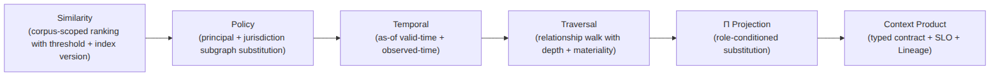

*Fig-CH07-07: Context Operators — compositional algebra The figure renders the four canonical operator categories — Traversal, Temporal, Policy, Similarity — composing into the Π projection and producing the Context Product that L6 serves. The composition order is load-bearing: Policy runs before Similarity so that similarity ranking scores only over the principal-permissible subgraph rather than over the full graph with post-hoc filtering; Π projects the composed output into a role-conditioned substructure rather than filtering a shared query result. Each operator is typed in its inputs, in its outputs, and in its side-effect-free-read-only-sync contract against the graph; the composition is itself a typed expression tree the projection engine evaluates deterministically. Fig-CH07-07 is the visual reference the operator-algebra commitment later in this section reads against. Fig-CH07-07 is the structural reference § 7.4 operates from: the four categories are the vocabulary; the composition is the mechanism; the determinism is the promise the composition makes possible.*

#### 7.4.1 The Operator Algebra

The compositional form the fabric commits to is:

```
ContextProduct = Π ∘ Traversal ∘ Temporal ∘ Policy ∘ Similarity
```

The ∘ is function composition read right-to-left: Similarity runs first, or equivalently the Policy-projected similarity surface is produced first; Policy runs next, subgraph-substituting the principal-permissible graph region; Temporal runs next, reconciling valid-time against observed-time at the as-of boundary the decision requires; Traversal runs over the temporally-reconciled policy-projected substrate, walking typed relationships within materiality bounds; Π projects the resolved subgraph into a role-conditioned substructure; the output is the Context Product the fabric serves. In practice, a specific request does not exercise all five categories — some compositions are three-operator, some four-operator, some include only Traversal and Policy. The algebra makes visible what the composition surface is; a particular request picks its operators from the algebra. The algebraic property the fabric reads against is composition-preservation: composing operator A and operator B and then running (A ∘ B) against graph state G yields the same output as running B against G to produce an intermediate context, then running A against that intermediate. Written formally, (A ∘ B)(G) = A(B(G)). This property — associativity of composition under the typed operator algebra — is what makes operator plans replayable and reconstructable. Three concrete consequences flow from composition-preservation. First, intermediate operator outputs are individually replayable — the intermediate context produced by B(G) is persistable, diffable, and re-executable against the same input state, which is the mechanism the replay primitive (§ 7.10 forward-ref) depends on. Second, intermediates are cache-coherent under λ_c-driven invalidation — when a new observation supersedes part of G, the intermediates downstream of that part invalidate predictably rather than requiring full recomputation of the composition. Third, every intermediate is lineage-complete: the L dimension of the resulting subgraph carries forward

the operators invoked, the parameters they were invoked with, and the graph state they read — each intermediate output carries its own provenance sub-chain. Key Insight — Fig-CH07-08 renders the composition-preservation property as a runtime interaction sequence. The figure is load-bearing because composition-preservation is the algebraic foundation behind Decision Replay — if intermediates were not individually replayable against the same inputs, the § 7.10 reconstruction story would collapse to best-effort approximation.

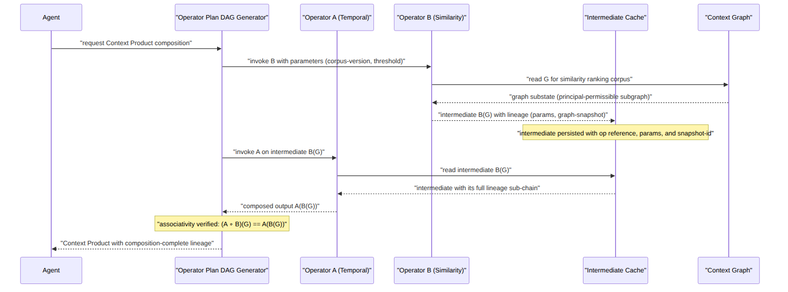

*Fig-CH07-08: Operator composition lifecycle — B(G) intermediate cached, A consumes intermediate, associativity preserved The sequence renders the three composition-preservation consequences as concrete runtime events. Operator B executes first, reading the principal-permissible substate of G and producing the intermediate B(G) the cache persists with a lineage sub-chain identifying the operator reference, the parameter set, and the snapshot identifier of the graph state read. Operator A then executes not against G but against the cached intermediate, which is the mechanism behind cache-coherent invalidation — if a new observation supersedes part of G that fed B(G), the cache invalidates B(G) and every downstream intermediate chained to it, rather than forcing the full composition to re-execute. The associativity verification Mermaid names as a Note is not a runtime check; it is the algebraic property the typed operator algebra provides by construction, which the Planner reads against when it decides whether an intermediate can be reused for a replay invocation. The architectural consequence is that Decision Replay at T_audit reconstructs the same Context Product bit-for-bit not by re-walking the graph end-to-end but by re-invoking the composition against the preserved intermediates, which is what makes the § 7.10 five-dimension replay record tractable at enterprise scale. The composition is not a pipeline whose stages happen to be ordered; it is an associative algebra whose intermediates are first-class reconstructable state. Rebuttals #11 and #13 land against this sequence — GraphRAG pipelines typically do not preserve intermediates with typed lineage, which is the architectural reason their inference runs are not replayable; CCF does, which is the architectural reason its inference runs are. Fig-CH07-08 is the interaction-level commitment behind D-14 algebraic composition, D-17 determinism, and D-18’s consolidated Rebuttal #11 + #13 answer; the rest of § 7.4 reads against it without re-rendering. Three formal ancestors ground the algebraic treatment without the fabric claiming novelty on composition itself.*

The first ancestor is relational algebra (Codd 1970), which established typed composition semantics over structured data: select, project, and join compose algebraically and their composition has determinate semantics independent of evaluation order optimization. The second ancestor is service-mesh filter composition — Envoy filter chains, and downstream the Istio ecosystem’s HTTP and TCP filter stacks — which established composition of typed request-processing filters as a deterministic ordered-application pattern, where each filter’s output is the next filter’s input and the chain’s composition is itself addressable for audit. The third ancestor is graph algebra, the family of compositional operations over typed graphs, encompassing traversal, projection, and temporal slicing, which established the mathematical vocabulary the Traversal and Π operators read against. The CCF’s commitment is composition of well-understood patterns with typed-contract and deterministic-semantics application to cognitive context, not invention of parts. The novelty is the semantic-domain application, the typed Context Product contract the composition resolves into, and the closed-loop feedback that feeds operator parameters back through the Control Plane — not the algebraic apparatus itself.

#### 7.4.2 The Operator Plan DAG Generator

The algebra is the compositional surface; the Operator Plan DAG generator is the runtime that selects which operators a specific request needs and orders them into a dependency-correct execution plan. Given an agent intent — typically a tuple of role, decision class, and entity reference — the Planner resolves the required operators via the operator registry, topologically orders them into a DAG that respects the composition dependencies (Policy before Similarity; Temporal before Traversal where Traversal reads temporally-reconciled state), and produces the plan the projection engine executes. Stage 1 maps intent to required operators via registry lookup; Stage 2 orders them into the topological composition tree; Stage 3 hands the plan to the projection engine, which resolves intermediate contexts and reconciles them into the final Context Product. # Operator Plan DAG generator — runtime operator composition function planOperators(agent_intent: {role, decision_class, entity_ref}, operator_registry: Registry) -> OperatorPlan: # Stage 1: intent -> required-operators map (via registry lookup) required = [] for op_ref in resolveRequiredOperators(agent_intent, operator_registry): required.append(op_ref) # Stage 2: required-operators -> execution plan (topologically ordered) plan = OperatorPlan() for op_ref in topologicalSort(required, dependencies): plan.append(op_ref) # Stage 3: plan execution -> resolved intermediate contexts -> Context Product # (invoked by projection engine; each intermediate lineage-complete) return plan # Planner batch-resolves operator references via DataLoader-style pattern:

# one query per operator type per call (N+1 avoidance) # Operator registry is import-time / boot-time loaded; # duplicate registration fails fast (§7.8 architectural invariant) Two mechanism commitments run through the generator. First, in a reference implementation, the Planner batch-resolves operator references via a DataLoader-style pattern, issuing one query per operator type per call — a standard N+1 avoidance primitive applied to cognitive-context execution. When a Counterparty Credit Risk Context Product composition requires Traversal operators across ownership edges, guarantee edges, and cross-default edges, the Planner resolves all three Traversal references in a single batched call to the graph substrate rather than three serial round-trips; when it requires Temporal operators for both filing-date and intradaymarket boundaries, both Temporal references resolve in a single batched call. This is how the composition stays within the illustrative SLO envelope § 7.6 commits to: the per-operator cost is amortized across the batched resolution. Second, the operator registry is import-time / boot-time loaded, and duplicate registration fails fast. Registering two operators under the same reference key is not permitted, and the failure is not a runtime error thrown during a request — it is a boot-time failure that prevents the fabric from serving any traffic until the duplicate is resolved. The invariant is CI-tested (the § 7.8 Architectural Invariants subsection will commit the broader invariant framing); the point at § 7.4 is that operator-plan generation is deterministic because the registry it reads is deterministic at runtime. Key Insight — Fig-CH07-09 renders the Operator Plan DAG generator’s fan-out across the four worked compositions this section will walk. The figure is load-bearing because it is the single visual that makes visible how an agent intent becomes a typed operator plan, how that plan fans out into the compositional design space, and how one composition per request resolves into the delivered Context Product. The figure renders the Planner at the center of the operator-execution surface: agent intent enters at the top (role, decision class, entity reference); the Operator Registry resolves which operator types are available via the dotted resolves edge; the Planner produces a topologically-ordered plan against the Registry’s typed catalog. Four illustrative compositions fan out below the Planner to make visible the compositional design space: (a) Covenant cross-reference for a credit officer resolving unstructured-primary loan-document state; (b) Intraday liquidity for a treasury manager resolving Temporal-primary market state; (c) AML Policy-before-Similarity for a compliance investigator resolving MNPI-sensitive four-operator state; (d) Credit-exposure traversal for a credit-risk officer resolving Traversal-primary counterparty state. In actual runtime, exactly one composition resolves per request, not four; the fan-out in the figure shows the design space rather than a single request’s execution path. The Context Product at the bottom is produced from the resolved composition under the typed contract § 7.6 specifies. Fig-CH07-09 is the visual anchor the four worked compositions below read against. Each composition picks its operators from the algebra, sequences them under the Planner’s topological ordering, and produces a Context Product the delivery layer (§ 7.6) serves. The compositions are walked operator-by-operator to make visible how the algebra produces the mechanism; each closes by naming the rebuttal or pitfall the composition architecturally answers.

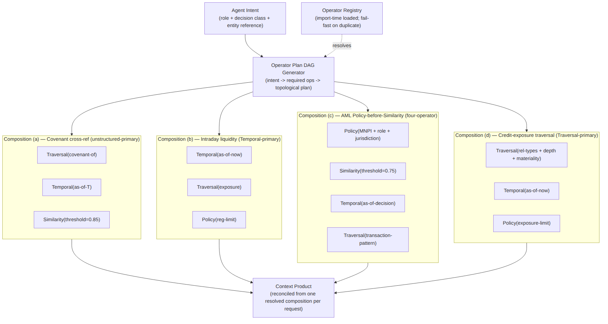

*Fig-CH07-09: Operator Plan DAG generator — agent intent fans into four example operator compositions*

#### 7.4.3 Composition (a) — Covenant cross-reference (unstructured-primary)

Algebraic form: Traversal(covenant-of) ∘ Temporal(as-of-T) ∘ Similarity(threshold=0.85) over the Counterparty Credit Risk graph. Setup: a credit officer queries covenant compliance for Borrower X at the current quarterly reporting date T. The decision requires resolving the covenant the facility is bound by, the definition the covenant term is defined-by, and the measurement methodology the definition is measured-by — a multi-hop traversal whose endpoints are passage-level anchored in the syndicated loan agreement. Operator walk-through. The Similarity operator runs first, scoring relevance of passages in the loan agreement corpus against the query embedding with threshold=0.85 and the corpus index version pinned in L. Because similarity is composed under the § 7.3 unstructured-as-first-class commitment, the scored output is not raw chunk-level retrieval — it is a ranked set of passage-level graph anchors, each with its L preserving the source document, page, and paragraph offsets. The Temporal operator runs next, constraining the state surface to the as-of boundary T (the current quarterly reporting date), which selects the facility’s active covenant version and excludes any superseded earlier version the graph still retains for historical reconstruction. The Traversal operator runs last, walking the covenant-of edge from the facility node to the covenant clause in § 14, then the defined-by edge to the definition in § 1.5, then the measured-by edge to the methodology in § 2.1 — a three-node traversal that returns a subgraph whose nodes are the three passage-anchored graph elements and whose edges are the two typed relationships between them. Architectural claim. In a retrieval-augmented pipeline, this same information task is resolved as retrieve-then-filter: the agent issues a similarity query against chunked paragraphs, the retrieval layer returns a ranked set of chunks, and the agent (or a post-retrieval filter) narrows the chunks to the ones that appear relevant to the covenant-definition-methodology chain. Passage ordering is lost,

the covenant and the definition and the methodology are not linked structurally at the index, and the multi-hop reasoning is reconstructed by the agent from retrieved chunks under ambiguity. In the CCF, the same task is project-then-retrieve: the graph already carries the typed relationships between the covenant, the definition, and the methodology; the operator composition projects the relevant subgraph via Similarity-over-unstructured-anchored-L plus typed Traversal; retrieval is the last step rather than the first. The passage-level anchoring at L is what makes the projection preserve the evidentiary chain end-to-end — the agent receives not just the resolved subgraph but the source-passage references for every node in it. The composition answers Rebuttal #11 (“just another RAG with fancier framing”) at mechanism level: RAG is retrieve-then-filter; CCF is project-then-retrieve; the difference is not a pipeline-ordering preference but a different substrate. It also discharges the § 7.3 XC-05 covenantcross-reference worked example at operator-algebra level (Chapter 8 § 8.3 Pattern 5 Unstructured Ingestion will commit the ingestion-time extraction mechanism end-to-end).

#### 7.4.4 Composition (b) — Intraday liquidity (Temporal-primary)

Algebraic form: Temporal(as-of-now) ∘ Traversal(exposure) ∘ Policy(reg-limit) over a treasury-liquidity graph slice. Setup: an intraday liquidity manager queries current exposure against regulatory daylight-overdraft limits to decide whether to release a large outbound payment. The decision is minutes-bounded; the state surface moves continuously as payments settle, as incoming payments post, and as market exposures mark against each other. Operator walk-through. The Policy operator runs first, projecting the graph to the regulatorylimit-applicable subgraph — the subset of accounts, exposures, and payment flows within the Fed Funds daylight-overdraft purview, scoped to the bank’s principal identity and the jurisdiction the payment is denominated in. The Traversal operator runs next, expanding exposure across the transaction settlement chain — outbound payment legs that have executed but not settled, inbound payment legs that have posted but not cleared, cross-currency exposures that are marked but not yet realized. The Temporal operator runs last with as-of-now, and here the mechanism matters: the Temporal operator reconciles valid-time (when a payment is actually effective in the external world, e.g., once it has cleared Fedwire) against observed-time (when the fabric learned of it, which may lag valid-time by seconds or minutes depending on the source system) to produce a single consistent snapshot. A payment that has executed but is not yet settled has a T state where valid-time is in the future and observed-time is now; a payment that has cleared externally but whose settlement confirmation has not yet posted internally has a valid-time of now and an observed-time in the future. The Temporal operator produces an as-of-now reconciliation that resolves both cases without flattening them. Architectural claim. Half-life in the CCF is not just TTL. The Temporal operator’s valid-time-vsobserved-time reconciliation is a temporal correctness semantic, not merely a time-to-live filter: the fabric expresses the difference between “we don’t have this yet” and “this hasn’t happened yet” structurally, and downstream operators (and the λ_c half-life primitive § 7.7 commits mechanism for) read against that distinction. This is the operator-layer answer to Rebuttal #5 (“Half-life is just TTL”) — the Half-life primitive sits on top of temporal correctness semantics the operator layer provides, not on top of a timestamp filter.

#### 7.4.5 Composition (c) — AML Policy-before-Similarity (four-operator)

Algebraic form: Policy(MNPI + role-entitlement + jurisdiction) ∘ Similarity(threshold=0.75) ∘ Temporal(as-of-decision) ∘ Traversal(transaction-pattern) over a transaction-andclient graph. Setup: an AML investigator in the compliance function queries transaction patterns for potential suspicious-activity review against known typologies, with FinCEN SAR-filing obligations bounded to the decision window. The investigator’s principal identity governs what counterparties, transactions, and client relationships they are permitted to surface; the investigator’s role governs which typology libraries are relevant; the MNPI (material non-public information) regime governs what research-desk and investment-banking-desk documents can inform the compliance view. Operator walk-through. The Traversal operator runs first in ordering terms but is constrained from the algebra — it expands the transaction graph across the typology-relevant relationship types: payment counterparties, routing chains, beneficial-ownership traces, and sanctioned-entity adjacency. The Temporal operator follows, constraining to the as-of-decision boundary (typically the SAR-filing window rather than now) so the review surface reflects the state at the time the suspicious activity is being evaluated. The Similarity operator runs with threshold=0.75 over the corpus of known typology narratives and against the typology-relevant passage-level anchors surfaced by the traversal and temporal state. The Policy operator is where the composition inverts the naive ordering: the Policy Operator runs before Similarity Operator, not after. Read the algebra right-to-left: Traversal produces the transaction-pattern subgraph; Temporal constrains it to the decision window; Similarity ranks passages against the typology corpus; Policy projects the result to the principal-permissible view. Critically, that projection is applied as subgraph substitution at the Context Graph layer, enforced by Π, not a row-level filter on an index. MNPI-tagged documents visible to the investment-banking desk in a wall-crossing context but restricted from the trading desk are not hidden by a visibility predicate appended to a retrieval query — they are structurally absent from the subgraph the principal’s Policy-projected graph consists of. Research-desk content not admissible to the compliance-desk view is not filtered after the fact — it is not in the graph the compliance-desk principal’s composition operates against. Jurisdictional constraints (FinCEN SAR-filing obligations bound to US persons and US-routed transactions) are baked into the Policy projection the same way. Architectural claim. The MNPI-leakage class of failure the industry has seen in retrieval-augmented compliance systems — what this document names the wrong-chunk-through-wrong-principal class: a chunk appears in a ranked retrieval result because its similarity to the query exceeds threshold, even though the principal requesting the query should never have seen the source document — is structurally prevented, not post-hoc mitigated in the CCF. The Policy Operator’s subgraph substitution produces a graph that does not contain the inadmissible content; the Similarity Operator ranks over the permissible subgraph; no filter runs after retrieval because no retrieval of inadmissible content happened. This is the Policy-before-Similarity inversion and it is the architectural answer to Rebuttal #13 (MNPI leakage). The composition also reinforces Rebuttal #11 (just GraphRAG): GraphRAG pipelines typically apply permissioning as a post-retrieval filter; CCF applies it as a pre-retrieval projection.

#### 7.4.6 Composition (d) — Credit-exposure traversal with materiality (Traversal-primary)

Algebraic form: Traversal(relationship-types, depth-limit, materiality-threshold) ∘ Temporal(as-of-now) ∘ Policy(exposure-limit) over the Counterparty Credit Risk graph § 7.3 specified. Setup: a credit-risk officer queries aggregate exposure to a counterparty’s corporate family ahead of a new-facility underwriting decision. The counterparty is part of a complex multinational corporate structure; the aggregate exposure the bank carries against the family is what the policy regime bounds, not just the exposure against the directly-borrowing entity. Operator walk-through. The Policy operator runs first, projecting the graph to the exposurelimit-applicable subgraph — the facilities, guarantees, and contingent claims within the jurisdictional exposure-limit policy scope (internal single-name limits and the applicable regulatory largeexposure regime per D-13 § 7.3). The Temporal operator follows with as-of-now, reconciling mark-to-market valuations and intraday drawdowns against current facility state. The Traversal operator then walks the counterparty’s relationship structure — but not as a naive graph walk. It is parameterized by relationship-types (ownership, guarantee, cross-default — the structuralrisk-carrying edges), depth-limit (typically three hops from the borrower: parent, parent-of-parent, material sibling subsidiaries), and materiality-threshold (ownership percentage above a configurable floor; guarantor exposure above a configurable floor; cross-default obligation size above a configurable floor). Distant affiliates with below-threshold ownership or negligible exposure are excluded; the traversal produces a bounded-expansion-of-relevance rather than exhaustiveexpansion-of-connection. Architectural claim. The complaint that derived-at-runtime is expensive — what PITFALLS Zone A3 articulates — assumes the derivation walks the entire graph. The CCF’s operator composition is the mechanism answer: cost scales with projected subgraph, not full graph. The Policy operator projects first, reducing the state surface; the Traversal operator walks the reduced surface under materiality bounds, further reducing. A naive graph walk against a Tier-1 counterparty could traverse hundreds of thousands of nodes; the bounded, policy-projected, materiality-thresholded traversal resolves in tens to low hundreds. § 7.6’s illustrative SLO envelope reads against this bounded-expansion discipline; § 7.7’s Debt-driven routing primitive reads against it as the routing prior.

#### 7.4.7 Determinism, Replay, and the Similarity Contract

The four compositions share a determinism property the composition-preservation algebra entitles them to claim. Given same graph state + Control Plane config + temporal boundary + execution plan, the operator composition produces the bit-for-bit same Context Product. This is not an aspirational claim about typical-case behavior; it is the determinism bar the Decision Replay primitive (§ 7.10 forward-ref) depends on. A decision made yesterday under graph state G_yesterday, Control Plane config C_yesterday, temporal boundary T_yesterday, and operator plan P_yesterday is reconstructible today because the operator composition over those inputs yields the same output byte-for-byte.

The Similarity operator is where the determinism claim requires precision, because similarity ranking over embeddings can be stochastic under naive implementations. The operator’s contract states: given same corpus version, same embedding model version, same query, same threshold, same policy regime → same result. Each element of the contract is structural: the index version is pinned in L (the L dimension of the output subgraph carries the embedding index identifier and version), so reconstructing the Similarity operator’s behavior at decision time requires no external knowledge of which index version was live. The threshold is part of the contract and not runtime-tuned: a Similarity operator invoked with threshold=0.85 carries that threshold through the composition, and a replay invocation must re-invoke with the same threshold. And composition with Policy runs BEFORE Similarity (not after), which means the similarity ranking happens over the principal-permissible subgraph — a different principal would not see the same ranked result not because the ranking is nondeterministic but because the input corpus is structurally different. This contract-level determinism distinguishes CCF from GraphRAG (whose intermediate pipeline outputs are not individually replayable). GraphRAG pipelines typically run retrieval, then ranking, then filtering, with the intermediate chunk-ranked surface produced under runtime-tunable parameters and without persisting the parameters as part of the decision record. The CCF operator composition produces intermediates that carry forward the parameters they were invoked with in L, which is what makes each intermediate individually replayable and the full composition deterministic. The contract above benefits from one further precision, because the word determinism has been carrying two meanings the architecture must keep separate. Determinism is a property of the function, not the value. The operator composition stated immediately above — given same corpus version, same embedding model version, same query, same threshold, same policy regime → same result — is function-deterministic: the composition behaves as a mathematical function on its inputs, and the function does not drift between invocations. The value the function returns, however, is time-varying — because the graph state the function consumes is itself timevarying under bitemporal reconciliation and per-signal half-life, the same query against the same composition can legitimately yield different outputs at different decision times without violating determinism in any sense the replay primitive depends on. Composition (b) above — intraday liquidity with valid-time-versus-observed-time reconciliation — is the canonical worked example: identical inputs to the Temporal operator produce different liquidity snapshots minute-over-minute as payments settle, post, and mark, and that legitimate value-variance is precisely what the function-deterministic composition is supposed to surface rather than smooth away. § 7.7’s R(t) = R₀ × (1/2)^((t − t₀) / λ_c) decay table is the concrete continuous instance of the same property at the half-life primitive layer; supersession-as-Policy-event (a new 10-K collapsing the old 10-K’s λ_c for current-value queries on receipt) is the same property in its discrete-event form — both change the value the composition returns, neither changes the function’s determinism. The § 7.6 three-mode Assembly Mode model below carries this distinction into the per-mode tradeoff: each of the three modes commits to function-determinism at a different scope (Mode 1 across the whole assembly; Mode 2 at the algorithmic substrate layer; Mode 3 at the orchestration layer), while value-variance is handled identically across all three.

#### 7.4.8 Rebuttal Landings and the Handoff to § 7.5

The four worked compositions carry the § 7.4 rebuttal commitments. Rebuttal #11 (“just another RAG with fancier framing”) is answered at mechanism level in compositions (a) and (c): in (a)

through the retrieve-then-filter versus project-then-retrieve pivot under typed Traversal over passage-level anchored L; in (c) through the Policy Operator runs before Similarity Operator, not after inversion that converts retrieval into subgraph projection. Rebuttal #13 (MNPI leakage) is answered in composition (c) through the subgraph substitution at the Context Graph layer, enforced by Π, not a row-level filter on an index commitment, the structurally prevented, not post-hoc mitigated architectural property, and the wrong-chunk-through-wrong-principal failure-class-by-name that the Policy-before-Similarity composition structurally prevents. Rebuttal #5 (Half-life as TTL) is answered at operator-layer in composition (b) through valid-time-versus-observed-time reconciliation; PITFALLS Zone A3 (derived-at-runtime cost) is answered in composition (d) through bounded-expansion-of-relevance. The mechanism-level answers close the § 7.4 rebuttal surface the chapter-level thesis named in the opener.

#### 7.4.9 Agent Swarms as Operator Realization

A Context Operator need not be a code-and-pipeline artifact. It may be realized as an agent swarm whose sole job is slot-filling a typed Context Product from the Context Graph — detection, classification, reconciliation, and policy-filtered emission — under the determinism guarantee that the output contract (the Context Product schema) holds even when the mechanism uses LLM-driven extraction internally. The algebra is the determinism surface; the swarm is one among several valid realizations, alongside code-and-pipeline operators, SQL-backed operators, and graphtraversal operators. What matters at the typed boundary is that the Context Product emerges with its schema, its λ_c, and its passage-level L intact, regardless of whether a Python function, a SQL planner, or a cooperating set of reasoning agents produced it. The downstream reasoning agent receives the completed Context Product plus seed context — for example, an image passed in the prompt, or a specific account identifier — and augments the decision through inference. It does not re-assemble context de novo; it consumes what the assembler swarm produced. This separation is what makes multi-agent architectures governable: the boundary between context assembly and context consumption is typed and enforceable. A supervisor team auditing the decision sees two distinct replayable artifacts — the assembler swarm’s Context Product (with its schema, its λ_c, and its passage-level L) and the reasoning agent’s inference trace composed against it — and can interrogate either layer independently. The assembler’s output is the record the examiner inspects; the reasoner’s use of it is a distinct record the § 7.10 Decision Replay primitive binds to the same five-dimension envelope. In a property-intelligence reference implementation, a Vehicle Context Product is assembled by an agent swarm reconciling detection, classification, and reconciliation events into the typed product contract; a driver-leaving decision agent consumes it. A Commercial Banking analog lives in creditmemo composition. A Credit-Memo Context Product is assembled by an agent swarm pulling the counterparty’s 10-K, the covenant corpus, the counterparty-relationship graph, and the covenant-health λ_c evaluations that § 7.7 specified; the product’s schema is the credit-memo contract, carrying passage-level L to every 10-K page, covenant clause, and relationship-graph edge the swarm consulted. A credit-committee pre-brief agent consumes this product to draft the risk narrative for the committee; it does not re-derive the covenants, does not re-read the 10-K, and does not retraverse the relationship graph. The assembler swarm’s emission is the typed artifact the committee — and the examiner, under BCBS 239’s aggregation-and-reporting obligation — inspects. Agent-swarm assembly is not retrieval. It is slot-filling a typed product under policy, with Pol-

icy composed before Similarity at every step the swarm takes. The retrieve-then-filter posture of standard RAG — in which a semantic store is queried and the caller filters the candidate set — is inverted: Policy shapes the candidate space before Similarity runs, the swarm fills the product schema against that constrained space, and the Context Product emerges typed. This is the mechanism distinction § 7.3 named abstractly in its unstructured-content-as-first-class-signal commitment, and that § 7.4 commits to here as an operator realization — the same Policy-before-Similarity inversion Rebuttal #11 answers at mechanism level, now extended to cover the case where the operator is itself a swarm of reasoning agents. § 7.4 has named how an agent swarm composes as an operator; the delivery-layer view of when to select agent-swarm assembly for a given Context Product belongs to § 7.6’s three-mode Assembly Mode model below, where Mode 3 commits agent-swarm assembly as one of three architectural mode choices — § 7.4 owns the operator-realization mechanism, § 7.6 owns the per-product mode-selection decision, and the two compose without collision.

#### 7.4.10 End-to-End Interaction — Counterparty Credit Exposure Context

Product

The four worked compositions each render one composition in detail; the end-to-end interaction from agent intent to delivered Context Product has not yet been rendered as a single sequence. Before § 7.5 commits the Projection mechanism and § 7.6 commits the delivery contract, the chapter owes the reader a single interaction trace that walks the full pipeline — Operator Plan DAG generator, the four operator categories composed in dependency order, the Π projection, the ContextProductContract population, and the cache write — for a concrete Wholesale Banking request. The canonical request is a counterparty credit exposure assessment, which composes against § 7.3’s Counterparty Credit Risk graph topology and previews the § 7.6 delivery contract. Key Insight — Fig-CH07-10 renders the counterparty-credit-exposure Context Product assembly as a single end-to-end sequence across Agent, Operator Plan DAG Generator, Context Graph, the four operator types, Π Projection, and Context Product Cache. The figure is load-bearing for the §7.4 → §7.6 bridge because it is the single visual that makes the composition-preservation property visible as a runtime interaction the Context Product delivery layer depends on. The sequence commits the full pipeline the chapter has so far rendered in subsection fragments. The Planner receives the agent intent, resolves the required operators against the import-time-loaded registry, and fans out the plan as four typed operator invocations against the § 7.3 Counterparty Credit Risk topology. Traversal runs first against the E/R dimensions and walks the ownership / guarantee / cross-default edges under depth and materiality bounds, producing a bounded subgraph rather than exhaustive-expansion-of-connection. Temporal reconciles valid-time against observed-time at as-of-now so mark-to-market exposure and filing-date 10-K state compose into a single consistent snapshot. Policy runs before Similarity — the canonical CCF inversion Fig-CH07-07 renders and composition (c) walks in full — so that adverse-media similarity ranking happens over the principal-permissible subgraph rather than over the full graph with post-hoc filtering. Similarity then ranks passage-level anchors with the index version pinned in L so that replay at T_audit reinvokes the same index version and re-produces the same ranking. The Note-over segment makes the composition-preservation property visible as a runtime checkpoint — (A ∘ B)(G) = A(B(G)) is the associativity the Planner reads against when it decides whether each intermediate is individually replayable, cache-coherent under λ_c-driven invalidation, and lineage-complete. Π then projects the composed subgraph for the credit-risk-officer role, producing the role-shaped Context Product


*Fig-CH07-10: Operator Plan DAG Generator assembles a counterparty-credit-exposure Context Product end-to-end — intent resolves into an operator plan, four operators execute in dependency order with composition preservation, Π projects, and the delivery layer writes the contract-validated product to cache payload § 7.5 commits mechanism for. The Context Product Cache wraps the payload under the typed ContextProductContract § 7.6 commits and writes with TTL so that subsequent requests within the materialization window serve from cache without re-derivation. The interaction is the operational realization of D-14 algebraic composition, D-15 Operator Plan DAG generator, D-17 determinism, and D-25 ContextProductContract population — the four decisions that together make the composition surface and the delivery contract a single architectural commitment rather than two. Fig-CH07-10 is the end-to-end bridge from § 7.4 composition to § 7.6 delivery; § 7.5 reads against it when it commits the Π projection as typed transformation, and § 7.6 reads against it again when it commits the ContextProductContract as the output stability layer the cache enforces. The composition surface § 7.4 specifies — four canonical operator categories, a typed algebraic composition, a runtime Operator Plan DAG generator, and the composition-preservation property that makes intermediates individually replayable — is the substrate § 7.5 reads against. § 7.5 commits the Π projection mechanism that takes the operator-composed subgraph and shapes it into a role-conditioned Context Product payload; the subgraph-substitution framing foreshadowed in composition (c) gets its full architectural commitment there. The composition is typed in its inputs and outputs; Π is the typed transformation that turns the composition’s subgraph output into the delivery-ready substrate § 7.6 will wrap under contract.*

### 7.5 Context Projection (Π) — System of Interpretation

§ 7.3 committed the graph as the system of state; § 7.4 committed the operator algebra that computes subgraph productions from it. The remaining step before a Context Product can reach an agent is interpretation — the shaping of a resolved subgraph into a principal-conditioned artifact. That step is what Π performs, and § 7.5 is where it stops being primitive-named-conceptually and becomes first-mechanism-specified. The load-bearing commitment is a single sentence the rest of the section unpacks.

Π performs subgraph substitution, not subgraph filtering. The output of Π is a valid Context Graph for that principal — a substructure, not a filter. The distinction the sentence makes is not stylistic; it is the architectural answer to the most frequent objection raised against role-conditioned context: that Π is an RBAC overlay dressed in graph vocabulary. Π is a typed transformation, not RBAC filter — its output is itself a Graph, composable with the operator algebra, auditable end-to-end, and parameterized by more than principal identity. The fabric commits to construct once, interpret many: one underlying Context Graph is the shared representation of truth; many projections produce role-shaped views of that truth at decision time. The Context Product Chapter 6 § 6.3 specified in contract terms is the output surface of Π — the typed delivery artifact that wraps the role-conditioned subgraph for agent consumption. This section walks the four distinctions between Π and RBAC, commits the ProjectionPlan as a structural-interface pattern, formalizes the two-stage execution model, and renders the three-view role-shaped document example the XC-05 obligation holds § 7.5 accountable for. Key Insight — Fig-CH07-11 renders the typed-substitution-versus-filter distinction as a side-byside visualization. The figure is load-bearing because the Rebuttal #4 answer rests on the difference between a filtered query result and a valid substructure — a difference easier to see than to argue.


*Fig-CH07-11: Context Projection (Π) — typed subgraph substitution versus RBAC filter The left-hand subgraph renders the RBAC model common in query-serving architectures: a query is issued, rows are retrieved from the underlying store, a permission filter runs against the retrieved rows per principal, and the result set is what the principal sees. The dotted absence-as-signal edge makes visible the failure mode — the filtered-out rows leak information by absence because the principal can often infer what was removed from what remains. The right-hand subgraph renders the Π substitution model the fabric commits to: the Context Graph is the substrate; Π substitutes*

principal-scoped structure conditioned by the tuple (principal, time, policy regime, jurisdiction); the output is a principal-scoped subgraph that is itself a valid Graph; the Context Product serves that subgraph under the typed contract § 7.6 specifies. The output of Π is a valid Context Graph, not a filtered result — the bridging dotted edge CCF replaces the former with the latter names the architectural move Ch 7 makes against the RBAC model. Fig-CH07-11 is the visual reference the four-distinction prose reads against. The RBAC model on the left is a filter applied after retrieval; the Π model on the right is a transformation applied before retrieval — and the fact that Π’s output is itself a Graph is what makes the transformation auditable, composable, and safe. The four distinctions below enumerate why the difference is architectural rather than semantic. (i) Enforcement boundary. RBAC enforces at the storage or service boundary: a permission check runs after rows are fetched from the store, and the rows that fail the check are dropped from the response. The storage layer itself has no principal semantics; permissioning is a predicate the application stack appends. Π enforces at the graph formalism itself: the subgraph substitution produces a Graph structure whose entities and relationships are those the principal is permitted to see, under the policy regime active at decision time. The enforcement is structural — it is a property of which nodes and edges exist in the principal’s projected Graph, not a property of which rows the application filtered from a retrieved set. A downstream operator composing against the projected Graph has nothing to filter because the inadmissible parts are not in scope. (ii) Composition with operators. RBAC can leak by absence — a skilled adversary can often infer the shape of what was removed by observing which records are missing relative to a complete enumeration, which is why RBAC systems frequently ship with auxiliary obfuscation layers (response padding, differential-privacy noise, enumeration throttling). Π’s output composes safely with operators because the output is itself a valid Graph. A Similarity operator ranking passages over a Π-projected Graph ranks over the principal-permissible subgraph — the passages that would have leaked absence under RBAC are not in the ranking corpus at all. A Traversal operator walking relationships over a Π-projected Graph terminates at the boundary of the principal’s subgraph without ever knowing a larger graph existed. Operators compose against Π’s output as if the full Graph were what they had been given; the compositional guarantee is that the full Graph they see IS the principal’s Graph. (iii) Decision-time parameterization. RBAC is principal-only — the access-check predicate reduces to “is this user permitted to see this row?” Π is parameterized by principal and time and policy regime and jurisdiction. The same principal resolving Counterparty Credit Risk for the same borrower at two different times — once at the last quarterly reporting date, once at today’s as-of boundary — receives two different projections, because the temporal context the projection is conditioned on is different. The same principal resolving the same borrower under US jurisdiction and under UK jurisdiction receives two different projections, because the policy regime the projection is conditioned on is different. The same principal resolving the same borrower at the same time under two different internal policy versions (pre-regulatory-update vs post) receives two different projections. Principal-only RBAC cannot express any of these distinctions; Π expresses all of them by construction. (iv) Auditability. Every Context Product carries its Projection as first-class Lineage metadata — the plan_id, the operators_invoked set, the policy_version, the graph_snapshot_at — and those fields are part of the Contract § 7.6 commits to. RBAC logs, by contrast, record access-check events only: who requested what, when, and whether the check passed. The RBAC log tells the

auditor that a principal was or was not permitted to see a row; it does not tell the auditor what meaning was constructed from the rows the principal did see. Π produces an audit trail of how meaning was constructed for this principal at this time under these rules — a trail an SR 11-7 model-validation examiner or an OCC consent-order monitor can re-traverse. The difference is the difference between “who touched the data” and “what Context Product did this principal consume for this decision.”

#### 7.5.1 ProjectionPlan as Structural Interface

The mechanism that realizes Π at the execution layer is the ProjectionPlan — a language-neutral structural interface the projection engine dispatches against via structural typing rather than class inheritance. Any implementation that exposes the two methods the Plan declares qualifies; no base class subscribes, no runtime-registered inheritance chain applies, and the engine does not resolve projections by type name. The Plan is a two-method contract: required_operators declares which operators the projection depends on before invocation, and invoke executes the typed transformation against the operator-composed subgraph and returns the typed Context Product. Both methods appear on the structural shape without inheritance — a concrete projection implementation is any type whose required_operators() and invoke() callables match the declared signatures. The engine resolves required_operators first — calling the Operator Plan DAG generator § 7.4 specified to batch-resolve the declared operator references — then invokes the Plan with the resolved operator outputs bound into the projection inputs. The output contract is the unified stability layer: every projection registered against the engine returns a typed ContextProductContract subclass, and the downstream Context Product layer (§ 7.6) knows how to wrap any such return value under the Contract the Control Plane maintains for that projection. Pattern grounding per the reference implementation: in a reference implementation, the projection layer realizes as a structural-interface pattern with two methods and an output contract; the engine dispatches via structural typing at registration time. Registration is import-time — every projection module’s class is structurally introspected at load; any class exposing the two-method shape with the right input and output types is discovered and made available. The dispatch cost is paid once at boot; runtime dispatch is a keyed lookup against the registered shape set. The rationale for structural typing over class-hierarchy inheritance is that projections do not share useful common base behavior. A narrative projection (one that produces prose commentary over resolved context) has fundamentally different internal logic from a temporal-correlation projection (one that aligns multiple as-of snapshots into a single decision-time view) from a branching-rule projection (one that applies a decision tree to condition the output shape on graph state). The three projection styles share nothing beyond the two-method shape. A class hierarchy would force either a minimal common base (so thin it adds no value) or a fat base that drags irrelevant behavior into every subclass. Structural typing lets the shape be the contract and lets every projection evolve independently within that shape. Testability also improves: a plain data-class-with-attributes structurally matching the two-method shape can be substituted for a real projection in tests, with no mocking framework required and no inheritance chain to reproduce. Key Insight — Fig-CH07-12 renders the Π runtime conditioning mechanism as a three-principal interaction against a single underlying Context Graph state. The figure is load-bearing because it makes visible the construct-once-interpret-many commitment as a runtime interaction

— three principals consume three structurally different Context Products from one resolved operator-composition intermediate, not from three separate graph reads.

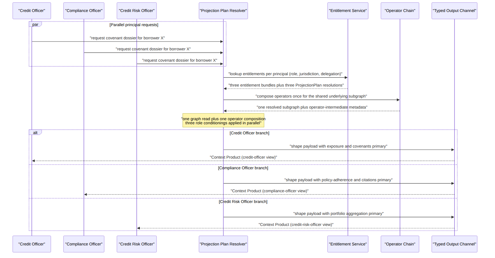

*Fig-CH07-12: Π runtime conditioning — three principals request the same covenant dossier; each receives a role-shaped Context Product from one shared graph read The sequence renders the architectural payoff the § 7.5 mechanism commits to. Three principals — a credit officer, a compliance officer, a credit risk officer — each request the covenant dossier for the same borrower, with the same entity reference and the same temporal boundary. The Projection Plan Resolver consults the Entitlement Service once per principal, receives three distinct entitlement bundles plus the three ProjectionPlan identifiers the role-to-intent-to-plan lookup tables map each principal to. Here the alt/else branches are essential — they render three outputs produced from one shared state, not three parallel pipelines that happen to read the same source. The Operator Chain executes once: the Traversal, Temporal, Policy, and Similarity operators each run once over the underlying Counterparty Credit Risk subgraph, producing one operatorcomposed intermediate the three projections share. The three projections then apply their role-shaped substitution in parallel — credit-officer elevates exposure and covenants, compliance-officer elevates policy-adherence evidence and passage-level citations, credit-risk-officer elevates portfolio aggregation — and each emits a typed Context Product to the appropriate principal over the typed output channel. The interaction is the runtime enactment of D-19 (Π performs subgraph substitution, not subgraph filter), D-20 (the ProjectionPlan Protocol as the two-method structural interface the resolver dispatches against), D-22 (role-shaped views from one shared graph), and D-23 (runtime conditioning as the mechanism that avoids the combinatorial-explosion failure mode of precomputeeverything). Three principals, one underlying truth, three constructed meanings — and no data hidden across the three views, because Π constructs meaning by substitution rather than by removing data. Fig-CH07-12 is the interaction commitment behind the three-view role-shaped document example § 7.5 walks in prose; subsequent § 7.6 Context Product commitments read against this sequence without re-rendering the role-conditioning mechanism.*

#### 7.5.2 Two-Stage Execution Model — Operator Plan plus Projection Plan

Projection layers on top of operator execution as a second-stage plan: Operator Plan answers “what is true”; Projection Plan answers “what that truth means in this decision context.” The two stages carry strict separation of responsibility and tight coupling in execution. Separation is structural. Operators are principal-agnostic — a Traversal over ownership edges with depth-limit=3 is the same computation regardless of who requested it. Projections are principal-conditioned — they shape meaning based on role, intent, temporal context, and policy regime. The operator plan knows nothing about who the principal is; the projection plan knows nothing about how the graph was traversed. Neither concern leaks into the other, which is what allows operators to memoize their intermediate contexts (same operators plus same state always yield the same output) and allows projections to be registered and evolved per role without modifying operator behavior. Coupling is tight in execution via operator-produced metadata. When the Operator Plan DAG generator (§ 7.4) produces its plan, the plan carries metadata the Projection Plan needs: which traversal paths were walked, which temporal constraints were applied, which policy filters were enforced at the pre-Similarity inversion, which similarity expansions occurred with which threshold and index version. The Projection Plan reads this metadata during its own invocation because the shape of meaning it produces depends on it — a credit-officer projection cannot frame a covenantcompliance narrative correctly if it does not know which covenant clauses were actually traversed in the three-node walk, because the narrative references those clauses by passage-level anchor. The architectural boundary is load-bearing. If operator and projection concerns are combined — if operators start doing principal-conditioning, or if projections start driving graph reads — the system becomes either rigid (operators-as-projections yields precomputed views that cannot adapt to new roles) or inconsistent (projections-as-operators pushes interpretation logic into agent code, where it fragments across teams and loses auditability). The two-stage separation is what keeps each concern tractable.

#### 7.5.3 Role-Shaped Document Views — Same Credit Memo, Three Context

Products

The XC-05 obligation § 7.5 discharges is the role-shaped document view: the same underlying resolved context, projected under three different Π, yields three different Context Products without duplication of state. The Counterparty Credit Risk thread § 7.3 committed as graph topology and § 7.4 composition (d) traversed as credit-exposure mechanism now carries into § 7.5 at the interpretation layer. Consider a single credit memo assembled for Borrower X — a commercial-lending obligor in a multi-subsidiary corporate group. The memo is drafted against a single resolved Context Graph substructure: the counterparty and its parent group and material subsidiaries, the exposure and facility and collateral nodes, the covenant structures and guarantor expansions, the policy bindings and temporal reconciliations that § 7.4 operator compositions produced. Three principals consume the memo for three different decisions; each receives a different Context Product. (i) The credit-officer view. The credit-officer projection elevates exposure relationships, covenant structures, guarantor expansions, and risk indicators as the primary signals — the underwriting-decision surface. Liquidity flows and portfolio correlation are present but subordinated; regulatory-citation lineage is present but compressed. The credit officer asks: is this counterparty a creditworthy borrower at this facility size under these covenant terms? The

projection shapes the context to answer that question — exposure structure prominent, covenant compliance foregrounded, guarantor chains expanded. (ii) The compliance-officer view. The compliance-officer projection elevates policyadherence evidence, regulatory-citation lineage, and historical-decision-trail as primary. Counterparty commercial detail is present but subordinated; credit-quality metrics are present but compressed. The compliance officer asks: has the bank’s internal policy been applied correctly, and is every policy inference traceable to a citable regulatory or internal source? The projection shapes the context to answer that question — policy bindings prominent, regulatory citations expanded with passage-level L anchors, decision history foregrounded. (iii) The credit-risk-officer view. The credit-risk-officer projection elevates aggregate portfolio exposure, correlation signals, and stress-test scenarios as primary. Individual-transaction detail is present but subordinated; counterparty-level narrative is present but compressed. The credit-risk officer asks: how does this credit decision move the bank’s aggregate risk posture, under stress scenarios, against portfolio-concentration and correlation thresholds? The projection shapes the context to answer that question — portfolio-level aggregation prominent, stress scenarios expanded, correlation structure foregrounded. Each projection derives from the same underlying Context Graph substructure. The entities, the relationships, the temporal state, the policy bindings, the passage-level lineage — none of these differ across the three views. What differs is the shape of the Context Product each principal receives: which axes are primary, which are subordinated, which are expanded, which are compressed. Projection is about constructing meaning, not removing data. The compliance officer sees all the commercial detail the credit officer sees; it is just not the foreground of their Context Product. The credit officer sees all the policy-citation detail the compliance officer sees; it is just not the foreground of theirs. The credit-risk officer sees both, reframed at the portfolio aggregation layer. No data is hidden across the three views; the meaning is constructed differently. Pattern grounding: in a reference implementation, 6 registered projections share one underlying graph; the equivalent pattern in a wholesale banking deployment would register credit-officer, compliance-officer, credit-risk-officer, portfolio-manager, treasurer, and relationship-manager projections against a single Counterparty Credit Risk graph. Each projection’s invoke() method reads the same graph state; each returns a structurally-different Context Product; the engine dispatches all six against the same memoized operator intermediate contexts. Six Context Products, one shared state, zero duplication.

#### 7.5.4 Runtime Conditioning — Dynamic Projection at Decision Time

Projection runs dynamically at runtime, conditioned by the tuple (role, intent, temporal context, policy). Runtime conditioning is the mechanism that makes the “construct once, interpret many” commitment expressible in a production system; without it, the fabric would collapse into one of two failure modes, both of which have precedent in the legacy data-mart architectures Chapter 4 diagnosed. The first failure mode is precompute-everything: materialize every combination of role × decisionclass × time-horizon × policy-regime as a precomputed view. The combinatorial explosion makes this intractable at enterprise scale. A bank with a dozen roles, a dozen decision classes, a handful of temporal regimes (as-of-now, as-of-last-quarter, as-of-year-end, stress-scenario-overlays), and a handful of policy states (current-policy, pre-update, proposed-update) expands to thousands of

view definitions before a single line-of-business variation is considered. Each precomputed view requires refresh orchestration, schema governance, and staleness reconciliation; the operational burden consumes the engineering capacity that should be producing new decision surfaces. The second failure mode is resolve-at-read-time: give the agent access to the full graph and let it apply whatever interpretive shaping it needs at decision time. This collapses the two-stage separation — interpretation leaks into agent code, audit becomes per-agent rather than per-projection, and role-shaped meaning fragments across implementations. Dynamic Π avoids both. The projection is resolved at request time against the current graph state and the current Control Plane config; the result is a Context Product shaped exactly to the decision the principal is making. No precomputation is wasted on combinations that are never requested; no interpretive logic lives in agent code. The two-stage execution model keeps the cost bounded by producing memoizable operator intermediates the Projection Plan composes against.

#### 7.5.5 Context Product Contract as Output Stability Layer

Π produces a Context Product Contract as its output surface — the typed, governed, decisionready artifact the agent consumes. The Contract is the stability layer that decouples agent consumers from the internal evolution of operators, graph structure, and policies. An operator can be re-implemented (with the same typed input and output), a graph class can be extended (with additional relationship types), a policy can be versioned (with updated jurisdictional bindings) — and the Contract’s surface to the agent stays stable across all of them, because the Contract declares the shape of the output in typed terms the agent binds to and the underlying evolution lives behind the Contract boundary. Section § 7.6 specifies the Contract in full — the ContextProductContract base with extra=forbid structural typing, the per-product semver evolution rules, the materialization policy that governs when Contracts are served from cache, the illustrative SLO envelope that calibrates production expectations. § 7.5 names Π as the producer of Contracts; § 7.6 commits the Contract mechanism itself. The interpretation layer § 7.5 commits is the bridge from the operator-composed subgraph § 7.4 produces to the typed delivery surface § 7.6 wraps. Π is the typed transformation; ProjectionPlan is the structural interface; the two-stage execution model separates truth from meaning; role-shaped views render the same graph as three different Context Products without duplication; runtime conditioning keeps the mechanism tractable; the Contract is the stable output. § 7.6 takes the Contract surface Π produces and commits the delivery mechanism — the base specification, the SLO envelope, the materialization policy, the cache coherency, the per-class cost envelope, and the algorithmic-and-semantic stage-alternation pattern that keeps replay deterministic and cost bounded.

#### 7.5.6 Role-Conditioned Meaning vs Access Control — Knowledge Catalog Perspectives as Foil

The four distinctions § 7.5 above established between Π and RBAC at the formalism level — enforcement boundary, composition with operators, decision-time parameterization, and auditability — answer the question how does Π differ from access control in general. The question the Knowledge Catalog foil sharpens is what distinguishes role-conditioned meaning from access control specifically when the substrate vendor productizes “Perspectives” as a named feature. Knowledge

Catalog’s product-surface analog to Π is a Perspectives capability documented in Google’s separate BigQuery and Looker product surfaces, where Perspectives provides role-shaped views over a single canonical schema — RBAC-shaped at the response boundary, access-control-shaped at the row-filtering layer. The “Perspectives” naming overlaps with Π in vocabulary; the architectural commitment underneath does not. Knowledge Catalog’s Perspectives feature, where it exists in the productized surface, filters a single canonical view; Π’s typed subgraph substitution constructs different typed graphs for different principals. The Wholesale-banking grounding makes the distinction concrete. The same counterparty entity — say, a publicly-traded mid-market industrial — has a different typed shape under role-conditioned meaning than RBAC can express. For the Commercial Banking credit officer, the typed shape projects exposure, covenant, collateral, and guarantor relationships as load-bearing entities; for the Compliance officer over the same counterparty, the same projection request yields a typed shape where the credit officer’s exposure-and-covenant structure simply does not appear because the Compliance graph is built around SAR-relevant transaction patterns, sanctions-screening artifacts, and KYC document spans the credit officer’s projection never composes. RBAC says which rows the principal may see; Π says what the typed structure of the graph is for the principal — and the typed structure determines what operators can compose over it. Fig-CH07-11 renders Π’s subgraphsubstitution model; Fig-CH07-12 renders the runtime-conditioning surface; together they commit the role-conditioned-meaning posture this foil sharpens against Knowledge Catalog’s access-control posture. The image9 dimension-#3 framing — Google provides one universal context shape with access control over it; the CCF constructs role-conditioned meaning per principal — lands here as the canonical foil-specific framing the rest of § 7.5’s mechanism prose carries forward into § 7.6’s delivery surface.
### 7.6 Context Products — System of Delivery

§ 7.3 committed the graph as state; § 7.4 committed the operator algebra that composes subgraphs from it; § 7.5 committed Π as the typed transformation that shapes those subgraphs into principal-conditioned views. § 7.6 commits the delivery boundary — the typed Context Product Contract that every projection returns, the illustrative SLO envelope the delivery layer calibrates against, the materialization policy that governs when Contracts are served from cache, the per-Context-Productclass cost envelope that answers the derived-at-runtime-is-expensive objection at mechanism level, and the algorithmic-and-semantic stage alternation the fabric commits as an architectural primitive to keep replay deterministic and cost bounded. Chapter 6 § 6.3 specified the Context Product Contract as an eight-element specification — schema, freshness SLA, TTL, policy binding, lineage, semantic versioning, discovery, addressability. § 7.6 does not re-specify those eight elements; it commits the Contract base mechanism the eight elements compose on top of. The Contract base is the typed scaffold every per-product subclass inherits and extends; the per-product subclasses carry the domain-specific payload; the cross-cutting invariants live on the base where they can be validated once and applied everywhere.

#### 7.6.1 ContextProductContract — Base Specification

The fabric commits to a typed base that every projection returns. In language-neutral terms, the ContextProductContract base carries the fields every Context Product must declare before the delivery layer will serve it. The seven contract fields enumerated below are the same seven fields Fig-CH07-13 renders as the Context Product Spec sidebar (schema, freshness SLA, TTL policy,

policy binding, lineage graph, semantic version, payload) — the prose specification and the visual sidebar commit to the same contract surface.

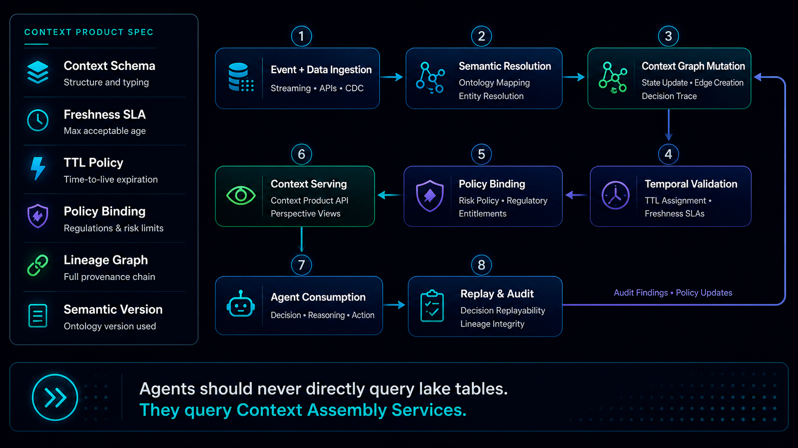

*Fig-CH07-13: The Anatomy of a Context Product. The eight-step lifecycle renders the full path a Context Product traverses from signal ingress to audit exit. Steps 1–3 are the write path that lands signals into the graph; steps 4–6 are the assembly path that composes a Contract-bound Product for consumption; steps 7–8 are the consumption-and-replay path that closes the loop back to governance. The architectural commitment is that agents should never query raw source tables — they query Context Assembly Services that enforce the Contract at delivery time The schema_name is a class-level constant that is stable per product — a CounterpartyCreditRiskContract declares schema_name = "counterparty_credit_risk" once, and the name does not change over the lifetime of the Contract class. Downstream systems discovering or subscribing to the product index against schema_name, which is why it is a classvar rather than an instance field. The schema_version is the semver that evolves as the Contract schema itself evolves; a field addition, a field type change, or a payload-shape reorganization all bump the schema_version according to standard semver discipline (MAJOR for breaking; MINOR for additive; PATCH for clarification). The plan_id identifies the ProjectionPlan that produced this Context Product. Because every projection registered against the engine has a structural-interface identity (§ 7.5), the plan_id is a stable identifier that connects the Contract back to the exact projection that constructed it — including the ProjectionPlan version, which makes forensic reconstruction tractable. The expires_at is a datetime TTL boundary; Contracts past expires_at must not be served from cache without re-derivation, and the delivery layer enforces the boundary at read time. The ttl_anchor names the policy the TTL derives from — an enum of from_decision (the TTL counts from the decision being made, e.g., a credit review window) or from_entity_freshness (the*

TTL counts from the freshness of the underlying entity, e.g., a 10-K whose valid period governs when the derived Context Product expires). The two anchors carry different semantics. from_decision means the Contract stays live only for the duration the decision is active; from_entity_freshness means the Contract stays live until the source entity’s validity period expires, which can span many decisions against the same source. Getting the ttl_anchor wrong breaks cache coherency in either direction — too permissive and stale Contracts serve live decisions; too restrictive and cache hit rates collapse. The lineage field carries the forensic-reconstruction payload: the set of operators_invoked during composition (typed operator references, not just operator names); the policy_version active at composition time; the graph_snapshot_at timestamp identifying the graph state the operators read. Together, the three elements compose the audit trail § 7.4 determinism requires — given a lineage record, the replay engine (§ 7.10 forward-ref) can reconstruct the operator composition against the graph snapshot under the active policy and produce the same Context Product bit-for-bit. The payload field is per-product typed; each subclass declares its own payload schema as a typed member whose structure is specific to the decision the product serves. The Contract base has extra=forbid as a structural-validation discipline. Forbidding extra fields blocks Contract drift: a per-product subclass cannot silently add a field the base did not declare, and a payload cannot drift beyond the shape the subclass declared without failing validation. The CI suite enforces extra=forbid as a build-time invariant — a pull request that introduces a drifted Contract fails CI before it reaches a deployment surface. This is the mechanism that keeps Contract evolution honest at scale; per-product subclasses add their payload without contaminating the base, and the base’s cross-cutting invariants travel with every Contract instance the fabric produces. Pattern grounding from the reference implementation: in a reference implementation, the Contract realizes as a strict-schema-validated typed base with extra=forbid structural validation; the empty-operator guard, lineage strict equality, and TTL bounds checks are three sequential validation gates in the projection execution engine. The empty-operator guard rejects a Contract whose operators_invoked is empty — a projection must have resolved at least one operator to have meaningfully read the graph, and an empty set indicates a misconfigured projection rather than a trivially-successful one. Lineage strict equality rejects a Contract whose declared operators_invoked does not match the set of operators the engine actually resolved — forgery, omission, or accidental drift all fail at the gate. TTL bounds rejects a Contract whose expires_at is in the past or beyond a MAX_TTL envelope — expired-on-arrival or impossibly-long-lived Contracts are both invariant violations. Per-product semver evolution independence is the final property the base commits to. A CounterpartyCreditRiskContract@v2.1.0 → v2.2.0 bump — say, to add an additional field in the payload shape — does not touch any other product’s Contract. AMLTypologyMatchContract@v1.3.0 stays at v1.3.0; TreasuryLiquidityPositionContract@v4.0.2 stays at v4.0.2; the per-product semver lanes are independent.

This is the stability property that makes Contract evolution tractable across an enterprise with dozens of product classes — each product evolves on its own cadence without cross-product blast radius.

#### 7.6.2 Illustrative SLO Envelope

The objection that “derived-at-runtime is expensive” needs a concrete answer before the Contract’s usefulness is credible. The fabric commits to an illustrative SLO envelope — a set of numerical targets an enterprise-scale CCF deployment should aim for, rendered with an explicit disclaimer so the numbers are read as envelope rather than benchmark. These numbers are illustrative of the envelope an enterprise-scale CCF deployment should target; they are not vendor benchmarks. Production calibration against decision-class workload patterns is required. Within that envelope, the fabric calibrates against four numerical targets. First, p99 300ms for interactive Context Products. Interactive decisions — an agent producing a credit memo while a relationship manager waits, a compliance investigator resolving a counterparty’s policy-binding lineage during a live investigation — require tail-latency bounded tightly enough that a human or agent-in-a-synchronous-loop experiences responsiveness rather than delay. Second, 2s asynchronous for asynchronous Context Products. Asynchronous decisions — a periodic portfolio-concentration recalculation, a nightly covenant-compliance sweep, a batched AML typology-scan run — tolerate wider latency in exchange for denser operator composition and larger projected subgraphs. Third, 10K Context Products per second per cluster throughput. The fabric aims for that steady-state throughput under typical decision-class mix within a single production cluster, scaling horizontally across clusters for larger deployments. Fourth and fifth, materialization budget band ≤ N% of cluster compute capacity (the share of compute the Control Plane allocates to pre-computed Context Products rather than derived-on-demand) and cache-hit target band ≥ M% at steady state within λ_c window (the hit-rate target the materialization policy calibrates against within each Context Product class’s Half-life window). These five numbers compose as envelope, not benchmarks. p99 300ms interactive and 2s asynchronous bound the latency surface an agent calibration expects. 10K Context Products per second per cluster bounds the throughput surface the fabric allocates cluster capacity against. The materialization-budget band and the cache-hit band bound the steady-state resource posture the Control Plane operates within. The closing discipline is that the envelope is illustrative, not vendor benchmarks — the numbers are the calibration lens a production deployment validates against observed workload patterns. Rebuttal #3 (“derived-at-runtime is expensive”) reads directly against this envelope: the fabric does not claim derived-at-runtime is free; it claims the cost is bounded by a specific envelope that production calibration must reconcile against observed workload.

#### 7.6.3 Materialization Policy and Cache Coherency

The delivery layer does not derive every Context Product on demand; the Control Plane maintains a materialization policy per Context Product class that decides which Contracts are pre-computed into the materialization tier and which are derived on demand at request time. The policy is driven by three signals. First, Half-life times access frequency. A Context Product whose underlying Half-life λ_c is four hours but whose access frequency is a thousand reads per hour is an obvious materialization candidate — pre-computing it once per λ_c window amortizes the derivation cost across the thousand reads in that window. A Context Product whose λ_c is a year but whose access frequency is five reads per day is not — the marginal cost of derivation per read is low enough that pre-computing is wasted capacity. The materialization policy quantifies this tradeoff per product class. Second, derivation cost envelope. A Context Product whose composition traverses high-fan-out relationships across a counterparty’s corporate family at multi-hop depth is expensive to derive; materialization pays for itself at lower access frequencies than a Context Product whose composition resolves against a compact policy-projected subgraph. The per-class cost-envelope bands the next subsection specifies feed this signal. Third, regulatory supersession triggers. When an underlying source entity changes state — a new 10-K files, a loan covenant is amended, a regulatory limit updates — downstream materialized Contracts depending on that entity must invalidate, and the invalidation cascades across the dependency chain. The supersession-triggered invalidation is a Policy event the Control Plane propagates to the Data Plane; § 7.7 carries the full treatment of supersession as a mechanism in the Debt/Half-life chapter. The cache coherency semantics are the runtime contract the materialization tier enforces. Materialized Context Products within their λ_c window are reused without re-derivation — the delivery layer reads from cache, returns the Contract, records the cache-hit in the request lineage. Contracts whose underlying state has been superseded are invalidated on the supersession event — the cache entry is evicted; the next request triggers re-derivation; the fresh Contract re-materializes with updated source. Invalidation cascades to downstream Context Products that inherit from the invalidated entity — a superseded counterparty E node invalidates every Context Product whose operators_invoked touched that entity, not just the Contracts named for the entity directly. Key Insight — Fig-CH07-14 renders the cache coherency state machine as the four-state lifecycle a materialized Context Product traverses — Fresh while within the λ_c window, Near-Expiry as the window closes and re-derivation becomes imminent, Invalidated-by-Supersession when a Policy event evicts the Contract outside the decay schedule, and Re-Derived as the next request restores a Fresh state under updated source. The state machine renders the four materialization states a Context Product occupies and the transitions between them. Fresh is the state after materialization — the Contract is within its λ_c window and the delivery layer serves it from cache. Near-Expiry is the state as the λ_c window closes; depending on access-frequency signals, the Control Plane may trigger re-derivation back to

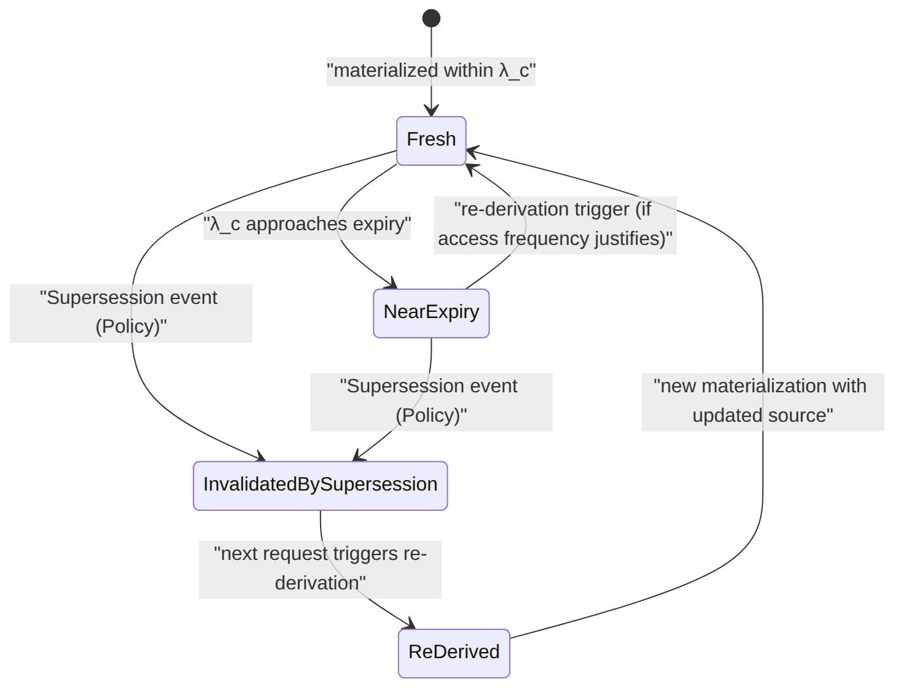

*Fig-CH07-14: Cache coherency state machine under λ_c and supersession events*

Fresh, or may let the Contract expire to force on-demand derivation. InvalidatedBySupersession is the state entered when a Policy event evicts the Contract outside the decay schedule — a new 10-K collapses currency, a regulatory limit updates, a counterparty restructures — and the cache entry is removed. ReDerived is the transitional state the next request produces; once materialization completes with the updated source, the Contract returns to Fresh. Supersession transitions are Policy events fired from the Control Plane, not time-decay events, and § 7.7 commits the full mechanism for how supersession propagates. Fig-CH07-14 is the visual anchor for the materialization-policy mechanism. The four states and the transitions between them are what the delivery layer implements; every materialized Context Product occupies exactly one state at any time; the transitions are the points at which the materialization policy exercises its three decision signals.

#### 7.6.4 Interaction Mechanics — Derivation Paths and Contract Validation

Fig-CH07-14 renders the state machine a single materialized Context Product traverses; the chapter still owes two runtime interaction commitments that make the delivery mechanism concrete. The first is how the materialization policy decides, per request, between serving from cache and deriving on demand — the two derivation paths a production deployment constantly traverses and whose cost envelope the per-class bands calibrate against. The second is how the ContextProductContract validation gates refuse to ship products that violate strict-schema, empty-operator, lineage-equality, or TTL-bounds invariants. Both interactions return the Fig-CH07-10 end-to-end assembly trace from § 7.4 into the delivery-layer boundary § 7.6 specifies. Key Insight — Fig-CH07-15 renders the two derivation paths as a single Mermaid interaction with an alt/else split on cache lookup. The figure is load-bearing because the architectural claim that derived-at-runtime cost is bounded rests on the cache-hit path handling the majority of requests at baseline cost while the cache-miss path amortizes the × 3–5 or × 8–15 bands across the materialization window’s access frequency. The sequence renders the two paths the delivery layer traverses on every request. Request A arrives and the Product Cache performs a keyed lookup against the composite identity that makes a Context Product instance unique — tenant, schema name, ProjectionPlan identifier, graph snapshot identifier, and principal binding. The alt branch renders the cache-hit path: the product is within the λ_c window Fig-CH07-14 named Fresh; the delivery layer records the cache-hit in the lineage Chain and serves the product without re-derivation; the request resolves well inside the p99 300 ms envelope § 7.6 commits to. The else branch renders the cache-miss path: the Materialization Engine invokes the operator composition Fig-CH07-10 walked; the Context Graph is read under policy projection; the operator chain returns a composed intermediate with lineage; the engine applies Π and populates the ContextProductContract payload. The Note-over segment renders the materialization policy’s three-signal decision — whether the access frequency, the λ_c window, and the per-class cost envelope jointly justify writing the newly derived product to cache. The conditional-write property is what keeps the cache from filling with products that would never be re-requested within their λ_c window — a product derived on demand for a one-off compliance review under a rare jurisdiction is not necessarily cached, because the marginal cost of caching exceeds the marginal benefit of the cache hit that would never arrive. The architectural payoff is that the cache-hit path dominates the steady-state statistics while the cache-miss path is bounded by the per-class cost envelope and the materialization policy’s conditional-write discipline. D-27 materialization policy and D-28 per-class


*Fig-CH07-15: Context Product derivation paths — Request A hits cache and serves within p99 budget, Request B misses and derives on demand with conditional cache write per materialization policy cost envelope both land against this sequence; the CAR routing pattern § 7.7 commits to further bounds the subset of cache-miss requests that actually exercise the expensive LLM-invocation path. The derivation-path interaction Fig-CH07-15 renders is the operational enactment of the materialization policy; Fig-CH07-10 from § 7.4 is the end-to-end trace for the cache-miss branch rendered in its full operator-by-operator detail, and Fig-CH07-14 is the state machine the cache-hit branch’s Fresh state occupies. Key Insight — Fig-CH07-16 renders the ContextProductContract validation as a strict-gate sequence. The figure is load-bearing because the strict-schema discipline is the architectural mechanism that keeps Contract drift from corroding the delivery boundary at scale — an invalid Context Product is structurally refused before it reaches a consumer, not caught at audit time. The sequence renders the three validation gates the Context Assembler traverses before any Context Product is written to cache or delivered to an agent. The first gate is the Schema Validator, which checks that all seven ContextProductContract base fields are present and that extra=forbid has not been violated by a per-product subclass silently adding a field the base did not declare. The second gate is the Policy Gate, which verifies that the policy binding recorded in the Contract matches the Control Plane’s active policy at assembly time — a Context Product whose policy version does not match the Control Plane’s current version is structurally inadmissible because the principal’s entitlement may have been evaluated against a superseded policy. The third gate is the Lineage Completeness Checker, which enforces strict equality between the Contract’s declared operators_invoked set and the set the engine actually resolved, and verifies that passage-level anchors exist for every claim derived from unstructured sources. Three failure branches render the refusal paths — schema-violation rejection, policy-binding rejection, lineage-incompleteness rejection — each returning to the agent with a structured rejection rather than silent acceptance. The cache write only occurs if all three gates pass, and the write itself re-verifies extra=forbid and TTL bounds within MAX_TTL at the cache boundary. The architectural consequence is that no invalid*


*Fig-CH07-16: ContextProductContract validation — three sequential gates refuse invalid products before the cache accepts them Context Product reaches an agent, no invalid Context Product enters the cache, and no invalid Context Product contaminates the Decision Replay record. D-25 ContextProductContract base with extra=forbid, D-27 materialization policy with conditional-write, and D-28 per-class cost envelope all read against this sequence as their validation pre-condition. Rebuttal #3 (derived-at-runtime is expensive) lands in part through this sequence because the validation cost is bounded per-gate and the gates fail fast on any violation, which is what keeps assembly cost bounded by the per-class envelope rather than inflated by retroactive cleanup of invalid products. Fig-CH07-16 is the interaction commitment behind the § 7.8 architectural invariants subsection — the Lineage strict equality invariant, the TTL bounds invariant, and the tenant-scoped invariant all read against this sequence as their runtime enforcement path.*

#### 7.6.5 Per-Context-Product-Class Cost Envelope

The illustrative SLO envelope bounds latency and throughput; the per-Context-Product-class cost envelope bounds compute. The fabric commits to four illustrative cost multiple bands, expressed relative to a baseline rather than as absolute dollar figures, because absolute dollar figures depend on cloud-provider pricing, cluster topology, and workload mix that vary per deployment. The first band is materialized-structured-only × 1 baseline. A Context Product whose composition reads only from structured source (core banking, trading systems, regulatory feeds) and whose shape is pre-materialized per the materialization policy establishes the baseline. Its cost is the reference unit; every other band is expressed as a multiple of this baseline. The second band is materialized-unstructured-heavy × 3–5. A Context Product whose composition includes passage-level retrieval against unstructured sources — loan-document covenant

extraction, credit memo passage resolution, adverse-media ingestion — carries embedding and retrieval overhead on top of graph traversal. Pre-materialization amortizes most of this overhead, but the embedding-index maintenance cost and the retrieval-against-index cost remain, putting the band at roughly three to five times baseline. The third band is derived-on-demand-structured × 2–4. A Context Product whose composition reads only from structured source but is not materialized — derived at request time — loses the amortization benefit of pre-materialization. The band is roughly two to four times baseline, bounded on the low end by operator-level memoization of intermediate subgraph productions and on the high end by worst-case composition depth against cold caches. The fourth band is derived-on-demand-unstructured × 8–15. A Context Product that combines unstructured retrieval with on-demand derivation carries both the embedding-and-retrieval overhead and the on-demand derivation cost, without the amortization of materialization. The band is roughly eight to fifteen times baseline, which makes derived-on-demand-unstructured the most expensive quadrant in the four-class matrix and the one the Control Plane’s materialization policy most aggressively targets for pre-computation. The mechanism-level answer to Rebuttal #3 is that the cost bands are not a gotcha but a calibration tool. The Control Plane decides materialization per product class based on where in the four-band matrix the class lives; a routing pattern — the fabric skips full-LLM assembly for the majority of cycles when the graph already carries the evidence the decision needs, producing a Context Product without semantic inference and bypassing the most expensive stages of the pipeline — is what keeps aggregate cost within the SLO envelope even when a minority of requests exercise the expensive quadrants. § 7.7 commits the full mechanism for the routing pattern in the Debt/Half-life treatment.

#### 7.6.6 Algorithmic ⇄ Semantic Alternation as an Architectural Primitive

The fabric commits to Algorithmic ⇄ Semantic Alternation as an Architectural Primitive — a structural discipline that every Context Product composition respects. Chapter 6 § 6.4 introduced the concept at the lifecycle-pattern layer; § 7.6 commits the mechanism that makes the pattern first-class in the delivery architecture.[^c2] State the pattern. Algorithmic stages perform deterministic computation without LLM inference; semantic stages receive as sole input the output of the immediately preceding algorithmic stage. Two invariants flow from this alternation. The first invariant is that no semantic stage operates on raw signals — every LLM invocation receives the pre-resolved typed substrate an algorithmic stage produced, never the unprocessed feed from an upstream source system. The second invariant is that no algorithmic stage performs semantic interpretation — every deterministic stage reduces to typed composition, policy enforcement, temporal reconciliation, and contract shaping, never to meaning-construction the LLM is responsible for. Every transition in the composition pipeline crosses the algorithmic-or-semantic boundary exactly once; the pattern is strict alternation, not a mixed execution where algorithmic computation and LLM inference interleave without discipline.

The algorithmic stages are where graph traversal, temporal reconciliation, policy subgraph substitution, similarity-over-pinned-index ranking, and contract-shaped structuring happen — all deterministic, all replayable, all cost-bounded. The semantic stages are where assessment, reasoning, and narrative production happen — the LLM invocations that translate assembled context into decision-shaped meaning. The pattern renders as a stage-by-stage pseudocode that makes the alternation visible.

```
# Algorithmic ⇄ Semantic Alternation stage pattern
Signals
  → Algorithmic-Assembly (deterministic; no LLM)
    → LLM-Assessment (semantic; receives assembled substrate only)
      → Algorithmic-Structuring (deterministic; enforces contract)
        → LLM-Reasoning (semantic; receives structured context only)
          → Algorithmic-Action-Structuring (deterministic; typed action)
            → Agent Action
```

Read the pipeline top-to-bottom. Signals enter the fabric at L1. The Algorithmic-Assembly stage runs L2 Context Assembly plus L3 Graph reads plus L4 Operator composition without any semantic interpretation — entity resolution runs algorithmically, temporal stitching runs algorithmically, policy binding runs algorithmically, operator plans execute as typed composition. The LLM-Assessment stage is where the first semantic step enters; its sole input is the assembled substrate from the preceding algorithmic stage, not raw signals. The Algorithmic-Structuring stage runs the Contract-shaping mechanism — enforcing extra=forbid, validating operators_invoked, anchoring graph_snapshot_at — deterministically and without semantic inference. The LLM-Reasoning stage is where decision-shaped meaning gets produced against the structured context. The Algorithmic-Action-Structuring stage enforces the typed-action contract — the agent’s action is structured before it emits — without further semantic inference. Agent Action is the output. The architectural consequence is that each LLM invocation receives a dimensionally-reduced, deduplicated, policy-enriched substrate rather than unprocessed sensor or signal output. The algorithmic stages do the work of reducing signal volume to the subset that matters for this decision, deduplicating across heterogeneous sources, and enriching every piece of that subset with the policy and entitlement metadata the semantic stage needs to reason correctly. The LLM never sees raw chunks that might or might not be relevant; it sees the pre-resolved typed substrate the algorithmic stages produced. This is what keeps replay deterministic — because the algorithmic stages are deterministic by construction, and because the semantic stages receive identical structured inputs under replay, the composition replays bit-for-bit as § 7.10 forward-ref requires. It is also what keeps cost bounded — because the expensive LLM invocation runs only on the reduced substrate, not on the raw signal volume.

Reference-implementation pattern attribution: in a property-intelligence reference implementation, the architectural transition point is explicitly marked — an assembly stage that is always algorithmic (never LLM) produces the unified substrate for downstream reasoning. The docstring on this stage reads: “This is always algorithmic (never LLM) and produces the unified substrate for downstream reasoning.” The reference implementation encodes the pattern directly in the stage’s inline documentation; the discipline is not a code-review convention but a structural invariant the CI suite validates against attempted bypasses. The alternation pattern carries forward into two downstream commitments. § 7.10’s Decision Replay determinism rests on it — the algorithmic stages produce replayable intermediates, and the semantic stages receive identical structured inputs under replay, so the composition reconstructs exactly. § 7.9’s closed-loop write-back respects it — feedback signals are interpreted into Control Plane updates through an algorithmic path (signal observation to typed outcome object to Control Plane version bump), not through direct model modification; the loop tightens by improving context, not by retraining weights. Chapter 6 § 6.4 named this pattern at concept level; § 7.6 commits the mechanism. The reading carries across the broader research landscape: Recursive Language Models (Sebastian + MIT CSAIL, primeintellect.ai/blog/rlm, 2026) is the cleanest external instantiation of the alternation thesis — the paper gives the model a Python REPL and the ability to call sub-instances of itself, treating long context as a program-synthesis problem rather than an attention problem and achieving effective context up to a hundred times longer than a base model handles directly. The architectural reading is the same as the one § 7.6 commits: deterministic computation alternating with bounded semantic invocation, with each LLM call receiving only the typed substrate the preceding algorithmic stage produced. What the fabric adds beyond the RLM construction is the governance layer that the program-synthesis framing leaves unaddressed — the per-ContextProduct Assembly Mode contract Chapter 6 § 6.3 carries as the ninth element, the five-dimension Decision Replay record § 7.10 makes load-bearing, and the λ_c-aware materialization policy § 7.7 binds to context degradation. RLM grounds the alternation thesis empirically; the CCF grounds the same thesis as a governed, replayable, λ_c-bounded composition the regulated enterprise can operate against, with Assembly Modes 2 and 3 in particular reading as the structural disciplines the program-synthesis literature is converging on independently.

#### 7.6.7 Three Assembly Modes — Cost-vs-Quality-vs-Determinism Tradeoff

The alternation pattern above commits the discipline every Context Product composition respects; the three-mode model below commits the delivery-layer choice the fabric exposes per product. The architectural commitment the choice rests on is trust-path purity — deterministic source-ofrecord with optional probabilistic presentation: the algorithmic substrate is what the audit trail anchors against; the natural-language rendering or agent-swarm-synthesized cross-reference is a presentation layer over the substrate, replay-deterministic under pinned configuration but never the artifact the supervisor inspects. Three Assembly Modes exhaust the delivery-layer choice space — (1) pure algorithmic assembly, (2) algorithmic assembly with LLM packaging, and (3) algorithmic orchestration with agent-swarm assembly — each committing the costvs-quality-vs-determinism tradeoff differently and each selecting itself through the per-ContextProduct mode-selection property Chapter 6 § 6.3 carries as the ninth element of the contract and

Chapter 6 § 6.4 carries through the eight-step lifecycle as the configuration governing how the product is built. Mode 1 — pure algorithmic assembly. No LLM invocation runs at any stage of assembly or of delivery; the typed Context Product is the output and the consuming agent acts on the typed structure directly. The cost-vs-quality-vs-determinism position is the lowest cost (no LLM tokens spent), the highest determinism (function-deterministic across the entire composition, with value-time-variance under bitemporal reconciliation and per-signal half-life as the only legitimate source of output-variance), and the lowest narrative quality (the output is the structured contract — schemas, identifiers, decay-weighted scores — with no natural-language presentation layer wrapping it). The canonical Wholesale exemplar is AML alert triage routing: an L1 analyst receives a typed AMLAlertContext Context Product whose rules-driven disposition recommendation (close-noaction / escalate / hold-for-review) was computed by deterministic scoring against the transaction graph plus policy projection, never by LLM inference. Mode 1’s routing-tier-versus-narrative-tier discipline matters here, because the same compliance domain admits Mode 2 packaging downstream: when an AML alert escalates and a SAR narrative requires composition, that downstream packaging shifts to Mode 2 under Chapter 8 § 8.9’s Forensic-Defensibility archetype — Mode 1 is the routing surface, not the narrative surface, and the distinction prevents the assumption that “AML uses LLMs” collapses the per-product mode-selection decision. Mode 2 — algorithmic assembly with LLM packaging. LLM invocation runs at the presentation layer only, over a dimensionally-reduced algorithmic substrate the upstream stages have produced under the alternation discipline above. The cost-vs-quality-vs-determinism position is moderate cost (the LLM invocation dominates per-decision cost on high-volume paths but the algorithmic stages are cheap by construction), high determinism at the substrate level (the algorithmic substrate stays artifact-of-record and is bit-for-bit replayable; the LLM-rendered presentation is replay-deterministic under pinned model version, pinned temperature, and logged prompt — three disciplines without which the user-facing artifact is not replayable even if the underlying substrate is), and high narrative quality (the LLM produces a natural-language rendering of the substrate the consuming user can read end-to-end). The canonical Wholesale exemplar is credit memo narrative packaging, with Chapter 8 § 8.4’s Alternating Derivation Pipeline walking the end-to-end mechanism — covenant extractions, exposure rollups, and lineage anchors compose into the algorithmic substrate at Algorithmic Perception and Algorithmic Verification stages; one LLM produces the narrative at Semantic Comprehension and one at Semantic Synthesis. Mode 2 sits at the § 7.6 fourband cost envelope’s materialized-unstructured-heavy × 3–5 band when the substrate amortizes well; for routine-volume routing surfaces Mode 1’s × 1 baseline is preferred per the per-product mode-selection discipline § 6.3 commits to. Mode 2’s principal failure mode is smoothing — the LLM may helpfully reconcile conflicts the algorithmic substrate deliberately surfaced as conflicts, which the § 7.7 Conditional Assessment Routing primitive treats as a regression of conjunctive trust the Trust Triangle’s weak-leg-degrades-the-whole property makes visible. The layer-distinction between Mode 2 and § 7.4’s Agent Swarms H3 matters here: § 7.4 owns operator realization (how agent swarms compose as operators), § 7.6 Mode 2 owns delivery-layer mode selection (what mode the product commits to at delivery); a credit-memo straddles cleanly because Mode 2 at delivery and agent-swarm-realized at the operator layer is one valid orthogonal composition the two surfaces share without collision. Mode 3 — algorithmic orchestration with agent-swarm assembly. A coordinator dispatches a swarm of agents into a Context Graph distributed across federated trust boundaries; each agent emits its typed contribution against a contract the coordinator verifies; the coordinator

reconciles the contributions into a single typed Context Product the consuming agent acts on. The cost-vs-quality-vs-determinism position is the highest cost (multi-agent coordination overhead is industry-reported as approximately 15× a single-agent baseline per Anthropic’s published multiagent telemetry, with the figure attributed as industry-reported rather than CCF-measured because the precise multiplier varies with topology, payload, and orchestrator design), function-deterministic at the orchestration layer (the coordinator’s mode selection, the agents’ typed contributions, and the reconciliation discipline are all replay-deterministic), and the highest synthesis quality for multi-source adjudication across federated trust boundaries that single-LLM assembly cannot perform. The canonical Wholesale exemplar is syndicated lending covenant cross-reference: a lead arranger’s covenant compliance certificate sits in one fabric, a participant bank’s share of the syndicated facility sits in another, and an agent bank holds the administrative reconciliation surface — each party’s covenant schedule is held under contractual and regulatory trust boundaries the consuming bank does not have ingestion-tier access to, so the multi-agent coordination is not optional but required by the syndicate’s structural trust-boundary partition. Chapter 8 § 8.3 Pattern 4 (A2A federation) carries the cross-organizational mechanism the Mode 3 assembly composes against; Mode 3 commits the assembly-mode that consumes Pattern 4’s federation surface, reconciling each party’s typed contribution into a single SyndicatedCovenantContext Context Product with passage-level lineage to every source covenant clause the swarm consulted. The federationversus-synthesis distinction matters here: a single LLM with an arbitrarily long context window would still be Mode 2-bounded because Mode 2 presumes single-organization substrate ingestion; Mode 3’s cost-position reflects the federation overhead the trust-boundary partition imposes, not just the multi-source synthesis the orchestrator performs. The § 7.6 stage-by-stage pseudocode block above (Signals → Algorithmic-Assembly → LLMAssessment → Algorithmic-Structuring → LLM-Reasoning → Algorithmic-Action-Structuring → Agent Action) renders Mode 2 specifically — the two LLM stages interleaved between three algorithmic stages are precisely Mode 2’s presentation-layer-LLM-over-algorithmic-substrate shape. Mode 1’s pseudocode would terminate at Algorithmic-Assembly → Algorithmic-Action-Structuring → Agent Action with no semantic stages at all; Mode 3’s pseudocode would expand the first Algorithmic-Assembly stage into Agent-Swarm Orchestrated Assembly (each agent contributing typed components into the reconciled substrate) while preserving the downstream alternation. The pseudocode itself is not modified; what changes per mode is the stage-structure the modes select against the same alternation primitive. Across all three modes, the same discipline holds: Determinism is a property of the function, not the value. Mode 1’s pure-algorithmic composition is function-deterministic across the entire assembly, with value-variance bounded only by the underlying graph’s time-variance. Mode 2’s algorithmic substrate is function-deterministic and bit-for-bit replayable; the LLM-packaged presentation layer is replay-deterministic under pinned model version, pinned temperature, and logged prompt — function-deterministic at the substrate layer, parameterized-deterministic at the presentation layer. Mode 3’s agent-swarm contributions are individually function-deterministic at the typed-contract boundary each agent emits against; the orchestration discipline (mode selection, contribution reconciliation, federation policy verification) is replay-deterministic at the coordinator layer. The § 7.4 expanded discussion above grounds the function-vs-value distinction in mechanism (Composition (b) intraday liquidity; § 7.7’s λ_c decay table and supersession-as-Policy-event); the three modes inherit the distinction at their respective scopes. What never changes across modes is the artifact-of-record posture — the algorithmic substrate, never the probabilistic presentation, is what the § 7.10 Decision Replay record commits to, which is what makes trust-path purity invariant under mode selection rather than dependent on which mode the product was built in.

#### 7.6.8 Per-Mode Replay Footprint

Where the Three Assembly Modes above commit what gets built at each mode, the replay footprint commits what survives of each mode-built product for SR 11-7 model validation, OCC consent-order review, and FinCEN examiner re-tracing. Mode selection is a per-Context-Product configuration decision committed at product class registration; the replay footprint is the architectural consequence the Decision Replay record at § 7.10 must carry. Three paragraphs name the per-mode footprint in summary; § 7.10’s new H3 elaborates the replay-record contents mechanism. Mode 1 replay is the trivial case. The algorithmic substrate is the artifact-of-record by construction — no LLM invocation runs at any stage of assembly or delivery, so the typed Context Product the L1 agent acted on is exactly what the algorithmic substrate produced. The five-dimension replay record § 7.10 specifies — graph snapshot at decision time, policy bindings active, model version (which is “none” or “N/A” for pure-algorithmic mode), perspective conditioning, content generation path — is sufficient to reproduce the decision context bit-for-bit. The canonical AML alert triage exemplar (Phase 12 D-05) is the Mode 1 replay case: an L1 analyst receives a typed AMLAlertContext Context Product whose rules-driven disposition recommendation was computed by deterministic scoring against the transaction graph plus policy projection; replay reproduces both the recommendation and the substrate the recommendation was scored against, without any LLM-replay-discipline overhead. Mode 2 replay carries a derivative-view discipline above the substrate replay. The algorithmic substrate stays the artifact-of-record and is bit-for-bit replayable on its own terms; the LLM-rendered presentation layer is a derivative view, replay-deterministic only under pinned configuration — model version pinned, temperature pinned, full prompt logged or hashed, LLM-output hash captured for bitwise verification. Without those four primitives, the user-facing narrative artifact cannot be replayed even when the underlying substrate can. The canonical credit memo narrative packaging exemplar (Phase 12 D-06) carries the Mode 2 discipline: covenant extractions, exposure rollups, and lineage anchors compose into the algorithmic substrate at the Algorithmic Perception and Algorithmic Verification stages; the LLM produces the narrative at Semantic Comprehension and Semantic Synthesis. The substrate hash anchors the artifact-of-record; the four LLM-replay primitives pinned at production time make the narrative artifact replayable as a derivative view above the substrate. Mode 3 replay moves the determinism boundary to the orchestration layer. A coordinator dispatches a swarm of agents into a Context Graph distributed across federated trust boundaries; the orchestration layer’s commitment is that mode selection, agents’ typed contributions, and reconciliation discipline are all replay-deterministic — even when individual agent contributions are probabilistic at their respective stages. The replay record adds orchestration primitives over the five-dimension baseline: orchestration plan ID, per-agent-version manifest, and per-agent contribution boundary markers that delimit which spans of the reconciled product each agent emitted. The canonical syndicated lending covenant cross-reference exemplar (Phase 12 D-07) is the Mode 3 replay case: the lead arranger agent, administrative agent, and participant bank agents each emit typed contributions against contracts the coordinator verifies; replay reproduces the orchestration plan and each agent’s contribution boundary, with per-agent contributions themselves replayed as Mode 1 / Mode 2 / Mode 3 depending on what assembly mechanism each agent committed to (recursive composition). § 7.10’s “Replay Across Assembly Modes” H3 specifies the replay-record contents in full.

#### 7.6.9 Five Disciplines for Mixed-Mode Assembly

Where Mode 1 is self-replaying by construction, Modes 2 and 3 carry replay disciplines the substrate alone does not enforce — and the disciplines also govern the substrate’s relationship to the LLM rendering and to the orchestration swarm in cost, semantic-consistency, and operational-grounding dimensions the per-mode replay footprint above commits to. Five disciplines hold the mixed-mode regime to the regulator-defensibility floor every Wholesale agentic workload must clear. Each carries its own Wholesale instantiation. (1) Artifact-of-record discipline. Across Modes 2 and 3, the algorithmic substrate is the replayable artifact-of-record and the LLM rendering (Mode 2) or agent-swarm contribution (Mode 3) is a derivative view. The discipline names which layer the examiner re-traces against: when an SR 11-7 model-validation reviewer asks “what context did the model reason against,” the answer is the algorithmic substrate hash, not the LLM-narrative paragraphs. The Wholesale instantiation is the commercial-credit memo: the algorithmic exposure / covenant / guarantor graph the assembly produced is the regulator-defensible record; the narrative paragraphs the LLM packaged above it serve the relationship manager’s reading workflow but are not what OCC reviews. Mode 1 is trivially compliant; Modes 2 and 3 require the discipline to be enforced at the contract layer Ch 6 § 6.3 commits to. (2) Model-version + temperature + full-prompt pinning. Mode 2’s LLM rendering is replay-able only when the model version, temperature, and full prompt are pinned at production time and the LLM-output hash is captured for bitwise verification. The discipline is operational: production deployments commit the four primitives as part of the Mode 2 product’s configuration before the product class is registered; runtime pinning enforces what governance documents during product-class registration. The Wholesale instantiation is the SAR narrative under 31 CFR §1020.320 five-year retention obligation. A SAR narrative drafted in 2026 must be reconstructible in 2031; without pinned model version + temperature + full prompt + output hash, the regulatorfacing reconstruction can demonstrate only that a SAR narrative existed, not that this SAR narrative is what the model produced from this Context Product under this LLM configuration. The retention obligation forces the pinning discipline. (3) Smoothing-failure-mode watchpoint. LLMs reconcile conflicts the algorithmic substrate deliberately surfaced as conflicts — a regression of Trust Triangle conjunctive trust at the presentation layer that the per-mode replay footprint cannot recover. The Wholesale instantiation is the syndicated facility where two source documents disagree on the guarantor’s share of the obligation — say, the credit-bureau record reports a 50% guarantor share and the borrower’s audited financials report a 100% guarantor share. The algorithmic substrate surfaces both values and exposes the semantic-consistency miss as S near zero; the LLM packaging in Mode 2 may “helpfully” reconcile the disagreement into an averaged 75% reading the user does not notice was reconciled. The architectural recourse lives at § 7.7’s new “Why Multiplicative-Conjunctive, Not Weighted-Additive” H3, where the smoothing failure is shown to be the regression mode weighted-additive D_c_alt produces and the multiplicative-conjunctive form forbids. The cross-cite is structural: the smoothing watchpoint at the Five Disciplines layer routes to the formal defense at the D_c formalism layer. (4) Cost economics. Algorithmic assembly is cheap by construction; per-decision LLM packaging in Mode 2 (or per-decision agent-swarm coordination in Mode 3) can dominate the operational cost envelope on high-volume paths. The architectural commitment is that mode selection is a productclass configuration decision that internalizes the cost tradeoff at registration time, not an emergent runtime property the agent discovers. The § 7.6 four-band cost envelope above quantifies the multi-

pliers (~× 1 baseline / × 3-5 materialized-unstructured-heavy / × 7-12 high-LLM-density / × 15+ multi-agent Mode 3). The Wholesale instantiation is a routine 500-credit portfolio review pipeline where 80-90% of the credit reviews resolve at Mode 1 baseline cost (typed CreditExposureContext straight to the L1 analyst’s screening UI) and 10-20% require Mode 2 narrative packaging for the relationship manager’s adjudication workflow; the cost economics force the per-product mode selection to match the routing tier the workload actually requires, rather than uniform Mode 2 packaging that would multiply the cost envelope without serving routing-tier consumers. (5) Property-intelligence failure-mode inventory. Pattern grounding from the homecams_v2 reference implementation surfaces instances where LLM packaging diverged from algorithmic signal in ways consuming users did not detect — silent failures the per-mode replay footprint can reproduce but the user-facing artifact does not surface. The discipline named here is to maintain a failure-mode inventory the product class consults during mode-selection registration and during model-validation audit. The Wholesale instantiation is the abstraction-level pattern, not the specific homecams_v2 instances: where LLM rendering can diverge silently from algorithmic substrate on a regulated Wholesale workload — covenant interpretation, exposure aggregation, sanctions-screening summary — the failure-mode inventory drives either elevation to Mode 1 (forcing the algorithmic substrate to be what the user sees) or strengthening of the Mode 2 pinning discipline (capturing the divergence at the LLM-output hash boundary). The discipline cross-cites § 7.10’s “Replay Across Assembly Modes” H3 as the audit surface where the inventory’s instances are reconstructed at examiner re-trace time.

#### 7.6.10 Credit Memo Drafting — Preview

The worked example § 7.6 previews as the System-of-Delivery anchor is commercial-credit memo drafting for a relationship manager. Consider the worked example of a commercial-credit memo assembled for a relationship manager under decision-time latency budget; this is where the p99 300ms envelope meets the Context Product Contract; Chapter 8 §8.4 walks through the alternating derivation pipeline end-to-end. The credit memo carries every mechanism § 7.3 through § 7.6 has committed. § 7.3’s Counterparty Credit Risk graph topology is the substrate the memo resolves against — the counterparty, the parent group, the material subsidiaries, the exposure and facility and collateral nodes, the covenant structures and policy bindings. § 7.4’s operator compositions build the memo’s content: the covenant cross-reference (composition (a)) resolves financial-covenant evidence via unstructured-primary operator composition; the credit-exposure traversal with materiality (composition (d)) resolves aggregate exposure across the corporate family. § 7.5’s credit-officer ProjectionPlan shapes the resolved context into the credit-officer-view Context Product — exposure prominent, covenants foregrounded, guarantor chains expanded, liquidity subordinated. § 7.6’s Contract enforces the typed delivery boundary — the ContextProductContract base with extra=forbid; the ttl_anchor = from_decision semantics tying the Contract’s lifetime to the memo’s decision window; the SLO envelope’s p99 300ms target for the interactive relationship-manager experience; the materialization policy caching the high-frequency parts and deriving on demand the lower-frequency parts. The full worked example — signal-to-memo pipeline walked stage by stage through the Algorithmic ⇄ Semantic Alternation sequence, with timing against the SLO envelope, cost accounting against the per-class bands, and regulatory-auditability framing — lives at Chapter 8 § 8.4 where the alternating derivation pipeline gets its end-to-end treatment. The eight-step lifecycle Fig-CH07-13

anchored at the opener of § 7.6 is the full path this worked example traverses: Event ingestion → Semantic Resolution → Graph Mutation lands the signals into § 7.3’s topology; Temporal Validation → Policy Binding → Context Serving composes the Contract-bound credit-officer view §7.5 projects; Agent Consumption → Replay and Audit closes the loop through the §7.10 replay primitive. § 7.6 commits the delivery mechanism; Chapter 8 commits the integration story. The delivery layer § 7.6 specifies — typed ContextProductContract base with extra=forbid; illustrative SLO envelope bounded by p99 300ms interactive and 2s asynchronous; throughput at 10K Context Products per second per cluster; materialization policy + cache coherency state machine (Fig-CH07-14); per-class cost envelope from × 1 baseline to × 8–15 derived-on-demand-unstructured; and the Algorithmic ⇄ Semantic Alternation architectural primitive — is the mechanism surface the Control Plane governs at runtime. § 7.7 takes the Context Product output the delivery layer produces and turns the discussion from “what is delivered” to “how delivery degrades gracefully under incomplete or stale context” — the Debt and Half-life primitives that measure context quality and gate action against it.

### 7.7 Context Debt and Context Half-life

§ 7.1 through § 7.6 committed the mechanism of state, computation, interpretation, and delivery — the four concerns § 7.2’s architectural decomposition named. § 7.7 takes up the Systemof-Operations concern: how the fabric behaves when context is incomplete, stale, or internally inconsistent, and how agents reason against that reality rather than pretending it away. Two primitives carry the operational story. Context Half-life (λ_c) is the temporal half-life of a piece of context’s decision-relevance; it is domain-specific, observation-type-specific, and bounded by supersession events as much as by continuous decay. Context Debt (D_c) is the gap, at assembly time, between contextual coverage the current decision requires and contextual coverage the fabric can actually deliver; it is a runtime signal the agent must consume as a first-class decision input, not a log-line to be read after the fact. This section commits to the formal decay formula, the illustrative document-type λ_c table, supersession-as-Policy-event semantics, the basic and extended D_c formulas, three banking debt components, Conditional Assessment Routing that translates D_c into economic LLM-invocation policy, the Trust Triangle Debt-mapping that resolves the forward-ref Chapter 6 §6.6 left open, the conservative fail-closed bias that answers the upstream-source-break objection, and a credit-memo Debt cascade that makes the mechanism concrete on a commercialbanking decision the relationship manager experiences every week.

#### 7.7.1 Context Half-life as Formal Decay

Context decays because the world it describes changes. A KYC address established 24 months ago is no longer a current assertion that the counterparty lives there; a 10-Q from last quarter is no longer the current window on the issuer’s balance sheet; a transaction-velocity signal sampled 40 minutes ago is stale relative to the sub-minute window a real-time fraud decision demands. The fabric commits to a formal decay model for this: a piece of context observed at t₀ with initial decision-relevance R₀ has decision-relevance R(t) at time t given by

```
R(t) = R₀ × (1/2)^((t − t₀) / λ_c)
```

where λ_c is the Context Half-life — the duration over which the decision-relevance halves. The formula is borrowed from radioactive decay deliberately: both describe a process where the quantityof-interest at any moment depends on the time elapsed since a reference observation, and both admit

composition under re-observation (a new observation at t₁ resets the decay clock the way a new measurement resets a detector’s count). The architectural consequence of committing to this formula is that the fabric can reason about context-age probabilistically rather than as a binary fresh-or-expired TTL check. A Context Product assembled at decision time t_d from observations at t₀¹, t₀², ..., t₀ⁿ has a per-observation freshness distribution rather than a single expiry bit, and the Freshness Budget available to the decision class is the composition of these per-observation decay curves against a decision-class-specific λ_c × Risk Sensitivity bound — a high-risk decision class consumes its freshness budget faster than a low-risk class does, because its tolerance for stale context is tighter. Two properties of λ_c are architecturally load-bearing. First, λ_c is domain-specific — a 10-K annual filing has a λ_c measured in months; a Bloomberg IB chat discussing market color has a λ_c measured in hours for trading decisions and years for compliance retention; a sanctions-screening match has a λ_c measured in minutes at most. The fabric stores λ_c as a Control Plane configuration per observation type, not as a per-document attribute, so that a policy change propagates consistently across every instance of that observation type without re-writing graph state. Second, λ_c is not a TTL. A TTL defines a hard cutoff after which data is purged or invalidated; λ_c defines a continuous decay curve against which the fabric reasons about confidence. Data past its λ_c remains accessible for historical reconstruction (Decision Replay at § 7.10 depends on this) but does not count as current for decision purposes. The distinction separates physical retention from logical decision-relevance — a distinction that matters immensely for regulated workflows where the retention obligation runs years beyond the decision-relevance window. The discrete implementation of the continuous decay formula is a sequential-window observer-buffer pattern: each observation type maintains a sliding window of observations with decay-weighted samples, and decision-time queries against the window return a freshness-weighted composite rather than the most-recent-observation-only answer. The pattern is reduced-to-practice in a reference implementation and is the subject of Patent Claim 2.[^c3] The empirical case for a per-claim half-life primitive is grounded in the contemporary evidence record. Vektor Memory’s analysis against ECAI 2025 benchmarks (dev.to/vektor_memory_43f51a32376/…, 2026) measures the gap directly: across the four-dimension framework of Storage, Curation, Retrieval, and Lifecycle, current architectures show a 15-point accuracy gap on temporal benchmarks versus semantic-similarity benchmarks that no current architecture closes — the symptom of running memory architectures without a per-claim validity model. The formal decay above is the architectural answer to the gap the empirical record measures; the illustrative table below operationalizes the model against the observation types Wholesale Banking actually carries.

#### 7.7.2 Illustrative λ_c Table by Document Type

The λ_c values the fabric configures per observation type are not universal constants; they are domain-specific calibrations that reflect how fast the underlying phenomenon a document describes actually changes, bounded by the regulatory supersession events that end a document’s validity for current-value queries. These values are illustrative, not empirical — production calibration against observed decision-reversal data and regulatory expectations is required. The table below enumerates seventeen observation types common in wholesale banking with illus

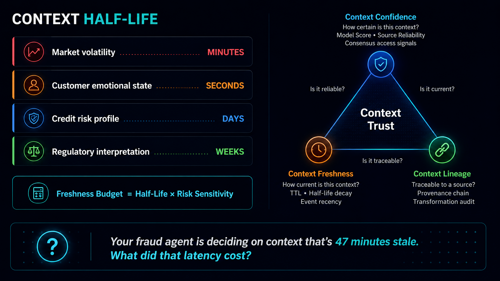

*Fig-CH07-17: The Context Trust Triangle with Half-Life and the Freshness Budget. Confidence, Freshness, and Lineage are the three legs every Context Product must stand on; if any one collapses, the Product’s fitness for decision collapses with it. The per-class Half-Life table makes visible why a single TTL is architecturally insufficient — market volatility demands minute-scale λ_c, regulatory interpretation tolerates week-scale λ_c, and the same fabric must serve both. The Freshness Budget equation binds the Half-Life to the decision’s risk sensitivity: high-risk decisions consume budget faster than low-risk decisions against the same underlying source*

trative λ_c bands, the dominant decay driver, and the supersession event that collapses the decay curve on the old observation in favor of the new:

| Document type | Illustrative λ_c | Dominant decay driver | Supersession event |
|---|---|---|---|
| 10-K annual report | 12 months | quarterly/annual supersession | new 10-K filing |
| 10-Q quarterly report | 3 months | intraperiod supersession | new 10-Q filing |
| 8-K event disclosure | indefinite / event-scoped | event termination | material change disclosure |
| Earnings call transcript | 3 months | next earnings cycle | new transcript |
| Loan agreement | life-of-facility stable | facility termination | amendment or refinance |
| Loan covenant | stable until next measurement + buffer | compliance cycle | measurement certificate |
| Credit memo | 12–18 months | annual review cycle | new memo issued |
| KYC address | 24 months | address change | updated verification |
| KYC UBO | 12 months | ownership change | UBO update |
| KYC sanctions match | hours | real-time sanctions feed | new match or clearance |
| Research report | 30–90 days | market conditions change | new analyst note |
| Bloomberg IB chat | 1 hour (markets color) / 5 years (compliance record) | dual retention | na for compliance |
| Adverse media article | 72 hrs breaking → continuous freshness | story evolves | retraction or update |
| SAR narrative | indefinite investigation artifact | case closure | follow-on SAR |
| Letter of credit | stable until expiry | expiry date | amendment |
| CRE appraisal | 12–24 months | market change | reappraisal |
| Pitchbook mandated deal | deal-period-scoped | deal close or withdraw | na |

The seventeen rows are not exhaustive — a production wholesale-banking deployment will extend this table with deal tapes, credit-rating-agency reports, shadow-CLO cap tables, intraday FX rate snapshots, and dozens of other observation types specific to the lines of business the deployment spans. The four-row per-class band Fig-CH07-17 renders (market volatility minutes / customer emotional state seconds / credit risk profile days / regulatory interpretation weeks) is the compressed visual version of the same configuration surface — the seventeen rows here are the wholesale-banking-specific expansion of the same shape. What the table commits to is the shape of the λ_c configuration surface: every observation type gets its own bounded band (not a single number), a named dominant decay driver (so the choice of λ_c is auditable back to the phenomenon it models), and a named supersession event (so the fabric knows when the continuous-decay story is cut short by a discrete event). The illustrative nature of the numbers matters. A commercial bank calibrating against its own decision-reversal history might find that credit memos hold relevance for 15–20 months rather than 12–18; a bank operating in a faster-moving emerging market might

find that KYC addresses need re-verification at 12 months rather than 24. The fabric architecture does not dictate the numbers; it dictates that the numbers be named per observation type, stored on the Control Plane, and auditable as first-class Policy configuration — which § 7.8 commits to in mechanism.

#### 7.7.3 Supersession as a Policy Event

The table names supersession events alongside continuous decay for a reason the architecture treats as load-bearing. Supersession is a Policy event, not just time decay. A new 10-K collapses λ_c on the old 10-K for current-value queries the moment it is filed, regardless of how much of the continuous-decay budget the old 10-K still nominally had. The same applies to new 10-Q filings, new KYC-verification certificates, covenant-measurement certificates, new credit memos, and every other observation type whose life ends at a discrete regulatory or business event rather than at a continuous clock-tick. The mechanism consequence is that the fabric cannot rely only on time-based decay; it must also listen for supersession events and collapse the relevant observation’s decision-relevance on receipt, propagating the invalidation through the Control Plane to the Data Plane cache-coherency layer § 7.6’s Fig-CH07-14 state machine commits to. Two properties of supersession-as-Policy-event are worth making explicit. First, a new 10-K collapses λ_c on the old 10-K for current-value queries, but historical reconstruction queries (Decision Replay at § 7.10) still see the old filing — an agent that made a credit decision three months ago against the old 10-K must be reconstructible against the old 10-K, not mis-reconstructed against the superseded filing. The fabric achieves this by committing to logical supersession, not physical deletion: the superseded observation remains in the graph with a superseded_by edge pointing to the new observation and a superseded_at timestamp; the assembly engine filters superseded observations out of current-value queries by default, but retains them for temporal queries that bind to pre-supersession time windows. The retention discipline is the architectural foundation that makes SR 11-7 model validation and OCC examiner re-tracing possible years after the decision — § 7.10 resolves this commitment in full with the five-dimension replay record. Second, supersession propagates through the Control Plane. When a new 10-K arrives, the supersession event is interpreted by the Control Plane as a Policy event that (i) marks the old filing as superseded in the graph, (ii) publishes an invalidation signal that cascades through the Data Plane cache-coherency layer invalidating Context Products whose lineage depends on the old filing, and (iii) triggers re-derivation on the next request for those Context Products under the new filing. The InvalidatedBySupersession state in Fig-CH07-14 is this propagation in visual form. The architectural distinction is that supersession does not trigger immediate re-materialization of every dependent Context Product — that would produce a thundering-herd cost spike on every quarterly earnings cycle across every issuer in the coverage universe. Instead, re-derivation is lazy: the invalidated Context Products become invalid for the next request, and the next request triggers a fresh derivation under the new filing. The economics are that supersession costs nothing until the next consumer asks, at which point a single re-derivation serves the request and re-populates the cache. Key Insight — Fig-CH07-18 renders the supersession-as-Policy-event cascade as a sequence across Regulatory Source, Policy Authority, Control Plane, Policy Store, λ_c Calibrator, Data Plane Operators, and Affected Context Products. The figure is load-bearing because it makes visible why supersession has to travel through the Control Plane rather than direct-wire from source system to cache — the governance posture requires every invalidation to be a versioned Policy event rather than a silent runtime side-effect.


*Fig-CH07-18: Supersession as a Policy event — regulatory guidance propagates through Control Plane → Policy Store → λ_c Calibrator → Data Plane invalidation → affected Context Products The sequence renders the architectural claim that supersession is a Policy event rather than a time-decay event. A new FinCEN guidance document on politically-exposed-persons screening enters at the Regulatory Source; the Policy Authority publishes the event to the Control Plane with its version identifier and effective date; the Control Plane versions the update in the Policy Store under the same governance discipline every other configuration change is subject to; the λ_c Calibrator consumes the new guidance and resets the half-life calibration for the affected document class, which resets the Freshness Budget every dependent decision class consumes. The Control Plane then publishes the invalidation event to the Data Plane operators, which mark the derived Context Products depending on the old guidance as invalid-for-next-request without triggering immediate re-derivation. Lazy re-derivation is the architectural property that avoids the thundering-herd cost spike a new FinCEN publication would otherwise produce across every AML decision class in every jurisdictional bundle across every Line of Business. The Note-over segments render two load-bearing properties of the cascade — the λ_c calibration is a Control Plane primitive, not a per-document attribute, which is why a single calibration update propagates consistently; and the re-derivation is lazy, not eager, which is what keeps the supersession event’s cost bounded. The interaction is the runtime enactment of D-31 λ_c formula as configuration, D-33 supersession-as-Policy-event under XC-05 obligation, and D-37 Trust Triangle Debt-mapping (the λ_c reset adjusts the Freshness leg of the triangle for every dependent decision class). The contrast with a naive cache-invalidation architecture is stark: a naive implementation would publish the FinCEN event directly to a cache-eviction bus, which would produce a silent runtime change with no Control Plane audit trail; the CCF commits that every invalidation is a versioned Policy event with its own audit lineage in the Policy Store. The supersession-as-Policy-event interaction Fig-CH07-18 renders is the mechanism behind the InvalidatedBySupersession transition Fig-CH07-14 named and the Policy Store configuration surface § 7.8 will enumerate; § 7.9 Closed-Loop learning composes the same Control Plane primitive with outcome-signal-driven updates, demonstrating that the CCF’s governance posture unifies configuration-change-from-regulatory-source with configuration-change-from-outcome-signal under one Control Plane discipline.*

#### 7.7.4 D_c Formulas — Basic and Extended

Context Debt is the fabric’s structural measurement of how far short the assembled context falls from the coverage the current decision requires. Formally,

```
D_c = 1 − (C_available / C_required)
```

where C_available is the aggregate contextual coverage the fabric can actually assemble for the requested Context Product at decision time, C_required is the coverage the decision class nominally requires, and D_c ∈ [0, 1]. A D_c of 0 means full coverage; a D_c of 1 means nothing relevant was assembled; intermediate values quantify the gap. The basic form is what a credit-decision agent consumes when the primary question is “did the fabric deliver everything the annual credit review asked for” — missing financial statements, a missing covenant-compliance certificate, a broken credit-bureau connection each contribute to C_available < C_required and lift D_c above zero. The basic form does not capture quality-of-coverage, only quantity-of-coverage, and a sophisticated decision class needs a finer-grained signal. The extended form incorporates three independent multiplicative factors for the dimensions along which coverage can degrade even when all required sources are nominally present:

```
D_c = 1 − (F · C · S)
```

where F is freshness (the composition of per-observation decay curves against the decision-class λ_c × Risk Sensitivity bound), C is completeness (the fraction of required fields actually populated across the assembled sources), and S is semantic consistency (the fraction of assembled sources whose structured assertions agree on the entities, relationships, and magnitudes the decision cares about). The three factors — freshness, completeness, semantic consistency — compose multiplicatively because they are gating: a decision that consumes fresh and complete but semantically inconsistent context (two sources disagree on the guarantor’s share of the obligation) is no more trustworthy than one that consumes stale or incomplete context; any one factor at zero drives D_c to 1. The extended formula keeps D_c ∈ [0, 1] by construction and lets the decision class choose which factors to weight; a trading desk might weight F heavily because stale is worse than incomplete; a compliance desk might weight S heavily because semantic inconsistency is the failure mode examiner questions turn on.

#### 7.7.5 Why Multiplicative-Conjunctive, Not Weighted-Additive

The multiplicative-conjunctive form D_c = 1 − (F · C · S) above is a defended choice, not an inherited convention, and the defense matters because the alternative formulation a reasonable model-validator might propose — weighted-additive D_c_alt — fails the regulator’s adversarial reading in a specific failure mode the Wholesale worked example below makes concrete. Three parts to the defense: explicit naming of the alternative, rejection rationale, and the masking-failure illustration. The weighted-additive alternative. The natural-looking competitor to D_c = 1 − (F · C · S) is

```
D_c_alt = 1 − (w_F · F + w_C · C + w_S · S)
```

where w_F + w_C + w_S = 1 and each w_i ≥ 0. The weighted-additive form has the surface appeal that decision classes can tune which factor matters more — a trading desk might weight F heavily because stale data is the dominant failure mode at intraday cadence; a compliance desk might weight S heavily because semantic inconsistency is what regulator questions turn on. The basic D_c formula and the extended D_c = 1 − (F · C · S) form share the D_c ∈ [0, 1] codomain; so does D_c_alt by construction (sum of weights equals one, each weight non-negative, each factor

in [0, 1]). The two forms are algebraically distinct, but the codomain identity makes the choice between them look like a tuning preference. It is not. Rejection rationale — any-factor-near-zero-collapses-whole. The multiplicative form has a property that the weighted-additive form does not: when any one of the three factors approaches zero, D_c approaches one regardless of the other two factors. The decision is forced into the Conditional Assessment Routing path (§ 7.7 L1140 below) because the substrate cannot support the decision even if two of the three quality dimensions are at full strength. This is the regulator’s adversarial reading made architectural — the multiplicative form refuses to average a near-zero quality dimension against strong values from other dimensions, because in a regulated context the bank must defend why the agent acted on context whose load-bearing dimension was at near-zero quality. The weighted-additive form admits the opposite property: a near-zero factor weighted at 0.2 contributes 0.2 × 0 = 0 to the sum, leaving the other two factors at full weight to push D_c_alt toward 0 (low-debt). The masking is mathematical, not pathological — it is what weighted-additive aggregation does when one input collapses. The architectural commitment that forbids the masking is what makes D_c = 1 − (F · C · S) regulator-defensible: the conservative behavior fails closed. Worked example — guarantor inconsistency on a syndicated facility. A Commercial Banking credit officer is assembling a Counterparty Credit Risk Context Product for a covenantamendment decision on a syndicated facility. Two source documents disagree on the guarantor’s share of the obligation: the institutional credit-bureau record reports a 50% guarantor share; the borrower’s audited financials (filed 90 days earlier) report a 100% guarantor share. The algorithmic substrate surfaces the disagreement by computing S — the fraction of assembled sources whose structured assertions agree on the magnitudes the decision cares about — at near zero, while F (freshness, recent enough for both documents) and C (completeness, both required fields populated) score near 0.95. Under D_c = 1 − (F · C · S) with F = 0.95, C = 0.95, S = 0.05, the multiplicative form yields D_c = 1 − (0.95 × 0.95 × 0.05) = 1 − 0.0451 ≈ 0.955 — high-debt, with the Conditional Assessment Routing primitive at L1140 below escalating to Forced-LLM with cross-document reconciliation surfacing the inconsistency. Under D_c_alt with the trading-desk-style weights w_F = w_C = 0.4 and w_S = 0.2 (compliance-leaning operators may weight S higher, but the masking failure surfaces wherever w_S < 1), the weighted-additive form yields D_c_alt = 1 − (0.4 × 0.95 + 0.4 × 0.95 + 0.2 × 0.05) = 1 − (0.38 + 0.38 + 0.01) = 1 − 0.77 = 0.23 — low-debt, routing to Standard LLM, with the agent acting on the masked guarantor inconsistency unflagged. When the SR 11-7 examiner re-traces the covenant-amendment decision and asks why the model acted on context where two load-bearing sources disagreed by a factor of two on the obligor’s share, the multiplicative form’s escalation provides the defended trail; the weighted-additive form provides only a tuning argument the examiner can dismantle. The multiplicative-conjunctive commitment is the architectural choice that makes this failure mode unreachable. The Five Disciplines H3 at § 7.6 names the smoothing-failure-mode watchpoint as a Mode 2/3 discipline (LLM packaging reconciles conflicts the substrate surfaced); this H3 is its formal defense at the D_c formalism layer. The substrate-surfaced S near zero is what the per-mode replay footprint preserves; the multiplicative-conjunctive D_c is what routes the decision such that the LLM cannot smooth the conflict away. The two together close the loop: substrate transparency at assembly time + multiplicative-conjunctive routing at decision time + Mode 2/3 pinning at replay time.

#### 7.7.6 Three Debt Components with Banking Instantiation

The extended formula is an abstraction; the fabric instantiates it at runtime through three named debt components, each of which rolls up into one of the F, C, or S factors and each of which has a concrete signal the assembly engine produces. The three components are the categories production deployments find recurring. Data-source-availability-debt is debt arising from source availability, not content quality. The fabric attempted to retrieve a required source and failed — the credit bureau API returned a 503, the internal data warehouse partition was unavailable, the document-vault service timed out. The assembly engine records the attempt, the failure mode, and the expected source in the Context Product’s lineage, and lifts D_c accordingly. The canonical banking instance is a credit-decision assembly where the credit-bureau connection is degraded: the FICO score and trade-line history cannot be retrieved, and D_c rises because C_available < C_required for the credit-risk decision class. A mature deployment distinguishes between “source returned nothing” (a zero-length response is information: the bureau has no file) and “source failed to return” (silence is not information: the state of the world is unknown) — the latter is a debt signal that biases the agent’s behavior toward caution in a way the former does not. As-of-time-staleness-debt is debt arising from temporal staleness beyond the decision class’s λ_c × Risk Sensitivity budget, with explicit disambiguation between “no activity” and “source failure.” The canonical banking instance is intraday market-data older than 30 minutes consumed by a real-time FX pricing decision: the observation is physically present in the graph but temporally disqualified for the decision class’s freshness budget, and D_c rises because F in the extended formula is below 1. The disambiguation matters architecturally because the fabric must be able to distinguish “the underlying market has not moved in 30 minutes, and the last observation is still the truth” from “the market-data feed broke 30 minutes ago, and the last observation is a stale artifact of a dead pipe.” The former is a low-debt condition (the world is quiet); the latter is a high-debt condition (the fabric does not know what the world is doing) — and a decision agent that cannot distinguish the two will either over-act on stale data or under-act on quiet markets. Entity-resolution-confidence-debt is debt arising from the fabric’s own confidence in its entityresolution, extraction, and schema-matching of unstructured sources. The canonical banking instance is a counterparty UBO chain resolution that produces a confidence score of 0.72 (on a 0-to-1 scale) because the beneficial-ownership documents span three jurisdictions, two languages, and one vintage of corporate-registry schema the fabric only partially recognizes. The entity-resolution engine returned a result; the result is internally consistent; but the fabric’s confidence in the resolution is below the 0.90 threshold the AML-decision class sets as its semantic-consistency floor, and D_c rises because S in the extended formula is below 1. The architectural consequence is that unstructured-dominant decision classes (AML, adverse-media screening, covenant cross-reference from natural-language loan agreements) carry an entity-resolution-confidence-debt component the fabric must surface as first-class signal, not buried in extraction metadata the agent never sees.

#### 7.7.7 Conditional Assessment Routing (CAR) and the LLM Economics Question

The D_c signal and the three debt components are descriptive; the economics question the fabric must answer is what an agent does differently when D_c is elevated versus when it is low. The naive answer is “route every decision through the LLM and let the LLM decide” — which produces the cost profile § 7.6’s per-class cost envelope warned against, where the derived-on-demand-

unstructured band sits at × 8–15 the baseline and every decision pays the full LLM cost regardless of whether the decision needs the LLM. The fabric’s mechanism-level answer is Conditional Assessment Routing (CAR): a routing matrix that consumes D_c, decision-class threat level, and relevant-signal count to decide which of four states the assessment falls into. The four states are Skip / Conditional / Standard LLM / Forced LLM, and the routing logic is:

- IF total_relevant_signals == 0 → Skip (no assessment needed; the decision resolves algorithmically because there is nothing semantic to reason about)
- ELIF threat_level ≤ LOW → Conditional (route to LLM only if context has changed significantly since the last cached assessment; otherwise serve the cached result)
- ELIF D_c above the class-specific threshold → Forced LLM (context is partial or stale; the LLM must be invoked with explicit awareness of the debt and must reason conservatively against it)
- ELSE → Standard LLM (normal decision assessment with the LLM consuming the full Context Product) The two extreme states — Skip and Forced — are the economically significant ones. In the reference pattern, this routing empirically skips LLM for 75–85% of cycles — the mechanism-level answer to “derived-at-runtime is expensive” — because the overwhelming majority of routine assessments across a large portfolio have either zero relevant signals (Skip) or low threat level with cached assessment still valid (Conditional). The 15–25% of cycles that do reach the LLM are either Standard (normal cost) or Forced (higher cost because the prompt includes explicit debt awareness and reconciliation reasoning), and the Forced subset is further bounded by the rate at which elevated D_c actually occurs. The economic outcome is that a naive all-LLM deployment at × 8–15 baseline cost per cycle collapses, under CAR, to a deployment where the full LLM cost is borne on roughly a sixth of cycles, with the remainder served algorithmically at baseline cost. The architecture does not eliminate LLM cost; it routes the cost so that the LLM is invoked where its reasoning actually earns its cost. The routing logic is rendered in Fig-CH07-19 as a decision tree with the four terminal states and the three gating predicates that separate them. The figure is a supplementary rendering of what the prose above commits to in mechanism — the reader who has internalised the routing logic can proceed; the reader who wants the visual should hold Fig-CH07-19 alongside the prose as the anchor. The decision tree in Fig-CH07-19 reads top-down: an assessment request enters at the top and is gated against the three predicates in order. The first gate is a zero-signal guard that diverts routine no-event cycles to Skip, which is the routing outcome that dominates the statistics in the reference pattern — this is where the 75–85% LLM-skip figure originates. The second gate diverts low-threat cycles to Conditional, which may still serve a cached LLM result or may invoke the LLM depending on whether the context has materially changed since the last invocation. The third gate diverts elevated-D_c cycles to Forced, where the LLM is invoked with explicit debt-awareness in the prompt and reconciliation reasoning is required. Cycles that pass all three gates without diversion fall through to Standard, which is the normal LLM-invocation path. The banking worked example makes the statistics concrete: in a Counterparty Credit Risk annual-review cycle running across 500 routine portfolio credits, 80–90% of those credits resolve algorithmically (Skip) because no material event has occurred in the review window — no new 10-K filing, no 8-K disclosure, no covenant-measurement certificate, no covenant breach, no payment delinquency. A single covenantcompliance-certificate-missing condition on one of the 500 credits drives that credit into the Forced state (per the unstructured-coverage debt signal), the LLM is invoked with explicit awareness that

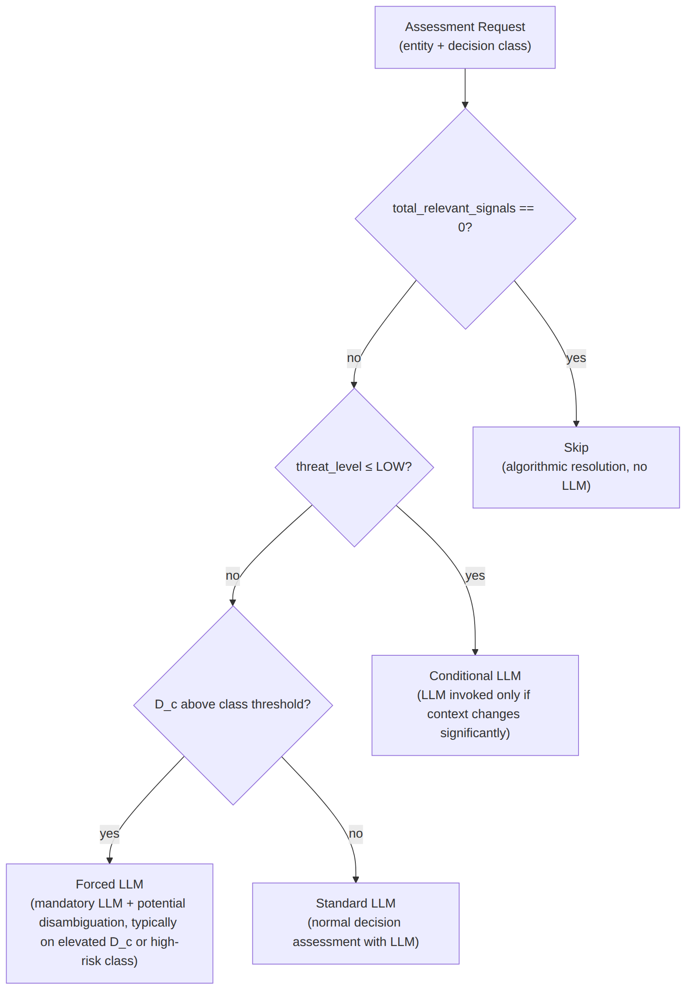

*Fig-CH07-19: Conditional Assessment Routing matrix — Skip / Conditional / Standard LLM / Forced LLM decision tree*

the compliance certificate is missing, and the reasoning reflects the gap rather than pretending the context is complete. The routing turns CAR into the economic engine that makes derived-on-demand context-products economically viable at fleet scale. Fig-CH07-19 is the supplementary reference for the four-state routing matrix; the mechanism is fully specified in prose above, and the figure carries the visual anchor for readers who prefer the decision-tree view.

#### 7.7.8 Trust Triangle Debt-mapping — Resolving the Chapter 6 Forward-ref

Chapter 6 §6.6 introduced the Context Trust Triangle — three legs on which any Context Product’s trustworthiness rests: Confidence, Freshness, and Lineage. The triangle is conjunctive, not disjunctive — weak legs degrade the whole — and a Context Product whose aggregate trust is low should not be acted upon. Chapter 6 committed that the mapping from the three Debt components § 7.7 names back to the three legs would land in Chapter 7, and this is where that forward-ref resolves. The mapping is structural, not metaphorical, and it runs:

- confidence-debt → Confidence leg — the entity-resolution-confidence-debt § 7.7 names (UBO chain resolution confidence 0.72, extraction confidence below the decision-class floor, schema-matching ambiguity) maps directly to the Confidence leg of the Trust Triangle. A Context Product whose entity-resolution-confidence-debt is elevated has a weak Confidence leg, and the conjunctive nature of the triangle means the aggregate trust is weak regardless of how strong the Freshness and Lineage legs are.
- freshness-debt → Freshness leg — the as-of-time-staleness-debt (intraday market data beyond the freshness budget, continuous decay past λ_c × Risk Sensitivity, supersession event not yet reflected in the downstream cache) maps directly to the Freshness leg. A Context Product whose freshness-debt is elevated has a weak Freshness leg, and the Trust Triangle fails as a whole regardless of how well-resolved the entities and how intact the lineage.
- lineage-integrity-debt → Lineage leg — the data-source-availability-debt and related breaks in source provenance (source failed to return, source lineage missing, passage-level citation cannot be re-traced to a specific document location) map to the Lineage leg. A Context Product whose lineage-integrity-debt is elevated has a weak Lineage leg — the chain from claim to source is broken somewhere — and the triangle fails regardless of how fresh and confidently-resolved the content is. The resolution is architecturally load-bearing because it turns the conceptual Trust Triangle Fig-CH07-17 anchored at the §7.7 opener into a runtime, measurable, three-component signal the fabric produces at assembly time. A Context Product arriving at an agent carries a composite D_c, the three component debt scores, and the three Trust Triangle leg strengths derived from them; the agent’s decision policy can reason against any of those signals explicitly rather than against an opaque “trust” label. The weak legs degrade the whole property Fig-CH07-17 renders as the conjunctive triangle remains — a Context Product whose lineage leg is weak fails the triangle even if the other two legs are strong — and the fabric’s D_c composition respects this by making the extended formula D_c = 1 − (F · C · S) multiplicative: any one factor at zero drives D_c to 1, which is the algebraic statement of the Trust Triangle’s conjunctive gating.

#### 7.7.9 Conservative Bias and Fail-Closed under Elevated D_c

The natural question the D_c primitive provokes is what the agent does under elevated debt, and the fabric’s architectural answer is deliberate and contrarian relative to how TTL systems and some retrieval-augmented-generation systems handle the same situation. Elevated D_c biases urgency upward, not downward. Debt is a risk amplifier, not a risk mitigator — the fabric treats context-insufficiency as a signal that the decision environment is more uncertain than expected, which biases the agent toward caution and human escalation rather than toward confident action on thin substrate. The reasoning behind the bias direction is that when D_c is elevated, the fabric’s honest statement to the agent is we don’t know what is happening — a state that should drive the agent toward conservative routing, not permissive action. The architectural posture is fail-closed by default: the absence of strong evidence against a suspicion is treated as an argument for caution, not as an argument for clearing the suspicion. The bias direction is where the fabric differs from two nearby alternative postures. A cache-first retrieval system treats missing data as a cache miss and either waits for the source or returns whatever it has and lets the consumer handle the gap; the gap is treated as a latency or availability problem, not a correctness problem. A permissive LLM-first system treats missing data as an opportunity for the model to reason from general knowledge and produce a plausible answer; the gap is filled with model confidence in the absence of grounded signal. Both postures bias action downward under debt — the system produces an answer that minimises the apparent uncertainty the caller sees, which is precisely the behavior a regulated-enterprise decision agent must not exhibit. The fabric’s conservative bias instead makes the uncertainty visible and routes it upward into human-escalation, additional-source-fetch, or decision-decline paths that preserve accountability. The conservative-bias-under-debt principle is the subject of Patent Claim 7.[^c4] It is also the mechanism-level resolution for the “what happens when an upstream source breaks” objection the research rebuttals enumerate (Rebuttal #10): when the credit bureau is down, when the KYC-verification service is unreachable, when the sanctions-feed falls behind, the fabric does not produce confident assessments under the gap — it produces elevated D_c, routes the affected cycles to Forced LLM with explicit debt-awareness or to human-escalation queues, and keeps the decision-reversal exposure bounded to the class of decisions that actually depended on the broken source. The upstream break becomes a bounded outage with auditable degradation rather than a silent correctness failure that shows up in regulatory review months later.

#### 7.7.10 Debt Cascade across Multi-Agent Handoff — Interaction Mechanics

The Debt components above accumulate against a single decision class. In a Wholesale Banking workflow, decisions increasingly flow across multiple agents — intake triages, escalation enriches, resolution acts — and the Debt a downstream agent consumes is not just its own computation but the cumulative Debt the upstream agents’ context carried forward. The cascade is not hypothetical: Chapter 3 §3.6 Fig-CH03-04 renders the Debt cascade as a flow; the interaction below renders the same cascade as a sequence of inter-agent context handoffs so that the fail-closed behavior § 7.7 commits to becomes visible at handoff boundaries. Key Insight — Fig-CH07-20 renders three agents (intake, escalation, resolution) processing a Wholesale client-servicing workflow, with Debt accumulating across the handoffs and breaching the D_c threshold at the second hand-off. The figure is load-bearing because it is the interaction that makes visible why Debt is a risk amplifier across agent handoffs, not a per-agent metric to be logged in isolation.


*Fig-CH07-20: Debt cascade across Agent A → Agent B → Agent C handoff — D_c accumulates through inherited staleness plus elapsed λ_c decay; threshold breach at the second handoff triggers fail-closed routing The sequence renders three agents operating in a Wholesale Banking client-servicing workflow — intake (Agent A), escalation (Agent B), resolution (Agent C) — with the Debt Calculator computing D_c at each handoff. Agent A reads the initial assembled context at T₀ and makes its intake decision with D_c = D₀ well within the class threshold; the decision-relevance of the underlying observations is fresh, the coverage is complete, and the semantic consistency holds. Agent A escalates the case to Agent B; here the interaction commits a property the handoff boundary alone makes visible — Agent B inherits the context Agent A read plus whatever new observations the assembly engine has gathered in the intervening window. D_c at T₁ is computed against the inherited observations (which have aged by T₁ − T₀ and have therefore lost some of their freshness under the observation-type λ_c calibration) plus the per-agent elapsed half-life decay; D_c = D₁ is approaching the class threshold. Agent B hands off to Agent C; here the cumulative Debt mechanism breaches the threshold: the observations are further aged, the coverage may have fragmented across source-availability changes, and the composition F · C · S has degraded to the point D_c = D₂ exceeds the class threshold. The Note-over segment names the failure the cascade would otherwise produce — a resolution agent acting on cumulative stale substrate — and the conservative fail-closed bias § 7.7 committed to is what turns the breach into a routing decision rather than an action decision. The Debt Calculator emits the fail-closed signal; Agent C declines to act and routes to human escalation; the cumulative Debt that would have degraded decision quality becomes instead a routing primitive that preserves accountability. The interaction is the runtime enactment of D-34 D_c formulas, D-35 three debt components, D-38 conservative fail-closed bias, and D-39 credit-memo Debt cascade applied to the agent-handoff topology. Fig-CH03-04 at Chapter 3 §3.6 is the flow-form visual companion; Fig-CH07-20 is the mechanism-level interaction the flow image gestures toward. The cascade interaction Fig-CH07-20 renders is the mechanism behind the “Debt compounds at agent speed, not human speed” thesis § 7.7 commits to; a multi-agent Wholesale workflow cannot treat Debt as a per-agent metric without inviting the cumulative-breach failure mode the sequence makes visible.*

#### 7.7.11 Credit-memo Debt Cascade — Worked Example

The primitives above come together in a commercial-credit-memo assembly cycle the relationship manager experiences every week. Borrower X is a mid-cap commercial borrower up for annual review. The credit-memo Context Product requires five inputs:

- (a) the borrower’s audited 10-K for the most recently completed fiscal year
- (b) peer financials from the lender’s syndication-participation history for borrowers in the same NAICS code and revenue band
- (c) industry-benchmark macro data from the bank’s research desk for the sector
- (d) the bank’s current lending policy version for the credit-risk-class this exposure falls in
- (e) the most recent covenant-compliance certificate from the borrower Inputs (a) through (d) are present and fresh. Input (e), however, is overdue — the borrower is 14 days late on the quarterly covenant-compliance certificate. The assembly engine detects the missing input, records the gap in the Context Product’s lineage, and computes D_c non-zero for the compliance-status claim specifically — the product’s other claims (exposure aggregate, guarantor chain, collateral position) remain at D_c = 0 because inputs (a)-(d) cover them fully, but the compliance-status claim sits at elevated debt because the primary evidence source is absent. The agent consumes the decomposed D_c as a decision input. Conditional Assessment Routing sees the elevated debt on the compliance-status claim and routes the memo to Forced LLM — not to reason around the missing certificate but to reason with explicit awareness that the certificate is missing, and to surface the absence in the memo’s output rather than bury it. The memo the LLM drafts for the relationship manager carries an explicit flag: “Covenant-compliance certificate for the quarter ending [date] is 14 days overdue; compliance status cannot be affirmed from the current context; recommended action: escalate to the Relationship Manager for direct outreach to the borrower, or decline to issue a full credit opinion until the certificate is received.” The decision agent does not hide the gap — it makes the gap visible as a first-class input to the memo’s nextaction recommendation. This is not a log line; it is a decision input. The distinction is the one the Debt primitive is architecturally committing to: the gap is not captured for post-hoc audit; it is captured before the decision is taken and shapes the decision directly. The Ch 8 §8.7 integration story carries the regulatory-payoff side of this example — how the creditmemo D_c cascade composes with SR 11-7 model validation, with consent-order-specific controls, and with the examiner-re-tracing posture that makes the gap auditable in the annual RegulatoryReview cycle. § 7.7 commits to the mechanism; § 8.7 commits to the regulatory context in which the mechanism earns its governance. The Debt primitive is the fabric’s structural answer to degradation. The next question the architecture must answer is how the Policy decisions, the λ_c values, the D_c thresholds, and every other configuration surface the fabric depends on are separated from the runtime that executes against them. § 7.8 takes up the Control Plane and Data Plane separation — the architectural commitment that defines what the fabric is allowed to do separately from the runtime that does it, and names the invariants that make the separation enforceable rather than conventional.

### 7.8 Control Plane vs Data Plane

The fabric’s governance posture depends on a structural separation the preceding sections have quietly leaned on but not yet committed to in mechanism: the separation between the plane that

defines what the fabric is allowed to do at runtime (policies, operator behavior parameters, projection rules, entitlements, debt thresholds, half-life values, materialization rules) and the plane that executes against those definitions (assembly engines, operator runtimes, projection computations, context-product serving, decision-replay record writers). § 7.8 commits to the Control Plane / Data Plane separation as first-class architectural primitives. The separation is not a novelty the fabric claims — the service-mesh community has matured this exact pattern over a decade — but the semantics of what flows through each plane in the CCF are distinctive and load-bearing. This section names the intellectual ancestry, specifies what each plane carries, resolves the canonical statement that the control plane is also the audit plane, enumerates the Control Plane configuration surface, commits to architectural invariants as CI-tested first-class commitments, and closes on Data Plane determinism as the foundation that makes Decision Replay possible.

#### 7.8.1 Intellectual Ancestry — Service-Mesh Control-Plane / Data-Plane

The service-mesh control-plane / data-plane pattern is well-established — Istio, Envoy, and the CNCF service-mesh ecosystem have matured this architectural separation. CCF adopts the pattern; it does not claim novelty on the separation itself. The novelty is in the semantics of what flows through each plane. The service-mesh analogy is worth drawing carefully because the pattern it names is useful precisely where the cargo it carries is not. A service-mesh Control Plane carries routing rules, mTLS configuration, traffic-shifting policies, circuit-breaker thresholds, rate limits, and the metadata that tells the Data Plane proxy fleet how to route and secure request/response traffic between microservices. The Data Plane is the proxy fleet (Envoy sidecars in Istio’s case) that executes the rules against real request traffic. The pattern is mature: the separation is well-specified, the handoff protocols are industry standard, the observability story is understood, and the failure modes are documented. An engineer coming to CCF from service-mesh work recognises the architecture immediately; the pattern is legible in ways that matter for enterprise adoption. What CCF changes is the cargo. The CCF Control Plane does not carry routing and mTLS config; it carries Policy definitions (regulatory constraints, internal risk thresholds, jurisdictional rules), Operator behavior rules (traversal-depth limits, materiality thresholds, temporal-boundary rules, similarity-threshold contracts), Projection rules and Entitlements (role-to-intent-to-plan lookup tables, perspective conditioning definitions), D_c thresholds per decision class (credit, AML, treasury, IB — each with its own tolerance band), λ_c per observation type (the 17-row table § 7.7 commits to), and Materialization policy (per-Context-Product-class pre-compute rules). The CCF Data Plane does not carry request/response proxy traffic; it carries the Context Assembly runtime, the Operator execution engine, the Projection computation engine, the Context Product serving tier, and the Decision Replay record writers. Fig-CH07-21 renders the separation with the CCF-specific cargo on one side and the service-mesh ancestor as the intellectual context on the other. The figure reads as two subgraphs with an ancestor panel off to the side. The left subgraph (Control Plane) carries six classes of CCF configuration — policies, operator rules, projection rules, decision-class debt thresholds, observation-type half-lives, and materialization policy — each of which is Control Plane configuration the runtime consumes, not runtime state the engines own. The right subgraph (Data Plane) carries the five runtime concerns the execution path requires — assembly, operator execution, projection computation, product serving, and replay-record writing — each of which executes against the Control Plane definitions without itself holding the definitional authority. The two dotted edges between the planes capture the dual role the Control Plane plays:

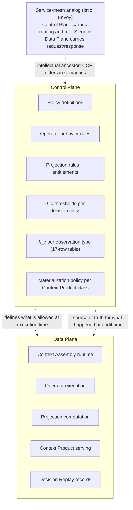

*Fig-CH07-21: Control Plane and Data Plane — service-mesh-inspired separation carrying CCF-specific cargo*

at runtime it defines what is allowed; at audit time it is the source of truth for what happened. The ancestor panel at the bottom names Istio and Envoy as the pattern’s origin and makes explicit that what differs is not the pattern but the cargo. Fig-CH07-21 is load-bearing because the rest of § 7.8 refers back to it when it names the audit-plane property, the configuration surface, and the invariant-enforcement boundary.

#### 7.8.2 The Control Plane Is Also the Audit Plane

A central architectural distinction between the CCF and the service-mesh ancestor — one that Fig-CH07-21 hints at but § 7.8 must commit to in mechanism — is the audit posture. The control plane is also the audit plane. Every Operator invocation, Projection computation, and Context Product assembly is observable from the Control Plane for replay — not via a sidecar observability concern bolted on after the fact, but as a first-class architectural property of the Control Plane itself. The reason is structural: the Control Plane defines what the fabric is allowed to do; the audit question is whether the fabric in fact did what it was allowed to do; and the cleanest place to answer that question is the plane that holds the definition. Every configuration change the Control Plane applies — every new policy version, every operator-parameter adjustment, every projection-rule refinement — is versioned, timestamped, and retained against the decisions that were made under the version in force at the time. Service-mesh control planes do not do this. In Istio and Envoy, observability is a sidecar concern — Prometheus scrapers, Jaeger tracers, ELK log shippers collect request-level telemetry from the data-plane proxies and forward it to observability backends the control plane does not govern. The approach is adequate for the cargo the service mesh carries (request routing is a commodity; the audit question “did the proxy route this request correctly” is answered by sampling the proxy logs, not by reconstructing the exact control-plane state that was in force). The approach is inadequate for the cargo the CCF carries. A regulated-enterprise decision agent’s credit-decision-approval or AML-SAR-filing cannot be audited by sampling data-plane logs; the audit question is the joint one — what did the agent know, under what policies, with what perspective conditioning, producing what content — and that question can only be answered by reconstructing the Control Plane state at decision time and replaying the Data Plane execution under it. The CCF commits to this reconstruction as a first-class architectural property rather than as a sidecar observability concern, and § 7.10 resolves the commitment in full with the five-dimension replay record. The control-plane-is-audit-plane property is what distinguishes an enterprise-governance-ready Control Plane from a commodity service-mesh Control Plane. The commitment makes every runtime decision auditable against the exact rule-state that was in force at the moment the decision was made, which is the posture SR 11-7 model validation, OCC consent-order examiner re-tracing, and EU AI Act evidentiary obligations all require. The observability concern is not bolted on; it is the plane itself.

#### 7.8.3 Control Plane Configuration Surface

The Control Plane configuration surface is enumerated explicitly because the enumeration is what makes the abstraction concrete. A production CCF Control Plane carries, at minimum, the following classes of definition, each of which is versioned, auditable, and propagated to the Data Plane under controlled handoff protocols. Policy definitions include the regulatory constraints the decision class must respect (SR 11-7 model-validation requirements, FinCEN SAR filing obligations, OCC consent-order-specific con-

trols, BCBS 239 data-lineage requirements, EU AI Act classifications, jurisdictional-specific rules like GDPR for EU persons and CCPA for California), internal risk thresholds the bank has set above regulatory floors, and the jurisdictional rules that determine which policy bundle applies to which counterparty or decision. Operator behavior rules include the traversal-depth limits per Traversal operator (how many hops out from the seed entity does the operator go), materiality thresholds per Materiality operator (what is the dollar or risk cutoff for inclusion), temporal-boundary rules per Temporal operator (what time window does the operator bind to), and similarity-threshold contracts per Similarity operator (what cosine-similarity or distance-score qualifies as a match). Projection logic includes the role-to-intent-to-plan lookup tables that tell the Projection engine which ProjectionPlan to invoke for which principal-and-intent pair, the projection rules themselves (which observations are primary, which are subordinated, which are compressed under which principal view), and the entitlement matrices that determine which principals have access to which projections under which policy bindings. D_c thresholds per decision class name the debt bound above which the Conditional Assessment Routing matrix routes the decision to Forced LLM or to human escalation — credit-risk class might set this at 0.15; AML class might set it at 0.08; treasury class might set it at 0.20; IB class might set it at 0.05 for deal-execution decisions and 0.12 for relationship-monitoring decisions. λ_c per observation type is the 17-row table § 7.7 illustrates, stored as Control Plane configuration so that a calibration update propagates consistently across every instance of that observation type without re-writing graph state. Materialization policy per Context-Product class names the pre-compute rules the Delivery tier applies — which products are materialized eagerly, which are derived on demand, which have hybrid policies that materialize structured payload and defer unstructured assembly. The worked example that makes the configuration-surface abstraction concrete is a regulatory exposure-limit change. Suppose a bank’s regulators issue a new directive tightening the concentration limit on single-counterparty credit exposure from 10% of Tier 1 capital to 8%. Under the Control Plane / Data Plane separation, the change flows as follows: the regulatory-policy owner updates the policy definition in the Control Plane (new exposure threshold: 8%); the Control Plane versions the update and propagates it to the Data Plane; the Data Plane’s Operator execution engines (specifically the Materiality and Traversal operators that enforce the concentration-limit check) consume the new threshold at their next invocation; subsequent Context Products assembled for concentration-limit-sensitive decisions reflect the new constraint. No changes to the graph state, the operator engine code, or the agent logic are required — the system adapts instantly and consistently across every decision class that consumes the concentration-limit policy. The instant-and-consistent adaptation property is what makes the Control Plane / Data Plane separation architecturally valuable beyond its service-mesh ancestry; it turns policy changes from multi-release-cycle engineering work into single-Control-Plane-update operations. Key Insight — Fig-CH07-22 renders the Control Plane ⇄ Data Plane message exchange as a sequence across Compliance Officer (Control Plane), Policy Store, Event Bus, Data Plane Operator, Product Cache, and Agent (Data Plane). The figure is load-bearing because it makes visible that the Control Plane is also the audit plane — every policy update is a versioned event with its own audit entry, and the Data Plane invalidation flows as a published event rather than a direct side-effect on cache state. The sequence renders the architectural claim that the Control Plane is orthogonal to the Data Plane — policy updates do not flow through the runtime request path, they flow through a separate governance channel that versions every change and publishes invalidation as an event. The Compliance Officer (acting as a Control Plane principal rather than a Data Plane consumer) updates the covenant-

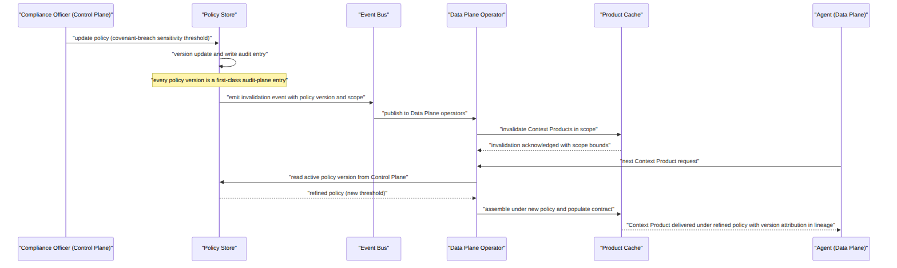

*Fig-CH07-22: Control Plane ⇄ Data Plane message exchange — policy update versioned in audit plane, invalidation emitted to Data Plane, next request reads refined policy breach sensitivity threshold by writing a new version to the Policy Store. The Policy Store versions the update and writes an audit entry — the Note-over segment renders the architectural property that every policy version is a first-class audit-plane entry, not a change-log appended after the fact. The Event Bus publishes the invalidation to the Data Plane operators with the policy version and the scope bounds (which Context Products depend on this policy, which decision classes are affected); the Data Plane operators acknowledge the invalidation and mark the affected cache entries as invalidfor-next-request under the Fig-CH07-14 state machine’s InvalidatedBySupersession transition. The next agent request arrives at the Data Plane operator, which reads the refined policy from the Control Plane, assembles the Context Product under the new threshold, and populates the contract with the active policy version in the lineage so Decision Replay at T_audit can reconstruct the exact policy-state-in-force at decision time. The orthogonality is structural — the Control Plane message flow never competes with the Data Plane runtime path for the same channel, which is what keeps the policy-update cost off the request’s p99 budget. The interaction is the runtime enactment of D-40 (Istio service-mesh ancestor), D-41 (control-plane-is-audit-plane), D-42 (config surface enumeration), and D-44 (Data Plane determinism under fixed Control Plane state). A naive direct-wire architecture — policy update cache eviction without a versioned event — would fail every test this sequence encodes: no audit entry, no scope bounds, no version attribution in lineage, no replay reconstruction at T_audit. The CCF commits that every policy update traverses this sequence exactly once, which is the governance invariant SR 11-7 model validation, OCC consent-order review, and EU AI Act evidentiary obligations all require. Fig-CH07-22 is the interaction commitment behind the control-plane-is-audit-plane property § 7.8 commits to; the § 7.9 Closed Loop learning sequence and the § 7.10 Decision Replay reconstruction both read against this separation as their foundational governance primitive.*

#### 7.8.4 Architectural Invariants as First-Class Commitments

The Control Plane / Data Plane separation is only as strong as the invariants that keep the Data Plane from drifting out of alignment with the Control Plane’s definitions, and the CCF’s posture toward those invariants is distinctive enough to deserve its own subsection. Architectural invariants in the CCF are CI-tested, not conventional. The design is not ‘please don’t bypass the engine’; the bypass literally doesn’t exist, and automated guards prevent every direction it could come back from. The distinction is between architecture expressed as a diagram the team agrees to respect and architecture expressed as enforced invariants the

system structurally cannot violate — and for regulated-enterprise deployments, the difference is the difference between a design that holds in the happy path and a design that holds under every pressure the production environment puts on it. The fabric’s five architectural invariants, each commitment at Control Plane / Data Plane boundary, are:

- (a) Single-writer for graph state. Only the Assembly worker writes to enrichment-surface collections; read-path services have no write handles. The invariant is enforced by dependency injection at boot time — the read-path services’ DI containers simply do not receive writecapable handles for the enrichment surfaces, and the compilation of those services against write-capable interfaces is prevented by the type system at build time. The architectural consequence is that there is no “accidentally wrote to the graph from the read path” bug category; the code that could produce the bug does not compile.
- (b) Projection stateless by invariant. The Projection execution engine never holds write locks and never caches within its own process boundary. Materialization — when it is needed for SLO reasons — exists in a separately gated tier (the cache layer § 7.6 Fig-CH07-14 commits to) governed by explicit materialization policy, not inside the Projection engine. The invariant is enforced by the engine class having no mutable state — projections are pure functions of the graph state, principal, time, and policy regime — and any state-bearing extension to the engine requires a design-review gate rather than silently slipping into the hot path.
- (c) Lineage strict equality. The operators_invoked field in every Context Product must equal the set of operators actually resolved during assembly — no more, no less. Forgery, omission, or misstatement of the lineage causes contract validation to fail at the stage-3a gate § 7.6’s ContextProductContract spec names, and the product is not served. The invariant is the architectural mechanism by which lineage becomes a first-class auditable field rather than a best-effort annotation, and it is the foundation the Decision Replay record § 7.10 commits to depends on — if lineage can drift from the actual operator trace, the replay record cannot be trusted as evidence.
- (d) TTL bounds. Every Context Product has expires_at ∈ (now, now + MAX_TTL] validated at assembly time. The invariant prevents two failure modes: a product with expires_at ≤ now (already-expired product served to a consumer who will consume stale context), and a product with expires_at > now + MAX_TTL (a product whose TTL exceeds the Control Plane’s configured bound, which would let the cache tier retain it beyond the Policy-configured retention window). The invariant is enforced at stage-3b of the assembly pipeline, and the stage-3b gate is CI-tested against synthetic TTLs at both boundaries.
- (e) Tenant-scoped by kw-only argument. Every execute() call on the assembly engine requires tenant_id as a keyword-only argument. Multi-tenant isolation is structural at the call-site level — the engine’s function signature refuses calls that omit the tenant scope — not a runtime filter applied inside a shared execution context. The invariant is enforced by the engine signature; the consequence is that cross-tenant context-leakage is not a bug that can arise from forgetting a filter in a query; it is a failure mode the engine’s signature structurally prevents. These five invariants are CI-tested in a reference implementation — the design is reduced-to-practice at the invariant level, not only at the primitive level. For a regulated-enterprise deployment, the distinction between ‘please-don’t-bypass’ and ‘can-not-bypass’ is the distinction between architecture-

as-diagram and architecture-as-enforced-invariant. A control that lives only in a design document can be forgotten by an on-call engineer under pressure, overridden by a well-intentioned optimization PR, or silently eroded by a framework upgrade that changes default behavior. A control that lives in the type system, the DI container, the function signature, or the CI gate cannot be forgotten — it must be consciously disabled to bypass, and conscious disablement is a governance event the Control Plane’s audit trail captures. The invariant posture is the architectural mechanism by which the CCF earns its governance posture, not just claims it. The Single-writer, stateless-projection, strict-lineage-equality, TTL-bounds, and tenant-scoped invariants are not, individually, architectural innovations — the Single-writer discipline has a long pedigree in event-sourced systems; strict lineage equality is standard in content-addressed storage; tenant-scoped kw-only arguments are familiar to anyone who has written multi-tenant SaaS. What is distinctive is that all five are committed to together at the Control Plane / Data Plane boundary, enforced as first-class invariants rather than conventions, and CI-tested in a reference implementation that carries them through the full assembly pipeline. The composition is where the architecture lives.

#### 7.8.5 Data Plane Determinism

The final property of the Control Plane / Data Plane separation the architecture must commit to is Data Plane determinism. Given the same graph state, the same Control Plane configuration, and the same temporal boundary, the Data Plane produces a bit-for-bit identical Context Product on every execution. The property is the same determinism claim § 7.4 made for operator composition, restated at the plane level: the entire Data Plane execution pipeline — assembly, operator execution, projection computation, context-product materialization — is deterministic in its output under fixed inputs. No sampling, no temperature-based variation in structural-reasoning stages, no hidden randomness in the retrieval or extraction paths; any randomness that appears (e.g., embedding models that admit non-determinism under GPU parallelism) is isolated to boundaries the replay record can reproduce exactly by re-invoking the same model with the same seed and batch shape. The determinism property is the architectural foundation that makes Decision Replay possible. If the Data Plane admitted silent non-determinism — if the same inputs could produce different Context Products on different executions — then Decision Replay would reduce to a best-effort reconstruction that could never be held to an evidentiary standard. Regulatory audit under SR 11-7, FinCEN examination, or OCC consent-order review requires that the exact context an agent consumed at the moment of the decision can be reconstructed exactly, not approximated; the determinism property is what makes that reconstruction possible. The distinction from LLM observability tools like LangSmith and W&B Weave, which capture the model’s trace (prompts, intermediate reasoning steps, token outputs) at inference time, is that the CCF Data Plane reconstructs the decision environment (the exact Context Product, the exact policy bindings, the exact perspective conditioning) deterministically from the five-dimension replay record § 7.10 commits to — the model trace is necessary but not sufficient for decision reconstruction, and the fabric makes the sufficient reconstruction a Data Plane determinism property. § 7.10 develops this distinction in full. The Control Plane / Data Plane separation commits the fabric’s governance posture. The next architectural question is how the fabric learns — how outcome signals from decisions executed under the Control Plane propagate back into the Control Plane in a way that improves future decisions without bypassing the governance the separation earns. § 7.9 takes up the Closed Loop

with self-learning, and the answer turns out to be that the loop is not in the model — it is in the graph.

### 7.9 Closed Loop with Self-Learning

The fabric’s governance posture is only half the architectural story; the other half is how the fabric improves over time without the improvement subverting the governance. A static Control Plane produces a fabric that is governable but brittle — policies calibrated at deployment time drift against the evolving phenomena they measure, λ_c values that were right for last year’s market conditions become wrong for this year’s, D_c thresholds that were defensible under last quarter’s regulatory posture become indefensible under this quarter’s. The fabric must learn, but learning must flow through the governance surfaces the Control Plane owns rather than around them. The architectural commitment of § 7.9 is that the loop is in the graph, not the model — agents appear to improve in production without retraining because the context they consume is improving, and the context improves because outcome signals, validity signals, and audit signals from the Data Plane flow back through the Control Plane as versioned configuration updates. This section specifies the graph write-back mechanism, names three categories of learning signal, enumerates four refinement targets, commits to learning-as-governance rather than learning-around-governance, renders the cycle as Fig-CH07-25, and walks a fraud-detection loop as the canonical worked example.

#### 7.9.1 Graph Write-Back — Outcome Signals as Control Plane Updates

The naive closed-loop architecture wires outcome signals directly into the runtime components they are meant to improve: the fraud-detection model re-trains on new labels overnight, the recommendation engine adjusts weights in real time, the pricing model updates per-transaction. The architecture is familiar but the governance properties are poor — every update is a silent behavioral change that the Control Plane did not author and the audit trail did not version. The regulated-enterprise posture cannot admit this failure mode; any change to how a decision agent behaves must be a versioned, auditable, Control Plane event, not a runtime side-effect. The fabric’s resolution is to commit to graph write-back through the Control Plane as the exclusive channel for closed-loop learning, rendered as the following pseudocode stage-pattern:

```
# Graph write-back — outcome signals interpreted as Control Plane updates
# (NOT direct runtime modifications to operators/projection/policy)
function processOutcomeSignal(outcome: TypedOutcome,
                              provenance: Provenance,
                              half_life_lambda_c: Duration) -> ControlPlaneUpdate:
    # Stage 1: outcome observation -> typed outcome-signal with Provenance
    signal = OutcomeSignal(
        outcome=outcome,
        provenance=provenance,
        observed_at=now(),
        lambda_c=half_life_lambda_c,  # outcome signals themselves have λ_c
    )
    # Stage 2: Control Plane interpretation -> versioned update
    update = interpret(signal)
    # -> operator definition change (traversal depth, similarity threshold)
    # -> policy calibration (detection thresholds, exposure limits)
    # -> projection logic refinement (signal weighting, emphasis)
    # -> half-life adjustment (TTL, freshness budget)
    # Stage 3: Data Plane propagation
    #    subsequent Context Products reflect the update
    #    projection_plan_id + contract_version attribution in replay records
    return versioned(update)
```

The pseudocode commits three properties the naive architecture lacks. First, outcome signals are first-class typed entities with Provenance and their own λ_c — an outcome signal observed at time t that reports “loan repaid” is itself a context entity whose decision-relevance decays over time (a loan repayment from five years ago is weaker evidence about the lender’s risk judgment today than a loan repayment from last quarter), and the fabric models this explicitly. Second, the Control Plane interprets, versions, and propagates — the outcome signal does not directly modify operator behavior or policy thresholds at runtime; it is interpreted by the Control Plane, which decides whether the signal warrants a configuration change and, if so, issues a versioned update. The interpretation step is where business judgment, statistical significance, and regulatory calibration constraints enter the loop. Third, the Data Plane propagation is downstream of the Control Plane update — subsequent Context Products reflect the update, and every Context Product carries projection_plan_id and contract_version attribution in its replay record so that historical decisions remain re-traceable against the Control Plane version that was in force when they were made. The three-stage pattern is what makes closed-loop learning auditable rather than opaque, and it is the mechanism-level answer to the objection that closed-loop self-learning systems “cannot be governed because they are always changing” — the fabric is always changing, but every change is a Control Plane event with its own audit trail. Key Insight — Fig-CH07-23 renders the graph write-back as a sequence across Agent, Decision Engine, Evidence Store, Graph Writer, Learning Signal Handler, and Next-Agent Invocation. The figure is load-bearing because it makes visible the canonical “the loop is in the graph” commitment — the outcome evidence does not flow through model retraining; it flows through graph write-back, and the next agent invocation reads refined state rather than re-trained weights. The sequence renders the closed-loop architectural commitment as a concrete interaction. The Agent makes a decision at time T; the Decision Engine captures the five-dimension replay record § 7.10 commits to and persists it via the Evidence Store. The Evidence Store emits outcome evidence when the outcome is confirmed at T + Δ — for a fraud-detection decision this delta is often days; for a credit-risk decision it may be quarters; for an AML SAR filing it may be years until examiner review returns the substantiation outcome. The Graph Writer updates the E, R, T, Π, and L dimensions with typed outcome edges — not by overwriting prior state, but by appending outcome claims with their own lineage and temporal binding. The Note-over segment renders the architectural property that graph write-back is logical and not destructive: the prior state remains available for Decision Replay of historical decisions, and the outcome evidence becomes a new claim whose weight in future compositions is determined by the operator algebra rather than by weight updates in any model. The Learning Signal Handler categorizes the evidence — outcome, validity, or audit/lineage — and emits the category to the Control Plane for interpretation (Fig-CH07-25 renders the full feedback cycle and Fig-CH07-24 will render the categorization in more detail).

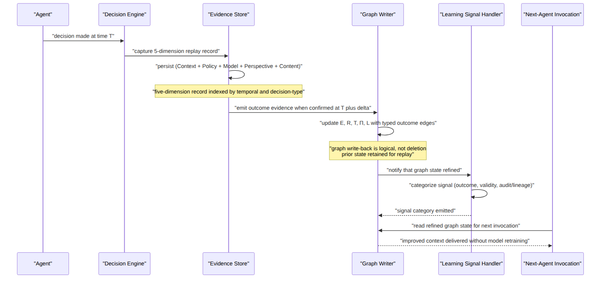

*Fig-CH07-23: Closed loop graph write-back — decision captured, evidence persisted, graph write-back refines E/R/T/Π/L, next agent invocation reads improved state. The Next-Agent Invocation at T + Δ + ε reads the refined graph state; the next decision is made against improved context rather than the same context plus a retrained model. The canonical statement D-47 commits to — “the loop is in the graph, not the model” — is what this sequence renders operationally. The agent is unchanged, the LLM is unchanged, the prompt is unchanged; what has changed is the substrate the agent reasons against, and the improvement compounds across decision classes because the graph is the shared substrate every decision class reads against. D-45 write-back pseudocode, D46 three learning signal categories, D-47 loop-is-in-the-graph, and D-48 learning-as-governance all land against this sequence; Fig-CH07-24 below renders the categorization mechanism Fig-CH07-23’s Learning Signal Handler abstracts. Fig-CH07-23 is the interaction commitment behind the closed-loop architecture § 7.9 commits to; the § 7.10 Decision Replay reconstruction reads against the five-dimension record this sequence persists without re-rendering it.*

#### 7.9.2 Three Categories of Learning Signal

The outcome signals the Control Plane interprets fall into three categories the architecture distinguishes explicitly because they answer different questions and warrant different interpretation logic. Outcome signals (i) are direct ground truth: a loan was repaid or defaulted; a flagged transaction was confirmed as fraud or cleared as legitimate; a treasury decision led to a liquidity shortfall or successfully hedged a currency exposure; an AML alert led to a filed SAR that survived examiner review or was closed without filing. These signals are the most direct form of closed-loop feedback because they speak to whether the decision the agent made was the right one, measured against the real-world outcome the decision was trying to influence. In the credit-risk context, an outcome signal might be: of 500 annual reviews the fabric flagged as low-risk, how many defaulted in the

subsequent 24 months; in the AML context, an outcome signal might be: of 1,200 typology-match alerts the fabric generated, how many survived OCC examiner review as substantiated. Outcome signals drive policy-calibration updates — detection thresholds, exposure limits, risk-score cutoffs — because they directly measure the false-positive and false-negative rates the policy parameters determine. Context validity signals (ii) are λ_c feedback: was the context within effective half-life at decision time? Did the fraud-detection agent reason on data that was within its freshness budget, or had the velocity signals gone stale by 30 minutes and the agent was consuming effectively dead context? Did the credit-decision agent consume a 10-K that was 14 months old against a λ_c of 12 months, and if so, how did the subsequent default behavior of the loan compare to loans decided against 10Ks that were still within λ_c? Context validity signals drive λ_c adjustments and freshness-budget recalibration; they answer the question of whether the half-life configuration the Control Plane set is actually right for the phenomenon it models, or whether the world is moving faster (or slower) than the λ_c assumes. Audit/lineage signals (iii) are the meta-signals that separate model failure from context failure. If an agent makes a wrong decision, the post-hoc analysis asks two separable questions: was the decision wrong because the context was incomplete, stale, or internally inconsistent (context failure, driving Debt-related updates); or was the decision wrong because the context was correct and complete but the agent reasoned poorly against it (model failure, driving agent-specific updates outside the Control Plane’s scope)? Separating these two causes is essential because the architectural response differs — a context failure calls for a graph-level update (new data source, tighter λ_c, elevated D_c threshold, richer projection); a model failure calls for a model-level intervention (prompt refinement, guardrails, different model selection). Audit/lineage signals are how the postmortem of a wrong decision attributes the failure to the right plane, and they are how the fabric avoids the degenerate case of re-training a model on wrong decisions whose root cause was bad context the model had no way to correct for. Key Insight — Fig-CH07-24 renders the categorization mechanism Fig-CH07-23 abstracted — how a single decision-outcome evidence event flows through the Signal Router into one of three category-specific handlers, each of which targets a distinct graph write-back path. The figure is load-bearing because the architectural claim that learning is structurally different from model retraining rests on the three-category routing being a graph-level operation rather than a gradientdescent operation. The sequence renders the three-category routing mechanism as a decision-outcome evidence event fanning through the Signal Router into one of three category-specific handlers. The alt/else branches render the three outcomes without ambiguity — exactly one handler processes any given evidence event, and the handler’s graph-write target is structurally distinct from the other two. The Outcome Signal Handler writes an outcome edge with decision-class attribution — a fraudconfirmed outcome, a default observed on a credit decision, a SAR substantiated by examiner review — and seeds the policy-calibration update surface on the Control Plane along with Π emphasis signal refinement. The Correction Signal Handler writes a correction edge with pre-decision and postdecision state — a human reviewer overrode a fraud classification, a credit officer escalated a memo the LLM concluded acceptable, a compliance officer re-categorized a typology match — and seeds a policy-threshold adjustment candidate and projection-emphasis candidate. The Metadata Signal Handler writes metadata refinement to the P (policy state) and Π (projection state) dimensions — an entitlement change, a policy supersession event, a role-reassignment — and enriches the Control Plane configuration surface with the refined metadata. The three Notes-over segments each render


*Fig-CH07-24: Learning signal categorization — one evidence event routed to one of three handlers; each writes a distinct refinement target on the graph rather than a weight update on any model the same architectural property: every category writes to graph state, not to weights. No gradient descent runs; no model parameters update; no retrained checkpoint ships. The graph state improves, the Control Plane configuration refines, and subsequent decisions are made against the improved substrate. The interaction is the runtime enactment of D-46 three learning signal categories, D-47 loop-is-in-the-graph, and D-48 learning-as-governance. The distinction from model retraining is structural: retraining requires training data curation, model validation under SR 11-7 discipline, deployment-gate approvals, and weight-update traceability that is difficult to audit against specific decisions; graph write-back requires only versioned Control Plane updates under the § 7.8 governance posture. The two learning surfaces are orthogonal — a mature deployment can run both, but the CCF’s own learning loop lives at the graph layer. Fig-CH07-24 is the interaction commitment behind the “loop is in the graph” thesis § 7.9 commits to; Fig-CH07-23 renders the graph-write-back end-to-end sequence and Fig-CH07-24 renders the categorization the Learning Signal Handler in Fig-CH07-23 abstracts.*

#### 7.9.3 Refinement Targets — What the Closed Loop Actually Updates

The three categories of signal drive updates to four refinement targets the Control Plane owns. The canonical architectural statement is the one this subsection commits to: Agents appear to improve in production without retraining because the context they consume is improving. The improvement is not in the model’s weights or in the agent’s prompt engineering; it is in the context substrate the agent reasons against, and the four refinement targets are where the improvement actually lives. Operator refinement updates the parameters that govern how Operators traverse the graph, compose signals, and bind temporal windows. Traversal depth might be expanded from 2 hops to 3 for counterparty-credit-risk assemblies because observed correlation-of-exposure in 3-hop groups turned out to matter more than the initial calibration assumed; similarity thresholds might be tightened from 0.65 to 0.72 for adverse-media matching because observed false-positive rates at 0.65 were too high; temporal boundaries might be narrowed from a 90-day default to a 30-day default for intraday-market-data operators because observed staleness failures at 90 days were

more frequent than the original calibration predicted. Operator refinement is where the “how the fabric computes” stabilises through production experience. Projection optimization updates how Context Products are shaped for consumption — which signals are primary, which are subordinated, which are emphasized, which are compressed. A credit-officer projection might learn over time that portfolio-correlation signals, initially subordinated to individual-transaction detail, should be elevated because downstream credit-officer decisions turned out to depend on the correlation signals more than the transaction detail; a compliance-officer projection might learn that the historical-decision-trail signal, initially compressed for readability, should be expanded when the counterparty is under ongoing regulatory review. Projection optimization is where the “how the fabric presents” adapts to the agent’s demonstrated reasoning patterns. Policy calibration updates the detection thresholds, exposure limits, D_c class thresholds, and entitlement boundaries the Control Plane configures. These are the direct descendants of outcome signals: a detection threshold that produces too many false positives gets tightened; an exposure limit that never binds gets loosened; a D_c class threshold that gates too many routine decisions to Forced LLM gets relaxed; an entitlement boundary that excludes too many legitimate principals from a projection gets widened. Policy calibration is where the “what the fabric allows” recalibrates to real-world effectiveness. Half-life adjustment updates λ_c and freshness budgets per observation type, driven by context validity signals. A λ_c of 12 months for 10-K documents that consistently produces stale-context outcomes on decisions made at month 11 gets reduced; a λ_c of 3 months for research reports that never produces stale-context outcomes gets extended; a freshness budget for real-time fraud detection that is consistently busted by velocity-signal staleness gets tightened. Half-life adjustment is where the “how long the fabric trusts” gets calibrated against observed decay. The four targets together are the architectural surface the closed loop actually operates on. The loop is in the graph, not the model. The phrase is deliberate; it distinguishes the CCF’s closedloop architecture from the model-retraining paradigm (where outcome signals flow into weight updates of a learned function) and from the prompt-refinement paradigm (where outcome signals flow into tuning of agent-specific prompts and guardrails). Both of those paradigms are orthogonal to the CCF — the fabric does not prevent them, does not replace them, and in a mature deployment they operate alongside it — but the CCF’s own learning loop operates at the graph and policy layer, not at the model layer. The consequence is that improvements compound across decision classes, are auditable at the Control Plane, and do not couple the fabric’s governance to any particular model’s lifecycle. A model can be swapped for a better one, a prompt can be refined, a guardrail can be added; the graph and the policy continue to accumulate the lessons of every decision the fabric has participated in. This architectural reading converges with the closed-loop validation work the broader research landscape has begun producing. Agentic Context Engineering (Zhang et al., Stanford + Groq, arXiv:2510.04618, 2025) measures the closed-loop thesis directly: a generate → reflect → curate cycle operating over the agent’s context — not its weights, not its prompt — produces +10.6% on agent benchmarks and +8.6% on finance tasks against strong baselines, with smaller opensource models matching top production agents on AppWorld once the cycle has stabilized. The paper names two failure modes the unrefined-context path systematically produces: brevity bias (where summarization-pressure costs the model domain knowledge it actually needed) and context collapse (where iterative rewriting erodes information quality over the deployment lifetime). The

CCF’s distinction from the ACE construction is the governance surface the Control Plane carries — every refinement-target update is a versioned configuration change with an outcome-signal-driven analysis trail, an approval workflow, and a staged propagation discipline, where ACE’s playbook evolution is opaque at the audit boundary. The fraud-detection worked example downstream of this subsection (§ 7.9, Fraud-Detection Loop — Worked Example) is the canonical Wholesale Banking instantiation of the same closed-loop mechanism — AML SAR triage outcome signals propagate to λ_c calibration updates through the same governed Control Plane path ACE leaves unaddressed.

#### 7.9.4 Learning as Governance, Not Around It

The architectural posture § 7.9 commits to is that learning does not bypass governance — it strengthens it. Every Control Plane update issued in response to outcome, validity, or audit signals is versioned and auditable in the same way every policy definition, every operator behavior rule, every projection rule has always been. The Control Plane becomes both the system of rules and the system through which those rules are continuously improved, and the improvement history itself becomes part of the audit trail the examiner re-traces when asking why a particular policy threshold was set at the value it was at the time a particular decision was made. Three consequences follow from the learning-as-governance posture. First, improvements are applied consistently across all use cases and agents that depend on the updated configuration surface — a λ_c adjustment for adverse-media observations propagates to every decision class that consumes adverse-media context, not just to the decision class where the signal was observed. The consistency is architectural: the Control Plane is the single source of truth for configuration, so there is no way for two decision classes to end up with different λ_c values for the same observation type unless the Control Plane explicitly commits that asymmetry. Second, changes are versioned and auditable — same governance discipline as any other system definition. A regulator asking “why was the fraud-detection similarity threshold set at 0.72 on the day of the decision” receives an answer that includes the Control Plane update version that set the threshold, the outcomesignal-driven analysis that justified the update, and the approval workflow the update ran through before propagation. Third, system behavior evolves in a controlled manner — the Control Plane’s approval workflows, the staged propagation from staging to production, the rollback procedures for updates that produce unexpected secondary effects, all apply to closed-loop updates exactly as they apply to initial policy definitions. The closed loop is not a separate governance regime; it is the same governance regime applied to a new class of inputs. The Fig-CH07-25 rendering below captures the cycle visually: signals flow into the graph, the graph feeds operators, operators feed projection, projection produces Context Products, Context Products feed agents, agents produce actions, actions produce outcomes, outcomes feed back through Replay and Audit into Learning Interpretation, and Learning Interpretation issues Control Plane Updates that flow back into the Operator, Projection, Graph, and λ_c configuration surfaces. The cycle is closed; every edge is audited; the loop is in the graph.

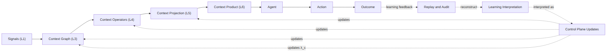

*Fig-CH07-25: Closed-Loop feedback cycle — outcome signals propagate as Control Plane updates Fig-CH07-25 reads left to right through the forward path and folds back through the dotted feedback*

path. The forward path — Signals → Graph → Operators → Projection → Context Product → Agent → Action → Outcome — is the runtime path every decision traverses; it is familiar from § 7.1’s layer walkthrough. The feedback path — Outcome → Replay → Learning Interpretation → Control Plane Updates → Operators/Projection/Graph/λ_c — is the architectural commitment § 7.9 makes explicit: outcomes do not directly modify the runtime components; they are reconstructed in Replay, interpreted as learning signals, translated into Control Plane Updates, and propagated back to the runtime components under the same Control Plane versioning discipline every other configuration change is subject to. The figure is supplementary in the sense that the mechanism is fully specified in prose above; readers who prefer the visual should hold Fig-CH07-25 alongside the prose as the anchor.

#### 7.9.5 Fraud-Detection Loop — Worked Example

The canonical worked example of the closed loop is fraud detection. Consider a transaction the fabric evaluates at time t₀: the transaction is classified as low-risk by the fraud-detection agent, the Context Product consumed by the agent contained transaction-velocity signals, similarity-to-knownfraud patterns, and counterparty reputation data, and the agent allowed the transaction through without additional friction. At time t₀ + 72 hours, the transaction is confirmed as fraudulent — the cardholder reports unauthorized use, the bank’s fraud-investigation team confirms the pattern, the outcome is logged. The closed loop now activates. In Replay, the fabric reconstructs the exact Context Product the agent consumed at t₀ — the five-dimension replay record § 7.10 commits to makes this reconstruction deterministic. Analysis of the reconstructed context identifies three contributing factors to the wrong decision. First, the transaction-velocity signals were stale: the velocity observation used in the Context Product was sampled 40 minutes before t₀, and the intraday-velocity λ_c was configured at 60 minutes, so the signal was nominally within freshness budget but the cardholder’s activity pattern had changed materially in the 40-minute window — the λ_c configuration was too permissive for the class of fraud attempted. Second, the similarity patterns to known fraud were under-weighted in the projection: the Context Product’s credit-officer-shape projection (the agent was consuming a general-purpose retail-transaction projection, not a fraud-specialist projection) subordinated the similarity signal to other signals, and the specific pattern the fraudulent transaction matched was a recent typology the projection’s signal-weighting had not yet elevated. Third, the transaction-related context TTL was too permissive: cached similarity-to-known-fraud Context Products were served from cache for up to 30 minutes, and in the 30 minutes since the last similarity-match update, a new fraudulent typology had been classified that the cached product did not yet reflect. Learning Interpretation receives the three factors and translates each into a Control Plane Update. The velocity λ_c for retail-card transactions is reduced from 60 minutes to 20 minutes. The retailtransaction projection is updated to elevate similarity-to-known-fraud from a subordinated signal to a primary signal for transactions that cross specific threshold-patterns. The similarity-context TTL is reduced from 30 minutes to 5 minutes for fraud-relevant products. Each update is versioned on the Control Plane, propagated to the Data Plane, and reflected in subsequent Context Products assembled for transactions evaluated after the update. Future fraud decisions improve not because the fraud-detection agent was retrained — the agent is the same, the model is the same, the prompt is the same — but because the context the agent consumes is now more accurate, more timely, and more aligned with the typology-evolution the fraud landscape exhibits.

The fraud-detection loop is the clearest worked example because the outcome signal arrives fast (typically within days), the ground truth is unambiguous (the transaction was or was not fraudulent), and the attribution to context-versus-model failure is often traceable through replay. Credit-risk loops are slower (outcomes unfold over quarters), AML loops are more adversarial (examiner review is the outcome signal, not a direct ground truth), and treasury-liquidity loops operate over shorter time scales but with more confounding variables. The closed-loop mechanism is the same across all of them; what differs is the λ_c of the outcome signal itself and the statistical-significance threshold the Control Plane applies to an update. The closed-loop commitment completes the fabric’s operational story — the fabric governs, the fabric degrades gracefully under Debt, the fabric learns through the Control Plane rather than around it. One architectural commitment remains: how every decision the fabric participates in is forensically reconstructible years after the fact, against the exact state of the fabric at the moment of the decision. § 7.10 takes up Decision Replay — the architectural property that makes the SR 11-7 model-validation posture, the FinCEN examiner re-tracing obligation, and the OCC consentorder auditability requirement all first-class commitments of the architecture rather than bolted-on observability concerns.

### 7.10 Decision Replay

The Cognitive Context Fabric’s final architectural commitment is that every decision it participates in is forensically reconstructible, years after the fact, against the exact state of the fabric at the moment of the decision. The commitment is not an observability concern bolted onto the runtime after the decisions have been made; it is a first-class property the architecture enforces at the moment of assembly, at the boundary of every Context Product, and at the Control Plane / Data Plane interface that § 7.8 commits to. § 7.10 specifies the five-dimension replay record that makes reconstruction exact, commits to environment replay as architecturally distinct from LLM observability’s model trace, names the Anthropic Citations API as the canonical component primitive on which passage-level Lineage for unstructured content builds, renders the evidence chain as Fig-CH07-28, commits to three-tier compression with severity exemption so that retention cost remains bounded over year-long retention windows, walks an AML SAR triage worked example that makes the reconstruction concrete, and names the three-audiences / three-renderings property that lets the same replay record serve auditors, risk and compliance, and management without re-engineering the underlying record.

#### 7.10.1 The Five-Dimension Replay Record

The central architectural primitive of § 7.10 is the five-dimension replay record. A decision made by an agent consuming a Context Product at time t is reconstructible only if five dimensions of state at time t can each be reproduced exactly. drop any one and a class of audit question becomes unanswerable. The five dimensions are:

- (1) Context Fabric Snapshot — the complete G(E, R, T, P, Π, L) at decision time, containing every entity the decision touched, every relation between them, the temporal binding active at t, the policy regime in force, the projection applied, and the lineage for every assertion the graph carries. This dimension answers the question “what did the agent know?” — which is the first audit question examiner re-tracing asks.
- (2) Policy Bindings Snapshot — the version identifier and serialized parameters of all active policies at decision time: the regulatory policy bundle the decision was governed by

(SR 11-7, FinCEN SAR, OCC consent-order, EU AI Act, jurisdiction-specific), the internal risk-threshold policies the bank set above regulatory floors, the operator-behavior policies the Control Plane had in force, and the projection and entitlement policies that shaped the Context Product. This dimension answers “what rules applied?” — the audit question that establishes governance compliance.

- (3) Model Version Record — identifiers of every model the decision pipeline invoked: the detection models that produced risk signals, the classification models that produced typology matches, the embedding models that produced similarity scores, and the LLM model and version that reasoned over the assembled Context Product. This dimension answers “what software reasoned?” — the audit question that separates model failure from context failure and is indispensable for SR 11-7 model-validation review.
- (4) Perspective Conditioning — the agent identity, the role definition the agent executed under, the tools the agent had available, and the delegation chain that led to the agent being invoked for this decision. This dimension answers “for whom, with what authority?” — the audit question that establishes that the right principal acted under the right delegation for the decision at hand.
- (5) Content Generation Path — the input-data identifiers for every source that contributed to the decision, the reasoning trace the agent produced (if any; for deterministic algorithmic decisions the reasoning trace is the operator/projection trace, not an LLM rationale), and the structured output the agent produced. This dimension answers “how did it get from input to output?” — the audit question that establishes traceability from source to conclusion. The five dimensions are orthogonal — each answers a different class of question — and they are collectively exhaustive for the decision-reconstruction problem. A replay record that captures four of the five dimensions answers four of the five question classes and leaves one class permanently unanswerable; there is no way to reconstruct what rules applied at decision time from the graph snapshot alone, or what software reasoned from the policy bindings alone, or how the agent moved from input to output from the model version record alone. The architectural commitment is that all five dimensions are captured, versioned, and retained together, indexed by the decision’s temporal boundary and decision class, and made available through the replay interface at any future time the audit obligation requires. The retention discipline is subject to the three-tier compression policy this section commits to below, but the five-dimension structure itself is inviolate. Patent Claim 13[^c5] covers the five-dimension replay record as reduced-to-practice architectural primitive. The named-competitor framing this primitive makes load-bearing is the test-time-trained-weights paradigm Chapter 5 § 5.6 carries: a weight delta is structurally silent on Dimension 1 (the Context Fabric Snapshot — there is no fabric snapshot when the fabric collapses into a gradient) and on Dimension 5 (the Content Generation Path — there is no path when the path is a weight update), which means context-as-weights drops two of the five dimensions by construction and triggers the “drop any one” warning by structural necessity rather than implementation oversight. Fig-CH07-26 renders the structure as five input nodes (one per dimension) converging on a single replay-record node, which in turn answers five audit-question classes — one question class per dimension. The figure is the canonical visual for the architecture § 7.10 commits to, and subsequent subsections refer back to it when they name which dimension the environment-replay concern

populates, which dimension the Anthropic Citations API feeds, and which dimension the three-tier compression operates against.

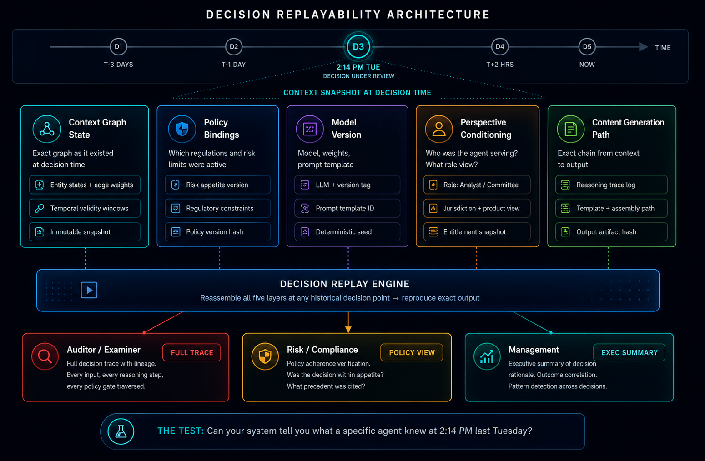

*Fig-CH07-26: Decision Replayability Architecture. The image renders the five-dimension record as a timeline-anchored structure where every decision has immutable snapshots of graph state, policy bindings, model version, perspective conditioning, and content generation path. The test the figure closes with — “can your system tell you what a specific agent knew at 2:14 PM last Tuesday?” — is the forensic question the fabric’s replay primitive commits to answering Fig-CH07-26 renders the five dimensions as five input nodes converging on a single indexed replayrecord node, which in turn is linked to the five audit-question nodes it answers. The structure is deliberately simple because the architectural point is structural — the five dimensions are the minimal sufficient set of state to answer the five audit-question classes regulated-enterprise decision environments are exposed to. Dropping Dimension 1 leaves “what did the agent know” permanently unanswerable, which breaks SR 11-7 model validation; dropping Dimension 2 leaves “what rules applied” unanswerable, which breaks FinCEN examiner review; dropping Dimension 3 leaves “what software reasoned” unanswerable, which breaks both SR 11-7 and OCC model risk management; dropping Dimension 4 leaves “for whom, with what authority” unanswerable, which breaks the delegation and principal-conditioning audit; dropping Dimension 5 leaves “how did it get from input to output” unanswerable, which breaks source-to-conclusion traceability and therefore BCBS 239 data-lineage requirements. Fig-CH07-26 is the canonical statement of the five-dimension architecture; subsequent subsections of § 7.10 operate against this structure. Key Insight — Fig-CH07-27 renders the Decision Replay re-trace as an interaction sequence across Examiner, Replay Engine, Context Graph (historical read), Policy Store (historical read),*

Model Registry, Projection (audience-specific), and Rendered Replay. The figure is load-bearing because it renders reconstruction as an interaction — the five dimensions are not just state; they are five parallel reads that the Replay Engine reconciles into a deterministic reproduction of the decision environment at T_decision.


*Fig-CH07-27: Decision Replay re-trace — an OCC examiner queries an AML SAR filing two years after the fact; the Replay Engine reads the five dimensions in parallel and reassembles the environment bit-for-bit under audience-specific projection The sequence renders the architectural commitment that every decision is forensically reconstructible years after the fact. An OCC examiner at T_audit — typically two or more years after T_decision — queries an AML SAR filing as part of a consent-order review. The Replay Engine looks up the five-dimension replay record indexed by the temporal boundary and decision-class; the index is what makes replay tractable at enterprise scale where millions of decisions accumulate across years. The Replay Engine then issues four parallel reads — the Context Graph historical read returns the G(E, R, T, P, Π, L) substate at T_decision (Dim 1); the Policy Store historical read returns the policy bindings snapshot active at T_decision (Dim 2); the Model Registry returns the detection, classification, embedding, and LLM model versions invoked at T_decision (Dim 3). The Note-over segment renders the architectural property D-52 commits to — the environment replay reassembly is bit-for-bit under the Data Plane determinism property § 7.8 specified, which is what distinguishes the CCF’s Decision Replay from LLM observability tools that capture only the model trace. The Projection stage applies perspective conditioning (Dim 4) and the content generation path (Dim 5), and shapes the replay output for the audience that requested it. The alt/else branches render the three-audience property D-56 commits to — the same five-dimension record serves auditors (full-fidelity forensic reconstruction with passage-level Evidence Chain per Fig-CH07-28), risk-and-compliance (policy-adherence verification), and management (pattern-detection summary across the decision corpus) through three distinct projections of the same underlying record. D-51 five-dimension record, D-52 environment replay versus model trace, D-53 Anthropic Citations API as the passage-level-lineage component primitive, and D-56 three audiences and three renderings all land against this sequence. The contrast with the model-trace alternative is explicit: a LangSmith trace at T_decision captures the prompt, the intermediate reasoning, and the token*

outputs but is silent on the graph substate, the policy bindings, the perspective conditioning, and the entitlement boundaries; the five-dimension record captures all of those and makes the reconstruction deterministic rather than best-effort approximation. The CCF is the environment replay; the model trace is the model trace; both are necessary for full forensic reconstruction and the CCF contributes the sufficient-condition the model trace alone cannot provide. Fig-CH07-27 is the interaction commitment behind the five-dimension replay record Fig-CH07-26 specifies and the Evidence Chain Fig-CH07-28 renders; the AML SAR triage worked example later in § 7.10 reads against this sequence as the re-tracing mechanism the examiner’s consent-order review actually traverses.

#### 7.10.2 Environment Replay, Not Model Trace

The distinction between the CCF’s Decision Replay and the model-trace observability that LLM observability tools provide is architecturally load-bearing, and it is the mechanism-level answer to the research rebuttal that asks “isn’t LangSmith or W&B Weave already doing this?” LLM observability captures the model’s trace; CCF reconstructs the decision environment. The two are complementary, not redundant, but the distinction matters for audit obligations that the model trace alone cannot satisfy. LangSmith and W&B Weave capture what happens inside the model during inference: the prompt as composed and submitted, the intermediate reasoning steps if any, the token outputs as produced, the tool invocations the agent made, the latency and token-count of each step. The trace is invaluable for debugging agent behavior, for prompt engineering, for identifying when a model misinterprets a prompt, and for understanding the path from input to output at the inference layer. What the model trace does not capture is the environment the model was invoked in — the exact Context Product the agent consumed (which depends on the policy bindings active at assembly time, the λ_c configuration for every observation type the context drew on, the projection the principal was conditioned under), the exact entitlement boundaries the agent was allowed to act within, the exact temporal binding the graph was queried against. The model trace is a faithful record of the model’s side of the conversation; it is silent on the fabric’s side. The CCF’s Decision Replay captures the environment: the exact G(E, R, T, P, Π, L) substate the Context Product was assembled from, the exact Control Plane configuration in force at assembly time, the exact projection applied, the exact perspective conditioning the agent operated under. Given those, and given the model’s own trace (captured separately by LangSmith or Weave or a comparable tool in a mature deployment), the reconstruction is deterministic — bit-for-bit. The Data Plane determinism property § 7.8 committed to is the architectural foundation; the fivedimension replay record § 7.10 specifies is the mechanism. The two tools are complementary, and a mature deployment uses both: LangSmith or Weave for the model’s trace, the CCF for the environment reconstruction, composed together for the full audit-reconstructible decision view. The regulatory obligations this composition satisfies are specific and named. SR 11-7 model validation requires that the exact context a model reasoned against at decision time can be reconstructed for post-hoc independent validation; the model trace alone is insufficient because it does not tell the validator what context the model was given, only what the model did with whatever context it received. OCC model validation under the OCC’s model-risk-management handbook carries the same reconstruction obligation, and the FinCEN examiner re-tracing obligation for SAR filings compounds the model trace with the explicit examiner-reconstruction of the evidence chain every claim in the narrative is based on. The CCF’s environment replay is the architectural mechanism

that makes all three obligations satisfiable at enterprise scale — not via a sidecar tool, not via a post-hoc reconstruction from logs, but as a first-class property of the fabric’s runtime itself. The distinction is worth restating in the form the research rebuttal frames it: the CCF delivers environment replay, not model trace, and the two are architecturally distinct layers of the audit-reconstruction stack. The model trace is necessary but not sufficient; the environment replay is the sufficient-condition the CCF contributes. Both layers retain the deterministic, bit-for-bit reconstruction property under their respective scopes, and a mature regulatory-audit posture at a large bank composes them.

#### 7.10.3 Anthropic Citations API — the Passage-Level Lineage Primitive

The Lineage dimension L of the Context Graph G(E, R, T, P, Π, L) must extend down to the passage level for unstructured content if the Decision Replay is to answer the evidence-chain question for claims derived from narrative sources. A structured claim like “the counterparty’s total assets are $2.4 billion” can be traced to a cell in a financial-statement table with structural certainty; an unstructured claim like “the counterparty’s risk officer noted concern about FX exposure in the Q3 earnings call” must be traceable to the specific passage in the earnings-call transcript where the concern was expressed, not to the transcript as a whole. Passage-level Lineage is the architectural primitive that makes unstructured-content auditability possible, and the CCF does not build the passage-level-citation primitive from scratch — it builds on a canonical component primitive that has matured in the AI-component ecosystem. Anthropic’s Citations API (GA January 2025) provides passage-level source references — the canonical component primitive on which CCF’s passage-level Lineage L for unstructured content builds. The Citations API (documented at Anthropic Citations API) is a feature of the Claude model family that returns, alongside each generated claim, passage-level references to the specific locations in source documents that the model used as evidence for the claim. The references are structured enough to be re-traceable — they identify the source document, the passage within it, and where applicable the page or bounding-box coordinates for figures and tables — and they are produced at inference time as part of the generation, not bolted on after the fact. The CCF integrates Anthropic Citations as the component primitive for passage-level Lineage in the L of the Context Graph tuple. When the fabric assembles a Context Product whose claims are derived from unstructured sources via LLM-assisted extraction or summarization, the passage-level references Anthropic Citations returns are persisted as Lineage entries attached to each claim in the Context Product. The Evidence Chain for Decision Replay — the chain from a Context Product claim back through passage-level Lineage, through the Anthropic Citations source reference, to the specific passage/page/bounding-box in the WORM/durable source record — is rendered in Fig-CH07-28. Fig-CH07-28 reads left to right through the provenance direction and folds back through the audit direction. The provenance direction — Context Product claim → passage-level Lineage → Anthropic Citations source reference → specific passage/page/bounding-box in WORM/durable source — is the forward chain every claim in an unstructured-derived Context Product must carry if it is to be auditable. The audit direction — an examiner reading the source’s specific passage, finding the citation, following the Lineage, identifying the Context Product claim the passage evidences — is the re-tracing path the AML SAR triage worked example § 7.10 walks through below, and is the canonical use case the XC-05 load-bearing figure stands for. Fig-CH07-28 is load-bearing


*Fig-CH07-28: Evidence Chain for Decision Replay — Context Product claim traces through passage-level Lineage to source in the XC-05 sense because it renders the unstructured-content-as-first-class-citizen commitment of XC-05 in the Decision Replay context; the earlier §§ 7.3 and 7.4 committed to unstructured as firstclass in the graph and in operator composition, and § 7.10’s Fig-CH07-28 carries the commitment through to the audit surface where XC-05’s obligations ultimately have to land. The architectural distinction worth naming is that Anthropic Citations is a component primitive the CCF uses, not a feature the CCF is. Other component primitives from other vendors may offer comparable passage-level attribution; the CCF’s architecture is not coupled to Anthropic’s specific implementation. What the fabric commits to is that passage-level Lineage is a first-class architectural field in the Context Graph L dimension, that the field is populated by whatever component primitive the deployment has selected for the unstructured-content-extraction stage, and that the populated field is persisted as part of the five-dimension replay record so that the Evidence Chain remains reconstructible at audit time. The CCF’s contribution is the architectural commitment, not the underlying citation technology.*

#### 7.10.4 Replay Across Assembly Modes

The five-dimension replay record specified above is the canonical artifact every Mode 1 product replays against — and the architectural baseline both Mode 2 and Mode 3 records extend without modifying. § 7.6’s “Per-Mode Replay Footprint” H3 named the footprint per mode in summary; this H3 commits the corresponding record contents that make the footprint replayable at examiner re-trace time. Three paragraphs name the per-mode record contents, parallel to § 7.6’s three-mode rhythm above; the existing three-tier compression and severity-exemption disciplines later in § 7.10 operate on every per-mode record without distinction. Mode 1 replay record contents. The Mode 1 replay record is the five-dimension record exactly — graph snapshot at decision time (the projected G(E, R, T, P, Π, L) the L1 agent reasoned over), active policy bindings (the regulatory bundle plus internal limits the projection composed under), model version (which is “none” or “N/A” for pure-algorithmic mode), perspective conditioning (the principal identity and delegation chain), and content generation path (the operator and projection trace, not an LLM rationale, since Mode 1 admits no LLM at any stage). The canonical AML SAR triage worked example § 7.10 walks below (L1692) is the Mode 1 replay case at the workedexample level: when a FinCEN examiner re-traces the disposition recommendation an L1 analyst acted on, the five-dimension record reconstructs the recommendation and the substrate it was scored against bit-for-bit. No additional Mode 1 primitives beyond the five-dimension baseline are required because Mode 1’s artifact-of-record posture is satisfied by the substrate itself. Mode 2 replay record contents. The Mode 2 replay record carries the five-dimension baseline plus four LLM-rendering primitives that pin the derivative-view layer above the substrate. These are the primitives § 7.6’s “Per-Mode Replay Footprint” H3 named in summary; § 7.10 commits

their record-level form: a model_version_string (vendor + model family + version + revision pin — e.g., anthropic.claude-opus-4-7@1.0.3), a temperature_float (the sampling temperature pinned for the rendering at production time), a full_prompt_text_or_hash (the literal prompt the LLM received, stored either inline if retention budget permits or as a content-addressed hash with the prompt body in the WORM tier), and an llm_output_hash (a hash of the LLM’s response captured at production time for bitwise verification at replay time). The algorithmic substrate hash from the upstream alternation pipeline (§ 7.6’s algorithmic-and-semantic stage alternation primitive) anchors the artifact-of-record: replay reproduces the algorithmic substrate exactly via the five-dimension record, then reproduces the LLM rendering bitwise if the model version + temperature + prompt are pinned within the LLM vendor’s pinning guarantees, which is itself part of the institution’s model-vendor management discipline that SR 11-7 model validation reviews at lifecycle audit time. The credit memo narrative packaging exemplar (§ 7.6 Mode 2) is the canonical Mode 2 replay record case: substrate hash anchors the covenant / exposure / lineage graph; the four LLM primitives pin the narrative rendering. Mode 3 replay record contents. The Mode 3 replay record carries the five-dimension baseline plus three orchestration primitives that delimit the coordination layer’s deterministic surface. These are: an orchestration_plan_id (a content-addressed reference to the orchestration plan the coordinator dispatched against — which agents, what typed contracts each agent emitted against, what reconciliation policy the coordinator applied), a per_agent_version_manifest (the version pin for each agent that contributed — agent identity, framework version, prompt version, tool inventory, all captured at the orchestration boundary so the manifest replays the swarm composition), and per_agent_contribution_boundary_markers (span-level markers in the reconciled product that delimit which sections each agent emitted — necessary because Mode 3’s typedcontract-boundary determinism guarantees apply at the agent’s typed contribution surface, not across the reconciled product as a whole). Per-agent contributions are themselves Mode 1, Mode 2, or Mode 3 records (recursive composition): a Mode 3 product whose participating agents are each Mode 1 producers replays the swarm-level reconciliation plus each agent’s substrate; a Mode 3 product whose participating agents are Mode 2 producers replays the swarm-level reconciliation plus each agent’s substrate plus each agent’s LLM-rendering primitives. The syndicated lending covenant cross-reference exemplar (§ 7.6 Mode 3) is the canonical Mode 3 replay record case: the orchestration plan ID anchors the swarm composition; the per-agent-version manifest pins each participating bank’s agent; the contribution boundary markers delimit which covenant clauses each agent emitted at the typed-contract boundary. The existing three-tier compression with severity exemption (the H3 below) and the AML SAR triage worked example (further below at L1692, plus the three-audiences / three-renderings property the §7.10 close commits) operate on the per-mode replay record without distinction: compression operates on the record contents regardless of which Mode produced it; severity exemption applies per the regulatory regime (SR 11-7, FinCEN, OCC, EU AI Act) regardless of Mode. The Modes × Decision-Replay commitments at § 7.6 (D-15 Per-Mode Replay Footprint + D-16 Five Disciplines for Mixed-Mode Assembly) and § 7.10 (this H3 + Modes 1/2/3 record contents) are bilateral — the §7.6 footprint commits what survives per mode in summary; the §7.10 record contents commit what is recorded per mode in detail. Together they make decision replay mode-invariant: the same Decision Replay record format extends from Mode 1 baseline to Mode 2 derivative-view to Mode 3 orchestration-layer determinism without requiring a different replay infrastructure per mode.

#### 7.10.5 Three-Tier Compression with Severity Exemption

The five-dimension replay record is rich — it captures the complete graph substate at decision time, the full policy binding, the model versions, the perspective conditioning, the content generation path — and full fidelity retention over year-long and decade-long retention horizons would be economically prohibitive at enterprise scale where millions of decisions are made each day. The architectural question is how retention cost is bounded without sacrificing the audit posture. The fabric’s answer is three-tier compression with a severity exemption that preserves audit-defensibility for the decisions that matter most. The three tiers are:

- Full fidelity — all fields of all five dimensions retained as originally written. Applied at the moment a decision is made and during the immediate post-decision window where real-time audit and quality-assurance processes may need to reconstruct the exact decision context. The retention window for Full fidelity is configurable per decision class, typically measured in weeks to months.
- Compressed — essential metrics only: the decision-class threat level, the entity counts and identifiers, the composite D_c score, the coverage percentage, the summary statistics that let aggregate analysis run over the record without re-hydrating the full graph substate. The graph substate itself is reduced to a deterministic hash of the five-dimension record, so that the exact substate can be re-hydrated if ever needed from a source-record archive, but is not itself retained in the hot replay tier. Applied after the Full-fidelity window closes.
- Tombstoned — metadata only: the timestamp, the threat level, the cycle id, the decision class, enough to know the decision happened and when, but not enough to reconstruct it without re-hydration from the cold archive. Applied after the Compressed window closes, typically measured in years or per regulatory retention minima. The severity exemption is the property that keeps the compression from corroding audit defensibility for the decisions that matter most. Instances at or above a configurable severity threshold are never compressed or tombstoned. The definition of severity is decision-class-specific — a SAR filing is always severity-exempt under AML retention obligations; a credit decision above a configurable exposure threshold is severity-exempt under credit risk management; a consent-ordertriggering decision is severity-exempt under the consent-order’s specific controls. The architectural consequence is that the hot replay tier always carries Full fidelity for the subset of decisions that regulatory review is most likely to ask about, and the compression-driven cost savings are concentrated on the routine decisions whose audit obligations are satisfied by the Compressed or Tombstoned tiers. Every compressed or tombstoned record carries a retention-reason field indicating why the record is not retained at full fidelity — whether the decision was below the severity threshold, whether the retention window has elapsed, whether a specific retention policy applies. The field is not incidental metadata; it is the audit-defensibility anchor that lets a regulator asking “why is this decision not retained at full fidelity” receive a structured answer rather than an opaque absence of data. Significant decisions retain full fidelity permanently. The principle is the architectural commitment that makes the three-tier compression defensible: the cost-bounding operates on decisions whose audit posture is satisfied by compression; the decisions whose audit posture requires full fidelity never lose it. In a reference implementation, the three-tier compression is an architectural invariant: the com-

pression algorithm is deterministic, the severity exemption is CI-tested, and the retention-reason field is structural. The implementation discipline matches the architectural commitment — the compression cannot be silently bypassed on the cost side, and the severity exemption cannot be silently disabled on the audit side. Patent Claim 14[^c6] covers the three-tier compression with severity exemption as a reduced-to-practice architectural primitive.

#### 7.10.6 AML SAR Triage — Worked Example

The worked example that makes the five-dimension replay record, the Evidence Chain, and the compression policy concrete is AML SAR triage — the investigator workflow that produces a Suspicious Activity Report narrative under FinCEN’s obligation and withstands OCC examiner re-tracing years after the filing. The example is the one § 7.6 D-30 anticipated and § 7.10 D-55 resolves, and it is the anchor example for the XC-05 load-bearing commitment of Fig-CH07-28. Consider an investigator at time t_d reviewing a cluster of transactions the fabric has flagged for AML typology match. The Context Product the investigator consumes contains: (i) the transaction pattern itself (structured data from the payment-processing layer), (ii) counterparty-relationship context (entities, relations, temporal binding from the Context Graph), (iii) a typology-match assessment (the fabric’s classification of the pattern against known AML typologies), (iv) corroborating evidence from unstructured sources — specifically, a passage from a Bloomberg IB chat between two desk traders discussing a fund’s activity, a passage from a payment-system wire narrative that describes the stated purpose of a specific wire transfer, and a passage from an adverse-media article that names a counterparty in the pattern as subject to a regulatory inquiry in a foreign jurisdiction. The investigator reviews the assembled Context Product, concludes that the pattern warrants a SAR filing, and drafts a narrative that incorporates specific claims derived from the four evidence sources. The Evidence Chain runs through each narrative claim. The claim “the fund’s activity in the two-week window prior to the wire transfer was inconsistent with its stated strategy” traces to the Bloomberg IB chat passage via passage-level Lineage — specifically, to the chat message from the trading desk dated t_d − 3 days that named the inconsistency. The claim “the stated purpose of the wire transfer was at odds with the counterparty’s historical payment pattern” traces to the wire narrative field in the payment-system entry for the transfer, with the passage-level citation identifying the specific narrative text. The claim “the counterparty has been named in an ongoing regulatory inquiry in [foreign jurisdiction]” traces to the adverse-media article’s specific paragraph, with the passage-level citation identifying the article, the paragraph, and the bounding-box for the relevant text. Each citation is produced by the Anthropic Citations API at the extraction stage, persisted as passage-level Lineage in the L dimension of the Context Graph at the moment the evidence is incorporated into the Context Product, and retained as part of the five-dimension replay record when the SAR filing decision is recorded. Decision Replay reconstructs all five dimensions at audit time. (i) The Context Graph state at decision time includes the transaction patterns, the counterparty graph substructure, the typologymatch resolution, and the passage-level Lineage for each unstructured source. (ii) The policy bindings active at decision time include the FinCEN SAR filing obligations the bank operates under, any OCC consent-order-specific controls on AML decisioning that apply, and the jurisdiction-specific rules the counterparty’s geography invokes. (iii) The models used include the typology6

matching model version, the similarity-ranking model version, and the LLM model and version that performed passage-level extraction with Anthropic Citations. (iv) The perspective conditioning captures the investigator’s role, jurisdiction, delegation chain, and access entitlements. (v) The content generation path captures the investigator’s narrative and the passage-level citations backing each claim. Years later, when an OCC examiner re-traces the SAR filing as part of a consent-order review, the re-tracing path runs through the Evidence Chain of Fig-CH07-28 in reverse — the examiner reads the specific passage of the Bloomberg chat, finds the Anthropic Citations reference that identifies it as source evidence, follows the Lineage back to the narrative claim it evidences, and verifies that the claim in the SAR narrative is defensibly derived from the passage. The re-tracing runs for every claim in the narrative, and the SAR filing is defensible exactly to the extent that every claim has a traceable Evidence Chain. Chapter 8 §8.9 carries the regulatory-defensibility payoff — the SAR narrative is defensible under FinCEN examiner re-tracing because every claim has passage-level L. The mechanism the CCF commits to in § 7.10 is what makes the defensibility architectural rather than accidental; Chapter 8 walks the end-to-end regulatory integration that earns the defensibility its full governance context. The severity exemption applies: the SAR filing is severity-exempt under AML retention obligations, so the five-dimension replay record for the filing is retained at Full fidelity permanently, regardless of how many years pass. The routine typology-match cycles that did not result in SAR filings are subject to the three-tier compression, because the audit posture for those decisions is satisfied by the Compressed or Tombstoned tier; the compression savings land on the routine cycles where the audit obligation is lower, and the severity-exempt filings retain the full reconstruction capability the examiner may need at any point within the multi-year SAR retention horizon.

#### 7.10.7 Three Audiences, Three Renderings

The final architectural property § 7.10 commits to is that the same underlying replay record serves three distinct audiences through three distinct renderings — and that the three renderings are not three separate records, they are three Projections of the same record. Auditors and regulatory examiners see the Full fidelity five-dimension trace, down to the passage-level Evidence Chain, rendered for forensic reconstruction of the decision environment and the decision outcome. Risk and compliance consume a policy-adherence-verification rendering that emphasizes the Policy Bindings Snapshot dimension, the D_c and severity summaries from the Context Fabric Snapshot, and the Perspective Conditioning for delegation audit — the rendering answers the question “did the decision operate within the policy envelope,” not the full forensic question. Management consumes an executive-summary rendering with pattern detection across decisions — aggregations over the replay record corpus that surface trends (decisions under elevated D_c, SAR filings under specific typologies, credit decisions at specific risk bands) without requiring the full Context Fabric Snapshot per decision. The three audiences are served by three Projections Π applied to the same five-dimension replay record. The mechanism is the recursive application of the same Projection primitive § 7.5 committed to in the Context Product context, now applied at the replay layer — the same primitive that shapes Context Products for credit-officer, compliance-officer, and credit-risk-officer consumption at decision time shapes replay records for auditor, risk-and-compliance, and management consumption at audit time. The architectural elegance is that the fabric does not need a separate mechanism for replay rendering; the Projection primitive composes across the runtime and replay domains, and

the audit-time consumption of the replay record inherits the same principal-conditioning, entitlement, and role-shaped semantics that runtime Context Product consumption has always had. One primitive, recursively applied, serves every consumption surface the fabric supports.

#### 7.10.8 Chapter Close — Handoff to Chapter 8

The fabric this chapter has specified — layered, decomposed, and governed — awaits its integration story. Chapter 8 commits to the how of non-invasive integration: the alternating derivation pipeline walked through for credit memo drafting (§8.4), the temporal abstraction layer that reconciles FX post-trade across batch and real-time (§8.6), the auditability-at-scale story for AML SAR defensibility (§8.9), and the conversational reporting layer for treasury advisory (§8.10). The central statement Chapter 8 leads with — layering, not replatforming — is the architectural posture Chapter 7 earns by committing to mechanism. Every primitive the Cognitive Context Fabric stands on has been reduced to mechanism in this chapter: the six-layer stack of responsibility at § 7.1; the architectural decomposition at § 7.2 that separated the four concerns of state, computation, interpretation, and delivery; the Context Graph as System of State at § 7.3; the Context Operators as System of Computation at § 7.4; the Context Projection as System of Interpretation at § 7.5; the Context Products as System of Delivery at § 7.6; the Context Debt and Context Half-life as System of Operations at § 7.7; the Control Plane versus Data Plane governance separation at § 7.8; the Closed Loop with self-learning at § 7.9; and the Decision Replay forensic-reconstruction posture at § 7.10. The ten sections have walked what Fig-CH07-01 anchored at the opener as persistent institutional memory — every primitive in the closed loop is now specified as mechanism, from the Dynamic Context the Signal Layer ingests through the Context Graph Memory the closed-loop graph write-back refines. The Cognitive Context Fabric is no longer a conceptual category; it is a specified architecture a principal engineer can probe, an enterprise architect can align with existing investments, and a regulator can audit against stated governance commitments. Chapter 8 takes up what the Cognitive Context Fabric requires to earn its place alongside the data warehouses, data lakes, event buses, and operational systems a large bank already depends on — not by replacing them, but by layering over them as the decision-substrate the agents need.

[^c1]: Subject of a US provisional patent application filed February 2026, Claim 18 (6-dimensional context graph as first-class computational primitive).
[^c2]: Subject of a US provisional patent application filed February 2026, Claim 20 (algorithmic/semantic alternation as architectural primitive).
[^c3]: Subject of a US provisional patent application filed February 2026, Claim 2 — sequential-window observer-buffer pattern as discrete implementation of continuous decay.
[^c4]: Subject of a US provisional patent application filed February 2026, Claim 7 — priority-cascade pattern (elevated context-debt biases decision urgency upward, not downward; fail-closed by default).
[^c5]: Subject of a US provisional patent application filed February 2026, Claim 13 (five-dimension replay record as reduced-to-practice architectural primitive for regulated-enterprise decision reconstruction).
[^c6]: Subject of a US provisional patent application filed February 2026, Claim 14 (three-tier replay-record compression with severity exemption for audit-defensibility preservation across enterprise retention horizons).
